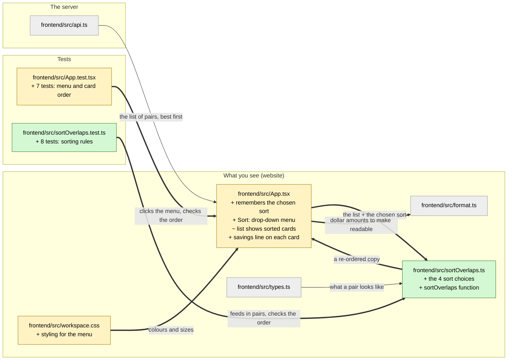

# Study guide: Sort the opportunity list by score, distance, time gap or savings

**Ticket:** #38 · **Date:** 2026-09-26 · **Gate:** not run (example built from commit `6b15637` in the Relay repo)

## The big picture

Relay shows a list of "coordination opportunities": pairs of power-line projects from two
different utilities that are close enough to be worth planning together. Before this ticket the
list always came in one fixed order (best match first). Now there is a **"Sort:" drop-down menu**
above the list, so you can reorder it by best match, closest distance, shortest time gap, or
biggest estimated savings. Each card also now shows its estimated savings.

Everyday analogy: it's the "Sort by: price / rating / distance" menu on a shopping or food
delivery app. The restaurants don't change; only the order you see them in does.

## Map of the changes



**How to read it:** each box is a file. Green = a new file this ticket created, yellow = an
existing file this ticket changed, grey = a file that was not changed but is connected to the
changes. Inside a box, `+` means something was added and `~` means something was changed.
Thick arrows are connections this ticket added; thin arrows already existed.

## Words you'll see

| Word | What it means here |
|------|--------------------|
| **file / module** | One code file. Files can share things with each other. |
| **import** | A line at the top of a file that says "I want to use something written in another file". |
| **export** | The opposite: "other files are allowed to use this". |
| **variable / constant** | A name that holds a value, like a labelled box. `const` means the box's contents won't be swapped out. |
| **string** | A piece of text, written in quotes: `'score'`. |
| **array** | A list of things, written in square brackets: `[1, 2, 3]`. |
| **object** | A bundle of named values in curly brackets: `{ key: 'score', label: 'Score %' }`. |
| **function** | A named set of steps you can run again and again, giving it inputs and getting a result back. |
| **type** | A description of what shape a value must have (e.g. "must be one of these four words"). TypeScript checks this before the app runs, catching mistakes early. |
| **TypeScript** | JavaScript (the language websites run) plus *types*. Files end in `.ts` or `.tsx`. |
| **React component** | A function that returns a piece of the web page. `App` is the main one. |
| **JSX** | HTML-looking tags written inside TypeScript (`<select>`, `<option>`). React turns them into the real page. |
| **state** | Something a component remembers between redraws, like "which sort did the user pick?". Changing it makes the page redraw. |
| **hook** | A React function whose name starts with `use` (like `useState`) that gives a component extra powers, such as memory. |
| **comparator** | A tiny function that looks at two items and answers "which goes first?". Sorting uses one. |
| **null** | "Nothing here" — used for pairs that have no savings estimate. |
| **CSS** | The styling language: colours, sizes, spacing. |
| **test** | Code that runs the real code with made-up data and checks the result is what it should be. |
| **fixture** | The made-up data a test uses. |

## File by file

Files are in the order things happen: the new sorting helper first, then the page that uses it,
then its styling, then the tests.

### `frontend/src/sortOverlaps.ts` - new

**What this file is for:** it didn't exist before. It's a small helper whose only job is to put
a list of pairs in a chosen order.
**What changed and why:** the ticket needs four orderings; keeping the sorting rules in their
own file keeps them out of the already-large page file and makes them easy to test on their own.

#### Piece 1 - the header and the import

```ts
// Orders the opportunity list. Pure: returns a new array and never touches the input, so the
// API's rank order stays intact for everything else (map, savings headline, #rank badges).
import type { Overlap } from './types'
```

**In plain words:** a note to future readers, then "borrow the description of what a pair looks
like from the `types` file".

**Line by line:**
1. `//` starts a **comment**: text for humans that the computer ignores. It explains that this
   file never changes the list it's given — it makes a new, re-ordered copy. "Pure" is the
   programmer word for that.
2. `import type { Overlap } from './types'`
   - `import` — "bring in something from another file".
   - `type` — "only a description, not real data". It disappears when the app runs.
   - `{ Overlap }` — the curly brackets pick one named thing out of that file: `Overlap`, the
     description of a pair (two projects, their distance, score, savings, and so on).
   - `'./types'` — which file. `./` means "in this same folder"; `.ts` is left off.

**Why it's written this way:** other parts of the app (the map, the "#01" badges) depend on the
original order. If sorting changed the original list, picking "Distance" would scramble them too.

#### Piece 2 - the four allowed choices

```ts
export type SortKey = 'score' | 'distance' | 'time_gap' | 'savings'
```

**In plain words:** "a sort choice must be exactly one of these four words."

**Line by line:**
1. `export` — other files may use this.
2. `type SortKey =` — creates a new type (a rule about values) named `SortKey`.
3. `'score' | 'distance' | ...` — `|` means **or**. So a `SortKey` is `'score'` or `'distance'`
   or `'time_gap'` or `'savings'`. Nothing else.

**Why it's written this way:** if someone types `'distnace'` by mistake, TypeScript flags it
before the app ever runs, instead of the menu silently doing nothing.

#### Piece 3 - what the menu shows

```ts
/** The sort choices in menu order; the first is the default. */
export const SORT_OPTIONS: readonly { key: SortKey; label: string }[] = [
  { key: 'score', label: 'Score % (best first)' },
  { key: 'distance', label: 'Distance (closest first)' },
  { key: 'time_gap', label: 'Time gap (shortest first)' },
  { key: 'savings', label: 'Est. savings (highest first)' },
]

export const DEFAULT_SORT_KEY: SortKey = 'score'
```

**In plain words:** a list of the four menu entries, each with an internal name (`key`) and the
words a person sees (`label`). Then: "when the page first opens, sort by score."

**Line by line:**
1. `/** ... */` — another kind of comment; editors show it when you hover over the name.
2. `export const SORT_OPTIONS` — a constant other files can use. ALL_CAPS is a naming habit
   meaning "this never changes".
3. `: readonly { key: SortKey; label: string }[]` — the type, read right to left:
   - `[]` — it's a list (an *array*)…
   - `{ key: SortKey; label: string }` — …of objects that each have a `key` (one of the four
     words) and a `label` (any text — `string`)…
   - `readonly` — …and nobody may add to or remove from the list later.
4. `= [ ... ]` — the actual list. Each `{ key: ..., label: ... }` line is one menu entry.
5. `DEFAULT_SORT_KEY: SortKey = 'score'` — the starting choice; the `: SortKey` part makes
   TypeScript check that `'score'` really is one of the four allowed words.

**Why it's written this way:** the page builds the menu by going through this list, so the menu
text lives in one place. Adding a fifth sort later means adding one line here.

#### Piece 4 - the sorting rules

```ts
/** Negative when `a` goes first. Null savings always sort after any estimate. */
const COMPARE: Record<SortKey, (a: Overlap, b: Overlap) => number> = {
  score: (a, b) => b.score - a.score,
  distance: (a, b) => a.distance_mi - b.distance_mi,
  time_gap: (a, b) => a.time_gap_days - b.time_gap_days,
  savings: (a, b) => {
    if (a.est_savings_usd === null || b.est_savings_usd === null) {
      return (a.est_savings_usd === null ? 1 : 0) - (b.est_savings_usd === null ? 1 : 0)
    }
    return b.est_savings_usd - a.est_savings_usd
  },
}
```

**In plain words:** one "which goes first?" rule (a *comparator*) for each of the four choices.
Each rule looks at two pairs, `a` and `b`, and answers with a number: **negative** means `a`
goes first, **positive** means `b` goes first, **zero** means "they're tied".

**Line by line:**
1. `const COMPARE` — not exported, so only this file can use it.
2. `Record<SortKey, ...>` — a `Record` is an object with one entry per allowed name. Here: one
   entry for each of the four `SortKey` words. If you forgot one, TypeScript would complain.
3. `(a: Overlap, b: Overlap) => number` — the shape of each entry: a function that takes two
   pairs and gives back a number. `=>` is the short way to write a function ("given this, give
   back that").
4. `score: (a, b) => b.score - a.score` — subtract. If `b` has score 0.9 and `a` has 0.5,
   `0.9 - 0.5 = 0.4`, which is positive, so `b` goes first. **Highest score first.**
5. `distance: (a, b) => a.distance_mi - b.distance_mi` — the other way round (`a` minus `b`):
   2 miles minus 10 miles is negative, so the 2-mile pair goes first. **Closest first.**
6. `time_gap` — same idea as distance: **shortest gap first**.
7. `savings: (a, b) => { ... }` — this rule needs several steps, so it uses curly brackets and
   `return` ("this is the answer") instead of a one-line answer.
8. `if (... === null || ... === null)` — `===` means "is exactly equal to"; `||` means "or". So:
   "if either pair has no savings estimate…"
9. `(a.est_savings_usd === null ? 1 : 0)` — `? :` is a short if/else: "if `a` has no estimate,
   use 1, otherwise 0". Doing the same for `b` and subtracting puts the pair *without* an
   estimate later. Example: `a` has none (1), `b` has $120,000 (0) → `1 - 0 = 1`, positive, so
   `b` goes first.
10. `return b.est_savings_usd - a.est_savings_usd` — if both have estimates: **highest savings
    first**, the same trick as score.

**Why it's written this way:** without the `null` check, subtracting "nothing" gives a broken
number (`NaN`, "not a number") and the order of the no-estimate pairs would be random.

#### Piece 5 - the function the page calls

```ts
/** A sorted copy of `overlaps` by `key`; ties keep the API's rank order (rank asc). */
export function sortOverlaps(overlaps: readonly Overlap[], key: SortKey): Overlap[] {
  const compare = COMPARE[key]
  if (!compare) throw new Error(`unknown sort key: ${String(key)}`)
  return [...overlaps].sort((a, b) => compare(a, b) || a.rank - b.rank)
}
```

**In plain words:** "give me a list of pairs and a sort choice, and I'll give you back a new
list in that order. If two pairs tie, keep them in their original best-match order."

**Line by line:**
1. `export function sortOverlaps(...)` — a named function other files can use.
2. `(overlaps: readonly Overlap[], key: SortKey)` — its two inputs: the list of pairs (which it
   promises not to change — `readonly`) and the sort choice.
3. `: Overlap[]` after the brackets — what it gives back: a list of pairs.
4. `const compare = COMPARE[key]` — square brackets look something up by name: if `key` is
   `'distance'`, this picks the distance rule from Piece 4.
5. `if (!compare) throw new Error(...)` — `!` means "not". "If no rule was found, stop
   everything and report an error." `throw` is how code says "something is wrong, don't carry
   on". The backticks `` ` `` make a text with a blank filled in: `${String(key)}` puts the bad
   key into the message.
6. `[...overlaps]` — `...` ("spread") pours every item into a new list, making a **copy**. This
   is how the original list stays untouched.
7. `.sort((a, b) => ...)` — the built-in way to sort a list, using a rule to compare two items.
8. `compare(a, b) || a.rank - b.rank` — `||` here means "use the first answer, unless it's 0 (a
   tie), then use the second". So ties fall back to the original rank: #2 before #5.

**Why it's written this way:** failing loudly on an unknown key means a bug shows up straight
away as an error, instead of a list that silently isn't sorted.

### `frontend/src/App.tsx` - changed

**What this file is for:** the main page of the app — the map, the sidebar, the tabs and the
opportunity list are all drawn here.
**What changed and why:** it now remembers which sort the user picked, shows the "Sort:" menu,
draws the cards in the sorted order, and adds a savings line to each card.

#### Edit 1 - borrow the new helper

```diff
 import { summarizeSavings } from './savings'
+import { DEFAULT_SORT_KEY, SORT_OPTIONS, sortOverlaps, type SortKey } from './sortOverlaps'
 import type { Overlap, Project } from './types'
```

**In plain words:** "use the four things the new file shares."

**Line by line:**
1. Lines starting with `+` were added; lines with no mark are unchanged context to show where
   the change sits.
2. `{ DEFAULT_SORT_KEY, SORT_OPTIONS, sortOverlaps, type SortKey }` — the starting choice, the
   menu entries, the sort function, and (marked `type`) the four-words rule.

**Why it's written this way:** the page doesn't need to know *how* sorting works — it asks the
helper.

#### Edit 2 - remember the user's choice

```diff
   const [query, setQuery] = useState('')
+  const [sortKey, setSortKey] = useState<SortKey>(DEFAULT_SORT_KEY)
   const [uploadOpen, setUploadOpen] = useState(false)
```

**In plain words:** "the page has a memory slot for the chosen sort, starting at Score."

**Line by line:**
1. `useState(...)` — a React **hook** that creates a memory slot (*state*). It gives back two
   things: the current value and a function to change it.
2. `const [sortKey, setSortKey] =` — square brackets on the left unpack those two things into
   two names: `sortKey` (read it) and `setSortKey` (change it). Changing it makes the page redraw.
3. `<SortKey>` — angle brackets tell `useState` which type to enforce: only the four words.
4. `(DEFAULT_SORT_KEY)` — the starting value, `'score'`.

**Why it's written this way:** an ordinary variable would be forgotten every time React redraws
the page; state survives redraws.

#### Edit 3 - make the sorted list

```diff
   const filteredOverlaps = visibleOverlaps.filter(o => ...includes(search))
+  const sortedOverlaps = sortOverlaps(filteredOverlaps, sortKey)
```

**In plain words:** "take the list that's already been narrowed down by the search box, and put
it in the chosen order."

**Line by line:**
1. The line above (unchanged) is the search filter: `.filter(...)` keeps only the pairs whose
   names contain what you typed.
2. `sortOverlaps(filteredOverlaps, sortKey)` — call the new function with that list and the
   remembered choice.

**Why it's written this way:** filtering first and sorting second means search and sort work
together — you see only matching pairs, in your chosen order.

#### Edit 4 - the menu replaces the old caption, and the cards use the sorted list

```diff
-<span>Ranked by proximity & timing</span>
+<label className="list-sort"><span aria-hidden="true">Sort:</span>
+  <select aria-label="Sort by" value={sortKey} onChange={e => setSortKey(e.target.value as SortKey)}>
+    {SORT_OPTIONS.map(o => <option key={o.key} value={o.key}>{o.label}</option>)}
+  </select>
+</label>
 ...
-{filteredOverlaps.map(o => <li key={o.overlap_id}> ...
+{sortedOverlaps.map(o => <li key={o.overlap_id}> ...
```

(In the real file this is all on one very long line; it's split here so you can read it.)

**In plain words:** the fixed caption "Ranked by proximity & timing" is gone. In its place is a
"Sort:" label and a drop-down menu. Picking an entry saves it to memory, and the list below now
draws from the sorted list instead of the unsorted one.

**Line by line:**
1. `<label className="list-sort">` — **JSX**: HTML-looking tags inside TypeScript. `className`
   is how React spells HTML's `class`; it links this tag to the CSS styling added below.
2. `<span aria-hidden="true">Sort:</span>` — the visible word "Sort:". `aria-hidden` tells
   screen readers (software that reads pages aloud for blind users) to skip it…
3. `<select aria-label="Sort by" ...>` — …because the menu itself is given the spoken name
   "Sort by". `<select>` is the browser's built-in drop-down menu.
4. `value={sortKey}` — curly brackets inside JSX mean "insert a TypeScript value here". The menu
   shows whatever is in memory.
5. `onChange={e => setSortKey(e.target.value as SortKey)}` — "when the user picks something":
   `e` is the *event* (what happened), `e.target.value` is the picked entry's key, and
   `setSortKey(...)` saves it, which redraws the list. `as SortKey` tells TypeScript "trust me,
   this is one of the four words" (it is, since the menu only offers those).
6. `SORT_OPTIONS.map(o => <option ...>)` — `.map` goes through a list and turns each item into
   something else; here each menu entry becomes an `<option>` tag showing its `label`.
7. `key={o.key}` — React needs a unique `key` on items drawn from a list so it can tell them
   apart when the list changes.
8. `-{filteredOverlaps.map(...` / `+{sortedOverlaps.map(...` — the one-word swap that makes the
   cards appear in the chosen order.

**Why it's written this way:** using the browser's own `<select>` gives keyboard and screen-reader
support for free, which a home-made menu would have to rebuild.

#### Edit 5 - a savings line on every card

```diff
-<span>{o.time_gap_days} days apart in service</span>{...Uploaded tag...}
+<span>{o.time_gap_days} days apart in service</span>
+{o.est_savings_usd === null
+  ? <span>No estimate</span>
+  : <span title={`${formatUsd(o.est_savings_usd)} est. savings`}>{formatUsdCompact(o.est_savings_usd)} est. savings</span>}
+{...Uploaded tag...}
```

**In plain words:** at the bottom of each card, after "N days apart in service", show either
"No estimate" or a short amount like "$1.5M est. savings". Hovering over the amount shows the
full figure, "$1,500,000 est. savings".

**Line by line:**
1. `{ condition ? A : B }` — the short if/else again: if there's no estimate (`=== null`), draw
   A ("No estimate"), otherwise draw B.
2. `title={...}` — the text a browser shows when you hover over something.
3. `formatUsd(...)` / `formatUsdCompact(...)` — two functions that already existed in
   `format.ts`: one writes `$1,500,000`, the other `$1.5M`.

**Why it's written this way:** once you can sort by savings, you need to *see* the savings on each
card, or the new order would look random.

### `frontend/src/workspace.css` - changed

**What this file is for:** the colours, sizes and spacing of the main page.
**What changed and why:** the new drop-down menu needed to match the dark sidebar.

```diff
+/* Opportunity list "Sort:" control (#38), in the list-caption row. */
+.list-sort { display:inline-flex; align-items:center; gap:4px; color:var(--muted); }
+.list-sort select { font-size:9px; border:1px solid var(--rule); border-radius:5px; padding:2px 4px; cursor:pointer; }
+.sidebar-panel .list-sort select { color:#d6ed8a; background:#ffffff0b; }
```

(Shortened; the real line has a few more rules of the same kind.)

**In plain words:** "put the word 'Sort:' and the menu side by side, make the menu small with a
thin rounded border and a pointing-hand cursor, and colour it light green in the dark sidebar."

**Line by line:**
1. `/* ... */` — a CSS comment.
2. `.list-sort` — a *selector*: "these rules apply to anything with `className="list-sort"`"
   (the label from Edit 4). The rules go inside `{ }`, each written `property:value;`.
3. `display:inline-flex; align-items:center; gap:4px` — lay the children out in a row,
   vertically centred, 4 pixels apart.
4. `var(--muted)` — use a colour defined once elsewhere under the name `--muted`, so the whole
   app's colours can change in one place.
5. `.list-sort select` — a space between selectors means "a `<select>` *inside* `.list-sort`".
6. `border-radius:5px` rounds the corners; `cursor:pointer` shows the hand icon on hover.
7. `#d6ed8a` — a colour written as a hex code (a light green); `#ffffff0b` is white at very low
   opacity, a faint tint.

**Why it's written this way:** without these rules the browser would draw a large, default-styled
menu that clashes with the dark sidebar.

### `frontend/src/sortOverlaps.test.ts` - new (test)

**What this file is for:** checks the sorting rules on their own, with no web page involved.
**What changed and why:** new file; every rule in the ticket gets a test.

```ts
const SCORES = [0.5, 0.9, 0.5, 0.2, 0.7]
const DISTANCES = [8.2, 3.1, 12.0, 3.1, 0.4]
...
it('distance: closest first, ties by rank asc', () => {
  // 0.4 (5), 3.1 (2, 4 tie), 8.2 (1), 12.0 (3)
  expect(ids(sortOverlaps(fixture(), 'distance'))).toEqual(['OVL_5', 'OVL_2', 'OVL_4', 'OVL_1', 'OVL_3'])
})
```

**In plain words:** five made-up pairs (a *fixture*) are given scores, distances, gaps and
savings chosen so that every sort produces a different order. Each test sorts them one way and
checks the exact order that comes out.

**Line by line:**
1. `const SCORES = [...]` — made-up values; the 1st number belongs to pair `OVL_1`, the 2nd to
   `OVL_2`, and so on.
2. `it('...', () => { ... })` — one test. The text describes what it checks; the function holds
   the steps.
3. `expect(X).toEqual(Y)` — "X must be exactly Y, or the test fails".
4. `ids(...)` — a small helper that turns the sorted pairs into just their names, so the
   comparison is easy to read.

The 8 tests check: each of the four sorts, ties falling back to rank order, no-estimate pairs
always last (even when every real estimate is $0), that the original list is never changed,
that exactly four choices exist with Score as the default, and that an unknown sort key causes
an error.

### `frontend/src/App.test.tsx` - changed (test)

**What this file is for:** tests the whole main page the way a person would use it.
**What changed and why:** 7 new tests in a group called `opportunity sort`.

```ts
fireEvent.change(sortSelect(), { target: { value: 'distance' } })
expect(sortSelect()).toHaveDisplayValue('Distance (closest first)')
expect(cardNames(items)).toEqual(['SC line 4', 'SC line 2', 'SC line 5', 'SC line 1', 'SC line 3'])
```

**In plain words:** the test draws the real page with made-up pairs, picks "Distance" in the
menu as a user would, and checks that the menu shows the choice and the cards are in the right
order.

**Line by line:**
1. `fireEvent.change(...)` — pretends a user changed the drop-down.
2. `sortSelect()` — finds the menu by its spoken name "Sort by", the way a screen reader would.
3. `toHaveDisplayValue(...)` — checks what the menu visibly shows.
4. `cardNames(items)` — reads the project names off the cards, in on-screen order.

## How you know it works

- **8 tests on the sorting rules** (`sortOverlaps.test.ts`): each sort gives the exact expected
  order, ties keep rank order, no-estimate pairs go last, the original list is untouched, and a
  wrong sort key raises an error.
- **7 tests on the page** (`App.test.tsx`): the menu has exactly the four choices and starts on
  Score; picking Distance, Time gap or Savings reorders the cards; search and sort work together;
  each card shows distance, gap, score and savings (or "No estimate"); clicking a card still
  selects it whatever the order.

## Try it yourself

1. Run the site locally and open it. Above the opportunity list, find **Sort:** with a menu.
2. Pick **Distance (closest first)** — the card with the smallest "mi apart" should jump to the
   top, but its **#** badge keeps its original number.
3. Pick **Est. savings (highest first)** — cards showing "No estimate" should all drop to the
   bottom.
4. Run only these tests: `cd frontend && npx vitest run src/sortOverlaps.test.ts` — you should
   see 8 passing.

## Open questions / risks

- The chosen sort is forgotten when the page is reloaded (it lives in memory only). That was not
  part of the ticket.
- The "#01" badges still show the original rank, which can look out of order under other sorts.
  This is on purpose (a test checks it) so each pair keeps a stable name.
