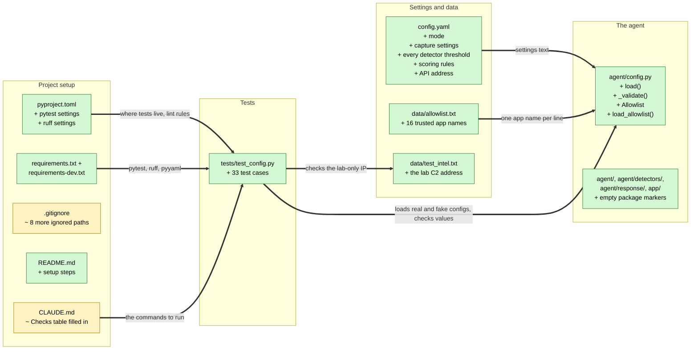

# Study guide: Set up the project folders, the settings file and the test runner

**Ticket:** #1 · **Date:** 2026-11-06 · **Gate:** APPROVE (second pass; the first pass was BLOCK, fixed below)

## The big picture

HomeSOC is an app that watches a home PC's network traffic, spots malware-like behavior and
blocks it. Before this ticket the repo held only instructions (`CLAUDE.md`) and no code. Two
people need to start writing code at the same time, so they need an agreed set of folders, one
shared settings file and a way to check that the code works.

This ticket adds that foundation. It creates the empty folders, a settings file called
`config.yaml` that holds every number the detectors will use, a small Python file that reads and
checks those settings, the list of apps that are never auto-blocked, and the test and lint
commands everyone will run. It adds no detection code yet.

Everyday analogy: it's setting up a new kitchen before anyone cooks. The drawers are labelled,
the recipe card with all the oven temperatures is on the fridge, and there's a thermometer to
check things. No food has been made yet.

## Map of the changes



**How to read it:** each box is a file (or a group of tiny files). Green = new file, yellow =
existing file this ticket changed. Inside a box, `+` means added and `~` means changed. Every
arrow is thick, because the repo had no code before, so every connection is new. Arrows are
labelled with what flows along them.

## Words you'll see

| Word | What it means here |
|------|--------------------|
| **repo** | The project folder, tracked by git so every change is recorded. |
| **Python** | The programming language HomeSOC is written in. Files end in `.py`. |
| **package** | A folder Python treats as a group of code. It needs a file named `__init__.py` inside, even an empty one. |
| **module** | One Python file, e.g. `agent/config.py`. Other files can borrow from it. |
| **import** | A line that says "I want to use code from another module or library". |
| **library** | Code someone else wrote that you install, like `yaml` (reads settings files) or `pytest` (runs tests). |
| **YAML** | A plain-text format for settings: `name: value` pairs, with indentation for groups. |
| **config** | Short for configuration: the settings the program reads when it starts. |
| **threshold** | A cut-off number, e.g. "flag a domain if the model is at least 0.8 sure". |
| **magic number** | A number typed straight into the code with no name. The project bans them; numbers live in `config.yaml` instead. |
| **function** | A named set of steps you can run, giving it inputs and getting a result. Starts with `def`. |
| **argument / parameter** | An input you hand to a function. |
| **return** | The result a function hands back. |
| **dict (dictionary)** | A lookup table of `key: value` pairs, like `{"mode": "notify"}`. |
| **tuple** | A fixed list that can't be changed, written with round brackets: `("off", "notify", "auto")`. |
| **set / frozenset** | A collection with no duplicates and fast "is X in it?" checks. *Frozen* means it can't change after it's made. |
| **string** | A piece of text in quotes, e.g. `"chrome.exe"`. |
| **type hint** | A note like `: str` or `-> dict` that says what kind of value is expected. Python doesn't enforce it, but tools and readers use it. |
| **class** | A blueprint for making objects that bundle data with behavior. |
| **dataclass** | A shortcut for writing a class that mostly just holds data. |
| **exception / error** | Python's way of stopping and saying "something is wrong". `raise` creates one. |
| **try / except** | "Try this; if this specific error happens, do that instead." |
| **logging** | Writing messages about what the program is doing to a log rather than the screen. |
| **test** | Code that runs the real code with known inputs and checks the result. |
| **pytest** | The tool that finds and runs the tests. |
| **fixture** | In pytest, a reusable piece of setup a test asks for by name. `tmp_path` is a built-in one that gives each test a fresh empty folder. |
| **lint / ruff** | A tool that reads code and flags mistakes and messy style without running it. `ruff` is the linter used here. |
| **venv** | A private folder of installed libraries just for this project, so it doesn't clash with other projects. |
| **loopback / 127.0.0.1** | The address that means "this same computer". A server on it can't be reached from other machines. |

## File by file

Files are in the order they're used: the settings first, then the code that reads them, then the
data lists, then the project setup files, and the tests last.

### `config.yaml` - new

**What this file is for:** the one place where every setting and threshold lives.
**What changed and why:** new file. The ticket and CLAUDE.md §10 say detectors must read their
numbers from here instead of having them typed into the code.

#### Piece 1 - the mode

```yaml
# Response mode: off (watch only) | notify (alert only) | auto (alert + contain).
mode: notify
```

**In plain words:** how much HomeSOC is allowed to do. It starts on "notify": it raises alerts but
blocks nothing until someone switches it to "auto".

**Line by line:**
1. `#` starts a **comment**, a note for humans that the program ignores. It lists the three choices.
2. `mode: notify` is a YAML `key: value` pair. The key is `mode` and the value is the text `notify`.

**Why it's written this way:** "notify" is the safe default (CLAUDE.md §9.6: "in doubt, alert,
don't block"). See Open questions: writing `mode: off` without quotes doesn't work yet.

#### Piece 2 - grouped settings

```yaml
capture:
  # Interface name as shown in Wireshark's interface list (§6.1). Set per machine.
  interface: "Ethernet"
  idle_timeout: 10        # NFStream idle_timeout (s)
  active_timeout: 30      # NFStream active_timeout (s)
```

**In plain words:** settings for the part that records network traffic: which network card to
listen on, and how long to wait before treating a connection as finished.

**Line by line:**
1. `capture:` with nothing after the colon opens a **group**.
2. The indented lines below belong to that group. In YAML, indentation (spaces at the start of a
   line) shows what's inside what.
3. `interface: "Ethernet"` is the network card's name, in quotes because it's text. It's a
   placeholder; it must match the name Wireshark shows on the Windows VM.
4. `idle_timeout: 10` is a number (no quotes). A comment after a value is allowed too.

**Why it's written this way:** grouping keeps related numbers together, so the capture code only
has to look inside `capture`.

#### Piece 3 - detector and scoring thresholds (shortened)

```yaml
detectors:
  dga:
    probability_threshold: 0.8 # model.predict_proba >= this -> signal
    burst_count: 5             # >= this many DGA-looking lookups ...
    burst_window_s: 60         # ... by one process within this window raises the score
  beacon:
    history: 20
    min_starts: 6
    ...
  anomaly:
    bytes_out_threshold: 10000000   # 10 MB uploaded in one window
    ...
scoring:
  alert_threshold: 0.5
  severity:
    medium: 0.5
    high: 0.75
    critical: 0.9
```

(Shortened: the real file also has `intel`, the rest of `beacon` and `anomaly`, `flow_model`, and
the other `scoring` keys. Each one is a single number with a comment.)

**In plain words:** every cut-off number from CLAUDE.md §6, one per line, grouped by the detector
that uses it. For example, the DGA detector flags a domain when its model is at least 0.8 (80%)
sure, and the scoring step raises an alert when combined risk reaches 0.5.

**Line by line:**
1. Groups can sit inside groups: `detectors` → `dga` → `probability_threshold`. Code reads it as
   `config["detectors"]["dga"]["probability_threshold"]`, which gives `0.8`.
2. Key names end in `_s` when the value is in seconds (`burst_window_s: 60` is 60 seconds), so
   nobody has to guess the unit.
3. `10000000` is ten million bytes, which is 10 MB.

**Why it's written this way:** when Jake tunes thresholds during the false-positive test (#49),
he edits this file, not the detector code.

#### Piece 4 - the API address and file paths

```yaml
api:
  host: "127.0.0.1"            # never 0.0.0.0 (§9.5)
  port: 8765
  ws_flow_rate_limit_per_s: 5  # throttled FlowEvent summaries on /ws

paths:
  allowlist: data/allowlist.txt
  test_intel: data/test_intel.txt
  cache_dir: data/cache
```

**In plain words:** the agent's internal web server listens only on this computer, at port 8765,
and sends at most 5 traffic updates per second to the app window. It also says where the data
files are.

**Why it's written this way:** `127.0.0.1` means only programs on the same PC can connect. The
spec forbids `0.0.0.0`, which would let any machine on the network connect.

### `agent/config.py` - new

**What this file is for:** reads `config.yaml` and the allowlist, and refuses bad settings with a
clear message.
**What changed and why:** new file. The ticket asks for `agent.config.load()` and a clear error
for an invalid mode.

#### Piece 1 - imports and constants

```python
from __future__ import annotations

import logging
from dataclasses import dataclass
from pathlib import Path
from typing import Any

import yaml

logger = logging.getLogger(__name__)

REPO_ROOT: Path = Path(__file__).resolve().parent.parent
DEFAULT_CONFIG_PATH: Path = REPO_ROOT / "config.yaml"
DEFAULT_ALLOWLIST_PATH: Path = REPO_ROOT / "data" / "allowlist.txt"

ALLOWED_MODES: tuple[str, ...] = ("off", "notify", "auto")
REQUIRED_SECTIONS: tuple[str, ...] = (
    "mode",
    "capture",
    "calibration",
    "detectors",
    "scoring",
    "api",
)
LOOPBACK_HOST = "127.0.0.1"  # the API must never bind anywhere else (§9.5)
COMMENT_PREFIX = "#"
```

**In plain words:** borrow some tools, work out where the project folder is, and write down the
fixed facts: the three allowed modes, the six sections the settings file must have, and the only
allowed API address.

**Line by line:**
1. `from __future__ import annotations` lets type hints refer to things defined later in the file.
   It's a common habit with no visible effect here.
2. `import logging` brings in Python's built-in logging tool.
3. `from dataclasses import dataclass` takes just one thing, `dataclass`, out of the `dataclasses`
   library.
4. `Path` (from `pathlib`) represents a file location and works the same on Windows and Mac. That
   matters because the tests run on a Mac but the app runs on Windows.
5. `Any` is a type hint meaning "any kind of value".
6. `import yaml` is the library that reads YAML files. Its install name is `pyyaml`.
7. `logger = logging.getLogger(__name__)` creates this file's logger. `__name__` is a built-in
   variable holding the module's name, here `agent.config`.
8. `REPO_ROOT: Path = ...` makes a variable with the type hint `Path`. Reading the value right to
   left: `__file__` is this file's location (`.../agent/config.py`). `.resolve()` makes it a full
   path. `.parent` goes up one folder to `agent/`, and the second `.parent` goes up to the
   project folder.
9. `REPO_ROOT / "config.yaml"`: with `Path` objects, `/` joins folder and file names. It isn't
   division.
10. `tuple[str, ...]` is a type hint meaning "a tuple of any number of strings".
11. Names in ALL_CAPS are a habit meaning "constant: don't change this".

**Why it's written this way:** working out the path from the file's own location means
`load()` finds `config.yaml` whichever folder you run the program from.

#### Piece 2 - a custom error type

```python
class ConfigError(ValueError):
    """Raised when ``config.yaml`` is missing, malformed or holds invalid values."""
```

**In plain words:** a named kind of error that means "the settings are wrong".

**Line by line:**
1. `class ConfigError(ValueError):` creates a new class. The name in brackets is its parent, so
   `ConfigError` *is a kind of* `ValueError`, Python's standard "bad value" error.
2. The text in triple quotes `"""..."""` is a **docstring**, a description that editors show on
   hover. A class needs at least one line inside it, and the docstring counts.

**Why it's written this way:** other code can catch exactly `ConfigError` and show the user a
helpful message, without also catching unrelated errors.

#### Piece 3 - `load()`, reading the file

```python
def load(path: str | Path | None = None) -> dict[str, Any]:
    config_path = Path(path) if path is not None else DEFAULT_CONFIG_PATH
    try:
        text = config_path.read_text(encoding="utf-8")
    except FileNotFoundError as exc:
        raise ConfigError(f"Config file not found: {config_path}") from exc

    try:
        data = yaml.safe_load(text)
    except yaml.YAMLError as exc:
        raise ConfigError(f"Config file {config_path} is not valid YAML: {exc}") from exc

    if not isinstance(data, dict):
        raise ConfigError(f"Config file {config_path} must contain a YAML mapping at the top level")

    _validate(data, config_path)
    logger.debug("Loaded config from %s (mode=%s)", config_path, data["mode"])
    return data
```

(The real function also has a docstring describing its inputs and errors; it's left out here.)

**In plain words:** open the settings file, turn its text into a Python dictionary, check it, and
hand it back. If anything goes wrong, stop with a `ConfigError` that says what and where.

**Line by line:**
1. `def load(...)` defines a function named `load`.
2. `path: str | Path | None = None` is the one input. `|` means "or", so it can be text, a `Path`
   or `None` (Python's "nothing"). `= None` makes it optional: calling `load()` with no input
   leaves it as `None`.
3. `-> dict[str, Any]` is the type hint for what comes back: a dictionary with text keys and
   values of any kind.
4. `X if condition else Y` is Python's short if/else: "use your path if you gave one, otherwise
   the default". For example, `load()` reads the real `config.yaml`, and
   `load("/tmp/test.yaml")` reads the test file.
5. `try:` starts a block where an error might happen. `except FileNotFoundError as exc:` says
   "if the file doesn't exist, run this instead and call the error `exc`".
6. `raise ConfigError(f"...")` stops with the custom error. The `f` before the quotes makes an
   **f-string**: anything in `{curly brackets}` gets filled in, so `{config_path}` becomes the
   real file path in the message.
7. `from exc` attaches the original error, so whoever debugs it can still see the root cause.
8. `yaml.safe_load(text)` turns YAML text into Python values. *Safe* means it won't run any code
   hidden in the file.
9. `isinstance(data, dict)` asks "is `data` a dictionary?" and `not` flips the answer. A file
   holding only `hello` would load as a plain string, which is not a valid config.
10. `_validate(data, config_path)` runs the checks in the next piece. The leading `_` is a habit
    meaning "internal helper, not for other files".
11. `logger.debug(...)` logs a quiet message. `%s` marks a spot that gets filled with the values
    listed after it.
12. `return data` hands the dictionary back to the caller.

**Why it's written this way:** every failure becomes one error type with a clear message, so the
agent can stop on startup with "Config file not found: ..." rather than a confusing crash later.

#### Piece 3b - the `mode: off` fix

```python
    # YAML 1.1 reads a bare `mode: off` as the boolean False; treat it as the "off" mode.
    if data.get("mode") is False:
        data["mode"] = "off"

    _validate(data, config_path)
```

**In plain words:** YAML has a surprise rule: a bare `off` (and `no`) means false, and `on` and
`yes` mean true. So when someone types `mode: off`, Python receives `False`, not the word
`"off"`. This turns that `False` back into `"off"` before the checks run.

**Line by line:**
1. `False` is one of Python's two **booleans**, the yes/no values `True` and `False`.
2. `is False` checks for exactly the value `False`. It's stricter than "looks empty", so a missing
   mode (`None`) isn't mistaken for `off`.
3. `data["mode"] = "off"` replaces the value in the dictionary with the text `"off"`.

**Why it's written this way:** the comment in `config.yaml` tells people the choices are `off`,
`notify` and `auto`, so typing `mode: off` must work. A bare `on` or `yes` (which arrives as
`True`) is still rejected, because it isn't one of the three modes.

#### Piece 4 - `_validate()`, checking the values

```python
def _validate(data: dict[str, Any], config_path: Path) -> None:
    missing = [key for key in REQUIRED_SECTIONS if key not in data]
    if missing:
        raise ConfigError(
            f"Config file {config_path} is missing required key(s): {', '.join(missing)}"
        )

    mode = data["mode"]
    if mode not in ALLOWED_MODES:
        raise ConfigError(
            f"Invalid mode {mode!r} in {config_path}; allowed modes are: {', '.join(ALLOWED_MODES)}"
        )

    api = data["api"]
    if not isinstance(api, dict) or api.get("host") != LOOPBACK_HOST:
        host = api.get("host") if isinstance(api, dict) else None
        raise ConfigError(
            f"Invalid api.host {host!r} in {config_path}; the API must bind to {LOOPBACK_HOST} only"
        )

    capture = data["capture"]
    if not isinstance(capture, dict) or not capture.get("interface"):
        raise ConfigError(f"Config file {config_path} must set capture.interface")
```

**In plain words:** four checks, in order. Are all six sections there? Is the mode one of the
three allowed words? Is the API on `127.0.0.1` only? Is a network card named? The first failure
stops with a message.

**Line by line:**
1. `-> None` means this function hands nothing back. Its job is to complain or stay quiet.
2. `[key for key in REQUIRED_SECTIONS if key not in data]` is a **list comprehension**, a
   one-line way to build a list. It reads as "go through each required section and keep the ones
   missing from `data`". If the file has only `mode`, the result is `["capture", "calibration",
   "detectors", "scoring", "api"]`.
3. `if missing:` is true when the list has anything in it; an empty list counts as false.
4. `', '.join(missing)` glues the list into one text with commas, e.g. `"capture, calibration"`.
5. `data["mode"]` uses square brackets to look up a key in a dictionary.
6. `if mode not in ALLOWED_MODES:` checks the mode against the three allowed words.
7. `{mode!r}` in an f-string shows the value in its code form, with quotes, so the message
   reads `Invalid mode 'panic'`. That makes typos and stray spaces visible.
8. `api.get("host")` is a safer lookup that returns `None` instead of crashing when the key is
   missing.
9. `or` means either condition is enough. `!=` means "is not equal to". So the check reads: "if
   `api` isn't a group, or its host isn't `127.0.0.1`, reject it".
10. `not capture.get("interface")` is true when the interface is missing or empty (`""`).

**Why it's written this way:** catching a bad setting at startup with a precise message beats
discovering it mid-demo. The `127.0.0.1` check enforces safety rule §9.5 in code, not just in
the comment.

#### Piece 5 - the allowlist

```python
@dataclass(frozen=True)
class Allowlist:
    """Exe names that are never auto-quarantined (§6.4). Matching is case-insensitive."""

    names: frozenset[str]

    def __contains__(self, exe_name: object) -> bool:
        return isinstance(exe_name, str) and exe_name.strip().casefold() in self.names

    def __len__(self) -> int:
        return len(self.names)


def load_allowlist(path: str | Path | None = None) -> Allowlist:
    allowlist_path = Path(path) if path is not None else DEFAULT_ALLOWLIST_PATH
    names: set[str] = set()
    for raw_line in allowlist_path.read_text(encoding="utf-8").splitlines():
        line = raw_line.strip()
        if not line or line.startswith(COMMENT_PREFIX):
            continue
        names.add(line.casefold())
    logger.debug("Loaded %d allowlisted exe names from %s", len(names), allowlist_path)
    return Allowlist(names=frozenset(names))
```

(The real `load_allowlist` also has a docstring; it's left out here.)

**In plain words:** read the list of trusted app names, skip notes and empty lines, and store
the names in a way that ignores capital letters. Later code can then ask
`"Chrome.EXE" in allowlist` and get `True`.

**Line by line:**
1. `@dataclass(frozen=True)` is a **decorator**: a line starting with `@` that adds behavior to
   what follows. Here it turns the class into a dataclass, and `frozen=True` makes it read-only
   after creation.
2. `names: frozenset[str]` is the one piece of data the class holds: an unchangeable set of names.
3. `def __contains__(self, exe_name)`: names wrapped in double underscores are special to Python.
   `__contains__` is what runs when you write `x in allowlist`. `self` is the allowlist object
   itself.
4. `exe_name.strip()` removes spaces at both ends, and `.casefold()` makes it lowercase (a
   stronger form of lowercase). So `" MsMpEng.EXE "` becomes `"msmpeng.exe"`.
5. `isinstance(exe_name, str) and ...`: `and` means both must be true. If someone asks about a
   non-text value, the answer is `False` instead of a crash.
6. `__len__` is what runs for `len(allowlist)`, so it gives the number of names.
7. `names: set[str] = set()` starts with an empty set.
8. `for raw_line in ...splitlines():` is a **loop** that runs the indented lines once per line
   of the file.
9. `continue` skips to the next line in the loop. It's used here for blank lines and lines
   starting with `#`.
10. `names.add(line.casefold())` stores the lowercase name.
11. `frozenset(names)` freezes the finished set before handing it back.

**Why it's written this way:** Windows doesn't care about capital letters in file names, so
`CHROME.EXE` and `chrome.exe` are the same program. Matching must ignore case too, or a trusted
app could be quarantined by mistake.

### `data/allowlist.txt` - new

**What this file is for:** the apps HomeSOC never blocks automatically. It will still alert on
them.
**What changed and why:** new file listing the §6.4 apps.

```text
# Browsers
chrome.exe
msedge.exe
...
# Windows Defender
MsMpEng.exe
NisSrv.exe
MpCmdRun.exe
```

(Shortened. There are 16 names in total: 5 browsers, 4 Windows Update programs, 2 Steam, Discord,
Spotify and 3 Defender.)

**In plain words:** one program name per line, with `#` headings, read by `load_allowlist()`.

**Why it's written this way:** a plain text file is easy for anyone to edit without touching code.

### `data/test_intel.txt` - new

**What this file is for:** fake "known bad" addresses for the demo.
**What changed and why:** new file holding only the lab's fake C2 server.

```text
# Lab IPs ONLY (host-only network 192.168.56.0/24). Never add real threat-intel IPs here.
192.168.56.20
```

**In plain words:** the only "bad" address is the lab machine running the fake command server.

**Why it's written this way:** safety rule §9.2 says the demo must never touch real criminal
servers, so it uses a lab address instead.

### Empty package markers - new

`agent/__init__.py`, `agent/detectors/__init__.py`, `agent/response/__init__.py`,
`app/__init__.py` and `tests/__init__.py` are empty files, and `data/cache/.gitkeep`,
`lab/.gitkeep` and `models/.gitkeep` are empty placeholders.

**In plain words:** `__init__.py` tells Python "this folder is a package", which is what makes
`from agent import config` work. `.gitkeep` exists because git doesn't save empty folders, so a
placeholder keeps the folder in the repo.

**Why it's written this way:** both people can now add files to the right folders without
arguing about the layout.

### `pyproject.toml` - new

**What this file is for:** project settings that pytest and ruff read.

```toml
[project]
name = "homesoc"
requires-python = ">=3.12"

[tool.pytest.ini_options]
testpaths = ["tests"]
pythonpath = ["."]

[tool.ruff]
target-version = "py312"
line-length = 100

[tool.ruff.lint]
select = ["E", "F", "W", "I", "UP", "B"]
```

(Shortened: it also has `version`, `description` and an `extend-exclude` that skips `.venv`.)

**In plain words:** the project needs Python 3.12 or newer. Tests live in `tests/`. Ruff checks
the code as if it were Python 3.12, flags lines over 100 characters, and applies six groups of
rules.

**Line by line:**
1. `[section]` in square brackets starts a group of settings. This format is called TOML.
2. `pythonpath = ["."]` tells pytest to treat the project folder (`.`) as the place to find
   imports, so tests can write `from agent import config`.
3. `select = ["E", "F", ...]` picks ruff's rule groups: E/W style, F real mistakes such as unused
   imports, I import order, UP outdated syntax, B likely bugs.

### `requirements.txt` and `requirements-dev.txt` - new

**What these files are for:** the lists of libraries to install. `requirements.txt` is the full
Windows list from §8. `requirements-dev.txt` is the small set needed to run the tests anywhere:

```text
pytest
ruff
pyyaml
```

**Why it's written this way:** libraries like `nfstream` and `winotify` only install on Windows,
so the Mac only installs what the tests need.

### `.gitignore` - changed

```diff
+.venv/
+.pytest_cache/
+.ruff_cache/
+data/cache/*
+!data/cache/.gitkeep
+data/evidence/
+data/*.pcapng
+*.db
```

**In plain words:** git should never save these files: the private library folder, tool caches,
downloaded blocklists, captured traffic and the database.

**Line by line:**
1. Lines starting with `+` were added.
2. `data/cache/*` ignores everything inside `data/cache/`, and `!data/cache/.gitkeep` makes one
   exception (`!` means "except").
3. `*.db` uses `*` as a wildcard meaning "any name", so it ignores every file ending in `.db`.

**Why it's written this way:** recorded network traffic can contain private data, and it should
never be uploaded to GitHub.

### `README.md` - new

A short project introduction, the Windows setup steps from §8, how to run the tests and lint on a
Mac, and a reminder of the safety rules. It contains no code.

### `CLAUDE.md` - changed

```diff
-| agent | none yet | none yet | none yet |
-| app | none yet | none yet | none yet |
+| agent | none (pure Python) | `.venv/bin/python -m pytest -q` (Windows: ...) | `.venv/bin/ruff check .` (Windows: ...) |
+| app | none (pure Python) | covered by the same pytest run (...) | covered by the same ruff run |
```

(Shortened. The new lines also give the full Windows commands, add a one-line Mac setup note,
and change the smoke-test line to "none yet (added by #19)".)

**In plain words:** the "how do we know it still works" table now has real commands. Every future
ticket's test gate runs exactly these.

### `tests/test_config.py` - new (test)

**What this file is for:** proves that `agent/config.py` and the data files behave as the ticket
says.

```python
def _write_config(tmp_path: Path, **overrides: object) -> Path:
    data = yaml.safe_load((REPO_ROOT / "config.yaml").read_text(encoding="utf-8"))
    data.update(overrides)
    path = tmp_path / "config.yaml"
    path.write_text(yaml.safe_dump(data), encoding="utf-8")
    return path

def test_invalid_mode_raises_clear_error(tmp_path: Path) -> None:
    path = _write_config(tmp_path, mode="panic")
    with pytest.raises(ConfigError) as excinfo:
        config.load(path)
    message = str(excinfo.value)
    assert "'panic'" in message
    for allowed in ("off", "notify", "auto"):
        assert allowed in message
```

**The fake data:** `_write_config` copies the real `config.yaml` into a temporary folder and
swaps in whatever values the test passes in. `**overrides` collects named inputs like
`mode="panic"` into a dictionary, and `data.update(overrides)` replaces those keys. Then it writes
the copy back out.

**What the checks do:** `assert X` means "X must be true, or the test fails". `with
pytest.raises(ConfigError)` means "the code inside must raise a `ConfigError`, or the test
fails". The test then reads the error message and checks it names `'panic'` and all three
allowed modes.

`@pytest.mark.parametrize("exe", SECTION_6_4_APPS)` runs the same test once per item in a list,
which is why 19 test functions count as 39 test cases.

Every test, in one sentence each:
- `test_load_defaults_to_repo_root_config`: `load()` with no input gives the same result as
  loading `config.yaml` by its full path.
- `test_config_has_mode_interface_and_capture_timeouts`: the mode is valid, the interface is set,
  and the capture timeouts are 10 and 30.
- `test_config_has_detector_thresholds`: every detector number matches §6 exactly (0.8, 5, 60,
  20, 6 and so on).
- `test_config_has_scoring_thresholds`: the scoring window, boost, alert level, severities and
  auto-quarantine rule match §6.4.
- `test_config_api_binds_loopback_only`: the API is `127.0.0.1:8765` with a limit of 5 messages
  per second.
- `test_each_valid_mode_loads`: `off`, `notify` and `auto` each load (3 cases). It writes the
  file with `yaml.safe_dump`, which adds quotes, so it couldn't catch the `mode: off` bug alone.
- `test_each_mode_loads_when_hand_written_unquoted`: edits the real file's text to a bare
  `mode: off` / `notify` / `auto`, exactly as a person would type it, and checks each loads
  (3 cases). The test gate checked that this fails if the fix is removed.
- `test_yaml_true_mode_is_rejected`: a bare `true`, `yes` or `on` is still refused (3 cases).
- `test_invalid_mode_raises_clear_error`: mode `panic` is rejected with a message naming it and
  the allowed modes.
- `test_config_error_is_a_value_error`: `ConfigError` is a kind of `ValueError`.
- `test_non_loopback_api_host_is_rejected`: a config with host `0.0.0.0` is refused.
- `test_missing_section_is_rejected`: a file with only `mode` is refused, and the message
  mentions `capture`.
- `test_missing_file_is_rejected`: loading a file that doesn't exist gives "not found".
- `test_real_allowlist_contains_section_6_4_apps`: each of the 16 apps is in the real allowlist
  (16 cases).
- `test_real_allowlist_has_exactly_the_listed_apps`: the allowlist has exactly those 16 and not
  `freegamecheats.exe`.
- `test_allowlist_ignores_comments_and_blank_lines`: comments and empty lines aren't treated as
  app names.
- `test_allowlist_matching_is_case_insensitive`: `MSMPENG.EXE` matches `MsMpEng.exe`, and
  `evil.exe` doesn't match.
- `test_test_intel_holds_only_the_lab_c2`: `test_intel.txt` holds only `192.168.56.20`.

## How you know it works

- **Settings load correctly:** 5 tests load the real `config.yaml` and check every number
  against the spec.
- **Bad settings are refused:** 5 tests try a bad mode, a public API address, a missing section
  and a missing file, and each is rejected with a clear message.
- **The allowlist works:** 19 cases check that all 16 trusted apps load, that comments are
  skipped and that case doesn't matter.
- **The demo stays safe:** one test makes sure the only "bad IP" is the lab machine.
- **Modes work as typed:** 6 cases write the mode as plain text and check that `off`, `notify`
  and `auto` load while `true`, `yes` and `on` are refused.
- The first gate pass said BLOCK because `mode: off` failed. After the fix, the second pass ran
  the suite 3 times with 39 of 39 passing, ruff clean, and said **APPROVE**.

## Try it yourself

1. One-time setup on the Mac: `python3 -m venv .venv && .venv/bin/pip install -r requirements-dev.txt`
   (this ticket's venv was made with `/usr/local/bin/python3.13`).
2. Run the checks from `CLAUDE.md` `## Checks`: `.venv/bin/python -m pytest -q`. You should see
   `39 passed`.
3. Run only this ticket's tests: `.venv/bin/python -m pytest -q tests/test_config.py`.
4. Run the linter: `.venv/bin/ruff check .`. You should see `All checks passed!`.
5. See the clear error yourself. Change `mode: notify` to `mode: panic` in `config.yaml`, then
   run `.venv/bin/python -c "from agent import config; config.load()"`. You'll get
   `ConfigError: Invalid mode 'panic' ...; allowed modes are: off, notify, auto`. Change it back
   afterwards.

## Open questions / risks

- **Fixed (first gate pass blocked on this): `mode: off` without quotes was rejected.** YAML
  reads a bare `off` as `False`, and `load()` failed with `Invalid mode False`. It's fixed by
  Piece 3b and covered by the hand-written-mode tests. The later `POST /mode` API ticket (#39)
  should accept `off` the same way.
- **Verifier, safety note: `svchost.exe` is trusted by name only.** Malware often names itself
  `svchost.exe`. A fake one in Downloads would never be auto-blocked (it would still be
  alerted). The scoring ticket (#15) should consider also checking the folder (System32) or the
  digital signature.
- **Verifier, minor:** `load_allowlist()` raises a plain `FileNotFoundError` when the file is
  missing, while `load()` wraps the same case in `ConfigError`.
- **Verifier, minor:** a few optional settings aren't in `config.yaml` yet: the Tranco top-100k
  size, NFStream `n_dissections`, and the ring-buffer size and count for evidence capture. Later
  tickets can add them.
- **Assumptions:** the interface name `"Ethernet"` is a placeholder for the Windows VM. 10 MB is
  taken as 10,000,000 bytes. The Mac venv uses Python 3.13 because 3.12 isn't installed, so the
  tests haven't been run on 3.12.
