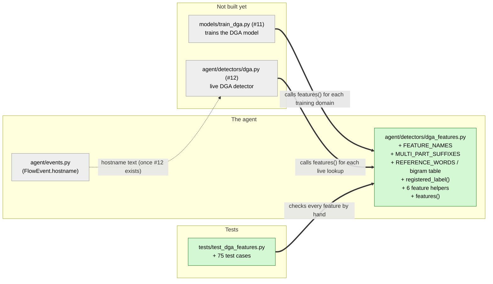

# Study guide: Turning a website name into numbers that reveal "random-looking" domains

**Ticket:** #10 · **Date:** 2026-11-07 · **Gate:** APPROVE

## The big picture

A lot of malware doesn't use one fixed server address. It runs a *domain generation algorithm* (DGA) that invents hundreds of nonsense names a day, like `xjq7vzk2pq.com`, and tries them until one works. HomeSOC will catch this with a small AI model (ticket #11 trains it, #12 uses it live). A model can't read text, though. It needs numbers. Before this ticket nothing turned a hostname into numbers.

Now `agent/detectors/dga_features.py` does exactly that. Give it `www.google.com` and it finds the part that matters, `google`, then measures 7 things about it: how long it is, how jumbled its letters are, how many vowels and digits it has, the longest clump of consonants, how many different characters it uses, and how unusual its letter pairs are compared to English. Both training and live detection call this same one function, so the model always sees numbers calculated the same way. It's like a doctor's checklist that every nurse uses identically: if the nurse who trained the new doctor and the nurse on the ward measured blood pressure differently, the doctor's judgment would be off.

## Map of the changes



**How to read it:** green boxes are new files and grey boxes are files this one connects to. The two "not built yet" boxes are future tickets that will import this file. `+` marks things added inside a file. Thick arrows (`==>`) are connections this ticket makes possible. The dotted arrow is a future link that doesn't involve this file directly.

## Words you'll see

| Word | What it means here |
|---|---|
| hostname | A website name, e.g. `www.google.com`. |
| label | One dot-separated piece of a hostname: `www`, `google`, `com`. |
| public suffix | The part anyone can register under, like `com` or `co.uk`. |
| registered-domain label | The label just left of the public suffix, the name someone actually bought: `google` in `www.google.com`, `bbc` in `news.bbc.co.uk`. |
| DGA | Domain Generation Algorithm: malware code that invents random domain names. |
| feature | One number that describes the input, which a model learns from. |
| model / training | The AI part. Training means showing it many labelled examples so it learns the pattern. |
| entropy (Shannon) | A measure of how mixed up the characters are, in bits. `aaaa` = 0 (no surprise), `abcd` = 2. |
| bit | A unit of information: one yes/no question's worth. |
| `log2` | "How many times do I halve to get here?" `log2(1/2) = -1`, `log2(1/4) = -2`. |
| ratio | A share between 0 and 1: 2 digits out of 4 characters = 0.5. |
| consonant | A letter that isn't a vowel. Here `y` counts as a consonant. |
| bigram | Two characters next to each other. `google` has `go`, `oo`, `og`, `gl`, `le`. |
| surprisal | How unexpected something is, `-log2(probability)`. Rare = high. |
| smoothing (add-one) | Adding 1 to every count so a pair never seen before doesn't get probability zero (which would mean infinite surprise). |
| IP literal | A hostname that's actually a raw IP address, like `192.168.56.20`. |
| punycode | How non-English names are written in DNS, e.g. `xn--bcher-kva` for "bücher". |
| constant | A value that never changes, written in ALL_CAPS by convention. |
| tuple | A fixed, ordered list that can't be changed: `("a", "b")`. |
| `frozenset` | An unchangeable set: no order, no duplicates, very fast "is X in it?" checks. |
| `Counter` | A Python dict that counts things: `Counter("google")` gives `{"g": 2, "o": 2, "l": 1, "e": 1}`. |
| `Mapping` | A type hint meaning "anything that works like a read-only dict". |
| docstring | The `"""…"""` text explaining a module or function. |
| pytest / test | The tool that runs checks, and one check (`assert` means "must be true"). |
| `pytest.approx` | "Equal, allowing a tiny rounding difference", needed for decimal numbers. |
| parametrize | Run one test several times with different inputs. |

## File by file

### `agent/detectors/dga_features.py` - new

**What this file is for:** turns a hostname into 7 numbers for the DGA model.
**What changed and why:** the whole file is new. Ticket #10 asks for a single `features(hostname)` function shared by training and live detection (§6.3, §7).

#### Piece 1 - The docstring: the rules written down

```python
"""DGA feature extractor shared by training and the live detector (CLAUDE.md §6.3, §7).

``models/train_dga.py`` and ``agent/detectors/dga.py`` both call :func:`features`, so the model is
always scored on exactly the features it was trained on. ...
Never add IP addresses or ports as features (§7).

Registered-domain label
    ... ``www.google.com`` -> ``google``, ``news.bbc.co.uk`` -> ``bbc`` ...

Features, all returned as ``float`` in :data:`FEATURE_NAMES` order ...
``bigram_rarity``
    ...
        p(b)  = (count(b) + 1) / (N + V)
        score = mean over the n-1 overlapping bigrams b of s of -log2(p(b))
"""
```
(shortened: the full docstring lists every edge case and every feature's exact definition)

**In plain words:** before any code, the file spells out exactly how each number is calculated and what happens with odd inputs. That's important because training and the live detector rely on this file meaning the same thing forever.

**Line by line:**
1. The double backticks (` ``…`` `) and `:func:` / `:data:` are documentation formatting: "this is code" and "this links to a function or value". They don't change what the program does.
2. `->` in the text just means "becomes".
3. The formula block is the bigram rarity definition, explained with numbers in Piece 6.

**Why it's written this way:** the ticket's acceptance criterion 2 wants each feature hand-checked, and that's only possible if each one is defined exactly. Writing the definitions here makes this file the single source of truth.

#### Piece 2 - Imports and the fixed lists

```python
from __future__ import annotations

import ipaddress
import math
from collections import Counter
from collections.abc import Mapping

FEATURE_NAMES: tuple[str, ...] = (
    "length",
    "entropy",
    "vowel_ratio",
    "digit_ratio",
    "longest_consonant_run",
    "unique_chars",
    "bigram_rarity",
)

VOWELS = frozenset("aeiou")
CONSONANTS = frozenset("abcdefghijklmnopqrstuvwxyz") - VOWELS
DIGITS = frozenset("0123456789")
HOSTNAME_ALPHABET_SIZE = 37  # a-z, 0-9 and "-"
BIGRAM_VOCABULARY_SIZE = HOSTNAME_ALPHABET_SIZE**2
```

**In plain words:** borrow some of Python's built-in tools, then define the official list of feature names in their fixed order, and the sets of letters that count as vowels, consonants and digits.

**Line by line:**
1. `import ipaddress` recognises IP addresses, `import math` gives `log2`, and `Counter` counts characters. All of these come with Python, so there's nothing new to install.
2. `FEATURE_NAMES: tuple[str, ...] = ( … )`: a tuple of text. `tuple[str, ...]` means "a tuple of any number of strings". The training script will use this order for its table columns.
3. `frozenset("aeiou")`: turning a string into a set gives its characters: `{a, e, i, o, u}`.
4. `frozenset("abc…z") - VOWELS`: `-` between sets means "remove these". That leaves the 21 consonants, including `y`.
5. `HOSTNAME_ALPHABET_SIZE = 37`: hostnames use 26 letters + 10 digits + the hyphen = 37 characters.
6. `HOSTNAME_ALPHABET_SIZE**2`: `**` means "to the power of". 37 × 37 = 1369 possible two-character pairs.

**Why it's written this way:** a tuple can't be changed by accident, so the column order is locked (acceptance criterion 4). Defining vowels and consonants once means every function agrees on them.

#### Piece 3 - The two built-in reference lists

```python
MULTI_PART_SUFFIXES: frozenset[str] = frozenset(
    """
    co.uk org.uk ac.uk gov.uk me.uk ltd.uk plc.uk net.uk sch.uk nhs.uk police.uk
    com.au net.au org.au edu.au gov.au asn.au id.au
    ...
    """.split()
)

REFERENCE_WORDS: tuple[str, ...] = tuple(
    """
    the of and to in is it you that he was for on are with as his they be at one have this from
    ...
    mail web online cloud net news shop store app service services data media info search video
    ...
    """.split()
)
```
(shortened: about 230 suffixes and about 450 words in total)

**In plain words:** two lists built into the file. The first is suffixes made of two parts, like `co.uk`, so the code knows `bbc.co.uk` belongs to `bbc` and not `co`. The second is ordinary English words plus common web words, used as the "normal" reference for letter pairs.

**Line by line:**
1. `"""…"""`: a multi-line block of text.
2. `.split()`: cuts text wherever there's whitespace, giving a list like `["co.uk", "org.uk", …]`.
3. `frozenset(...)` / `tuple(...)`: turn that list into an unchangeable set or tuple.

**Why it's written this way:** the developer chose a built-in list over the `tldextract` library, because it needs no new dependency and can never go online. CLAUDE.md §1 says the only network request HomeSOC makes is the blocklist refresh. The word list deliberately has *no brand names*, so `google` isn't scored as normal just because it's in the list.

#### Piece 4 - Building the bigram table once

```python
def _count_bigrams(words: tuple[str, ...]) -> Counter[str]:
    counts: Counter[str] = Counter()
    for word in words:
        counts.update(word[i : i + 2] for i in range(len(word) - 1))
    return counts


REFERENCE_BIGRAM_COUNTS: Mapping[str, int] = _count_bigrams(REFERENCE_WORDS)
```

**In plain words:** go through every reference word and count each two-letter pair. For "the" that's `th` and `he`. The result is a table like `{"th": 40, "he": 35, …}`, built once when the file is loaded.

**Line by line:**
1. `def _count_bigrams(words) -> Counter[str]:`: a function that returns a counter. The leading `_` means "internal helper".
2. `range(len(word) - 1)`: for "the" (length 3), `range(2)` gives 0, 1.
3. `word[i : i + 2]`: slicing, which takes characters from position `i` up to (not including) `i + 2`. `"the"[0:2]` = `"th"`, `"the"[1:3]` = `"he"`.
4. `counts.update( … for i in … )`: the bit in brackets is a generator, a compact loop that produces each pair. `update` adds 1 to the count of each pair it produces.
5. `REFERENCE_BIGRAM_COUNTS = _count_bigrams(REFERENCE_WORDS)`: runs once at load time, so every call to `features()` reuses the same table.

**Why it's written this way:** building it from a fixed list in the code means the table is identical every time, on every machine, with no download, so training and live results can't drift apart.

#### Piece 5 - `registered_label()`: finding `google` in `www.google.com`

```python
def registered_label(hostname: str | None) -> str:
    if not hostname:
        return ""
    host = hostname.strip().lower().rstrip(".")
    if not host or _is_ip_literal(host):
        return ""
    labels = [label for label in host.split(".") if label]
    if not labels:
        return ""
    if len(labels) == 1:
        return labels[0]
    if ".".join(labels[-2:]) in MULTI_PART_SUFFIXES:
        return labels[-3] if len(labels) >= 3 else labels[0]
    return labels[-2]


def _is_ip_literal(host: str) -> bool:
    candidate = host[1:-1] if host.startswith("[") and host.endswith("]") else host
    try:
        ipaddress.ip_address(candidate)
    except ValueError:
        return False
    return True
```
(docstring shortened)

**In plain words:** tidy the hostname, give up politely if it's empty or an IP address, split it at the dots, and pick the right piece. Usually that's the second from the end. If the last two pieces form a known suffix like `co.uk`, it's the third from the end.

**Line by line:**
1. `hostname: str | None`: the input may be text or nothing (`None`).
2. `if not hostname: return ""`: `None` and `""` both count as false, so the result is an empty label.
3. `hostname.strip().lower().rstrip(".")`: chained steps. Remove surrounding spaces, make lowercase, remove dots at the end. `" WWW.Google.COM. "` becomes `"www.google.com"`.
4. `[label for label in host.split(".") if label]`: a list comprehension, a one-line loop that builds a list. It splits at dots and keeps only non-empty pieces, so `"a..example.com"` gives `["a", "example", "com"]`.
5. `labels[-2:]`: negative positions count from the end, so `-2:` means "the last two". `".".join([...])` glues them back with a dot: `["co", "uk"]` becomes `"co.uk"`.
6. `labels[-3] if len(labels) >= 3 else labels[0]`: the one-line if/else. For `news.bbc.co.uk`, labels are `["news", "bbc", "co", "uk"]`, `co.uk` is a suffix, so `labels[-3]` = `"bbc"`.
7. `return labels[-2]`: for `www.google.com`, `["www", "google", "com"]` gives `"google"`.
8. `_is_ip_literal`: `host[1:-1]` strips the square brackets from `[2001:db8::1]`. `ipaddress.ip_address(...)` succeeds only for a real IP. `try`/`except ValueError` means "if it complains, it's not an IP, so return `False`".

**Why it's written this way:** acceptance criterion 1 requires `google`, not the full `www.google.com`. Without that, every hostname would look longer and more random than it really is. IPs return `""` because §7 says IP addresses must never be used as features. "Never raises" matters because this will run on every DNS lookup the PC makes.

#### Piece 6 - The seven measurements

```python
def shannon_entropy(s: str) -> float:
    n = len(s)
    if n == 0:
        return 0.0
    entropy = -sum((c / n) * math.log2(c / n) for c in Counter(s).values())
    return entropy + 0.0  # turn -0.0 (single repeated character) into 0.0


def vowel_ratio(s: str) -> float:
    return sum(ch in VOWELS for ch in s) / len(s) if s else 0.0


def digit_ratio(s: str) -> float:
    return sum(ch in DIGITS for ch in s) / len(s) if s else 0.0


def longest_consonant_run(s: str) -> int:
    longest = current = 0
    for ch in s:
        current = current + 1 if ch in CONSONANTS else 0
        longest = max(longest, current)
    return longest


def bigram_rarity(s: str, counts: Mapping[str, int] | None = None) -> float:
    if len(s) < 2:
        return 0.0
    table = REFERENCE_BIGRAM_COUNTS if counts is None else counts
    denominator = sum(table.values()) + BIGRAM_VOCABULARY_SIZE
    bigrams = [s[i : i + 2] for i in range(len(s) - 1)]
    surprisal = sum(-math.log2((table.get(b, 0) + 1) / denominator) for b in bigrams)
    return surprisal / len(bigrams)
```
(docstrings shortened)

**In plain words:** one small function per measurement. Each returns `0.0` for an empty label instead of crashing.

**Line by line, with worked examples:**
1. **Entropy.** `Counter(s).values()` gives how often each character appears. For `google` that's 2, 2, 1, 1 out of `n = 6`. Each `c / n` is a share (2/6 = 1/3). The formula adds up `share × log2(share)` and flips the sign: 2 × (1/3 × log2 3) + 2 × (1/6 × log2 6) = 1.0566 + 0.8617 = **1.918 bits**. For `aaaa` there's one character with share 1, and log2(1) = 0, so entropy is **0**. Python can produce `-0.0` there, and `+ 0.0` turns it into a plain `0.0`.
2. **Vowel ratio.** `ch in VOWELS for ch in s` gives True/False for each character. In Python, `sum` counts each True as 1. For `hello`: e and o are 2 vowels out of 5, so **0.4**. The ending `if s else 0.0` avoids dividing by zero for an empty label.
3. **Digit ratio.** The same idea with digits: `a1b2` has 2 digits out of 4, so **0.5**.
4. **Longest consonant run.** `longest = current = 0` sets both to 0. For each character, if it's a consonant the current run grows by 1, otherwise it resets to 0. `max(...)` remembers the best so far. For `strength`: s-t-r (3), then `e` resets, then n-g-t-h (4), so **4**. For `bc1dfg` the digit `1` resets the run, so the answer is 3, not 5.
5. **Bigram rarity.**
   - `if len(s) < 2: return 0.0` handles a single letter, which has no pairs.
   - `table = … if counts is None else counts` uses the built-in table unless a test supplies its own.
   - `denominator = N + V` is the total number of reference pairs plus 1369 possible pairs.
   - `table.get(b, 0)` looks up a pair's count, and gives 0 if it's never been seen.
   - `(count + 1) / denominator` is the smoothed probability. The `+ 1` stops a never-seen pair from having probability 0.
   - `-math.log2(...)` is the surprisal, so rare pairs get big numbers.
   - The last line averages over all pairs. With the test's tiny table where `N + V = 4096`: `ab` seen 2047 times gives (2047+1)/4096 = 1/2, which is **1 bit**. A never-seen pair gives 1/4096, which is **12 bits**. `abx` has pairs `ab` (1) and `bx` (12), so the average is **6.5**.

**Why it's written this way:** these are the seven features §6.3 lists. Random DGA names tend to have high entropy, few vowels, more digits, long consonant clumps and weird letter pairs. Real names are the opposite. Small separate functions mean each one can be tested by hand on its own.

#### Piece 7 - `features()`: putting it together

```python
def features(hostname: str | None) -> dict[str, float]:
    """Return the DGA features of ``hostname``'s registered-domain label, in FEATURE_NAMES order.

    Never raises. A hostname with no usable label (empty, IP literal) gives all zeros.
    """
    label = registered_label(hostname)
    return {
        "length": float(len(label)),
        "entropy": shannon_entropy(label),
        "vowel_ratio": vowel_ratio(label),
        "digit_ratio": digit_ratio(label),
        "longest_consonant_run": float(longest_consonant_run(label)),
        "unique_chars": float(len(set(label))),
        "bigram_rarity": bigram_rarity(label),
    }
```

**In plain words:** find the label, then return all seven measurements as a dict, always in the same order.

**Line by line:**
1. `-> dict[str, float]`: returns a dict with text keys and decimal-number values.
2. `{ "length": …, … }`: a dict literal. Python keeps keys in the order they're written, and this order matches `FEATURE_NAMES`.
3. `float(len(label))`: `len` gives a whole number, and `float()` turns 6 into 6.0 so every value has the same type.
4. `len(set(label))`: `set("google")` = {g, o, l, e}, so there are **4** unique characters.

**Why it's written this way:** the training table needs every row to have the same columns, in the same order, all numbers (acceptance criterion 4). The verifier noted that the keys are typed out rather than generated from `FEATURE_NAMES`. A test guards that they match.

### `tests/test_dga_features.py` - new (test)

**What this file is for:** proves each feature is computed correctly and on the right label.
**What it uses:** no fake objects and no network. It calls the real functions on hand-picked strings whose answers were worked out with pencil-and-paper arithmetic, written in comments next to each value. One test builds a tiny custom bigram table (`{"ab": 2047, "zz": 680}`) chosen so the numbers come out as whole bits.

**Every test, one sentence each:**

AC1 (computed on the registered-domain label):
- `test_www_google_com_is_computed_on_google`: `www.google.com` gives the label `google`, the same features as plain `google`, and length 6, not 14.
- `test_multi_part_suffix_gives_label_left_of_suffix` (×6): `news.bbc.co.uk` gives `bbc`, `www.abc.net.au` gives `abc`, and so on.
- `test_registered_label_edge_cases` (×17): trailing dot, uppercase, spaces, `localhost`, `co.uk`, doubled dots, hyphens and digits, punycode, `_ldap._tcp…`, empty, dots only, spaces only, IPv4, IPv6 and bracketed IPv6 all give the right label without crashing.
- `test_none_hostname_gives_empty_label`: `None` gives `""`.
- `test_no_label_gives_all_zero_features` (×5): empty, `.`, IPs and `None` give every feature as 0.0.
- `test_ip_literal_features_never_use_the_digits`: `203.0.113.5` has digit ratio 0, so IP digits never leak in (§7).

AC2 (hand-checked value per feature):
- `test_length_hand_checked`: `example.com` gives 7, and `a` gives 1.
- `test_entropy_hand_checked` (×5): `aaaa` = 0, `ab` = 1, `aabb` = 1, `abcd` = 2, `google` = 1.91830.
- `test_vowel_ratio_hand_checked` (×4): `hello` = 0.4, `rhythm` = 0 (y isn't a vowel), `aeiou` = 1, `a1-2` = 0.25.
- `test_digit_ratio_hand_checked` (×4): `a1b2` = 0.5, `google` = 0, `123` = 1, `xjq7vzk2pq` = 0.2.
- `test_longest_consonant_run_hand_checked` (×6): `strength` = 4, `rhythm` = 6, `aeiou` = 0, `bc1dfg` = 3, `bc-dfg` = 3, `xjq7vzk2pq` = 3.
- `test_unique_chars_hand_checked` (×3): `google` = 4, `aaaa` = 1, `a1-b1` = 4.
- `test_bigram_rarity_hand_checked_with_small_table`: with the tiny table, `ab` = 1 bit, `abx` = 6.5, `qq` = 12, and a single letter or empty string = 0.
- `test_bigram_rarity_default_table_unseen_bigram_is_maximum`: with the real table, a never-seen pair `qq` scores the maximum, log2(N + 1369).
- `test_bigram_rarity_default_table_common_bigram`: `th` scores exactly the formula's value and less than `qq`.
- `test_reference_table_is_built_offline_and_deterministically`: the table equals a fresh rebuild from the word list. The verifier called this nearly circular, so it proves little.

AC3 (random-looking label scores higher than `google`):
- `test_random_label_has_higher_entropy_and_bigram_rarity_than_google`: `xjq7vzk2pq` beats `google` on both entropy and bigram rarity.
- `test_random_label_with_suffix_still_scores_higher`: the same holds with `.com` / `www.…com` attached.

AC4 (same keys, same order, every input):
- `test_feature_keys_and_order_are_fixed` (×14): for 14 very different inputs, including empty, `None` and IPs, the keys are exactly `FEATURE_NAMES` in order and every value is a float.
- `test_feature_names_constant`: `FEATURE_NAMES` is exactly the 7 names in the agreed order.

## How you know it works

- **The math is right:** every feature is compared to numbers worked out by hand, and the ticket verifier redid the arithmetic independently and got the same answers.
- **The right part of the name is used:** `www.google.com` and `news.bbc.co.uk` give `google` and `bbc`, and 17 awkward inputs are handled without crashing.
- **It separates random from real:** `xjq7vzk2pq` scores higher than `google` on the two features most associated with DGAs.
- **Training-ready:** every input, even empty or an IP, gives the same 7 float columns in the same order.
- **Results (2026-11-07):** the test gate approved every test. It found no tampering, the full suite passed 261 (186 before + 75 new), ruff was clean, and the new tests passed 3 runs in a row. The ticket verifier said PASS.

## Try it yourself

1. Open a terminal in the project folder.
2. Run just these tests:
   ```powershell
   .venv\Scripts\python -m pytest -q tests/test_dga_features.py
   ```
   You should see `75 passed`.
3. Run everything (CLAUDE.md `## Checks`):
   ```powershell
   .venv\Scripts\python -m pytest -q
   .venv\Scripts\ruff check .
   ```
4. Play with it. Start `.venv\Scripts\python` and type:
   ```python
   from agent.detectors.dga_features import features
   features("www.google.com")
   features("xjq7vzk2pq.com")
   features("news.bbc.co.uk")
   ```
   Compare `entropy` (about 1.92 vs 3.12) and `bigram_rarity` (about 8.8 vs 11.7) between the first two.
5. Break it on purpose: in `longest_consonant_run`, change `else 0` to `else current`, so runs never reset. Rerun step 2 and watch the `strength` and `bc1dfg` cases fail. Undo the change.

## Open questions / risks

- **Not the full public-suffix list.** About 230 common two-part suffixes are built in. Rare ones, three-part ones, and "private" suffixes like `github.io` or `duckdns.org` fall back to the second-to-last label, so `x.duckdns.org` gives `duckdns`. The verifier noted this could hide DGA names created under free dynamic-DNS providers. Training and live use the same function, so they can't disagree, but #11 and #12 should keep it in mind. `tldextract` (with its bundled list, offline) could be swapped in later behind `registered_label()`.
- **The bigram reference is home-made.** It's about 450 common English and web words, not a published frequency table. If anyone edits `REFERENCE_WORDS`, every `bigram_rarity` value changes and `models/dga.joblib` (#11) must be retrained.
- **IPs and empty hostnames give all zeros** rather than an error. The live detector (#12) should skip them before asking the model, along with `*.local`, `*.arpa`, Tranco top sites and the allowlist (§6.3).
- **Unusual IP spellings slip through.** Shorthand or integer IPs (`127.1`, `3232235521`) aren't recognised as IPs, so their digits become a "label". That's rare in real DNS lookups, but it's a small gap against §7.
- **One weak test.** `test_reference_table_is_built_offline_and_deterministically` compares the table with the function that built it, so it proves very little. It's harmless.
- **Helpers don't lowercase on their own.** `bigram_rarity()` and the others assume lowercase input. Only `features()` normalises it, so callers should go through `features()`.
