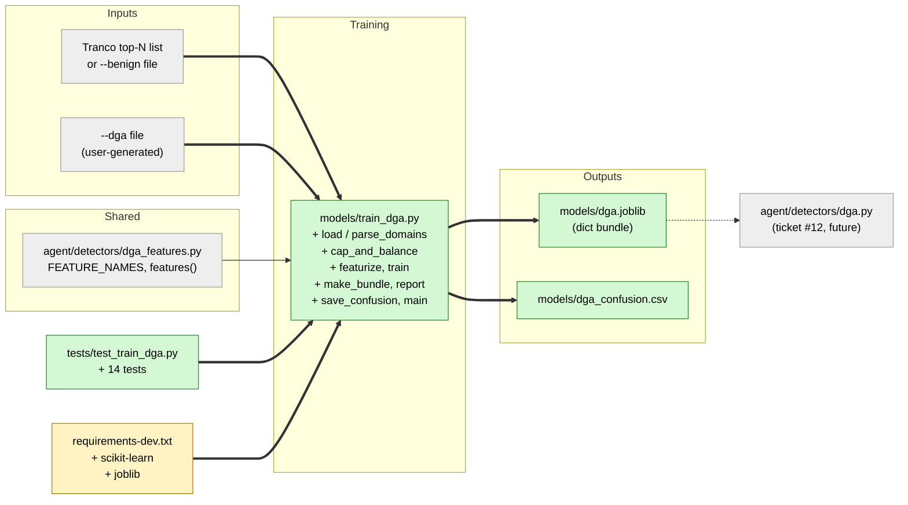

# Study guide: Train the DGA classifier

**Ticket:** #11 · **Date:** 2026-11-07 · **Gate:** APPROVE

## The big picture

Some malware does not carry a fixed list of servers to call home to. Instead it uses a **DGA**
(domain generation algorithm): a recipe that spits out thousands of random-looking domain names
like `xk3jq9vbz2.com`, and the malware tries them until one works. Before this ticket we had a
feature extractor (`dga_features.py`, ticket #10) that turns a domain into numbers (length,
randomness, vowel share and so on), but nothing that learned from those numbers.

Now there is a training script, `models/train_dga.py`. You give it a file of known DGA domains and
a list of normal domains, and it teaches a **random forest** (a crowd of simple yes/no decision
trees that vote) to tell the two apart, then saves the result to `models/dga.joblib`. The live
detector in the next ticket (#12) will load that file. Analogy: it is like showing a new bank
teller a pile of real and forged banknotes until they can spot a fake by feel.

## Map of the changes



**How to read it:** green = new, yellow = edited, grey = already exists or comes later; thick
arrows are connections this ticket added, thin arrows already existed, the dotted arrow is the
future hand-off to the detector.

## File by file

### `models/train_dga.py` - new

**What it's for:** a command-line script that trains the DGA classifier and saves it.
**What changed and why:** the whole file is new; CLAUDE.md §7 says the DGA model comes from a
training script that prints class counts, a classification report, a confusion matrix and the top
features.

**Loading domains (`parse_domains`, `load_domains`, `fetch_tranco`)**

```python
domain = _pick_domain(line).strip().lower().rstrip(".")
if domain and domain not in seen:
```

Each line is cleaned: blanks and `#` comments are skipped, text is lowercased, and duplicates are
dropped. If a line has extra columns like `1,google.com` the part that looks like a domain is used.
DGA domains come only from a file you supply (`--dga`); the GPL-licensed generator code from
baderj is used by you locally and is never copied into this repo. Benign domains come from
`--benign` or, if omitted, are fetched with the `tranco` package (the only network use).

**Balancing (`cap_and_balance`)**

```python
n = min(len(benign), len(dga), cap)
rng = random.Random(random_state)
return rng.sample(list(benign), n), rng.sample(list(dga), n)
```

Both classes are cut to the same size: the smallest of the two list lengths and the cap (100,000).
Example: 100,000 benign and 30,000 DGA gives 30,000 of each. Equal sizes stop the model from
learning "just always say benign". The random sample is seeded, so it picks the same rows every run.

**Features and training (`featurize`, `build_dataset`, `train`)**

```python
rows.append([feats[name] for name in FEATURE_NAMES])
model = RandomForestClassifier(n_estimators=n_estimators, random_state=random_state, n_jobs=1)
```

Every domain becomes a row of numbers in the fixed `FEATURE_NAMES` order. Labels are 0 (benign) and
1 (dga). Data is split 80% train / 20% test (stratified, meaning both classes keep the same
proportion in each part). `random_state=42` and `n_jobs=1` are used everywhere so two runs on the
same data give identical results. No IPs or ports are features (CLAUDE.md §7).

**The saved bundle (`make_bundle`)**

```python
{"model": model, "feature_names": list(FEATURE_NAMES),
 "dga_class_index": list(model.classes_).index(DGA), ...}
```

The file is a dict, not the bare model. `feature_names` tells the detector which order to build its
number-vector in; `dga_class_index` says which column of `predict_proba` is "probability this is
DGA". Storing both avoids a silent mismatch between training and live use.

**Reporting (`report`, `top_features`, `save_confusion`)**

Prints the classification report (precision/recall per class), a confusion matrix (a 2x2 table of
true vs predicted class: how many fakes were caught, how many real domains were wrongly flagged),
and features ranked by importance. The matrix is also written as a CSV for the metrics slide, so
we do not need matplotlib.

**`run` / `main`**

`run` ties it together on in-memory lists; `main` reads the command-line options (`--dga` is
required; `--benign`, `--out`, `--confusion`, `--cap`, `--n-estimators`, `--test-size` are
optional). A small `sys.path` tweak at the top lets you run it as a plain script.

### `requirements-dev.txt` - changed

**What it's for:** the list of packages the dev environment installs.
**What changed and why:** added `scikit-learn` (the random forest and metrics) and `joblib`
(saving the model), both needed by the training script and its tests.

### `tests/test_train_dga.py` - new (test)

**What it's for:** proves the training script works without any network or real data.
**Fake data:** a tiny generated set of 120 "normal-looking" word-like domains and 120 random-letter
domains (seeded), small enough to train in a moment.

- Output model: file loads, bundle has the expected keys, `predict_proba` works on the model inside.
- Confusion matrix: saved as a CSV with the right header and rows.
- Required printout: class counts, classification report, confusion matrix, top features.
- Input parsing: comments, blanks, duplicates and extra columns are handled.
- Cap and balance: lopsided data uses the smaller class; the cap applies; an empty class is
  rejected; the default cap is 100,000.
- Feature order: bundle `feature_names` match `dga_features`, and rows follow that order.
- Reproducibility: two runs give identical predictions; `random_state` is 42.

## How you know it works

- The 14 new tests cover each requirement in the ticket (see groups above) using synthetic data.
- Verifier: PASS with no blocking findings.
- Test gate: APPROVE. 275 tests passed (261 before + 14 new), ruff clean, no regressions.

## Try it yourself

1. Make a text file of DGA domains (one per line) using baderj's generators on your machine.
2. Train: `.venv\Scripts\python models\train_dga.py --dga data\dga_domains.txt`
   (add `--benign tranco.txt` to skip the download).
3. Check `models/dga.joblib` and `models/dga_confusion.csv` appeared.
4. Run just these tests: `.venv\Scripts\python -m pytest -q tests/test_train_dga.py`
   (full check from CLAUDE.md: `.venv\Scripts\python -m pytest -q` and `.venv\Scripts\ruff check .`).

## Open questions / risks

- `fetch_tranco` (the network download) is untested; it is marked `# pragma: no cover`.
- There is no trained `models/dga.joblib` yet. It needs a DGA domain file that a person generates
  locally, so the model must be trained before the detector can be tried for real.
- Ticket #12 must read the dict bundle (`bundle["model"].predict_proba(...)[0][bundle["dga_class_index"]]`),
  not call `predict_proba` on the loaded object directly, or it will fail.
- Real-world accuracy depends on which DGA families are in the user's file; the tests only prove
  the pipeline works, not how good the model is.
