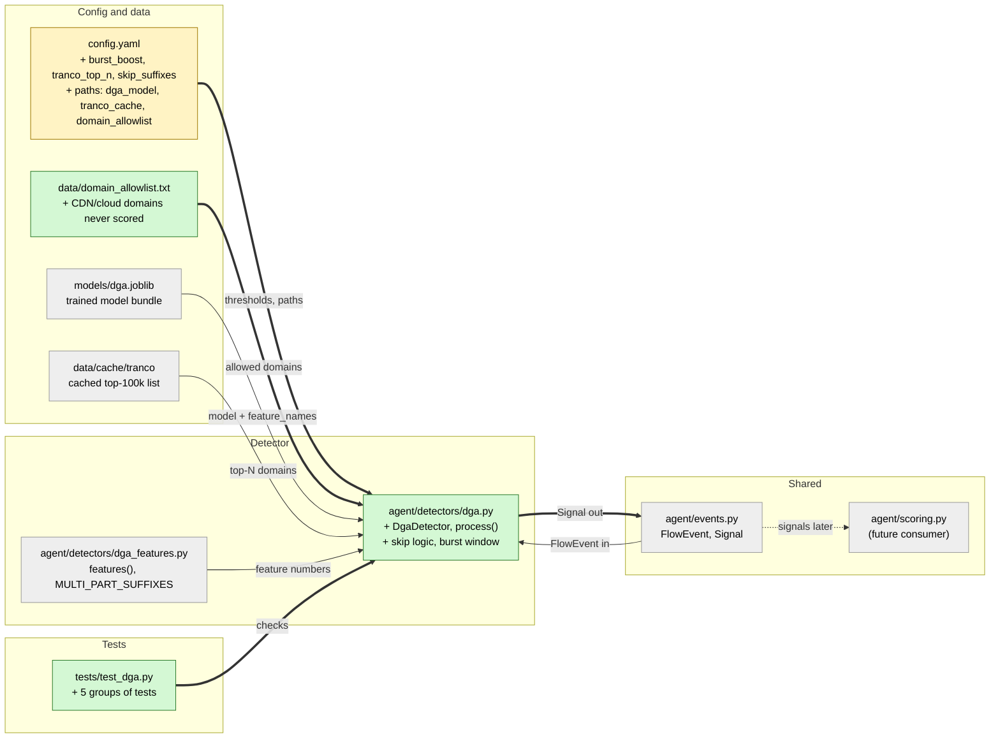

# Study guide: Flag DGA lookups live

**Ticket:** #12 · **Date:** 2026-11-07 · **Gate:** APPROVE

## The big picture

Before this ticket, HomeSOC could train a "DGA classifier" (`models/train_dga.py` makes
`dga.joblib`) but nothing used it while the PC was running. A DGA (domain generation algorithm)
is a trick malware uses: it invents thousands of random-looking website names like
`xkqzjvwpthrb.com` and tries them until one reaches its boss server. Real sites rarely look like that.

Now `agent/detectors/dga.py` watches each DNS lookup (the "what is the address of this name?"
question a computer asks before visiting a site). It skips names that are obviously fine, asks the
trained model about the rest, and raises a `Signal` when the model is at least 80% sure the name is
machine-made. If one program makes five or more such lookups within a minute, the score is nudged up.

Analogy: a mailroom clerk who waves through letters from known senders (the skip lists), looks
closely at letters with scrambled return addresses (the model), and gets more suspicious when one
person sends five of them in a minute (the burst boost).

## Map of the changes



**How to read it:** green = new file, yellow = edited file, grey = existing and unchanged; thick
arrows are connections added by this ticket.

## File by file

### `config.yaml` - changed

**What it's for:** every tunable number and file path lives here (no magic numbers in code).
**What changed and why:** the detector needs a burst boost, a Tranco list size, suffixes to ignore,
and three file paths.

```yaml
burst_boost: 0.1
tranco_top_n: 100000
skip_suffixes: [".local", ".arpa"]
...
dga_model: models/dga.joblib
tranco_cache: data/cache/tranco
domain_allowlist: data/domain_allowlist.txt
```

The existing `probability_threshold: 0.8`, `burst_count: 5` and `burst_window_s: 60` were already
there; the detector now reads them. `burst_boost` is the amount added to the score during a burst.

### `data/domain_allowlist.txt` - new

**What it's for:** domains the DGA detector never scores, for example CDNs (content delivery
networks) that really do use random-looking hostnames such as `d1a2b3.cloudfront.net`.
**What changed and why:** it is a separate file because the existing `data/allowlist.txt` lists
program names (like `chrome.exe`), not domains. One domain per line, `#` starts a comment, and
subdomains are covered too.

### `agent/detectors/dga.py` - new

**What it's for:** turns a DNS `FlowEvent` into a DGA `Signal` (or nothing).
**What changed and why:** this is the ticket's main work, built from small pieces.

**Loading (`DgaDetector.__init__`)** reads config, loads the model, the Tranco cache and the
allowlist. Missing pieces are logged as warnings and the detector keeps going instead of crashing
the agent. With no model it simply returns no signals. Tranco is only read from disk, never
downloaded.

**Matching helpers (`registered_domain`, `candidate_domains`)**

```python
# news.bbc.co.uk -> ["news.bbc.co.uk", "bbc.co.uk"]
def candidate_domains(host): ...   # (shortened)
```

A name is "known good" if it, or any parent down to the registered domain, is on a skip list. So
`www.google.com` matches `google.com`. It stops at the registered domain so that `co.uk` alone
never whitelists every British site; the two-part-ending list (`MULTI_PART_SUFFIXES`) is reused from
`dga_features.py` so training and live code agree.

**Skipping (`_should_skip`)** drops IP-address "hostnames", anything ending in `.local` or `.arpa`,
and anything on the Tranco or allowlist. This all happens before the model is called, which keeps it
fast and cuts false alarms.

**Scoring (`_predict`)**

```python
vector = [feats[name] for name in self._feature_names]
return float(self._model.predict_proba([vector])[0][self._dga_index])
```

The model was saved together with the list of feature names in the order it learned them. Building
the live numbers in that exact order guarantees they match training. `predict_proba` returns the
chance (0 to 1) that the name is DGA.

**Burst boost (`_record`, inside `process`)** Each process keeps a queue of timestamps of its
above-threshold lookups. Old ones (older than 60 s) are dropped from the front.
Worked example: a process looks up random names at 0 s, 10 s, 20 s, 30 s, 40 s. At the 5th lookup
the count reaches 5, so a 0.85 probability becomes `min(1.0, 0.85 + 0.1) = 0.95`, and a second
reason line says it made 5 random-looking lookups. Time comes from the flow's own `ts_ms`, not the
clock, so tests are repeatable.

**Entry points** `DgaDetector.process(event)` and a module-level `process(event)` that lazily makes
one shared detector, matching the "each detector exposes `process`" rule in `CLAUDE.md`. The Signal
carries `mitre="T1568.002"` (the standard label for this technique).

### `tests/test_dga.py` - new (test)

The tests use a stub model that returns a fixed probability and records every vector it was given,
so they can check both the signal and whether the model was called at all. Tranco and allowlist
files are small temporary files. No real model or network is needed.

- Random DNS lookup gives a Signal (also DNS detected by `app_proto` on another port; low
  probability gives nothing).
- Non-DNS flows give nothing.
- Skipped names (Tranco, `.local`, `.arpa`, allowlist, parents of a known domain) never reach the
  model; missing Tranco, allowlist or model is tolerated with a log; Tranco size limit; cache
  directory; a bare model without the bundle also works.
- Burst: 5th lookup in the window scores higher, spread-out lookups do not, bursts are per process,
  score capped at 1.0, below-threshold lookups do not count.
- Threshold is read from `config.yaml`.
- Helper test for `candidate_domains`.

## How you know it works

- Each ticket requirement (signal, non-DNS ignored, skipping before the model, burst boost,
  config-driven threshold) has its own test group.
- The "skipped names do not call the model" test checks the stub's call record, so it proves the
  model really is bypassed.
- Verifier: PASS.
- Test gate: APPROVE, 302 tests passed (baseline 275), ruff clean, no blocking items.

## Try it yourself

1. Run just these tests: `.venv\Scripts\python -m pytest -q tests/test_dga.py`
2. Run the whole suite: `.venv\Scripts\python -m pytest -q`
3. Lint: `.venv\Scripts\ruff check .`
4. Optional: open `config.yaml`, change `probability_threshold` and watch
   `test_threshold_is_read_from_config_file` show why the value is not hard-coded.

## Open questions / risks

- The demo VM needs the Tranco cache filled in (run `models/train_dga.py` without `--benign`);
  without it there are more false alarms on popular sites, though a warning is logged.
- Which domains go in `data/domain_allowlist.txt` was the developer's choice and deserves a review.
- Repeated lookups of the same name count toward the burst (a program asking for one odd name five
  times looks like a burst).
- Verifier minor findings: the per-process burst dictionary never removes old processes (a small
  memory growth over a long run), and old timestamps are only trimmed from the front, which assumes
  flows arrive roughly in time order. The final count uses absolute differences, so the answer is
  still correct.
