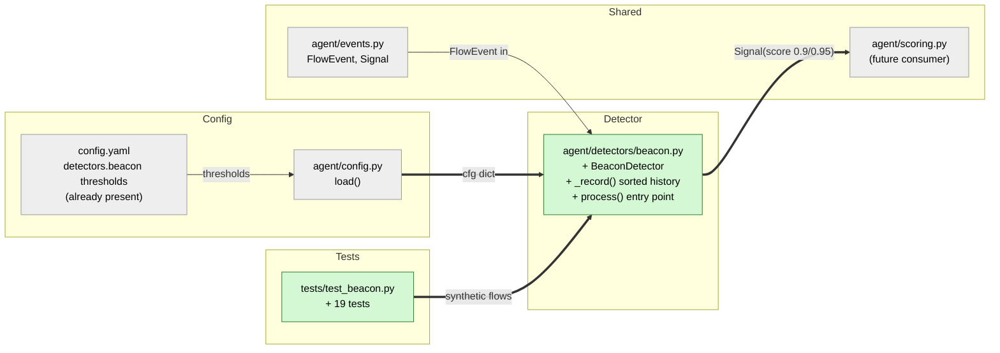

# Study guide: Spot C2 beaconing

**Ticket:** #13 · **Date:** 2026-11-07 · **Gate:** APPROVE

## The big picture

Before this ticket, HomeSOC could spot known-bad IPs (intel) and random-looking domain names (DGA),
but nothing noticed malware that simply "phones home" on a timer. Many infected programs contact
their boss server (the "C2", command and control) every few seconds or minutes, like clockwork.
Real apps rarely do that: humans and normal software connect at uneven times.

Now `agent/detectors/beacon.py` remembers when each program opened connections to each destination.
Once it has seen six of them, it checks how evenly spaced they are. If they are very regular, it
raises a `Signal` saying "this app checks in with this IP every 5.0 s".

Analogy: a neighbour who rings your doorbell at exactly 3:00, 3:05, 3:10, 3:15... A friend would
turn up at random times; the clockwork pattern is what makes it suspicious.

## Map of the changes



**How to read it:** green = new file, grey = existing file it plugs into; thick arrows are
connections added by this ticket, thin ones already existed.

## File by file

### `agent/detectors/beacon.py` - new

**What it's for:** decide whether a program is connecting to the same place at suspiciously even
intervals.
**What changed and why:** the ticket asks for a beacon detector (CLAUDE.md section 6.3). Every
threshold is read from `config.yaml`, so nothing is hard-coded.

**Keeping the history (`_record`)**

```python
starts = self._starts.setdefault(key, [])
index = bisect.bisect_left(starts, ts_ms)
if index == len(starts) or starts[index] != ts_ms:
    starts.insert(index, ts_ms)
    if len(starts) > self._history:
        del starts[: len(starts) - self._history]
```

For each key `(process, dst_ip, dst_port)` it keeps a list of flow start times. `bisect` finds where
the new time belongs so the list stays sorted, even if events arrive out of order. An exact
duplicate time is ignored, because it would create a fake 0-second gap. Only the newest 20 are kept.

**Checking the rhythm (`process`)**

```python
intervals_s = [(b - a) / MS_PER_S for a, b in zip(starts, starts[1:], strict=False)]
mean_s = statistics.fmean(intervals_s)
if not self._mean_min_s <= mean_s <= self._mean_max_s:
    return []
spread_s = statistics.pstdev(intervals_s)
if spread_s / mean_s >= self._cv_max:
    return []
```

It turns start times into gaps between neighbours, then takes the average gap (mean). The mean must
be between 2 and 600 seconds. The "coefficient of variation" (CV) is the spread divided by the
mean, a measure of how uneven the gaps are relative to their size; below 0.1 counts as regular.
Spread is the population standard deviation (the usual "typical wobble" formula, dividing by the
number of gaps).

Worked example: gaps of 4.8, 5.2, 4.8, 5.2, 4.8 s have mean 4.96 and spread 0.196. CV = 0.196 / 4.96
= 0.04, under 0.1, so it is a beacon. The reason prints as
`checks in with 192.168.56.20 every 5.0 s (±0.2 s)`.

**Score and scope.** The score is 0.9, or 0.95 once 12 or more starts are held. Only `outbound`
flows count: on an inbound flow `dst_ip` is the PC itself, so it would be meaningless. Once a
connection is beaconing, a signal is emitted on every further flow; scoring is expected to dedupe per
detector.

**Module-level `process()`** creates one shared `BeaconDetector` the first time it is called (lazy),
the same pattern as `dga.py`, so the rest of the agent can just call `beacon.process(event)`.

### `tests/test_beacon.py` - new (test)

**What it's for:** prove the detector fires on regular check-ins and stays quiet otherwise.
**What changed and why:** every detector must have unit tests with synthetic flows (CLAUDE.md
section 10).

Fake data: `FlowEvent`s from `freegamecheats.exe` to `192.168.56.20:8080`, with start times built by
`jittered_starts` (every N seconds plus a small seeded random wobble, so runs are repeatable).

- Spec behaviour: 5 s check-ins fire on the 6th flow at 0.9; 0.95 from the 12th; reason text matches the format.
- Negatives: random gaps, and regular gaps outside 2 to 600 s, do not fire; exactly 2 s and 600 s do.
- Separation: different ports, IPs, or processes are tracked independently.
- Edge cases: duplicates ignored, out-of-order starts sorted, history capped, inbound ignored, signal timestamp.
- Config and wiring: thresholds are read from config (changed values change behaviour); the module-level `process()` works.

## How you know it works

- The tests cover both sides of each threshold (fires at exactly 2 s and 600 s, not at 1.9 s or 601 s).
- Random-gap traffic produces no signals, which guards against false alarms.
- Config-driven thresholds are proven by changing them in a test and seeing the result change.
- Gate: APPROVE, 321 tests passed (302 before plus 19 new), ruff clean, no regressions.
- Verifier: PASS with no defects.

## Try it yourself

1. Open a terminal in the repo.
2. Run only these tests: `.venv\Scripts\python -m pytest tests/test_beacon.py -q`
3. Run the whole suite and lint: `.venv\Scripts\python -m pytest -q` then `.venv\Scripts\ruff check .`
4. Optional: in a test, change `cv_max` in the config dict and watch the same data stop firing.

## Open questions / risks

- Idle keys are never evicted, so a long-running agent slowly accumulates one small list per
  `(process, dst_ip, dst_port)` it has ever seen. Minor, but worth a cleanup later.
- The spec does not define "spread" or whether to look at direction; this ticket chose population
  standard deviation and outbound-only. Worth confirming with the team.
- A signal is re-emitted on every flow once beaconing starts; this relies on `scoring.py` (not yet
  built) deduping per detector.
