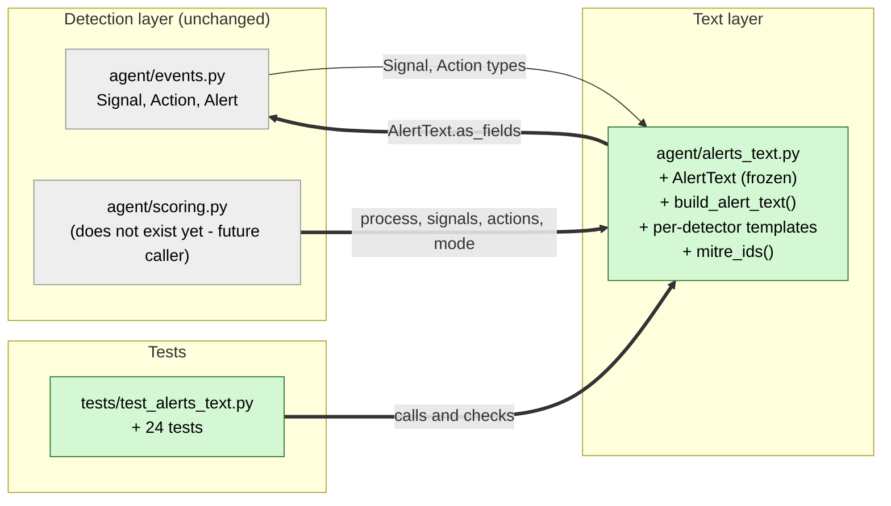

# Study guide: Plain-English alert templates

**Ticket:** #14 · **Date:** 2026-11-07 · **Gate:** APPROVE

## The big picture

Before this change, HomeSOC could detect bad behavior (signals) and contain it (actions), but
nothing turned those into words. An `Alert` has four text fields (`title`, `what_happened`,
`what_we_did`, `what_you_should_do`) and nobody filled them in. Now `agent/alerts_text.py` takes
a process name, its signals and the actions taken, and writes all four fields in everyday
language for a home user. It also lists the MITRE ATT&CK IDs (public codes for attack
techniques, like `T1071.001`) so a more technical reader can look them up.

Think of a hospital discharge sheet: the doctor's chart is full of jargon, and the sheet
rewrites it as "here is what was wrong, here is what we did, here is what you should do next".

## Map of the changes



**How to read it:** green = new file, grey = existing or not-yet-written, thick arrows = links
added by this ticket (the `scoring.py` arrow is the planned future link).

## File by file

### `agent/alerts_text.py` - new

**What it's for:** writes the plain-English text of an alert.
**What changed and why:** the file is new; CLAUDE.md section 6.4 says scoring must "build the
text with `alerts_text.py`".

**`AlertText` and `as_fields()`**

```python
@dataclass(frozen=True)
class AlertText:
    title: str
    what_happened: str
    what_we_did: str
    what_you_should_do: str
    mitre: list[str] = field(default_factory=list)
```

A small result object. "Frozen" means it can't be changed after it is made. `as_fields()`
returns just the four text fields as a dictionary, so a caller can write
`Alert(..., **text.as_fields())` (`**` spreads a dictionary into named arguments). `mitre` is
kept out of that dictionary because `Alert` has no MITRE field.

**Per-detector templates (`what_happened`)**

```python
HAPPENED = {"intel": _happened_intel, "dga": _happened_dga, "beacon": ..., "anomaly": ...,
            "flow_model": ...}   # (shortened)
```

Each detector gets one short sentence in plain words, for example the beacon one says the app
"keeps checking in with X on a regular timer, the way malware phones home". Signals are first
grouped by detector, so two beacon signals produce one sentence, not two. A detector with no
template (a future one) falls back to `_happened_generic` and logs a warning instead of
crashing. The flow_model sentence looks at the MITRE ID to name the attack: `T1046` is a port
scan, `T1110` a brute-force password attack, `T1498` a denial-of-service flood.

**Title**

One detector gives a specific title ("freegamecheats.exe is secretly checking in with a remote
server"). Several detectors give the blunt `"<process> is acting like malware"`. No signals
gives a neutral "Suspicious activity from ...".

**MITRE IDs and the Details line**

```python
def mitre_ids(signals):
    return list(dict.fromkeys(s.mitre for s in signals if s.mitre))
```

`dict.fromkeys` is a trick to remove duplicates while keeping the first-seen order. The IDs
are added to the end of `what_happened` as `(MITRE ATT&CK: T1568.002, T1071.001)` and also
returned in `AlertText.mitre`. A `Details:` line repeats each signal's reason strings.

**`what_we_did`**

Each action becomes a sentence: block an IP, quarantine an app, stop a process, or remove an
earlier block. If something was contained and not undone, the text adds "You can undo this at
any time from the Alerts screen." An action marked `undone` is reported as "later undone".

When there are no actions, the reason nothing was blocked is chosen in a fixed order, first
match wins:

1. the app is on the allowlist (trusted apps are never blocked automatically),
2. mode is `notify`,
3. mode is `off`,
4. otherwise a generic "we were not sure enough" message.

**`what_you_should_do`**

Advice depends on what happened: after a quarantine, "uninstall it or scan with Defender, or
undo if you trust it"; for an allowlisted app, "this may be a false alarm"; for anomaly (big
upload), "change your important passwords"; for inbound attacks, "check your home network
devices". If none match, a "keep an eye on this app" default is used.

**`build_alert_text(...)`**

```python
def build_alert_text(process, signals, actions=(), *, mode="notify", allowlisted=False) -> AlertText
```

The only function callers need. The `*` means `mode` and `allowlisted` must be passed by
name, which avoids mixing them up. It never raises on unknown input.

### `tests/test_alerts_text.py` - new (test)

**What it's for:** proves the text is right for every case.
**Fake data:** hand-made `Signal`s for the fake malware `freegamecheats.exe` (a DGA lookup of
`xkqzjwpvtr.com`, a beacon to `192.168.56.20`) and a quarantine `Action`. No network or
Windows needed.

- DGA plus beacon: the process name, both behaviors in plain words, and the multi-detector title.
- `what_we_did`: quarantine text, nothing-blocked text, and one reason per mode (notify, off,
  allowlisted); every action kind; the "later undone" case.
- Every detector has a template, each flow_model attack kind is named, and unknown detectors
  or action kinds use the generic text with a logged warning.
- MITRE IDs all appear, are deduplicated, and keep their order.
- `as_fields()` can fill a real `Alert`; an empty signal list still gives text.

## How you know it works

- 24 new tests cover each acceptance criterion: DGA plus beacon text, `what_we_did`, a
  template per detector with a fallback, and MITRE IDs.
- Edge cases are checked: no signals, no actions, undone actions, unknown detector and action.
- The test gate returned APPROVE: 399 tests passed, ruff (the linter) was clean, no regressions.
- The verifier was skipped because the ticket is size S.

## Try it yourself

1. Open a terminal in the repo root.
2. Run only these tests: `.venv\Scripts\python -m pytest tests/test_alerts_text.py -q`
3. Run the linter: `.venv\Scripts\ruff check .`
4. In a Python shell, call `build_alert_text("x.exe", [], mode="off").what_we_did` and read it.

## Open questions / risks

- The `Details:` line passes detector reason strings through word for word, so it can contain
  technical wording (for example "DGA model 0.93") in an otherwise plain-English alert.
- `agent/scoring.py` doesn't exist yet and will be the caller, so the real argument shapes
  (especially `mode` and `allowlisted`) are untested against it.
