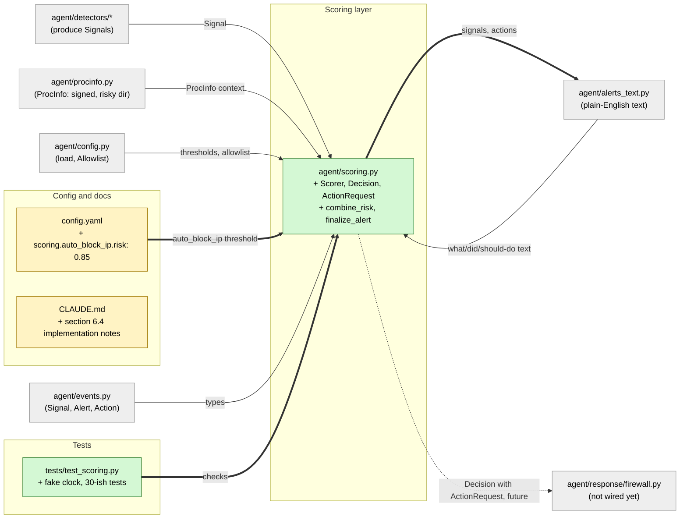

# Study guide: Combine signals into a risk score and decide how to respond

**Ticket:** #15 · **Date:** 2026-11-07 · **Gate:** APPROVE

## The big picture

Before this ticket, each detector (intel, DGA, beacon, ...) produced its own `Signal` with a score from 0 to 1, but nothing looked at them together. A single weak hint and a pile of strong hints looked the same, and nothing decided "this deserves an alert" or "this deserves a firewall block".

Now `agent/scoring.py` collects signals for each program (process) over the last 60 seconds, merges them into one **risk** number, and returns a **Decision**: the risk, an optional Alert, and an optional request to contain the threat. Scoring never touches the firewall itself. It only asks; a later piece of the pipeline does the work.

Analogy: a security guard who doesn't act on one odd noise, but when three different alarms (door, window, motion sensor) go off within a minute for the same room, writes an incident report and, if the building is in "auto" mode, asks for the room to be locked.

## Map of the changes



**How to read it:** green = new file, yellow = edited file, grey = existing file this plugs into; thick arrows are connections added by this ticket, thin arrows already existed, and the dotted arrow is a connection that does not exist yet (no pipeline calls the Scorer so far).

## File by file

### `config.yaml` - changed

**What it's for:** holds every threshold so no magic numbers live in the code.
**What changed and why:** one new key so inbound attacks (port scans, brute force) have their own "block this IP" threshold.

```yaml
  auto_block_ip:
    risk: 0.85   # auto mode: inbound flow_model risk >= this -> block the source IP
```

The existing keys (`window_s`, `context_boost`, `alert_threshold`, `severity`, `auto_quarantine`) were already there; the Scorer reads them all.

### `agent/scoring.py` - new

**What it's for:** turn many detector Signals into one risk number and a response decision.
**What changed and why:** this is the whole feature from ticket #15 (CLAUDE.md section 6.4). It is a "pure" module: no firewall, no disk, no real clock required, so it can be tested on any OS.

**Risk formula (`combine_risk`, `best_per_detector`)**

```python
best[det] = max(best.get(det, 0.0), _clamp(sig.score))
...
risk = 1.0 - math.prod(1.0 - s for s in scores)
return min(MAX_RISK, risk * boost)
```

Each detector counts once, using its highest score in the window (so a noisy beacon detector firing 20 times doesn't count 20 times). Then the formula `1 - (1-a)(1-b)...` gives "chance at least one detector is right". Worked example: DGA 0.6 and beacon 0.5 give `1 - 0.4 x 0.5 = 0.8`. If the exe is unsigned, 0.8 x 1.2 = 0.96, capped at 1.0 if it would go over.

**Context boost (`has_risky_context`)**

```python
return proc.signed is False or proc.in_risky_dir is True
```

Only a *known* unsigned exe, or one in Downloads/Temp, gets the x1.2 boost. `None` means "we couldn't find out", and unknown is not treated as suspicious (same rule as `procinfo`).

**Severity (`severity_for`, `_at_least`)**

Risk of 0.5 or more is medium, 0.75 high, 0.9 critical. Comparisons use a tiny slack (`1e-9`) because decimal maths on computers is slightly off: `1 - 0.1` might come out as 0.8999999999 and wrongly miss "critical".

**The sliding window (`Scorer.add`, `_expire`, `prune`)**

```python
now = self._clock()
...
window.entries.append((now, signal))
```

Each process has a list of `(time added, signal)`. Entries older than 60 seconds are dropped. The time is the clock at the moment the signal arrives, not `Signal.ts_ms`, because a flow's start time can be up to 30 seconds old by the time NFStream reports it. The clock is passed in (`clock=`), so tests can move time forward instantly. `prune()` clears empty windows to save memory.

**Policy (`_decide`, `_action_request`)**

- Below 0.5: no alert, nothing else.
- 0.5 or more: an Alert in **every** mode (`off`, `notify`, `auto`). Only `auto` can act.
- In `auto`: request `quarantine_app` if there is an intel hit, or risk >= 0.85 with at least 2 distinct detectors. One strong detector alone only alerts.
- Safety (CLAUDE.md section 9.6, "in doubt, alert"): never quarantine an allowlisted app (Chrome, Steam, ...) or one whose exe path is unknown.

**Inbound attackers**

```python
key = f"{INBOUND_KEY_PREFIX}{signal.target}" if inbound else signal.process
```

`flow_model` signals are about a remote attacker, so they are grouped by the attacker's IP, not by a local app. They get no boost. In `auto` with risk >= `auto_block_ip.risk`, scoring requests `block_ip` on that IP, but never for loopback (`127.x`) or unspecified (`0.0.0.0`) addresses (`_is_blockable_ip`).

**Repeat suppression (`_should_alert`)**

Without this, every new flow would produce another alert. Within one "episode" (until all of a key's signals expire) a new alert appears only if the severity rises, a new detector joins, or a new action is requested. The same `(kind, target)` action is requested at most once per episode.

**`Decision`, `ActionRequest`, `finalize_alert`**

`add()` returns a `Decision` (risk, detectors, mode, alert, action). The alert's text is first written assuming the action will succeed. After the pipeline runs the firewall, it calls `finalize_alert(decision, actions)`, which attaches the real action ids and rewrites the text with what really happened (pass an empty list if the call failed, so the text doesn't claim something was blocked).

### `CLAUDE.md` - changed

**What it's for:** project memory and the spec.
**What changed and why:** section 6.4 got notes recording these decisions (alerts in every mode, unknown exe path means alert only, inbound handling, repeat suppression, `finalize_alert`), as the project rules require when a spec changes.

### `tests/test_scoring.py` - new (test)

**Fake data:** a `FakeClock` that you advance by hand, a config copied from `config.yaml`, and small `sig(...)` helpers that build Signals for a made-up process, with fake `ProcInfo` objects (signed, unsigned, risky folder, unknown).

Test groups, by what they prove:
- **Risk maths:** two detectors combine to 0.8; the same detector twice counts once (highest score).
- **Context boost:** unsigned or risky dir boosts x1.2, capped at 1.0; signed or unknown gets none.
- **Severity:** boundaries at 0.5/0.75/0.9, including float error; below 0.5 makes no alert.
- **Auto policy:** intel hit quarantines; one strong detector alerts only; two detectors at high risk quarantine; `notify` and `off` never act.
- **Safety:** allowlisted app and unknown exe path with an intel hit alert only.
- **Inbound:** flow_model blocks the source IP; loopback is never blocked.
- **Window and repeats:** the same action is requested once; a new detector gives a new alert; signals older than 60 s drop out; an expired window allows a fresh action; `prune` drops empty windows.
- **Finalize and config:** `finalize_alert` attaches action ids; an invalid mode is rejected; thresholds come from config, not constants.

## How you know it works

- The new tests cover each rule above with a fake clock, so timing is exact and nothing sleeps.
- The independent verifier returned **PASS** against the ticket.
- The test gate returned **APPROVE**: 448 tests pass (413 before this ticket), and `ruff` is clean.
- No existing tests changed or broke.

## Try it yourself

1. Run just these tests (Windows): `.venv\Scripts\python -m pytest tests/test_scoring.py -q`
2. Run the linter: `.venv\Scripts\ruff check .`
3. In `tests/test_scoring.py`, change a score in `test_two_detectors_combine_to_0_8` and watch the expected number change.
4. In `config.yaml`, lower `auto_quarantine.risk` and re-run to see `test_thresholds_come_from_config` style behavior (the policy follows the config).

## Open questions / risks

- Should `off` mode stay silent? Right now alerts are raised in every mode, including `off`.
- Should the exe allowlist also apply to inbound `block_ip`? Currently it does not, since no app is touched.
- There is no LAN or gateway guard on `block_ip`: a flow_model signal from your router's address could ask to block it.
- Windows are keyed by process *name*, not PID, so two copies of the same program share one window.
- Verifier note: if a firewall call fails, the same action is not requested again until the window episode ends.
- Verifier note: `risk_of()` ignores inbound keys (cosmetic).
- Nothing in the pipeline calls `Scorer` yet, so this is untested end to end; the dotted arrow in the map is future work.
