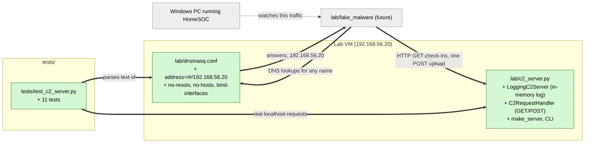

# Study guide: The lab C2 server and lab DNS config

**Ticket:** #16 · **Date:** 2026-11-07 · **Gate:** APPROVE

## The big picture

Before this ticket, HomeSOC had detectors (beaconing, DGA domains) but nothing to aim them at. The demo plan has a harmless "fake malware" program that looks up odd domain names and checks in every 5 seconds. Those requests need somewhere to land, and we need a way to show the check-ins *stop* once HomeSOC quarantines the app.

This ticket builds that "somewhere": a tiny web server (`lab/c2_server.py`) that only writes down who knocked and when, plus a DNS config (`lab/dnsmasq.conf`) that makes every domain name inside the lab point at that server. "C2" means command-and-control, the server real malware phones home to. Ours never sends orders back. It is a guest book at the door: it records visitors and hands out no instructions. Both pieces live only on the isolated lab network (192.168.56.0/24).

## Map of the changes



**How to read it:** green = new file, grey = existing or future piece it plugs into; thick arrows are connections this ticket adds, the dotted one already existed in spirit (HomeSOC watching the PC's traffic).

## File by file

### `lab/dnsmasq.conf` - new

**What it's for:** Makes the sealed lab's DNS server answer every question with the C2's address.
**What changed and why:** The fake malware makes up random-looking domains (to trigger the DGA detector). Those names don't exist anywhere, so the lab DNS must answer them itself, and must never ask the real internet.

**The wildcard line**

```
address=/#/192.168.56.20
```

In dnsmasq, `/#/` means "every domain name". So `xk3jq9zv.com`, `google.com`, anything: the answer is `192.168.56.20`. That is how the simulator's made-up lookups end up connecting to our C2.

**The "stay sealed" lines (shortened)**

```
listen-address=192.168.56.20
bind-interfaces
no-resolv
no-hosts
```

`listen-address` + `bind-interfaces` make dnsmasq answer only on the lab address. `no-resolv` stops it reading the system's upstream DNS list, so it cannot forward questions out. `no-hosts` stops it using the VM's local hosts file. Together they keep the lab airtight, matching the safety rules in CLAUDE.md §9.

### `lab/c2_server.py` - new

**What it's for:** A passive HTTP server that logs check-ins and uploads, and nothing more.
**What changed and why:** Gives the demo a visible target. When the app is quarantined, new log lines simply stop appearing.

**`LogEntry` and `LoggingC2Server`**

```python
@dataclass(frozen=True)
class LogEntry:
    kind: Literal["GET", "POST"]
    client_ip: str
    ts: float
    byte_count: int = 0
```

A `LogEntry` is one line of the guest book: what kind of request, who sent it, when, and (for uploads) how many bytes. `LoggingC2Server` extends Python's built-in `ThreadingHTTPServer` (so several requests can be handled at once) and adds a plain list, `self.log`. The list lives in memory only, so tests and a future demo view can read it without any file being written.

**`do_GET`: the check-in**

```python
entry = LogEntry(kind="GET", client_ip=self._client_ip(), ts=time.time())
self.server.record(entry)
self._reply(b"ok\n")
```

Note: methods named `do_GET` / `do_POST` are the names Python's handler class looks for automatically. A GET records the time and the client's IP, then answers with a tiny "ok". No commands or payloads are returned.

**`do_POST` and `_drain_body`: the upload that is thrown away**

```python
chunk = self.rfile.read(min(READ_CHUNK, remaining))
received += len(chunk)
remaining -= len(chunk)
del chunk  # read-and-discard
```

The simulator uploads about 20 MB once. The server must read the body (or the connection would stall), but it only counts the bytes and drops each 1 MiB piece straight away, so nothing is kept or saved. Two guards: a missing or bad `Content-Length` counts as zero, and reading stops at `MAX_UPLOAD_BYTES` (64 MiB) so a client can't make the server work forever.

**`make_server`, `_parse_args`, `main`**

`make_server(host, port)` builds the server without starting it, which is what lets tests use `127.0.0.1` and port `0` (the OS picks a free port). The command line takes `--host` (default `192.168.56.20`) and `--port` (default `8080`). The default is the documented lab address, never `0.0.0.0` ("listen on every network"), so the server can't accidentally face a real network.

### `tests/test_c2_server.py` - new (test)

**What it's for:** Proves the server and DNS config behave as described and stay safe.
**What changed and why:** The ticket's acceptance criteria are tested for real, on any OS, with no lab VM.

**Fake data:** a fixture starts the real server on `127.0.0.1` in a background thread and the tests send real HTTP requests to it using Python's `http.client`. Nothing leaves the local machine.

Tests by acceptance criterion (11 total):
- **GET is logged with time and client IP** (2 tests): one request is recorded with `127.0.0.1` and a timestamp; three requests give three entries.
- **POST logs the byte count and stores nothing** (3 tests): a 1234-byte upload logs exactly 1234; an upload leaves the temp folder unchanged; a source-text check confirms the module never calls `open(`, `write_text` or `write_bytes`.
- **Bind address comes from the CLI, not a public default** (4 tests): `--host/--port` are parsed; default is `192.168.56.20`; `make_server` binds exactly what it is given; the source has no `0.0.0.0`.
- **DNS config is correct** (2 tests): `address=/#/192.168.56.20` appears as a real (non-comment) line, and `no-resolv` is present.

## How you know it works

- The GET and POST tests use real sockets, so they exercise the actual handler code, not a mock.
- The byte-count test shows an upload is counted correctly even though it is discarded.
- The static source guards back up the "no files, no public bind" promises.
- The DNS tests read the config text, so a deleted wildcard or `no-resolv` line fails the build.
- Gate verdict: APPROVE with no blocking items. The ticket was size S, so the separate verifier was skipped.

## Try it yourself

1. Run only these tests: `.venv\Scripts\python -m pytest tests/test_c2_server.py -q` (on macOS/Linux `.venv/bin/python -m pytest tests/test_c2_server.py -q`).
2. Run the whole suite and linter from the CLAUDE.md Checks table: `.venv\Scripts\python -m pytest -q` and `.venv\Scripts\ruff check .`.
3. Optional, by hand: `python lab/c2_server.py --host 127.0.0.1 --port 8080`, then open `http://127.0.0.1:8080/` in a browser and watch a log line appear.

## Open questions / risks

- Non-blocking gate note: `test_post_upload_writes_no_files` checks `tmp_path`, which the server never touches, so it is weaker than it looks. Making it `chdir` into `tmp_path` before the upload would tighten it. The "stores no files" claim is still covered by the static source check and code review.
- The log is in memory only, so it is lost when the server stops. That is intentional for safety, but the demo must watch the console output live.
- `dnsmasq.conf` is only checked by reading its text. Nothing here starts dnsmasq, so a real run on the lab VM is still a manual step.
- `do_GET` and `do_POST` import `time` inside the function; this looks like a style choice and is harmless, but the reason is not stated in the code.
