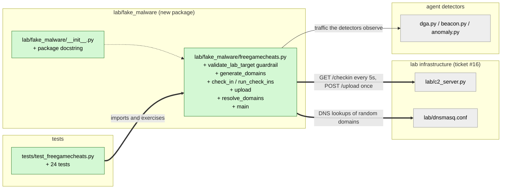

# Study guide: The harmless FreeGameCheats lab simulator

**Ticket:** #17 · **Date:** 2026-11-07 · **Gate:** APPROVE

## The big picture

Before this change, HomeSOC had detectors (DGA, beacon, anomaly) but nothing to point them at during the demo. The lab C2 server and DNS config from ticket #16 were waiting for a visitor. Now there is `freegamecheats.py`, a small program that pretends to be "malware" so the detectors have something to catch.

It is **not** real malware. It does only three things: it looks up made-up random-looking domain names, it sends a tiny web request ("check-in") to the lab server every 5 seconds, and it uploads about 20 MB of random junk once. It also refuses to run unless two safety conditions hold (see "guardrail" below).

Think of a fire drill. The smoke is fake and the building is empty, but it lets you check that the alarms really go off. Here the alarms are the HomeSOC detectors.

## Map of the changes



**How to read it:** green = new file, grey = existing and untouched; thick arrows are connections added by this ticket, thin arrows are existing flows (the detectors watching traffic).

## File by file

### `lab/fake_malware/__init__.py` - new

**What it's for:** it marks the folder as a Python package so `python -m lab.fake_malware.freegamecheats` works.
**What changed and why:** it contains only a docstring (a description in quotes) stating that nothing here is real malware. It makes the safety intent obvious to anyone browsing the folder.

### `lab/fake_malware/freegamecheats.py` - new

**What it's for:** the harmless demo "malware" described in CLAUDE.md section 9.1.
**What changed and why:** the whole file is new. The demo needs traffic with the three telltale shapes that the DGA, beacon and anomaly detectors look for.

**The guardrail: `validate_lab_target()`**

```python
if not lab_enabled:
    raise LabGuardError("refusing to run: HOMESOC_LAB='1' is required ...")
if not _is_in_lab_network(host):
    raise LabGuardError("refusing to run: LAB_C2=... is not inside the host-only lab network ...")
```

This is the safety lock. It checks two things: the environment variable `HOMESOC_LAB` must be exactly `"1"` (an environment variable is a setting you give a program from outside), and the target address must be inside `192.168.56.0/24` (the isolated lab network). The address check uses Python's `ipaddress` module instead of text matching, so tricks like `192.168.560.1` or a stray space do not slip through. It does no network work itself, so it is safe to call first.

**Fake domains: `generate_domains(seed, count)`**

```python
rng = random.Random(seed)
label = "".join(rng.choice(DOMAIN_ALPHABET) for _ in range(length))
```

It builds names like `qkzvhtwpxmadl.biz` from random lowercase letters, 10 to 18 long, with a random ending such as `.com` or `.xyz`. A "seed" is a starting number for the random generator: the same seed always gives the same list, which makes the demo repeatable. It uses its own private `random.Random(seed)` so it never disturbs any other code that uses Python's shared random numbers. Example: `generate_domains(42, 10)` gives the same 10 names every time, while seed 43 gives a different 10.

**Check-ins: `check_in()` and `run_check_ins()`**

```python
conn = http.client.HTTPConnection(host, port, timeout=timeout)
conn.request("GET", path, headers={"Connection": "close"})
```

`check_in` opens a brand-new connection, sends one GET, reads the reply and closes it. `Connection: close` tells the server not to keep the line open. This matters because the beacon detector counts separate network "flows" (one flow is one conversation between two computers). If the program reused one connection, the detector would see only one flow and could not notice the regular rhythm. `run_check_ins` repeats this every 5 seconds, either forever or a fixed number of times.

**The upload: `upload()`**

It makes `os.urandom(20 MiB)` (20 megabytes of random bytes), sends it in one POST, and closes the connection. The data is pure noise, and nothing on the computer is read. This is the "unusual large upload" the anomaly detector should flag.

**Making DNS lookups: `resolve_domains()`**

It asks the system DNS (the internet's phone book) for each fake name. In the lab, dnsmasq answers every name, so the queries stay inside the lab. If a lookup fails the error is logged and ignored, since the detectors only need to see the questions being asked.

**Starting up: `main()`**

```python
try:
    validate_lab_target(host, lab_enabled=lab_enabled)
except LabGuardError as exc:
    raise SystemExit(2) from exc
```

`main` reads settings, runs the guardrail first, and exits with code 2 (a failure code) if it fails, before any network work. If it passes, it resolves the fake domains, uploads once, and then starts the check-in loop. Command-line options (`--checkins`, `--interval`, `--upload-size` and so on) let tests and demos adjust it. The transport functions take `host` and `port` as arguments so tests can aim them at a local test server.

What it deliberately does not do: no persistence (it never makes itself start again after a reboot), no encryption of files, no stealing of passwords, no spreading to other machines, and no hiding from analysts. These are the section 9.1 prohibitions.

### `tests/test_freegamecheats.py` - new (test)

**What it's for:** proves the simulator behaves as specified and, most importantly, that the safety lock really works.
**Fake data:** a real mini web server runs on your own computer (`127.0.0.1`) and counts how many connections it accepts and how large each POST body is. A "tripwire" replaces the network functions so that any attempt to use them is counted and fails.

Tests, grouped by acceptance criterion:
- **No `HOMESOC_LAB` flag:** `main` exits with code 2 and the tripwire shows zero network calls; the flag must be exactly `"1"` (`"true"` and `"0"` are rejected).
- **`LAB_C2` outside the lab:** `8.8.8.8` is refused with zero network calls; a parametrized table checks edge cases (adjacent subnet, loopback, junk text, trailing space) and accepts valid lab addresses.
- **New connection per check-in:** N check-ins produce exactly N connections and N GET requests on the counting server.
- **Upload once:** one POST, one connection, body length equals the requested size; the default is 20 MiB.
- **Domains:** same seed gives same list, different seeds differ, the global random stream is untouched, and names look random (letters only, valid length, enough distinct letters and entropy, a measure of unpredictability).

## How you know it works

- The guardrail tests use a tripwire to show that when the guard fails, zero network calls happen.
- The connection-counting server shows that check-ins really are one connection each, which is the property the beacon detector depends on.
- The upload test checks the exact byte count that arrived at a real server, not just that a function was called.
- Gate result: APPROVE. The verifier gave PASS with no blocking findings. 539 tests pass (24 new) and ruff (the style checker) is clean.

## Try it yourself

1. Run only these tests (from the CLAUDE.md Checks table, Windows form): `.venv\Scripts\python -m pytest tests/test_freegamecheats.py -q`
2. Check style: `.venv\Scripts\ruff check lab tests`
3. See the lock work: run `python -m lab.fake_malware.freegamecheats` without setting `HOMESOC_LAB`; it should print "refusing to run" and exit.
4. In the lab VM only, with the C2 and DNS running: `set HOMESOC_LAB=1` then `python -m lab.fake_malware.freegamecheats --checkins 3`.

## Open questions / risks

- `main()` does the 20 MB upload before the check-in loop. A slow or failed upload could end the run before any check-ins happen. The verifier flagged this as non-blocking and acceptable for a lab tool.
- The tests cover the pieces and the guardrail, but not a full end-to-end run through `main()` against a lab-range address (the guard rejects `127.0.0.1`, so a local server cannot stand in). The end-to-end run is expected to be covered later by the smoke test.
