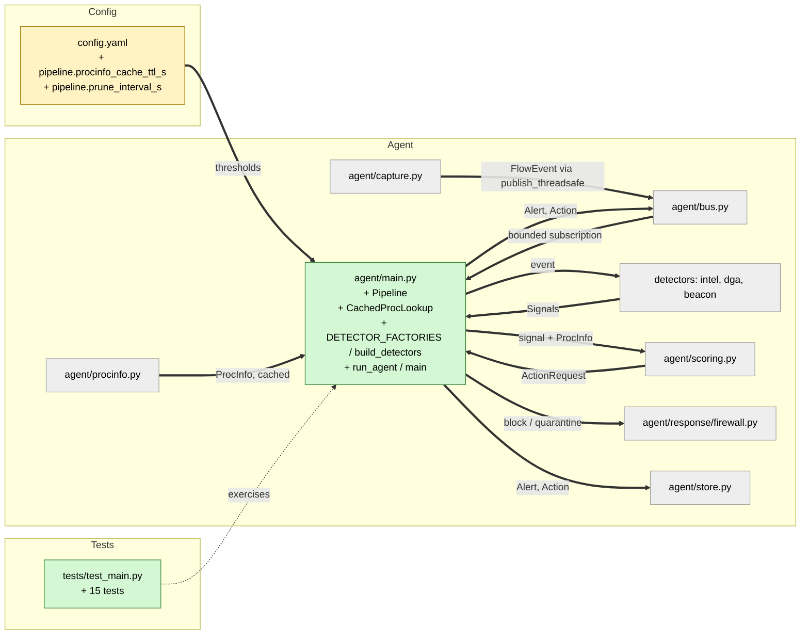

# Study guide: Wire capture -> detectors -> scoring -> response in agent/main.py

**Ticket:** #18 · **Date:** 2026-11-07 · **Gate:** APPROVE (552 passed, was 538; ruff clean)

## The big picture

Before this ticket, HomeSOC was a set of separate parts that had never been connected. Capture could
turn network traffic into `FlowEvent`s, the detectors could judge events, scoring could decide
what to do, and the firewall module could block things. Nothing ran them in order. Now
`python -m agent.main` starts live capture and sends every flow through all of them. If fake
malware shows up, the result is an alert and a quarantine rule, both saved and sent to the UI.

Think of an airport. Capture is the conveyor belt of bags. The detectors are the scanners, each
looking for something different. Scoring is the supervisor who reads all the scanner results and
decides whether to call security. The firewall is security itself. `main.py` is the building plan
that puts them in the right order and keeps the belt moving even when one scanner jams.

## Map of the changes



**How to read it:** green = new file, yellow = edited file, grey = existing and unchanged; thick arrows are connections this ticket added.

## File by file

### `config.yaml` - changed

**What it's for:** All tunable numbers live here, not in the code (project rule).
**What changed and why:** A new `pipeline:` block with two settings.

```yaml
pipeline:
  procinfo_cache_ttl_s: 30
  prune_interval_s: 60
```

`procinfo_cache_ttl_s` is how long to remember what we learned about a process (its file path and
whether it is signed). Asking Windows is slow, so we ask once per process per 30 s.
`prune_interval_s` is how often scoring throws away old signals it no longer needs. If the keys are
missing, `main.py` falls back to the same defaults.

### `agent/main.py` - new

**What it's for:** The agent's entry point and the one place where all the pieces are joined.
**What changed and why:** The whole file is new. It is the first end-to-end path, so fake malware can lead to an alert and a quarantine.

**DETECTOR_FACTORIES and build_detectors**

```python
DETECTOR_FACTORIES = (
    ("intel", lambda cfg: IntelDetector(cfg).process),
    ("dga", lambda cfg: DgaDetector(cfg).process),
    ("beacon", lambda cfg: BeaconDetector(cfg).process),
)
```

A list of (name, recipe) pairs. A "factory" is just a small function that builds something.
Adding the anomaly or flow_model detector later is one more line. `build_detectors` runs each
recipe; if one fails to start, it logs the problem and carries on without it.

**CachedProcLookup**

```python
if pid < 0: return None
...
if _names_differ(process, info.name): return None
```

Wraps `procinfo.info` with a memory per PID (process ID number). It returns `None` for an unknown
PID, and also when the PID now belongs to a differently named program (Windows reuses PIDs).
`None` means "we don't know the file", and scoring treats that as alert only, never quarantine,
so we never block the wrong program.

**Pipeline.handle(event)**

```python
for signal in self.detect(event):
    try:
        alert = self._score(signal)
    except Exception:
        logger.exception(...)
        continue
```

The heart of the file. For each flow it runs every detector (each in its own try/except, so one
crashing detector can't silence the others), feeds each signal to the scorer, and returns any
alerts. It never raises, so one bad event cannot kill the agent. Every dependency (detectors,
scorer, store, publish function, firewall functions, process lookup) is passed in from outside
("injected"), which is why tests can replace them with fakes and need no NFStream or PowerShell.

**Pipeline._score and _carry_out**

```python
decision = self.scorer.add(signal, proc)
actions = self._carry_out(decision)
alert = finalize_alert(decision, actions)
```

Scoring decides policy (mode, allowlist, risk). The pipeline only does what it is told: if the
scorer asks for `quarantine_app` or `block_ip`, it calls the matching firewall function. If the
firewall raises `FirewallError`, no Action exists, but the alert is still sent, and
`finalize_alert` rewrites its text so it honestly says nothing was blocked. The Action is saved and
published before its Alert, so the UI already knows the action when the alert arrives.

**Pipeline.run**

```python
async for event in sub:
    if isinstance(event, FlowEvent):
        await asyncio.to_thread(self.handle, event)
```

Reads events from its own bounded queue (when full, the oldest is dropped) and handles them one at
a time in a worker thread, because PowerShell can take seconds. One at a time matters: the
detectors keep running state and must not be used from two threads at once.

**run_agent and main**

Starts the bus, store and pipeline, then runs capture in a daemon thread (a background thread that
doesn't stop the program from exiting) because NFStream blocks while waiting for traffic. Capture
publishes with `publish_threadsafe`, so it never waits on detection. On Ctrl+C it cancels the
worker and closes the store; on a normal end it lets queued events finish first. `main()` loads
the config, exits cleanly with a message on config or capture errors, and logs on Ctrl+C.

### `tests/test_main.py` - new (test)

**What it's for:** Proves the pipeline works without Windows, NFStream or the network.
**Fake data:** A `FreeGameCheats.exe` (PID 4242) that makes six random-looking DNS lookups and a
check-in to the lab C2 `192.168.56.20` every 5 seconds, mirroring the demo. The beacon detector is
real, the DGA detector is real with a stub model, the store is a real SQLite file in a temp folder,
the bus is real, and PowerShell is patched at `subprocess.run`.

- End to end: beacon + DGA lead to a quarantine, an Action and Alert saved and published, Action first.
- Failed firewall: the alert still goes out and says nothing was blocked.
- Notify mode: alert raised, no firewall call.
- Unknown exe path: alert only, never quarantine.
- Resilience: a raising detector doesn't stop the others; `handle` never raises even if scoring fails; a detector that fails to start is skipped; a DGA detector with no model file doesn't crash.
- Process lookup: caching works, a reused PID is rejected, a lookup error is survived.
- Wiring: `DETECTOR_FACTORIES` covers the existing detectors; flows are logged; `run_agent` runs fake NFlows through to a firewall call.

## How you know it works

- The end-to-end test checks the whole path from flows to a stored, published alert with a quarantine.
- The failure tests (firewall error, raising detector, scoring error) show nothing crashes the pipeline.
- The unknown-exe and notify-mode tests show the safety rules from CLAUDE.md §9 hold.
- The `run_agent` test shows capture, bus and pipeline are connected for real.
- Gate: APPROVE, 552 tests passed (538 before), ruff clean. Verifier: PASS.

## Try it yourself

1. Run just these tests: `.venv/bin/python -m pytest -q tests/test_main.py` (Windows: `.venv\Scripts\python -m pytest -q tests\test_main.py`).
2. Run the lint check: `.venv/bin/ruff check .`.
3. On the Windows VM, in an admin terminal: `.venv\Scripts\python -m agent.main` and watch the log lines for flows.

## Open questions / risks

- The manual Windows check is still outstanding: `python -m agent.main` should log FlowEvents on the real VM with Npcap.
- Every FlowEvent is logged at INFO, which will be noisy on a busy PC.
- If a firewall call fails, it is not retried until the scorer's 60-second window for that key empties.
- Signals are not published on the bus, only Alerts and Actions.
- Ctrl+C drops any events still queued.
