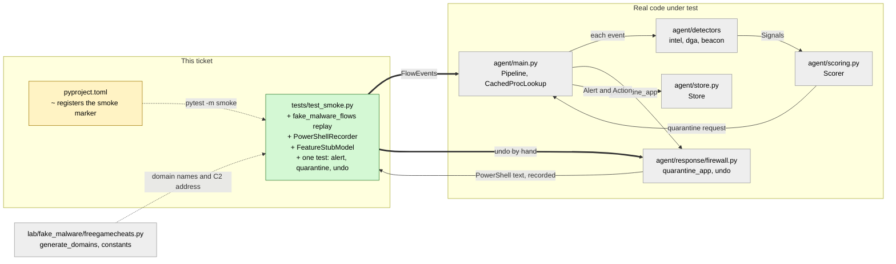

# Study guide: the end-to-end smoke test (fake malware -> alert -> quarantine -> undo)

**Ticket:** #19 · **Date:** 2026-11-07 · **Gate:** APPROVE (588 passed, ruff clean, smoke test about 0.5 s)

## The big picture

Before this ticket, every piece of HomeSOC had its own unit tests (the intel detector, the beacon detector, the scorer, the firewall, the store, the pipeline). Nothing checked that they work *together* on the story we show in the demo: a bad program looks up weird domain names, checks in with its boss server every 5 seconds, gets caught, gets blocked by the firewall, and the user presses Undo.

Now there is one fast test, `tests/test_smoke.py`, that replays exactly that story through the real pipeline in `auto` mode and checks every step. It is also the "smoke test" named in the `## Checks` section of `CLAUDE.md`. Think of it as a fire drill: you do not test each smoke alarm separately, you light a small (fake) fire and watch whether the alarm, the sprinklers and the "all clear" button all fire in order.

Only one thing is faked at the edge of the system: `subprocess.run`, the Python function that would launch PowerShell. Everything else is the real code, so the test runs on any computer with no admin rights, no network and no Npcap.

## Map of the changes



**How to read it:** green = new file, yellow = edited file, grey = existing code the test drives; thick arrows are connections this ticket added, thin ones already existed.

## File by file

### `pyproject.toml` - changed

**What it's for:** project settings for pytest and ruff.
**What changed and why:** it now declares a `smoke` marker so the smoke test can be run alone.

```toml
markers = [
    "smoke: end-to-end demo path (...); tests/test_smoke.py",
]
```

A *marker* is a label you can stick on a test. Registering it here stops pytest from warning about an unknown label, and lets you run `pytest -m smoke` to run only the labelled tests.

### `tests/test_smoke.py` - new (test)

**What it's for:** replay the fake malware's network behaviour through the real pipeline and check the whole demo path.
**What changed and why:** this is the whole ticket; it gives us one cheap test that fails if any link in the demo chain breaks.

**The fake traffic (`fake_malware_flows`)**

```python
hosts = [BENIGN_HOST, *fgc.generate_domains(DOMAIN_SEED)]
...
ts = start + i * CHECKIN_EVERY_MS + jitter
```

A *flow* is one network conversation. The test builds one harmless lookup (`www.microsoft.com`), then the made-up random-looking domains that the lab simulator itself generates (so the test cannot drift from the simulator), then 12 check-ins to `192.168.56.20` about every 5 seconds. The check-ins wobble by a few hundredths of a second, like real software, so the beacon detector has to cope with slightly imperfect timing.

**The only patch (`PowerShellRecorder`)**

```python
def __call__(self, args, *a, **kw):
    self.calls.append(list(args))
    return subprocess.CompletedProcess(args=args, returncode=0, stdout="", stderr="")
```

This class pretends to be `subprocess.run`. It writes down every command the firewall code tries to run and always answers "success, exit code 0". Later the test reads the list to see exactly which PowerShell text would have run.

**Injected helpers (not patches)**

The real classes already accept their dependencies through their constructors, so the test just hands in fakes:
- a fake clock (a list holding the current time) that jumps to each flow's time, so nothing sleeps;
- a process lookup that always says "this PID is `FreeGameCheats.exe`, unsigned, in Downloads";
- an intel detector with an **empty** known-bad list and no network refresh;
- a DGA detector that uses the real `models/dga.joblib` if it exists. If not (it is not checked in), it uses `FeatureStubModel`, a tiny stand-in that calls a domain "DGA" when its label is long and made of rare letter pairs.

Why the empty intel list? The shipped `data/test_intel.txt` contains `192.168.56.20`, so the intel detector would quarantine on the very first check-in. With it empty, the test exercises the DGA-then-beacon route that the demo checklist describes.

**The test itself (`test_fake_malware_alert_quarantine_undo`)**

It runs in four stages inside a temporary folder and a temporary SQLite database:
1. **Replay.** Each flow goes into `pipeline.handle(...)`. The process lookup is cached per PID, so it must be called only twice for the roughly one-minute replay.
2. **Alert.** The stored alerts all belong to `FreeGameCheats.exe`, never mention the benign lookup, and at least one carries *both* a `dga` and a `beacon` signal. The one that triggered the action is high or critical, points at the Downloads path, and the beacon reason says "every 5.0 s".
3. **Quarantine.** Exactly one `quarantine_app` Action is saved, with two uniquely named `HomeSOC ...` rule names. The recorder shows exactly two PowerShell commands, one outbound and one inbound, each in group `HomeSOC`, blocking that exe. The Action is published before the Alert that refers to it.
4. **Undo.** The API does not exist yet, so the test does by hand what `POST /actions/{id}/undo` will do: load the action from the store, call `firewall.undo`, save the resulting "undo" action, and call `mark_undone`. It then checks that the removal commands name exactly the two quarantine rules (exact match, only inside the group) and that the original action is now marked undone.

Last, the whole thing must finish in under 10 seconds.

One helper worth knowing: `homesoc_literals` pulls every single-quoted `'HomeSOC ...'` name out of a PowerShell command, so the test can assert that a command touches *only* the rule it should.

## How you know it works

- One test walks the full chain: flows -> real detectors -> real scorer (real `config.yaml` and `data/allowlist.txt`) -> real firewall code -> real store -> undo.
- The assertions check the exact PowerShell text that would run, not just "something was called", including that undo can only match the two rules created.
- The gate approved: 588 tests passed, ruff reported no problems, and the smoke test takes about 0.5 s.
- It needs no admin rights, network, Npcap or real PowerShell, so it runs on any OS and in CI.

## Try it yourself

1. From the repo root, run only the smoke test: `.venv\Scripts\python -m pytest -q -m smoke` (or `.venv\Scripts\python -m pytest -q tests/test_smoke.py`).
2. Run the full check from `CLAUDE.md`: `.venv\Scripts\python -m pytest -q`, then `.venv\Scripts\ruff check .`.
3. Break it on purpose: in `config.yaml` temporarily change the beacon tolerance so check-ins never count as beacons; the smoke test should fail at the "dga and beacon" assertion. Put it back afterwards.

## Open questions / risks

- **The trained DGA model is not guarded.** Without `models/dga.joblib` the test uses a stub, so a broken real model would not fail this test.
- **Undo is done by hand.** Once the API lands, switch step 4 to call `POST /actions/{id}/undo` so the real endpoint is covered.
- **Demo order differs from the checklist.** The shipped `data/test_intel.txt` lists `192.168.56.20`, so in the live demo the app would be quarantined by the intel hit on the first check-in, before the beacon detector fires. That differs from the order in `CLAUDE.md` section 12, step 4. The test deliberately empties the list to cover the DGA-then-beacon path; the intel path is covered in `tests/test_scoring.py`.
- The verifier step was skipped because the ticket is size S.
