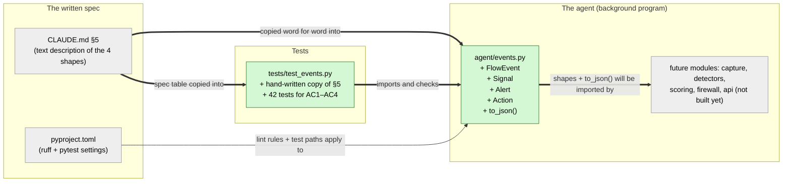

# Study guide: The shared "message shapes" every part of HomeSOC uses

**Ticket:** #2 · **Date:** 2026-11-06 · **Gate:** BLOCK (the gate had no shell to run the checks; see "Open questions / risks")

## The big picture

HomeSOC is built from many small parts. One part watches network connections, several "detectors" look for bad behavior, one part decides how risky things are, one part adds firewall rules, and a window shows it all to the user. These parts need a common language: when the watcher reports a connection, every detector has to know exactly what that report contains. Before this ticket that language existed only as text in `CLAUDE.md` §5. No code defined it, so no other part could be built against it.

Now `agent/events.py` turns §5 into real Python. It defines four "message shapes": `FlowEvent` (one network connection), `Signal` (one detector saying "this looks suspicious"), `Alert` (what the user sees), and `Action` (a firewall change we made). It also adds a helper, `to_json()`, which turns any of these into plain data that can be sent to the app window over the WebSocket. Think of it as the standard forms in an office. Everyone fills in the same "incident report" form with the same boxes, so whoever picks it up knows where to look, and `to_json()` is the photocopier that makes a copy you can post to another building.

## Map of the changes



**How to read it:** green boxes are new files, grey boxes already existed and were not changed. `+` marks something added inside a file. Thick arrows (`==>`) are connections this ticket created; the thin arrow (`-->`) already existed. The "future modules" box is a placeholder: those files don't exist yet, but they're the reason this file exists.

## Words you'll see

| Word | What it means here |
|---|---|
| Python | The programming language HomeSOC is written in. |
| module / file | A `.py` file. `agent/events.py` can be loaded by other code as `agent.events`. |
| `import` | A line that pulls names (tools) from another module so this file can use them. |
| class | A blueprint for a kind of object, e.g. "a FlowEvent has a process name, a port, …". |
| instance / object | One concrete thing made from a class, e.g. one specific connection by chrome.exe. |
| field | One named box inside a class, like `pid` or `dst_ip`. |
| dataclass | A Python shortcut: you list the fields, and Python writes the boring setup code for you (creating, comparing, printing). |
| decorator (`@dataclass`) | A line starting with `@` that sits above a class and changes how it behaves. Here it turns a plain class into a dataclass. |
| type hint | The `: int` or `: str` after a field name. It says what kind of value belongs there. Python doesn't enforce it, but tools and people read it. |
| `int`, `float`, `str`, `bool` | Whole number, decimal number, text, and true/false. |
| `list`, `dict` | A list is an ordered row of values `[1, 2, 3]`. A dict is a set of labelled values `{"a": 1}`. |
| `Optional[str]` | "Either text, or `None` (nothing)". Same meaning as `str \| None`. |
| `None` | Python's "no value here". |
| `Literal["a", "b"]` | "Only these exact text values are allowed". It's a hint, not enforced. |
| default | The value a field gets if you don't supply one. |
| `field(default_factory=list)` | "Make a brand-new empty list for every instance", instead of all instances sharing one list. |
| mutable | Changeable in place. Lists and dicts are mutable; numbers and text are not. |
| JSON | A plain-text data format every language and browser understands, e.g. `{"type": "flow", "pid": 1234}`. |
| WebSocket | A live two-way connection between the agent and the app window, used to push alerts instantly. |
| `asdict()` | A dataclass tool that turns an instance (and any instances inside it) into plain dicts. |
| `TypeError` | The standard Python error for "you gave me the wrong kind of thing". |
| `raise` | Stop the function and report an error. |
| docstring | A text block in triple quotes `"""…"""` at the top of a file or function that explains it. |
| ruff | The "linter": a tool that checks code style and common mistakes. |
| `noqa` | A comment that tells ruff "don't complain about this rule here". |
| pytest | The tool that finds and runs the tests. |
| test | A small function that runs the real code and checks (`assert`s) the result is right. |
| `assert` | "This must be true, otherwise the test fails." |
| parametrize | A pytest feature that runs the same test several times with different inputs. |
| round trip | Convert something to another form and back, and check you get the same thing. |
| MITRE ID | A standard code for an attack technique, e.g. `T1071.001` = talking to a command server over the web. |

## File by file

### `agent/events.py` - new

**What this file is for:** it defines the four message shapes that every part of HomeSOC passes around, plus the helper that turns them into JSON.
**What changed and why:** the whole file is new. The ticket asks for the §5 dataclasses "exactly as in CLAUDE.md §5" plus a `to_json()` helper for the WebSocket.

#### Piece 1 - The header, the lint note and the imports

```python
"""The shared event contract (CLAUDE.md §5). SHARED by CE and CS: see §2 before changing it.

All modules talk through these types. The WebSocket sends them as JSON via ``to_json()``
(``asdict()`` + ``"type"``).
"""

# The dataclasses below are copied verbatim from §5, which spells optional fields as Optional[...].
# ruff: noqa: UP045

from dataclasses import asdict, dataclass, field, is_dataclass
from typing import Any, Literal, Optional
```

**In plain words:** a note saying what the file is and warning that both team members depend on it, an instruction to the style checker, and a list of tools borrowed from Python's built-in libraries.

**Line by line:**
1. `"""…"""`: a docstring. Text between three double quotes can span several lines. It does nothing when the program runs; it's documentation. The double backticks (` ``to_json()`` `) are just a formatting convention that marks code inside the text.
2. `# …`: any line starting with `#` is a comment, ignored by Python.
3. `# ruff: noqa: UP045`: a special comment that ruff reads. Rule UP045 says "write `str | None` instead of `Optional[str]`". §5 uses `Optional`, so this line switches that rule off for the whole file to keep the code identical to the spec.
4. `from dataclasses import asdict, dataclass, field, is_dataclass`: borrow four tools from Python's `dataclasses` library. `dataclass` makes the classes, `field` sets up the "fresh empty list" defaults, `asdict` converts to dicts, and `is_dataclass` checks whether something is a dataclass.
5. `from typing import Any, Literal, Optional`: borrow type-hint tools. `Any` means "any kind of value".

**Why it's written this way:** §2 of CLAUDE.md says nobody may change `events.py` silently, so the warning is right at the top. The `noqa` keeps the code matching the spec word for word while ruff stays happy.

#### Piece 2 - `FlowEvent`: one network connection

```python
@dataclass
class FlowEvent:
    type: Literal["flow"] = "flow"
    ts_ms: int = 0                    # bidirectional_first_seen_ms
    end_ms: int = 0                   # bidirectional_last_seen_ms
    process: str = "unknown"          # e.g. "chrome.exe"
    pid: int = -1
    exe_path: Optional[str] = None
    src_ip: str = ""
    src_port: int = 0
    dst_ip: str = ""
    dst_port: int = 0
    protocol: int = 0
    hostname: Optional[str] = None    # NFStream requested_server_name (DNS query / TLS SNI)
    app_proto: Optional[str] = None   # NFStream application_name
    bytes_out: int = 0                # src2dst_bytes
    bytes_in: int = 0                 # dst2src_bytes
    packets: int = 0
    direction: Literal["outbound", "inbound"] = "outbound"
    features: dict = field(default_factory=dict)   # raw NFStream stats for flow_model
```

**In plain words:** a blank form for "one connection the PC made". It records which app made it (`process`, `pid`, `exe_path`), who it talked to (`dst_ip`, `dst_port`, `hostname`), when (`ts_ms` to `end_ms`, in milliseconds), how much data went each way (`bytes_out`, `bytes_in`), and whether the connection came in or went out (`direction`).

**Line by line:**
1. `@dataclass`: the decorator. It means "Python, write the setup code for this class". Afterwards you can write `FlowEvent(process="chrome.exe", pid=1234)` and every field you skip gets its default.
2. `class FlowEvent:`: starts the blueprint named `FlowEvent`. The colon `:` means "the indented lines below belong to this".
3. `type: Literal["flow"] = "flow"`: the pattern on every line is `name: type_hint = default`. This field is always the text `"flow"`, so whoever receives the data can tell what kind of message it is.
4. `ts_ms: int = 0`: a whole number, default 0. `ts_ms` is a timestamp in milliseconds since 1970, e.g. `1_700_000_000_000`. The underscores in numbers are only there for readability.
5. `pid: int = -1`: the process ID. `-1` means "we don't know yet", because real PIDs are never negative.
6. `exe_path: Optional[str] = None`: either a file path as text, or `None` if unknown.
7. `direction: Literal["outbound", "inbound"] = "outbound"`: only those two words are meant to go here.
8. `features: dict = field(default_factory=dict)`: a dict of extra statistics. `field(default_factory=dict)` means "call `dict()` to make a new empty `{}` each time a FlowEvent is created". Writing `features: dict = {}` would make every FlowEvent share one dict, and Python refuses that for dataclasses because of exactly this trap.
9. The `# …` comments at line ends say where each value comes from in NFStream, the capture library, e.g. `bytes_out` is NFStream's `src2dst_bytes`.

**Why it's written this way:** it is a character-for-character copy of §5, because the capture code (owned by CE) creates these and the detectors (owned by CS) read them. Any difference would break the other person's code.

#### Piece 3 - `Signal`: one detector's finding

```python
@dataclass
class Signal:
    type: Literal["signal"] = "signal"
    detector: Literal["intel", "dga", "beacon", "anomaly", "flow_model"] = "intel"
    process: str = "unknown"
    pid: int = -1
    target: str = ""                  # IP or domain the signal is about
    score: float = 0.0                # 0..1
    reasons: list[str] = field(default_factory=list)   # short, human-readable
    mitre: Optional[str] = None       # e.g. "T1071.001"
    ts_ms: int = 0
```

**In plain words:** the form a detector fills in when something looks bad: which detector, which app, what it was talking to (`target`), how sure it is (`score` from 0 to 1, so 0.9 means "90% sure"), and short human-readable reasons, e.g. `"checks in with 192.168.56.20 every 5.0 s (±0.2 s)"`.

**Line by line:**
1. `detector: Literal["intel", "dga", "beacon", "anomaly", "flow_model"] = "intel"`: names the five detectors. The default is `"intel"`.
2. `score: float = 0.0`: a decimal number. `0.0` rather than `0` makes the default a float.
3. `reasons: list[str] = field(default_factory=list)`: `list[str]` means "a list of texts". `default_factory=list` gives each Signal its own fresh `[]`.
4. `mitre: Optional[str] = None`: the MITRE attack-technique code, or nothing.

**Why it's written this way:** scoring (§6.4) combines many Signals per app, and the `reasons` text ends up in what the user reads, so every detector must report in this one shape.

#### Piece 4 - `Alert`: what the user sees

```python
@dataclass
class Alert:
    type: Literal["alert"] = "alert"
    id: str = ""
    ts_ms: int = 0
    severity: Literal["low", "medium", "high", "critical"] = "low"
    process: str = "unknown"
    exe_path: Optional[str] = None
    risk: float = 0.0
    title: str = ""
    what_happened: str = ""
    what_we_did: str = ""
    what_you_should_do: str = ""
    signals: list[Signal] = field(default_factory=list)
    action_ids: list[str] = field(default_factory=list)
```

**In plain words:** the alert card. It has a severity level, the overall `risk`, the three plain-English sections the app shows ("What happened / What we did / What you should do"), the Signals that caused it, and the IDs of any firewall Actions taken.

**Line by line:**
1. `severity: Literal["low", "medium", "high", "critical"] = "low"`: one of four levels.
2. `signals: list[Signal] = field(default_factory=list)`: a list whose items are `Signal` objects from Piece 3. A shape inside a shape. This is why `to_json()` needs to handle nesting (Piece 6).
3. `action_ids: list[str] = …`: a list of text IDs pointing at `Action`s, e.g. `["action-1"]`.

**Why it's written this way:** the alert keeps its evidence (the Signals) inside it, so the UI can show *why* without a second lookup. It only stores Action *IDs* because Actions can be undone later and live on their own.

#### Piece 5 - `Action`: a firewall change we made

```python
@dataclass
class Action:
    type: Literal["action"] = "action"
    id: str = ""
    ts_ms: int = 0
    kind: Literal["block_ip", "quarantine_app", "kill_process", "undo"] = "block_ip"
    target: str = ""                  # IP or exe path
    rule_names: list[str] = field(default_factory=list)
    undone: bool = False
```

**In plain words:** a record of something HomeSOC did, such as blocking an IP or quarantining an app. It stores the exact Windows Firewall rule names it created, so they can be removed later, and whether it has been undone.

**Line by line:**
1. `kind: Literal["block_ip", "quarantine_app", "kill_process", "undo"] = "block_ip"`: what kind of action it was.
2. `rule_names: list[str] = …`: e.g. `["HomeSOC quarantine FreeGameCheats.exe out", "HomeSOC quarantine FreeGameCheats.exe in"]`.
3. `undone: bool = False`: `bool` is true/false. It starts as `False` (not undone yet).

**Why it's written this way:** safety rule 3 in CLAUDE.md says every firewall action must be undoable. Keeping the rule names makes Undo work even after the agent restarts.

#### Piece 6 - `to_json()`: turn a shape into sendable data

```python
def to_json(obj: Any) -> dict[str, Any]:
    """Turn an event dataclass instance into a JSON-ready dict for the WebSocket.
    ... (docstring shortened)
    """
    if not is_dataclass(obj) or isinstance(obj, type):
        raise TypeError(f"to_json() expects a dataclass instance, got {type(obj).__name__}")
    data = asdict(obj)
    if "type" not in data:
        raise TypeError(
            f"to_json() needs a dataclass with a 'type' field, got {type(obj).__name__}"
        )
    return data
```

**In plain words:** give it any of the four shapes and it hands back a plain dict, e.g. `{"type": "flow", "ts_ms": 0, "process": "chrome.exe", …}`, which can be turned straight into JSON text. If you give it something that isn't one of these shapes, it refuses with a clear error instead of sending junk to the app.

**Line by line:**
1. `def to_json(obj: Any) -> dict[str, Any]:`: `def` defines a function named `to_json`. It takes one input, `obj`, which can be anything (`Any`). `->` says what it gives back: a dict whose keys are text (`str`) and whose values are anything.
2. `if not is_dataclass(obj) or isinstance(obj, type):`: `if` runs the indented lines only when the condition is true. `is_dataclass(obj)` is true for dataclass objects, but also for the dataclass *blueprint itself*. `isinstance(obj, type)` is true when `obj` is a blueprint (a class) rather than a made object. So this reads: "if it's not a dataclass, **or** it's a blueprint instead of an actual object…". Example: `to_json(Signal())` passes, while `to_json(Signal)` (no brackets, so the blueprint) and `to_json({"type": "flow"})` fail.
3. `raise TypeError(f"…{type(obj).__name__}")`: stop with an error. The `f"…"` is an f-string: anything in `{ }` is filled in, so passing `42` gives the message "…got int".
4. `data = asdict(obj)`: convert the object into a dict. `asdict` goes inside nested shapes too, so an Alert's `signals` become a list of dicts, not a list of Signal objects. It also makes copies of lists and dicts, so changing `data` won't change the original.
5. `if "type" not in data:`: checks the dict has a `"type"` key. All four shapes do. This only catches some *other* dataclass passed in by mistake.
6. The second `raise` is the same idea, split across lines with brackets `( )` to stay under the 100-character line limit.
7. `return data`: hand the dict back to whoever called the function.

**Why it's written this way:** the ticket says "`asdict()` + `"type"`". `asdict` handles the nesting, and since every shape already has a `type` field, there's nothing to add, only to check. The app window will use `"type"` to decide how to show each message, so a message without it would be useless. Rejecting bad input loudly makes bugs show up early.

### `tests/test_events.py` - new (test)

**What this file is for:** it proves that `events.py` matches §5 and that `to_json()` behaves as the ticket requires.
**What changed and why:** new file, one group of tests per acceptance criterion (AC1–AC4).

**The fake data it uses:**
- **A hand-written copy of §5** (`FLOW_EVENT_SPEC`, `SIGNAL_SPEC`, `ALERT_SPEC`, `ACTION_SPEC`): for each field, a `(name, type, default)` row, e.g. `("pid", int, -1)`. A default written as `list` or `dict` means "fresh empty list/dict". The tests compare the real classes against these rows, so if someone changes `events.py` without changing §5, the tests fail.
- **Realistic samples:** a FlowEvent for `chrome.exe` talking to `192.168.56.20:443`. A beacon Signal for `freegamecheats.exe` with score 0.9. A critical Alert containing two Signals (beacon and DGA). A quarantine Action with two `HomeSOC …` rule names. These use the lab IPs from the demo plan, not real ones.
- `_rebuild()`: a small helper that turns a dict back into the original shape. For an Alert it also turns each signal dict back into a `Signal`.

**Syntax you'll see in the tests:**
- `@pytest.mark.parametrize(("cls", "spec"), SPECS)`: run the test below once per item in `SPECS`, so 4 times, once per shape.
- `with pytest.raises(TypeError):`: "the code inside this block **must** raise a TypeError; if it doesn't, the test fails."
- `a is not b`: checks that two names point to two *different* objects in memory, not merely equal ones.
- `from __future__ import annotations`: a technical line that delays reading type hints. You can ignore it.

**Every test, one sentence each:**

AC1 (fields, types, defaults; build each with defaults):
- `test_fields_match_spec_names_and_order` (×4): each class has exactly the §5 field names, in the §5 order.
- `test_field_types_match_spec` (×4): each field's type hint equals §5's, e.g. `pid` is `int`, `exe_path` is "text or None".
- `test_construct_with_defaults_matches_spec` (×4): building with no arguments, e.g. `FlowEvent()`, gives every field its exact §5 default, and of the exact type (so `0.0` must be a float, not the int `0`).
- `test_mutable_fields_use_default_factory` (×4): the list/dict fields use `default_factory`, and every other field has the §5 default stored directly.

AC2 (`to_json()` makes JSON-ready dicts with the right `"type"`):
- `test_to_json_returns_dict_with_type` (×4): the output is a dict, `"type"` is `flow`/`signal`/`alert`/`action`, and keys come in field order.
- `test_to_json_type_for_default_instances` (×4): the same `"type"` check on default-built objects.
- `test_to_json_is_json_serializable_and_round_trips` (×4): turns the dict into JSON text and back, checks nothing changed, then rebuilds the object and checks it equals the original. This is the full round trip.
- `test_to_json_does_not_alias_the_original` (×4): lists/dicts in the output are copies, so editing the output can't secretly change the original object.
- `test_to_json_rejects_non_dataclass`: a dict, text, a number, `None` and a list all raise `TypeError`.
- `test_to_json_rejects_dataclass_class_not_instance`: passing the blueprint `Signal` (not `Signal()`) raises `TypeError`.
- `test_to_json_rejects_dataclass_without_type_field`: a made-up dataclass with no `type` field raises `TypeError`.

AC3 (nested Signals become dicts):
- `test_alert_nested_signals_serialize_as_dicts`: in the sample Alert's output, each signal is exactly a plain `dict` with exactly the expected contents (beacon first, then DGA), and the Alert can be rebuilt equal to the original.
- `test_alert_with_no_signals_serializes_empty_list`: an Alert with no signals gives `"signals": []` and still converts to JSON.

AC4 (mutable defaults aren't shared):
- `test_mutable_defaults_are_not_shared` (×5, one per field: `features`, `reasons`, `signals`, `action_ids`, `rule_names`): builds two objects and checks their lists/dicts are different objects. It then adds an item to the first one's (e.g. `"injected"`) and checks the second object and a brand-new object are still empty.

That's 16 + 16 + 3 + 2 + 5 = **42 tests**.

## How you know it works

- **The shapes match the spec:** the AC1 tests compare every field's name, order, type and default against a hand-written copy of §5. A typo in either place shows up as a failure.
- **`to_json()` output is safe to send:** the AC2 tests actually run `json.dumps` (turn into JSON text) and `json.loads` (read it back), and rebuild the original object from the result.
- **Alerts carry their evidence correctly:** the AC3 test checks the nested Signals come out as plain dicts with the exact expected values.
- **No shared-list bug:** the AC4 tests change one object and prove the others are unaffected.
- **Bad input is refused:** three tests check that `TypeError` is raised for wrong inputs.
- **Results on this machine (2026-11-06):** the full suite passed 81 tests (39 existing + 42 new), ruff reported no problems, and the new tests passed in 3 repeat runs. The test gate itself could not run them (see below).

## Try it yourself

1. Open a terminal in the project folder (`C:\Users\Jakef\Mocat-Security-Dashboard`).
2. Run just these tests:
   ```powershell
   .venv\Scripts\python -m pytest -q tests/test_events.py
   ```
   You should see `42 passed`.
3. Run everything, as listed in CLAUDE.md `## Checks`:
   ```powershell
   .venv\Scripts\python -m pytest -q
   .venv\Scripts\ruff check .
   ```
   You should see `81 passed` and `All checks passed!`.
4. Play with it. Start Python with `.venv\Scripts\python`, then type:
   ```python
   from agent.events import Alert, Signal, to_json
   a = Alert(severity="high", signals=[Signal(detector="beacon", score=0.9)])
   to_json(a)
   ```
   You'll see a dict where `"signals"` holds a plain dict starting with `'type': 'signal'`. Then try `to_json(42)` and you'll get a `TypeError`.
5. Break it on purpose: change `pid: int = -1` to `pid: int = 0` in `FlowEvent`, rerun step 2, and watch `test_construct_with_defaults_matches_spec[FlowEvent]` fail. Undo the change afterwards.

## Open questions / risks

- **Test gate verdict: BLOCK, but not because of a defect.** The gate agent had no shell tool on this Windows machine, so it could not run pytest, ruff or the 3 repeat runs. Its rules require seeing them pass before it approves. It reviewed every test and approved all of them on reading. It found no tampering, and it expects APPROVE once the checks run. Blocking item from the gate: *run `.venv\Scripts\python -m pytest -q` (expect 81 passed), `.venv\Scripts\ruff check .` (expect exit 0) and `pytest -q tests/test_events.py` 3 times*. Those commands were run by hand afterwards and all passed, but that is not a gate APPROVE.
- **Both owners must agree before merging.** The ticket and §2 say David (CE) and Jake (CS) must both sign off on `events.py`, because everything else will be built on it.
- **`Optional[str]` vs `str | None`.** The code keeps §5's `Optional` spelling, which needs a file-wide `# ruff: noqa: UP045`. Switching to `str | None` would remove the `noqa`, but §5 would have to be updated in the same change. The verifier notes that the file-wide `noqa` would also hide new `Optional` uses if more code is added to this file later.
- **`"type"` is not checked against the class.** Python doesn't enforce `Literal`, so `FlowEvent(type="x")` would be sent as `"type": "x"`. §5 doesn't ask for this check. The ticket verifier (PASS) and the gate both rated it out of scope.
- **Nothing uses `to_json()` yet.** The WebSocket in `agent/api.py` comes in a later ticket.
