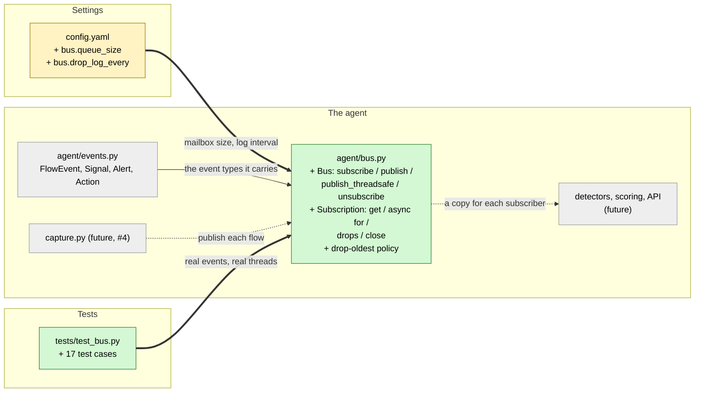

# Study guide: The message bus that carries events between parts of the agent

**Ticket:** #3 · **Date:** 2026-11-07 · **Gate:** APPROVE

## The big picture

HomeSOC's agent is several parts that each do one job. Capture sees network connections. The
detectors look for bad behavior. Scoring decides how worried to be, and the API sends updates to
the app window. Every one of them needs to hear about each new connection, and capture produces
connections nonstop, sometimes hundreds a second.

Before this ticket the parts had no way to talk to each other. Now `agent/bus.py` provides a
**bus**: capture *publishes* each event once, and every part that *subscribed* gets its own copy,
in order. The key rule is that publishing never makes capture wait. If one part falls behind
and its inbox fills up, its oldest unread event is thrown away to make room, the drop is counted
and logged, and nobody else is affected.

Everyday analogy: it's a group chat where each member has a mailbox that holds 1,000 messages.
The sender posts once and everyone gets a copy. If someone stops reading and their mailbox fills
up, the oldest message in *their* box is thrown out, and nobody else's mailbox changes.

## Map of the changes



**How to read it:** green = new file, yellow = changed file, grey = unchanged or not built yet.
`+` = added. Thick arrows are connections this ticket added, the thin arrow already existed
(Jake's `events.py` from #2), and dotted arrows are where future tickets will plug in.

## Words you'll see

| Word | What it means here |
|------|--------------------|
| **bus / publish / subscribe** | A message system. *Publish* sends one message to everyone. *Subscribe* means "add me to the list". |
| **subscriber / subscription** | One listener on the bus, with its own mailbox. |
| **queue** | A line of waiting items: first in, first out, like a checkout line. |
| **bounded queue** | A queue with a maximum size (here 1,000). |
| **asyncio** | Python's way of doing many waiting jobs at once on one thread, by switching between them whenever one is waiting. |
| **event loop** | The asyncio engine that keeps switching between those jobs. |
| **coroutine / `async def` / `await`** | An `async def` function can pause at `await` ("wait here, let others run") and continue later. |
| **blocking** | Making the caller stop and wait. The bus must never do this to capture. |
| **thread** | A separate line of work running at the same time. NFStream capture runs in its own thread. |
| **thread-safe** | Safe to use from several threads at once. asyncio queues are **not**. |
| **sentinel** | A special marker object meaning "this isn't data, it's a signal", here "the subscription is closed". |
| **exception** | An error object. `raise` throws one and `except` catches it. |
| **property** | A method you read like a plain value: `sub.drops`, not `sub.drops()`. |
| **context manager / `with`** | An object that runs cleanup automatically when a `with` block ends. |
| **classmethod** | A method called on the class itself (`Bus.from_config(...)`) that builds a new object. |
| **log / warning** | A message written to the program's log. A warning means "something's wrong but we're carrying on". |
| **flaky test** | A test that sometimes passes and sometimes fails. Thread tests are prone to this, so the gate ran this one 30 times. |

## File by file

### `config.yaml` - changed

```diff
+bus:
+  queue_size: 1000             # max events buffered per subscriber; when full, the oldest is dropped
+  drop_log_every: 1000         # log a drop warning on the 1st drop and then every Nth drop per subscriber
```

**In plain words:** each mailbox holds 1,000 events, and drop warnings are written on the first
drop and then every 1,000th.

**Why it's written this way:** project rule §10 says numbers like these go in `config.yaml`, not
in the code.

### `agent/bus.py` - new

**What this file is for:** passing every event from the part that produces it to every part that
wants it, without ever making the producer wait.
**What changed and why:** new file for ticket #3. Capture (#4), the pipeline (#18) and the
WebSocket (#40) will all use it.

#### Piece 1 - imports, the event type and the "closed" marker

```python
import asyncio
import logging
from collections.abc import AsyncIterator
from typing import Any

from agent.events import Action, Alert, FlowEvent, Signal

logger = logging.getLogger(__name__)

Event = FlowEvent | Signal | Alert | Action


class SubscriptionClosed(Exception):
    """Raised by :meth:`Subscription.get` once the subscription is closed and drained."""


class _Closed:
    """Sentinel put on a queue to wake a consumer waiting in ``get()`` when it is closed."""


_CLOSED = _Closed()
```

**In plain words:** bring in asyncio and the four event types from Jake's contract, define an
error that means "you've unsubscribed and there's nothing left", and create one special marker
object that means "closed".

**Line by line:**
1. `from agent.events import ...` borrows the shared event types. The bus reads them but never
   changes `events.py`.
2. `Event = FlowEvent | Signal | Alert | Action` is a **type alias**, a short name meaning "any
   of these four". `|` means "or".
3. `class SubscriptionClosed(Exception):` is a custom error, a kind of `Exception`.
4. `class _Closed:` is an empty class. Its only purpose is to make one unique object, `_CLOSED`.
   The leading `_` means "internal, other files shouldn't touch it".

**Why it's written this way:** the closed marker has to be something no real event could ever
equal, and a private one-of-a-kind object guarantees that.

#### Piece 2 - one subscriber's mailbox

```python
class Subscription:
    def __init__(self, bus: Bus, name: str, queue_size: int, drop_log_every: int) -> None:
        self.name = name
        self._bus = bus
        self._queue: asyncio.Queue[Any] = asyncio.Queue(maxsize=queue_size)
        self._drop_log_every = drop_log_every
        self._drops = 0
        self._closed = False

    @property
    def drops(self) -> int:
        return self._drops
```

(Shortened: docstrings, and the similar `closed` property and `qsize()` method, are left out.)

**In plain words:** each subscription remembers its name, has its own queue with a size limit,
and counts how many events it had to throw away.

**Line by line:**
1. `def __init__(self, ...)` is the **constructor**, which runs when a new subscription is
   created. `self` is the new object being set up.
2. `asyncio.Queue(maxsize=queue_size)` is a queue that refuses new items once it holds
   `queue_size`.
3. `@property` lets other code read `sub.drops` like a variable, but not set it, because there's
   no setter. Only the bus itself changes the count.

#### Piece 3 - reading from the mailbox

```python
    async def get(self) -> Any:
        if self._closed and self._queue.empty():
            raise SubscriptionClosed(self.name)
        item = await self._queue.get()
        if item is _CLOSED:
            raise SubscriptionClosed(self.name)
        return item
```

(`get_nowait()` is the same idea without waiting. It raises `asyncio.QueueEmpty` if nothing is
there.)

**In plain words:** wait for the next event and return it. If the subscription was closed and
everything has been read, raise `SubscriptionClosed` instead.

**Line by line:**
1. `async def` makes this a coroutine, so callers write `await sub.get()`.
2. `await self._queue.get()` pauses *this reader only* until an event arrives, while the rest of
   the agent keeps running.
3. `item is _CLOSED` uses `is`, which asks "is it that exact same object?" This is how the reader
   recognizes the closed marker.
4. Events that were queued before the close still come out first, because the marker sits at the
   back of the queue.

#### Piece 4 - the drop-oldest rule (the heart of the ticket)

```python
    def _put_dropping_oldest(self, item: Any) -> None:
        try:
            self._queue.put_nowait(item)
            return
        except asyncio.QueueFull:
            pass
        self._queue.get_nowait()  # drop the oldest item; the queue is full so it can't be empty
        self._drops += 1
        if self._drops == 1 or self._drops % self._drop_log_every == 0:
            logger.warning(
                "Bus subscriber %r is full (size %d); dropped oldest event (%d dropped so far)",
                self.name,
                self._queue.maxsize,
                self._drops,
            )
        self._queue.put_nowait(item)
```

**In plain words:** try to add the event. If the mailbox is full, throw away the oldest event,
count it, write a warning (but not every single time), then add the new event.

**Line by line:**
1. `put_nowait(item)` adds an item *without waiting*. If the queue is full it raises
   `asyncio.QueueFull` instead of pausing. This is what keeps capture from ever being held up.
2. `except asyncio.QueueFull: pass` catches "full" and does nothing yet (`pass` means "do
   nothing"). The code then carries on to the lines below.
3. `self._queue.get_nowait()` takes the oldest item out and discards it.
4. `self._drops += 1` adds 1 to the counter. `+=` means "add to the current value".
5. `%` is the **remainder** operator: `2000 % 1000 == 0`, but `1500 % 1000 == 500`. So the
   warning is written on drop 1, drop 1000, drop 2000 and so on.
6. `%r`, `%d` mark spots in the log message that get filled in with the name and the numbers.
7. Example with a queue of 3 and 10 events published: events 1–7 get dropped one by one, the
   queue ends up holding events 8, 9 and 10, and `drops` is 7.

**Why it's written this way:** dropping the *oldest* keeps the newest information, which matters
more for live detection. Throttling the warning stops a flood from writing a million log lines.
There's no `await` anywhere in this method, which means nothing can interrupt it halfway: the
verifier checked that a reader can't slip in between "full" and "drop".

#### Piece 5 - closing, `async for` and `with`

```python
    def close(self) -> None:
        if self._closed:
            return
        self._bus._remove(self)
        self._closed = True
        self._put_dropping_oldest(_CLOSED)

    async def __anext__(self) -> Any:
        try:
            return await self.get()
        except SubscriptionClosed:
            raise StopAsyncIteration from None

    def __exit__(self, *exc: object) -> None:
        self.close()
```

(Shortened: `_deliver`, a 2-line check that skips closed subscriptions, plus `__aiter__` and
`__enter__`, which just return `self`, are left out.)

**In plain words:** closing removes the subscriber from the bus and drops the closed marker in
its mailbox, which wakes anyone waiting in `get()`. Closing twice does nothing the second time.

**Line by line:**
1. `if self._closed: return` exits early if it's already closed. This makes it safe to call
   more than once.
2. `__anext__` is what Python calls on each step of `async for event in sub:`. Raising
   `StopAsyncIteration` tells the loop "finished", so the loop ends cleanly when the subscription
   closes.
3. `from None` hides the original error from the traceback, because it isn't useful there.
4. `__exit__` runs when a `with bus.subscribe() as sub:` block ends, so cleanup is automatic.
   `*exc` collects any arguments Python passes in, which this method ignores.

#### Piece 6 - the bus itself

```python
class Bus:
    def __init__(self, queue_size: int, drop_log_every: int,
                 loop: asyncio.AbstractEventLoop | None = None) -> None:
        if queue_size < 1:
            raise ValueError(f"bus queue_size must be >= 1, got {queue_size}")
        ...
        self._subs: list[Subscription] = []

    @classmethod
    def from_config(cls, cfg: dict[str, Any], loop=None) -> Bus:
        bus_cfg = cfg["bus"]
        return cls(bus_cfg["queue_size"], bus_cfg["drop_log_every"], loop=loop)

    def subscribe(self, name: str = "") -> Subscription:
        if self._loop is None:
            try:
                self._loop = asyncio.get_running_loop()
            except RuntimeError:
                pass
        sub = Subscription(self, name or f"sub{len(self._subs)}", self._queue_size,
                           self._drop_log_every)
        self._subs.append(sub)
        return sub

    def publish(self, event: Any) -> None:
        for sub in tuple(self._subs):
            sub._deliver(event)
```

(Shortened: the arguments are reflowed onto fewer lines, and the `drop_log_every` check, the
`subscribers` property, `attach_loop()`, `unsubscribe()`, `_remove()` and the log lines are left
out.)

**In plain words:** the bus keeps a list of subscriptions. `subscribe()` adds one, and
`publish()` hands the event to each one.

**Line by line:**
1. `raise ValueError(...)` rejects a mailbox size of 0 or less straight away, with a clear
   message.
2. `@classmethod` with `cls`: `Bus.from_config(cfg)` builds a bus from the loaded settings, and
   `cls(...)` means "make a new `Bus`".
3. `asyncio.get_running_loop()` grabs the running event loop if there is one, for use by the
   thread-safe publish (Piece 7). It raises `RuntimeError` if none is running, which is caught
   and ignored.
4. `name or f"sub{len(self._subs)}"`: `or` picks the first value that isn't empty, so an empty
   name becomes `sub0`, `sub1` and so on.
5. `publish` is a plain `def`, not `async def`, so capture just calls `bus.publish(event)`, with
   no `await` and no waiting.
6. `tuple(self._subs)` loops over a *copy* of the list, so a subscriber that unsubscribes during
   a publish can't break the loop.

#### Piece 7 - publishing from another thread

```python
    def publish_threadsafe(self, event: Any) -> None:
        if self._loop is None:
            raise RuntimeError("Bus has no event loop attached; call attach_loop() first")
        try:
            self._loop.call_soon_threadsafe(self.publish, event)
        except RuntimeError:
            logger.debug("Bus loop is closed; dropped event published from another thread")
```

**In plain words:** capture's NFStream runs in its own thread, and asyncio queues aren't safe to
touch from another thread. So this doesn't touch the queues at all. It asks the event loop to run
`publish(event)` on the loop's own thread as soon as it can, and returns immediately.

**Line by line:**
1. `call_soon_threadsafe(self.publish, event)` is asyncio's one official doorway between
   threads. It queues "call `publish(event)`" for the loop thread. Note it's `self.publish`, not
   `self.publish(event)`: we pass the function itself, to be called later.
2. `except RuntimeError` covers a loop that has already shut down (the agent is exiting). In that
   case the event is quietly dropped, because nobody is left to deliver it to.

**Why it's written this way:** this is the standard, safe way to hand work from a normal thread
to asyncio. The test proves delivery really happens on the loop thread.

### `tests/test_bus.py` - new (test)

**The fake data:** `_flows(n)` makes `n` real `FlowEvent`s from Jake's contract, numbered by
`ts_ms` so their order can be checked. `_drain(sub)` reads everything currently in a mailbox
without waiting. Nothing is mocked: these are the real bus, real asyncio and a real thread.

```python
        bus = Bus(queue_size=3, drop_log_every=1000)
        slow = bus.subscribe("slow")
        fast = bus.subscribe("fast")
        ...
        for event in events:
            result = bus.publish(event)  # plain call: would be a coroutine if it awaited
            assert result is None
            fast_got.extend(_drain(fast))  # the fast consumer keeps up
        assert time.monotonic() - start < 0.5

        assert _drain(slow) == events[-3:]  # newest three, in order
        assert slow.drops == 7
        assert fast_got == events
        assert fast.drops == 0
```

**What the checks do:** two subscribers with mailboxes of 3. "fast" reads after every publish and
"slow" never reads. After 10 events:
- `slow` holds only the last 3. `events[-3:]` means "the last three items", the `-` counting from
  the end.
- `slow` dropped 7.
- `fast` got all 10 and dropped none, so the slow reader didn't hurt the fast one.
- `result is None` proves `publish` returned a plain value. An `async` function would have
  returned a coroutine object instead.
- `time.monotonic()` is a stopwatch, and the whole loop must take under half a second.
- `asyncio.run(main())` in each test starts a fresh event loop, runs the test inside it, and
  closes it.

Every test, in one sentence each:
- `test_config_has_bus_queue_size`: the real `config.yaml` has `queue_size: 1000`.
- `test_bus_from_config_uses_queue_size`: a bus built from config with size 3 keeps 3 and drops 2
  of 5.
- `test_invalid_sizes_are_rejected`: sizes 0 and -1 raise `ValueError` (2 cases).
- `test_three_subscribers_receive_every_event_in_order`: 3 subscribers each get all 52 mixed
  events (flows, signals, alerts) in the same order.
- `test_async_for_yields_events_then_stops_on_close`: `async for` gives every event, then stops
  after close.
- `test_publish_with_zero_subscribers_is_a_no_op`: publishing with nobody listening does nothing
  and doesn't crash.
- `test_full_queue_drops_oldest_and_counts`: the walkthrough above, plus exactly one warning that
  names "slow".
- `test_drop_warning_is_throttled_and_shows_running_count`: warnings appear only at drops 1, 5
  and 10 when the interval is 5, with the running count in the text.
- `test_publish_returns_while_a_consumer_is_blocked_elsewhere`: a reader that's stuck doesn't
  stall a live reader.
- `test_unsubscribe_stops_delivery_to_that_subscriber_only`: of 3 subscribers, the one that
  leaves halfway gets only the first 3 events while the others get all 6.
- `test_unsubscribe_twice_is_harmless`: unsubscribing again doesn't crash or affect others.
- `test_close_wakes_a_waiting_consumer`: a reader waiting in `get()` wakes up when its
  subscription closes.
- `test_context_manager_unsubscribes`: leaving a `with` block unsubscribes.
- `test_publish_threadsafe_from_a_real_thread_delivers_in_order`: a real second thread publishes
  200 events, all 3 subscribers get them in order, and a "spy" proves delivery ran on the loop
  thread.
- `test_publish_threadsafe_without_loop_raises`: with no event loop, it gives a clear
  `RuntimeError`.
- `test_publish_threadsafe_after_loop_closed_does_not_raise`: after shutdown it drops the event
  quietly instead of crashing.

## How you know it works

- **Delivery:** 3 tests show every subscriber gets every event in order, including from a real
  second thread.
- **Never blocking:** 4 tests show a full mailbox drops its oldest event, counts it, logs a
  throttled warning, and never slows anyone else down.
- **Unsubscribing:** 4 tests show leaving stops delivery to that subscriber only, and is safe to
  repeat.
- The test gate ran the full suite 3 times (**162 passed** each time, including the 145 earlier
  ones) and ran the thread test 30 times in a row with no failures. Ruff was clean.
- The ticket verifier checked every async edge case by reading the code (blocking, races, the
  closed marker, threads, the counter) and said **PASS**. The test gate said **APPROVE**.

## Try it yourself

1. Run all checks from `CLAUDE.md` `## Checks`: `.venv/bin/python -m pytest -q` (expect
   `162 passed`) and `.venv/bin/ruff check .`.
2. Run just this ticket's tests: `.venv/bin/python -m pytest -q tests/test_bus.py`.
3. Watch a drop happen. Save this as `try_bus.py` in the project folder and run
   `.venv/bin/python try_bus.py`:
   ```python
   import asyncio, logging
   from agent.bus import Bus
   from agent.events import FlowEvent

   logging.basicConfig(level=logging.WARNING)

   async def main():
       bus = Bus(queue_size=2, drop_log_every=1)
       sub = bus.subscribe("demo")
       for i in range(4):
           bus.publish(FlowEvent(ts_ms=i))
       print("drops:", sub.drops)                       # 2
       print([sub.get_nowait().ts_ms for _ in range(2)])  # [2, 3] - the newest two

   asyncio.run(main())
   ```
   You'll see two warnings, then `drops: 2` and `[2, 3]`. Delete the file afterwards.

## Open questions / risks

- **Not blocking: a starved loop can still pile up work.** The 1,000-event limit applies to
  each mailbox. But `publish_threadsafe` adds one "deliver this" job to the event loop's own to-do
  list, which has no limit. If something heavy hogs the loop thread, events from capture can
  queue up there and use memory. Keep slow work (like model predictions) off the loop thread when
  wiring the pipeline (#18).
- **Not blocking: closing a full mailbox drops one event.** The closed marker needs a slot, so it
  pushes out the oldest unread event, and that counts as a drop.
- **Not blocking: `publish()` from the wrong thread isn't detected.** It's documented, but if
  someone calls `publish()` (not `publish_threadsafe()`) from the capture thread, it won't
  warn. Capture (#4) must use `publish_threadsafe`.
- **Minor:** `qsize()` counts the closed marker after a close. Auto-generated names (`sub0`,
  `sub1`) can repeat after someone unsubscribes, which only affects log labels. Two readers on one
  subscription would hang on close, but the design is one reader each.
- **Follow-up:** `config.py` doesn't require the `bus` section, so a config missing it only fails
  when `Bus.from_config` runs. It could be added to the required sections later.
