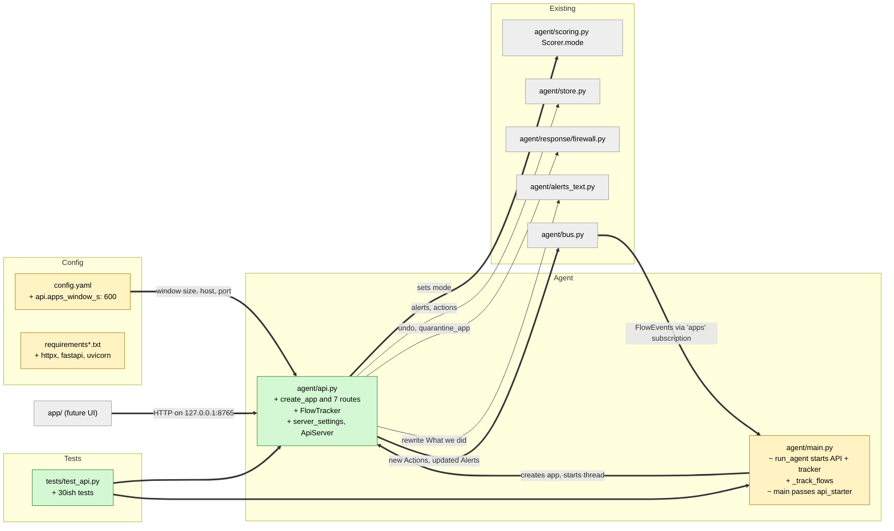

# Study guide: The local REST API that lets the app see and control the agent

**Ticket:** #39 · **Date:** 2026-11-07 · **Gate:** APPROVE (615 passed, baseline 576, ruff clean)

## The big picture

Before this change the HomeSOC agent (the background program that watches network traffic, raises alerts and adds firewall rules) worked on its own, and nothing else could talk to it. The desktop app had no way to ask "what is going on?" or to say "undo that block". Now the agent also runs a small web server, a REST API (a set of web addresses you send requests to and get JSON answers back). It listens only on `127.0.0.1:8765`, the "this computer only" address, so nothing outside the PC can reach it (safety rule 9.5).

Analogy: the agent is a security guard in a back room. The API is a window with a few labelled slots: "status", "list of alerts", "undo this", "change guard mode". The app is a person at the window who can drop notes through the slots but cannot walk in.

The endpoints: `GET /status`, `GET /apps`, `GET /alerts`, `POST /mode`, `POST /actions/{id}/undo`, `POST /undo-all`, `POST /alerts/{id}/quarantine`.

## Map of the changes



**How to read it:** green = new file, yellow = changed file, grey = existing file it plugs into; thick arrows are connections added by this ticket.

## File by file

### `agent/api.py` - new

**What it's for:** the whole REST API and the code that starts it.
**What changed and why:** the ticket needs the app to read state and give commands. Everything the API needs is passed in from outside, so tests can run on a Mac with no PowerShell.

**`create_app` (the factory)**

```python
def create_app(store, mode_holder, tracker, *, firewall_fns=None,
               allowlist=None, publish=None, clock=time.monotonic) -> FastAPI:
```

A factory is a function that builds the thing instead of it existing as a global. Every dependency (database, the object holding the mode, the flow tracker, the firewall functions, the trusted-apps list, the "send to bus" function, the clock) is handed in. In tests you pass fakes; in the real agent you pass the real ones. The route functions are plain `def` so FastAPI runs them in a thread pool and a slow PowerShell call does not freeze the server.

**`GET /status`, `GET /apps`, `GET /alerts`**

`/status` returns the mode, seconds of uptime, number of alerts, number of active (not undone) actions and number of apps. `/alerts?limit=N` returns stored alerts newest first (default 100, allowed 1 to 1000, otherwise FastAPI answers 422). `/apps` returns what the flow tracker holds.

**`FlowTracker` (feeds `/apps`)**

```python
def _expire(self, now):
    cutoff = now - self.window_s
    while self._flows and self._flows[0].at_s <= cutoff:
        self._flows.popleft()
```

It keeps recent flows in a `deque` (a list that is fast to remove from the front). Each flow is stamped with the time it was *received*, not the time NFStream says it started, because NFStream can report a flow many seconds late. Flows older than `api.apps_window_s` (600 s) are dropped. `_summarise` then groups flows per process: total bytes in and out, process ids, and per remote address the hostname, ports and bytes. For an inbound flow the "remote" side is the source IP. Example: two chrome.exe flows to the same IP, 100 and 50 bytes out, become one destination with `bytes_out=150, flows=2`.

**`POST /mode`**

```python
class ModeBody(BaseModel):
    mode: Literal["off", "notify", "auto"]
```

`Literal` means only those three exact strings are valid, so anything else (including `"AUTO"`) gets a 422 "unprocessable" error automatically. A good value is written to `mode_holder.mode`, which in the agent is the live Scorer, so the next signal is scored with the new mode. It is not saved to disk: restarting uses `config.yaml` again.

**`POST /actions/{id}/undo` and `POST /undo-all`**

Look up the stored action, call the firewall undo, then mark it undone and store a new `kind="undo"` record. Error codes: 404 unknown id, 409 already undone (or the action is itself an undo record), 502 if PowerShell failed. On a 502 nothing is marked undone, so the action still shows as active and the user can try again.

**`POST /alerts/{id}/quarantine`**

The user presses "quarantine" on an alert. Refusals come first: 404 unknown alert; 409 if the exe path is unknown (rule 9.6, in doubt do not block), if the app is on the allowlist, or if it is already quarantined (path compared case-insensitively, as Windows does); 400 if the path is unsafe for PowerShell; 502 if the firewall call fails. On success it saves the Action, adds its id to the alert's `action_ids`, rewrites the "What we did" text through `alerts_text`, saves the alert and publishes both.

**Server startup: `server_settings`, `make_server`, `ApiServer`, `start_in_thread`**

```python
if host != API_HOST:
    raise ValueError(f"Refusing to bind the API to {host!r}; ...")
```

The host must equal `127.0.0.1` exactly, otherwise the code refuses to start (even `localhost` and `0.0.0.0` are refused). uvicorn (the program that actually serves the web requests) runs in a daemon thread, meaning a background thread that dies with the agent. `stop()` sets `should_exit` and waits up to 5 s.

### `agent/main.py` - changed

**What it's for:** the pipeline entry point that starts capture and detection.
**What changed and why:** it now builds the tracker and API and starts the server.

`run_agent` gets two optional arguments, `api_starter` and `tracker`. It adds a second bus subscription named `"apps"`; a small task `_track_flows` copies every `FlowEvent` into the tracker. If an `api_starter` is given, it creates the app with `pipeline.scorer` as the mode holder and starts the server. On shutdown the apps task is cancelled and `server.stop()` is called. `main()` passes `api.start_in_thread`; tests pass nothing so no real server starts.

### `config.yaml`, `requirements.txt`, `requirements-dev.txt`, `CLAUDE.md` - changed

`config.yaml` gains `api.apps_window_s: 600` (thresholds live in config, not code). `httpx` is added because FastAPI's `TestClient` needs it; `fastapi` and `uvicorn` are added to the dev requirements so tests run on any OS. `CLAUDE.md` section 6.6 gets implementation notes on the routes and error codes, and the pip command gets `httpx`.

### `tests/test_api.py` - new (test)

**Fake data:** a temp SQLite store, a `FakeClock` that you advance by hand, a `FakeFirewall` that records calls and can be told to fail, a real `Scorer`, and synthetic alerts, actions and flows.

- Status and alerts: counts, uptime, newest-first order, `limit`, empty store.
- Mode: each valid mode is set; bad values give 422 and leave the mode unchanged; a mode change affects the next scoring decision.
- Undo: calls the firewall with the stored action; 404, 409 and 502 cases (action stays active); one test patches PowerShell at the subprocess level.
- Undo-all: success marks everything undone; failure marks nothing.
- Quarantine: action created and linked to the alert; 404, unknown path, allowlist, duplicate, 502 (alert unchanged) and 400 unsafe path.
- Apps: aggregation per process and destination, the 10-minute window using the fake clock, inbound flows, window read from config.
- Safety: the host is loopback, and `0.0.0.0`, `::`, empty, `localhost` and a LAN address are all refused.
- Integration: `run_agent` feeds the tracker and `POST /mode` changes the pipeline's mode.

## How you know it works

- Every route has tests for success and for each error code, so the status codes in the docs are checked.
- Failure paths check that nothing is half-done (a failed undo leaves the action active, a failed quarantine leaves the alert unchanged).
- The loopback-only rule is tested with several bad hosts.
- Verifier: PASS. Test gate: APPROVE, 615 tests passed (576 before), ruff clean, no blocking items.

## Try it yourself

1. Run only these tests: `.venv/bin/python -m pytest -q tests/test_api.py` (Windows: `.venv\Scripts\python -m pytest -q tests/test_api.py`).
2. Run the whole suite and lint: `.venv/bin/python -m pytest -q` then `.venv/bin/ruff check .`.
3. On the Windows VM, start `python -m agent.main` as admin, then open `http://127.0.0.1:8765/status` in a browser (FastAPI also shows `/docs`).

## Open questions / risks

- Race (verifier, minor): a manual quarantine and the pipeline can both rewrite the same alert at the same time, so one rewrite could overwrite the other.
- `kind="undo"` records show up in `list_actions(undone=False)`. The API filters them for its counts, but other callers of the store must do the same.
- The mode set through `/mode` is lost on restart (by design, but worth knowing).
- `GET /alerts/{id}/evidence` and `WS /ws` are not part of this ticket.
