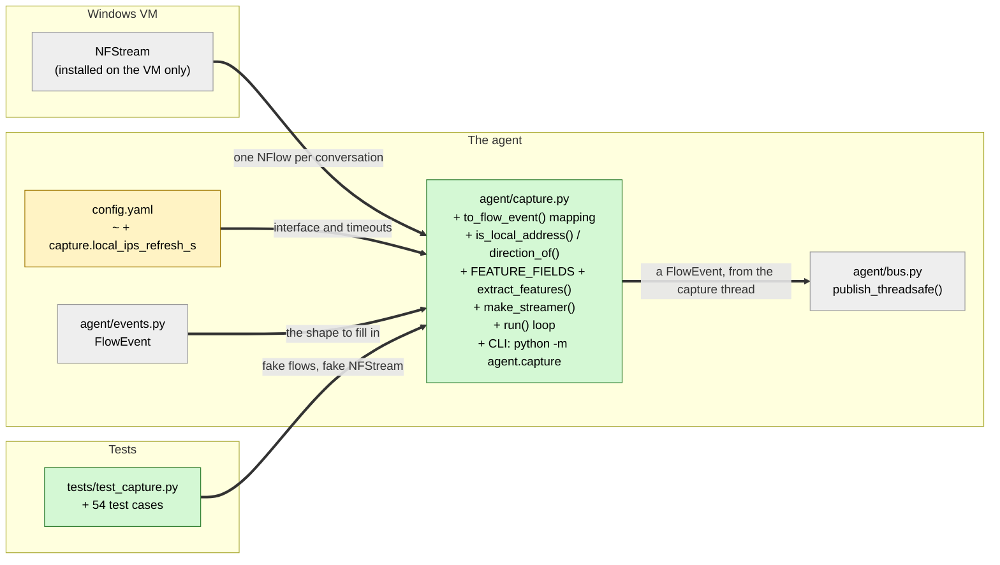

# Study guide: Turn live network traffic into FlowEvents

**Ticket:** #4 · **Date:** 2026-11-07 · **Gate:** BLOCK (second pass: every automated test approved; only the manual Windows VM check is left)

## The big picture

HomeSOC's first job is to *see* every network connection the PC makes. NFStream, a network
capture library, watches the network card and groups packets into **flows**: one flow is one
conversation, such as "Chrome talked to google.com on port 443 for 5 seconds and sent 1,234
bytes". NFStream calls each one an `NFlow` and gives it about a hundred attributes.

Before this ticket nothing read those flows. Now `agent/capture.py` starts NFStream with the
exact settings from the spec, turns each `NFlow` into the project's own `FlowEvent` (Jake's shared
format from #2), labels it `inbound` or `outbound`, and publishes it on the bus (#3) so the
detectors can see it. It also adds a command, `python -m agent.capture`, that prints each flow so
you can check it on the Windows VM.

Everyday analogy: NFStream is a mail sorter that writes a long slip for every letter. This file
copies the dozen facts we care about onto our own standard form, stamps it "incoming" or
"outgoing", and drops it in the shared mailbox.

## Map of the changes



**How to read it:** green = new file, grey = existing files this one uses but didn't change.
`+` = added. Every arrow is thick, because all of these connections are new with this ticket.

## Words you'll see

| Word | What it means here |
|------|--------------------|
| **packet** | One small chunk of data travelling over the network. |
| **flow** | A whole conversation between two addresses: many packets grouped together. |
| **NFStream / NFlow / NFStreamer** | The capture library, one flow record from it, and the object that produces flow records. |
| **IP address / port** | The computer's network address (`192.168.56.20`) and the numbered "door" on it a program uses (`443` for HTTPS). |
| **src / dst** | Source (who sent) and destination (who received). |
| **private / loopback / link-local IP** | Addresses that only work inside a home or office network (`192.168.x.x`, `10.x.x.x`), the PC talking to itself (`127.0.0.1`), and self-assigned addresses (`169.254.x.x`). |
| **IPv4 / IPv6** | The old address format (`8.8.8.8`) and the newer, longer one (`2001:4860::8888`). |
| **inbound / outbound** | Who started the conversation: someone else (inbound) or this PC (outbound). |
| **feature** | A number fed to a machine-learning model, e.g. average packet size. |
| **lazy import** | Loading a library only when a function actually needs it, not when the file is first opened. |
| **`getattr(obj, "name", default)`** | "Give me `obj.name`, or `default` if it doesn't have one." |
| **pure function** | A function whose output depends only on its inputs, with no network, files or clock. Easy to test. |
| **thread / `threading.Event`** | A separate line of work; and a simple on/off flag threads use to tell each other "stop". |
| **CLI** | Command-line interface: something you run by typing a command. |
| **`MagicMock` / `SimpleNamespace`** | Test stand-ins. `MagicMock` records how it was called. `SimpleNamespace(a=1)` is a quick object with attribute `a`. |

## File by file

### `agent/capture.py` - new

**What this file is for:** the agent's eyes: it starts NFStream and turns its flows into events.
**What changed and why:** new file for ticket #4. The PID fallback (when NFStream doesn't know
the process) is left as a hook for ticket #5.

#### Piece 1 - fixed settings and the feature list

```python
UNKNOWN_PROCESS = "unknown"
UNKNOWN_PID = -1
NFSTREAM_UNKNOWN_PIDS: frozenset[int] = frozenset({0, -1})  # NFStream's "no PID" values

STATISTICAL_ANALYSIS = True
SYSTEM_VISIBILITY_MODE = 1  # 1 = report the process name/PID that owns each flow

_DIRECTIONS = ("bidirectional", "src2dst", "dst2src")
_STATS = ("min", "mean", "stddev", "max")
_TCP_FLAGS = ("syn", "cwr", "ece", "urg", "ack", "psh", "rst", "fin")

FEATURE_FIELDS: tuple[str, ...] = (
    *(f"{d}_{m}" for d in _DIRECTIONS for m in ("duration_ms", "packets", "bytes")),
    *(f"{d}_{s}_ps" for d in _DIRECTIONS for s in _STATS),
    *(f"{d}_{s}_piat_ms" for d in _DIRECTIONS for s in _STATS),
    *(f"{d}_{f}_packets" for d in _DIRECTIONS for f in _TCP_FLAGS),
)
```

(Shortened: the comments between the `FEATURE_FIELDS` lines are left out.)

**In plain words:** name the fixed settings, then build the list of 57 statistics names to copy
for the flow-detection model (#48). They cover how long the flow lasted, how many packets and
bytes, packet sizes (`_ps`), the gaps between packets (`_piat_ms`, "packet inter-arrival
time"), and counts of each TCP flag.

**Line by line:**
1. `frozenset({0, -1})` is an unchangeable set: NFStream uses 0 or -1 to mean "no PID".
2. `f"{d}_{m}" for d in ... for m in ...` is a **generator** with two loops. For every direction
   `d` and every measure `m` it makes a name, so `"bidirectional_duration_ms"`,
   `"bidirectional_packets"`, … `"dst2src_bytes"`, which is 3 × 3 = 9 names.
3. `*(...)` **unpacks** each group into the one big tuple. In total that's 9 + 12 + 12 + 24 = 57
   names.
4. SYN, ACK, RST and FIN are TCP **flags**, signals inside packets. "SYN" starts a connection, so
   lots of SYNs with no reply is what a port scan looks like.

**Why it's written this way:** building the names from small lists avoids typing 57 strings by
hand. No IPs, ports or MAC addresses are in the list. Rule §7 bans them as model features,
because the model should learn *behavior*, not memorize addresses.

#### Piece 2 - small safe converters

```python
def _int(value: Any, default: int = 0) -> int:
    try:
        return int(value)
    except (TypeError, ValueError):
        return default


def _str_or_none(value: Any) -> str | None:
    if value is None:
        return None
    text = str(value).strip()
    return text or None
```

**In plain words:** turn anything into a whole number, using a default if that's impossible.
Turn empty text into `None`.

**Line by line:**
1. `int(value)` converts `"443"` or `443.0` to `443`. `int(None)` raises `TypeError` and
   `int("abc")` raises `ValueError`, and both fall back to `default`.
2. `str(value).strip()` makes it text and trims spaces, so `"  "` becomes `""`.
3. `text or None`: an empty string counts as false, so `""` becomes `None` and `"google.com"`
   stays as it is.

**Why it's written this way:** NFStream writes "no hostname" as `""`, but the project's contract
uses `None` for "nothing". The ticket requires `None` so later code can simply ask
`if event.hostname:`.

#### Piece 3 - inbound or outbound? (rewritten after the first review)

```python
def parse_ip(ip: str) -> IPAddress | None:
    try:
        addr = ipaddress.ip_address(str(ip).split("%", 1)[0])
    except ValueError:
        return None
    if isinstance(addr, ipaddress.IPv6Address) and addr.ipv4_mapped is not None:
        return addr.ipv4_mapped
    return addr


def host_addresses() -> frozenset[IPAddress]:
    import psutil  # lazy: only live capture needs it

    found: set[IPAddress] = set()
    for addrs in psutil.net_if_addrs().values():
        for snic in addrs:
            if snic.family in (socket.AF_INET, socket.AF_INET6):
                addr = parse_ip(snic.address)
                if addr is not None:
                    found.add(addr)
    return frozenset(found)


def is_local_address(ip: str, local_ips: Iterable[IPAddress]) -> bool:
    addr = parse_ip(ip)
    if addr is None:
        return False
    return addr.is_loopback or addr in frozenset(local_ips)


def direction_of(src_ip: str, local_ips: Iterable[IPAddress]) -> Literal["outbound", "inbound"]:
    return "outbound" if is_local_address(src_ip, local_ips) else "inbound"
```

(Shortened: docstrings are left out.)

**In plain words:** a flow is **outbound** only if *this PC* started it, meaning the starting
address is one of the PC's own addresses, or loopback (the PC talking to itself). Anything else is
**inbound**, even another machine on the same home or lab network.

**Line by line:**
1. `str(ip).split("%", 1)[0]`: IPv6 link-local addresses can carry a "zone" such as
   `fe80::1%eth0`, naming the network card. `split("%", 1)` cuts the text at the first `%` and
   `[0]` keeps the part before it.
2. `ipaddress.ip_address(...)` parses the text into an address object. Nonsense like `"999.1.1.1"`
   raises `ValueError`, so the function returns `None`.
3. `addr.ipv4_mapped`: an IPv6 address can wrap an IPv4 one (`::ffff:192.168.56.10`). This unwraps
   it so both spellings compare equal.
4. `psutil.net_if_addrs()` lists every network card and its addresses. `.values()` gives just the
   address lists. `AF_INET`/`AF_INET6` are IPv4/IPv6, and other kinds, like the card's hardware
   (MAC) address, are skipped.
5. `addr in frozenset(local_ips)` asks "is this one of the PC's addresses?"
6. `Literal["outbound", "inbound"]` is a type hint meaning "only these two exact words".

**Why it's written this way:** the first version treated *any* private address (`192.168.x.x`)
as "this PC". That labelled an attack from the lab machine `192.168.56.20`, or from an infected
phone on the same Wi-Fi, as **outbound**, so the inbound-attack detector (#48) would never see it.
David decided "local" means *this PC's own addresses*. CLAUDE.md §6.1 now says so.

#### Piece 3b - keeping the PC's address list fresh

```python
class LocalAddresses:
    def __init__(self, refresh_s, source=None, clock=time.monotonic) -> None:
        self._refresh_s = refresh_s
        self._source = source or (lambda: host_addresses())
        self._clock = clock
        self._ips: frozenset[IPAddress] = frozenset()
        self._read_at: float | None = None

    def get(self) -> frozenset[IPAddress]:
        now = self._clock()
        if self._read_at is None or now - self._read_at >= self._refresh_s:
            try:
                self._ips = self._source()
            except Exception:
                logger.exception("Could not read this PC's addresses; keeping the last ones")
            self._read_at = now
        return self._ips
```

(Shortened: type hints on the arguments and a comment are left out.)

**In plain words:** reading the network cards on every single flow would be wasteful, so the
address list is remembered and re-read only every 60 seconds (`capture.local_ips_refresh_s`).
The PC's address can change when Wi-Fi reconnects and the router hands out a new one (DHCP). If
a re-read fails, the last known list is kept.

**Line by line:**
1. `source or (lambda: host_addresses())`: if no source is given, use a tiny function that calls
   `host_addresses` *when needed*. Tests can then swap in a fake.
2. `time.monotonic()` is a stopwatch that never jumps backwards, even if the clock is changed.
3. `now - self._read_at >= self._refresh_s` asks "has it been 60 seconds since the last read?"

#### Piece 4 - the process name, and the hook for #5

```python
def default_process_fallback(flow: Any) -> tuple[str, int] | None:
    """TODO(#5): map the flow's local port to a PID with psutil.net_connections(...)"""
    return None


def _process_of(flow: Any, process_fallback: ProcessFallback | None) -> tuple[str, int]:
    name = _str_or_none(getattr(flow, "system_process_name", None))
    if name is None:
        resolved = (process_fallback or default_process_fallback)(flow)
        return resolved if resolved is not None else (UNKNOWN_PROCESS, UNKNOWN_PID)
    pid = _int(getattr(flow, "system_process_pid", None), UNKNOWN_PID)
    return name, (UNKNOWN_PID if pid in NFSTREAM_UNKNOWN_PIDS else pid)
```

(Shortened: the full docstring is cut to one line.)

**In plain words:** use the process name NFStream reports. If it reports none, ask the fallback.
For now the fallback always says "don't know", so the flow gets `"unknown"` and PID `-1`.
Ticket #5 will plug in a real fallback.

**Line by line:**
1. `tuple[str, int] | None` means "returns a `(name, pid)` pair, or `None`".
2. `(process_fallback or default_process_fallback)(flow)`: the brackets pick whichever function
   was supplied, and `(flow)` then calls it.
3. `pid in NFSTREAM_UNKNOWN_PIDS` turns NFStream's 0 or -1 into the project's -1.

#### Piece 5 - the mapping itself

```python
def to_flow_event(flow, local_ips, process_fallback=None) -> FlowEvent:
    process, pid = _process_of(flow, process_fallback)
    src_ip = str(getattr(flow, "src_ip", "") or "")
    return FlowEvent(
        ts_ms=_int(getattr(flow, "bidirectional_first_seen_ms", 0)),
        end_ms=_int(getattr(flow, "bidirectional_last_seen_ms", 0)),
        process=process,
        pid=pid,
        exe_path=None,
        src_ip=src_ip,
        ...
        hostname=_str_or_none(getattr(flow, "requested_server_name", None)),
        app_proto=_str_or_none(getattr(flow, "application_name", None)),
        bytes_out=_int(getattr(flow, "src2dst_bytes", 0)),
        bytes_in=_int(getattr(flow, "dst2src_bytes", 0)),
        packets=_int(getattr(flow, "bidirectional_packets", 0)),
        direction=direction_of(src_ip, local_ips),
        features=extract_features(flow),
    )
```

(Shortened: type hints on the signature are left out. `src_port`, `dst_ip`, `dst_port` and
`protocol` follow the same pattern. The 3-line `extract_features()` copies each `FEATURE_FIELDS`
name the flow actually has. `local_ips`, this PC's addresses, is passed in so the function stays
pure: the same inputs always give the same output.)

**In plain words:** fill in each field of the project's `FlowEvent` from the matching NFStream
attribute.

**Line by line:**
1. `process, pid = ...` **unpacks** the pair into two variables.
2. `getattr(flow, "requested_server_name", None)` reads the hostname (the website name from DNS
   or the TLS "SNI" field), or `None` if the attribute is missing.
3. `src2dst_bytes` → `bytes_out`: "source to destination" bytes are what this side *sent*.
4. `exe_path=None`: NFStream doesn't know the file path. `procinfo` (#6) finds it later from the
   PID.
5. Every read uses `getattr` with a default, so a flow missing an attribute still maps instead of
   crashing.

**Why it's written this way:** keeping it pure (no NFStream inside) means it can be tested on the
Mac with fake flows. The downside is that if NFStream spells an attribute differently than
expected, the code quietly uses the default. That's why the VM check matters.

#### Piece 6 - starting NFStream

```python
def make_streamer(cfg: dict[str, Any]) -> Any:
    try:
        from nfstream import NFStreamer  # lazy: Windows/VM-only dependency
    except ImportError as exc:
        raise CaptureError(
            "NFStream is not installed. Live capture needs Windows with Npcap and "
            "`pip install nfstream` (CLAUDE.md §8)."
        ) from exc

    capture_cfg = cfg["capture"]
    return NFStreamer(
        source=capture_cfg["interface"],
        statistical_analysis=STATISTICAL_ANALYSIS,
        system_visibility_mode=SYSTEM_VISIBILITY_MODE,
        idle_timeout=capture_cfg["idle_timeout"],
        active_timeout=capture_cfg["active_timeout"],
    )
```

**In plain words:** load NFStream only now, and start it on the configured network card with
exactly the spec's settings.

**Line by line:**
1. The `import` sits *inside* the function, which makes it a **lazy import**. Opening
   `capture.py` on the Mac works fine; only calling this function needs NFStream.
2. `except ImportError` turns "module not found" into a clear message saying what to install.
3. `idle_timeout=10`: a flow with no packets for 10 s is finished. `active_timeout=30`: a
   long-running flow is reported every 30 s so detectors don't wait forever.
4. `n_dissections` is deliberately **not** passed. Its default (20 packets examined) is what
   fills in the hostname.

#### Piece 7 - the capture loop

```python
def run(bus, cfg, streamer_factory=make_streamer, stop_event=None, process_fallback=None,
        local_addresses=None) -> int:
    if local_addresses is None:
        local_addresses = LocalAddresses(cfg["capture"]["local_ips_refresh_s"])
    published = 0
    for flow in streamer_factory(cfg):
        if stop_event is not None and stop_event.is_set():
            break
        try:
            event = to_flow_event(flow, local_addresses.get(), process_fallback)
        except Exception:
            logger.exception("Could not map an NFStream flow to a FlowEvent; skipping it")
            continue
        bus.publish_threadsafe(event)
        published += 1
    logger.info("Capture stopped after publishing %d flow(s)", published)
    return published
```

(Shortened: the signature is put on one line with its type hints removed, and the docstring is
left out.)

**In plain words:** for every flow NFStream produces, stop if asked to, convert it, and post it on
the bus. One broken flow is logged and skipped. It doesn't stop capture.

**Line by line:**
1. `for flow in streamer_factory(cfg):` loops forever on a live network, because NFStream keeps
   handing out flows. It **blocks**, meaning it waits while no traffic is flowing.
2. `stop_event.is_set()` checks whether someone flipped the stop flag.
3. `logger.exception(...)` logs the message plus the full error details.
4. `bus.publish_threadsafe(event)`: this loop runs in its own thread, so it must use the
   thread-safe publish from #3, not `publish()`.
5. `streamer_factory=make_streamer` is the default, but tests pass a fake that returns a plain
   list of fake flows.

#### Piece 8 - the CLI for the VM check

```python
async def _log_flows(bus: Bus) -> None:
    with bus.subscribe("capture-cli") as sub:
        async for event in sub:
            logger.info("flow %s pid=%s host=%s -> %s:%s (%s)", event.process, event.pid,
                        event.hostname, event.dst_ip, event.dst_port, event.direction)


async def _main_async(cfg, stop_event) -> None:
    bus = Bus.from_config(cfg, loop=asyncio.get_running_loop())
    printer = asyncio.create_task(_log_flows(bus))
    try:
        await asyncio.to_thread(run, bus, cfg, stop_event=stop_event)
    finally:
        stop_event.set()
        printer.cancel()
        ...
```

(Shortened: the log call is reflowed, and `main()` is left out. `main()` sets up logging, loads
config, and exits with code 1 and a clear message if NFStream is missing.)

**In plain words:** make a bus, subscribe one listener that logs every flow, and run capture in a
background thread. On exit, set the stop flag and stop the listener.

**Line by line:**
1. `asyncio.create_task(...)` starts the logging listener running alongside.
2. `asyncio.to_thread(run, ...)` runs the blocking `run()` in a separate thread, so it doesn't
   freeze the event loop.
3. `finally:` runs whether capture ended normally or with Ctrl+C.

### `config.yaml` - changed

```diff
   active_timeout: 30      # NFStream active_timeout (s)
+  local_ips_refresh_s: 60 # re-read this PC's own IPs (inbound vs outbound) this often
```

### `CLAUDE.md` - changed

```diff
-- Map each NFlow → `FlowEvent`. `direction="inbound"` if `src_ip` is not a local address.
+- Map each NFlow → `FlowEvent`. `direction="outbound"` if `src_ip` is **one of this PC's own
+  addresses** (from `psutil.net_if_addrs()`, re-read every `capture.local_ips_refresh_s`) or
+  loopback; otherwise `"inbound"`. "Local" means *this host*, not "any private IP": ...
```

(Shortened: the last line of the new text is cut.)

**In plain words:** the spec now records David's decision. §13 requires updating the spec in the
same change, and Jake's and David's later detector tickets rely on this rule.

### `tests/test_capture.py` - new (test)

**The fake data:** `_flow()` builds a `SimpleNamespace` fake NFlow with every mapped attribute
(Chrome, `192.168.56.10` → `142.250.80.4:443`, `www.google.com`, 1234 bytes out, 56789 in) plus
a few statistics and two MAC addresses that must *not* become features. The `fake_nfstream`
fixture inserts a fake `nfstream` module whose `NFStreamer` is a `MagicMock` that records its
arguments.

```python
def test_make_streamer_uses_exactly_the_spec_settings(fake_nfstream: MagicMock) -> None:
    cfg = config.load()
    streamer = capture.make_streamer(cfg)
    assert streamer is fake_nfstream.return_value
    fake_nfstream.assert_called_once_with(
        source="Ethernet",
        statistical_analysis=True,
        system_visibility_mode=1,
        idle_timeout=10,
        active_timeout=30,
    )
    _, kwargs = fake_nfstream.call_args
    assert "n_dissections" not in kwargs
```

**What the checks do:** `assert_called_once_with` checks the fake `NFStreamer` was called once
with exactly these arguments and no others. The last line double-checks that `n_dissections`
wasn't passed.

The tests, grouped:
- **Mapping (19 cases):** every field matches a full expected `FlowEvent`, bytes out and in
  aren't swapped, PID 0 and -1 become -1, an empty process name gives `"unknown"`/-1, missing
  attributes give defaults, the #5 hook is used only when the name is empty, features skip
  missing values, never include IPs, ports or MACs, and cover all 57 names, and a bare object
  maps without crashing.
- **Direction (24 cases):** the tests use `PC_IPS = {192.168.56.10, fe80::1}` as "this PC".
  - The PC's own addresses and loopback (`127.x`, `::1`) give outbound.
  - **The lab attacker `192.168.56.20` connecting to the PC's port 22 gives inbound.**
  - Every other machine (other private, link-local, IPv6-private and public addresses) gives
    inbound, and nonsense addresses give inbound.
  - `fe80::1%eth0` and `::ffff:192.168.56.10` are normalized, and with no known addresses only
    loopback is outbound.
  - The first-pass tests (any private address = outbound) were replaced, because they encoded
    the rejected rule.
  - The gate swapped the old rule back into a scratch copy: 10 of these tests failed, so they
    really guard the fix.
- **This PC's addresses (4):** `host_addresses()` reads every network card's IPv4 and IPv6
  addresses (with a fake psutil) and skips the hardware address. The list is re-read after 60 s
  and kept if a re-read fails. The setting loads from config, and `run()` with no address list
  reads this PC's addresses itself.
- **Empty → None (7 cases):** `""`, spaces and `None` for both hostname and app name become
  `None`.
- **Streamer (2):** the exact spec settings from the real `config.yaml`, and the values really
  come from config.
- **Run loop and import (7):** importing works without NFStream (checked in a separate Python
  process with NFStream blocked), a clear error is raised when it's missing, every mapped flow is
  published with `publish_threadsafe`, a bad flow is skipped, the stop flag works, the hook is
  passed through, and a real thread plus real bus deliver 200 events in order.

## How you know it works

- 54 new tests pass alongside the earlier 186: **240 passed** on 3 runs, with ruff clean and no
  regressions.
- First gate pass: BLOCK. The direction rule was wrong and the VM check wasn't done.
- Second gate pass: **every automated test approved**, the direction fix was proven by the
  mutation check, and there was no tampering. It still says BLOCK only because the manual VM check
  can't be done on a Mac.

## Try it yourself

1. Run all checks from `CLAUDE.md` `## Checks`: `.venv/bin/python -m pytest -q` (expect
   `240 passed`) and `.venv/bin/ruff check .`.
2. Run just this ticket's tests: `.venv/bin/python -m pytest -q tests/test_capture.py`.
3. See the direction rule work:
   `.venv/bin/python -c "import agent.capture as c; from ipaddress import ip_address as a; pc={a('192.168.56.10')}; print(c.direction_of('192.168.56.20', pc), c.direction_of('192.168.56.10', pc))"`
   prints `inbound outbound`: the lab attacker is inbound and the PC is outbound.
4. See your own machine's addresses:
   `.venv/bin/python -c "import agent.capture as c; print(sorted(map(str, c.host_addresses())))"`.
5. **The manual check, on the Windows VM in an admin terminal:** set `capture.interface` in
   `config.yaml` to the name Wireshark shows, run `.venv\Scripts\python -m agent.capture`, and open
   a website. You should see lines like `flow chrome.exe pid=4242 host=www.google.com ->
   142.250.80.4:443 (outbound)`. If process names or hostnames come out as `unknown`/`None` for
   everything, an NFStream attribute name is probably wrong.

## Open questions / risks

- **Fixed (first pass blocked on this): the inbound rule.** "Local" now means this PC's own
  addresses, by David's decision, recorded in CLAUDE.md §6.1. Lab and home-network attackers are
  inbound, so #48 can see them.
- **Still blocking: the manual VM check isn't done.** `python -m agent.capture` needs NFStream
  and Npcap on Windows. Until someone runs it there, or explicitly waives it, that criterion is
  unmet.
- **Risk: the NFStream attribute names are unconfirmed.** They were written from memory and
  couldn't be checked against the docs or a live install. The core ones (`system_process_pid`,
  `requested_server_name`, `bidirectional_packets`, …) look right to both reviewers, but a wrong
  name fails *silently* because of the `getattr` defaults. The VM check will show this.
- **Minor:**
  - If the PC gets a new address mid-session, flows can be mislabelled for up to 60 seconds,
    until the next re-read.
  - The CLI can take until the next flow (or a timeout) to exit after Ctrl+C on a quiet network,
    because the stop flag is only checked between flows.
  - An empty process name also drops NFStream's PID; ticket #5 can revisit that.
