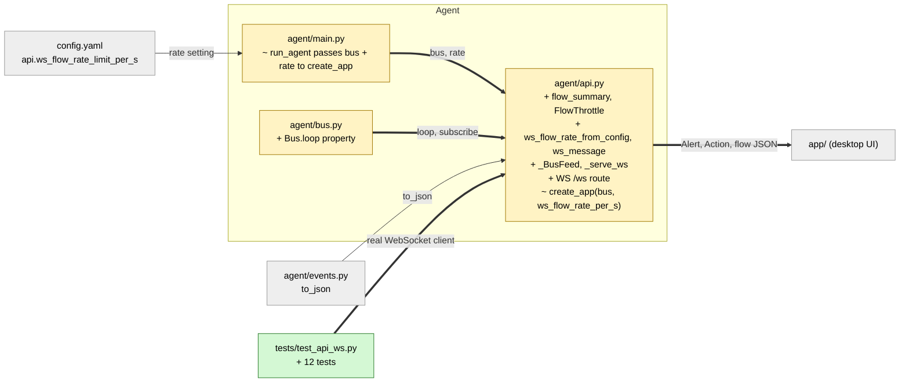

# Study guide: Push alerts, actions and throttled flows over WS /ws

**Ticket:** #40 · **Date:** 2026-11-07 · **Gate:** APPROVE

## The big picture

Before this change the agent had a REST API: the app had to keep asking "anything new?". Now
the agent has a live channel, a **WebSocket** (a connection that stays open so the server can
push messages whenever it likes). The desktop app connects to `/ws` and instantly receives
every Alert and every Action as JSON, plus a small summary of network flows, at most 5 per
second so the screen is not flooded.

Think of a radio station. Alerts and Actions are the news bulletins: every listener hears all
of them. Flow summaries are the traffic report, read out only a few times per second. Each
listener tunes in separately, so each gets their own copy of the broadcast.

## Map of the changes



**How to read it:** green = new, yellow = changed, grey = untouched; thick arrows are
connections added by this ticket.

## File by file

### `agent/bus.py` - changed

**What it's for:** the bus is the agent's internal message board; every part subscribes to it.
**What changed and why:** it now exposes which event loop it lives on, so `/ws` can tell
whether it is running on the same loop.

```python
@property
def loop(self) -> asyncio.AbstractEventLoop | None:
    return self._loop
```

An "event loop" is the scheduler that runs async code. The bus runs on the main one; the web
server (uvicorn) runs on a second one in its own thread. Queues from one loop must not be
used directly from another, so `/ws` needs to know which is which.

### `agent/api.py` - changed

**What it's for:** the local HTTP/WebSocket API on 127.0.0.1.
**What changed and why:** adds the `/ws` route and the helpers behind it.

**`flow_summary(event)`**

```python
return {"type": "flow", **{name: getattr(event, name) for name in FLOW_SUMMARY_FIELDS}}
```

Builds a small dictionary from a FlowEvent with just 11 fields (process, IPs, bytes,
direction...). The bulky `features` dictionary is left out. `**` copies all the pairs in.

**`FlowThrottle`**

```python
cutoff = now - WS_FLOW_WINDOW_S
while self._sent and self._sent[0] <= cutoff:
    self._sent.popleft()
if len(self._sent) >= self.rate_per_s:
    return False
self._sent.append(now)
return True
```

A sliding 1-second window. It remembers the times of recent sends, forgets any older than one
second, and refuses when the list is already full. Example with a limit of 2: sends at t=0,
0 are allowed, a third at 0 is refused, and at t=1.0 both old ones have expired so sending
works again. It uses the injected `clock`, so tests control time. One throttle per client.

**`ws_flow_rate_from_config`** reads `api.ws_flow_rate_limit_per_s` (default 5).

**`ws_message(event, throttle)`** decides what to send: Alerts and Actions always
(`to_json`), FlowEvents only if the throttle allows (as a summary), everything else
(Signals) is skipped by returning `None`.

**`_BusFeed`**

```python
self._sub = await asyncio.wrap_future(
    asyncio.run_coroutine_threadsafe(subscribe(), bus_loop))
```

The bridge between the two loops. If the server shares the bus's loop (or the bus has none
yet) it just subscribes directly. Otherwise it submits the subscribe, each `get`, and the
close to the bus's loop with `run_coroutine_threadsafe` ("run this on that other loop and
give me the result"), and waits on the answer.

**`_serve_ws`** runs two tasks per connection: `pump` reads events and sends them;
`watch` just reads from the client so it notices a disconnect right away. When either
finishes, both are cancelled. If the bus subscription ends, the socket closes with code 1001
("going away").

**The `/ws` route** (inside `create_app`)

```python
await feed.open()          # subscribe first
await websocket.accept()   # then complete the handshake
await _serve_ws(...)
...
finally:
    feed.close()           # always unsubscribe
```

Subscribing before accepting means that once a client is connected it cannot miss an event.
The `finally` guarantees cleanup however the connection ends. With no bus, it closes with
1011 (server error); a closed bus loop does the same.

**`create_app`** gains `bus=` and `ws_flow_rate_per_s=`, and builds one throwaway
`FlowThrottle` up front so a bad rate fails at startup, not at the first connection.

### `agent/main.py` - changed

**What it's for:** starts the whole agent.
**What changed and why:** `run_agent` now hands `bus` and the configured rate to
`create_app`, so `/ws` reads the real agent bus.

### `tests/test_api_ws.py` - new (test)

**Fake data:** a real `Bus` and a real WebSocket client (`TestClient.websocket_connect`), a
fake clock, and synthetic Alerts, Actions and FlowEvents from `tests/test_api.py`.

- **Alerts/actions pushed:** a published Alert and Action arrive as JSON with the right fields; Signals are not sent.
- **Throttle:** 100 flows in one second give only 5 flow messages while an Action and Alert in the middle still arrive; a new second allows flows again; each client has its own limit; the sliding window and a negative rate are checked directly.
- **Summary:** the flow message has exactly the small field set, no `features`.
- **Config:** the rate is read from config, with a default.
- **Disconnects:** one client leaving unsubscribes it and does not disturb others; no bus means close code 1011.
- **Two loops:** the bus on a separate thread's loop still delivers and cleans up.
- **End to end:** through `run_agent`, captured fake NFlows reach a `/ws` client as flow summaries.

## How you know it works

- Alerts and Actions reach a real WebSocket client intact, and are never throttled.
- 100 flows in a second yield at most 5 flow messages per client.
- Disconnecting leaves no leftover subscription (`bus.subscribers` is empty at the end).
- The two-loop layout used by the real agent is tested, not just the easy single-loop case.
- Gate: APPROVE; 639 tests pass (626 before) and ruff is clean.

## Try it yourself

1. Run just these tests: `.venv/bin/python -m pytest -q tests/test_api_ws.py` (Windows: `.venv\Scripts\python -m pytest -q tests/test_api_ws.py`).
2. Run the lint check: `.venv/bin/ruff check .`
3. Change `RATE` in the test file to 3 and see which assertions follow it.

## Open questions / risks

- The test helper `recv` reads Starlette's private `ws._send_rx`; a Starlette upgrade could break the tests (not the feature).
- Slow clients: if a client reads slowly, its own bus queue may drop events; this guide did not check how the bus reports that.
- Verifier was skipped (size S); only the test gate reviewed this.
