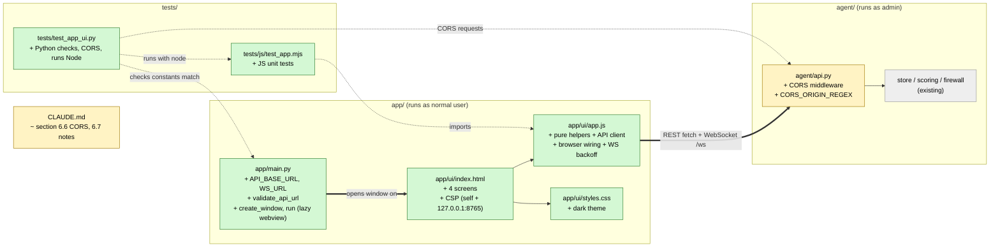

# Study guide: The HomeSOC desktop window and its four screens

**Ticket:** #41 · **Date:** 2026-11-07 · **Gate:** APPROVE

## The big picture

Before this change HomeSOC was only a background program (the "agent") with a local API. There was nothing a person could look at or click. Now `python -m app.main` opens a desktop window with four screens: **Home** (status tiles and recent alerts), **Apps** (which programs use the network), **Alerts** (cards that say What happened / What we did / What you should do, with Undo, Quarantine and Export evidence buttons) and **Settings** (switch the mode off/notify/auto, plus "Undo all").

Analogy: the agent is the security guard in the back room, and the window is the monitor on the front desk. The monitor never makes decisions itself. It only asks the guard (over `127.0.0.1:8765`, which means "this same computer") and shows the answers. The window is a web page (HTML, CSS, JavaScript) shown inside a small native window by a library called pywebview.

## Map of the changes



**How to read it:** green = new file, yellow = existing file edited, grey = existing and untouched. Thick arrows are connections added by this ticket; dotted arrows are tests checking something.

## File by file

### `app/main.py` - new

**What it's for:** Starts the desktop window.
**What changed and why:** The ticket needs a window that can only ever talk to the local agent.

**The URL constants and `validate_api_url`**

```python
API_BASE_URL = "http://127.0.0.1:8765"
...
if parts.hostname != API_HOST:
    raise ValueError(...)
```

There is one constant for the agent's address. `validate_api_url` takes any URL and raises an error unless it is `http` or `ws` on exactly `127.0.0.1`, port 8765, with no user name or password in it. `localhost` and `0.0.0.0` are refused on purpose. The rule from CLAUDE.md is that the app must only talk to the local agent. `create_window` runs the check before opening anything.

**`create_window` and `run`**

```python
import webview as webview_module  # lazy
...
webview_module.start(http_server=True, debug=debug)
```

`webview` is imported inside the function, not at the top of the file. That way the tests import this file on a Mac or Linux machine where pywebview is not installed (it is only needed on the Windows VM). `http_server=True` tells pywebview to serve the UI files from a tiny local web server (`http://127.0.0.1:<random port>/`) instead of `file://`. `run` also accepts an `on_started` callback, a hook where the later tray-icon and toast tickets will plug in.

### `app/ui/index.html` - new

**What it's for:** The page skeleton: a sidebar with four nav buttons and four `<section>`s (only one visible at a time).
**What changed and why:** Gives the screens a home, and adds a security rule.

**The Content Security Policy (CSP)**

```html
<meta http-equiv="Content-Security-Policy"
  content="default-src 'self'; ... connect-src http://127.0.0.1:8765 ws://127.0.0.1:8765; ..." (shortened)>
```

A CSP is a list of rules the browser enforces about where a page may load things from. This one says: load scripts and styles only from the app's own files, and only open network connections to the agent. Even if a bug let an attacker inject code into the page, the browser would refuse to send data anywhere else.

### `app/ui/styles.css` - new

**What it's for:** A dark "security dashboard" look using system fonts only (no web fonts, so no outside requests). Colours are CSS variables, with severity colours (green/yellow/orange/red) matching the tray colours in the spec.

### `app/ui/app.js` - new

**What it's for:** All the behaviour. It has two halves so it can be tested without a browser.

**Half 1: pure helpers** (no DOM, so Node can run them)

- `escapeHtml` - replaces `& < > " ' \`` with safe codes. Every alert field (title, process name, hostname...) goes through it before being put in HTML. Otherwise a process named `` could run code inside the window. This is called an XSS attack.
- API client (`apiRequest`, `getStatus`, `getApps`, `getAlerts`, `undoAction`, `undoAll`, `setMode`, `quarantineAlert`, `exportEvidence`). Each takes an optional `fetchFn`, so tests pass in a fake `fetch` and check which URL and method were used. A failed call becomes an `ApiError`, and `errorMessage` turns it into a friendly sentence (for example 502 becomes "The Windows Firewall change failed; nothing was changed.").
- `renderAlertCard` builds the card with the three sections, one Undo button per action id, a Quarantine button (disabled if the alert has no `exe_path`) and an Export evidence button.
- `renderAppsTable`, `renderStatusTiles` - same idea for the Apps and Home screens.
- State updates: `upsertAlert` (insert or replace by id, newest first), `mergeFlow` (adds one live flow summary to the Apps list), `applyWsMessage` (decides what a WebSocket message changes).
- `nextBackoff(n)`: the wait before reconnect try n.

Worked example for the backoff: attempts 0, 1, 2, 3 wait 1 s, 2 s, 4 s, 8 s, and from attempt 5 on it stays at the 30 s cap. That way a stopped agent is not hammered with reconnects.

**Half 2: browser wiring** (`startUi`, only runs when `document` exists)

It switches screens, loads the first data from REST, then opens the WebSocket (`/ws`). Alerts and actions pushed over `/ws` update the cards at once, and flow summaries update the Apps table live. If the socket closes, it shows "Agent offline - reconnecting..." and retries with the backoff. Quarantine and Undo all ask `confirm(...)` first. Changing a mode radio button calls `POST /mode`.

The file ends by exporting its functions with `module.exports` when run under Node, which is how the tests get to them.

### `agent/api.py` - changed (CORS)

**What it's for:** The agent's REST and WebSocket server.
**What changed and why:** Browsers block a page on one "origin" (host + port) from reading answers from another. The window's page lives at `http://127.0.0.1:<random>/` and the API at `127.0.0.1:8765`, so they differ.

```python
CORS_ORIGIN_REGEX = r"^http://(127\.0\.0\.1|localhost)(:[0-9]{1,5})?$"
app.add_middleware(CORSMiddleware, allow_origin_regex=CORS_ORIGIN_REGEX,
                   allow_methods=["GET", "POST"], allow_headers=["Content-Type"])
```

CORS (cross-origin resource sharing) is the set of headers where the server says "this other origin may read my answers". Only plain-`http` loopback origins match. A web page from the internet, or a sandboxed page whose origin is the string `null`, gets no headers.

### `CLAUDE.md` - changed

Adds the CORS note under section 6.6 and the implementation notes for `app/` under 6.7 (the single constant, lazy import, CSP, how the JS tests run), as the project rules require when a spec changes.

### `tests/js/test_app.mjs` - new (test)

Uses Node's built-in test runner with a fake `fetch` that records calls and returns canned answers. Groups:
- Base URL and WS URL are the local agent.
- Alert card has all three sections, labels actions, disables Quarantine without a path.
- XSS: hostile titles, process names and hostnames come out escaped.
- Every API function uses the right method, path and JSON body; ids are URL-encoded; a bad mode never calls fetch.
- Errors (404/409/502, network down) become readable messages.
- WebSocket messages update alerts/actions/apps; backoff grows and is capped.

### `tests/test_app_ui.py` - new (test)

- Python constants: exact base URL, `validate_api_url` accepts loopback and rejects other hosts, ports, user info; `create_window` refuses a bad URL.
- Static scan: `app.js`, HTML and CSS mention no host except the agent and load nothing external; the CSP only allows self and the agent; the four screens exist.
- A `FakeWebview` checks that `create_window` loads `index.html`, `run` uses `http_server=True`, the `on_started` hook gets the window, and importing `app.main` does not import `webview`.
- Runs the Node harness through `node` (skipped if `node` is missing) and checks the JS and Python URLs are equal.
- CORS: loopback origins get headers; other origins (remote sites, `null`) do not.

## How you know it works

- Gate verdict **APPROVE**: 685 tests passed (the baseline before this ticket was 640), ruff is clean and the smoke test passes.
- The verifier gave **PASS** after reading the code against the ticket.
- The URL tests make it hard to point the app at another host by accident: the Python side, the JS side and the CSP are all checked.
- The XSS tests show hostile strings are escaped in alert cards and the Apps table.
- Still not done: the manual check on the Windows VM (the window opens, Apps updates live from `/ws`).

## Try it yourself

1. Run just these tests: `.venv/bin/python -m pytest -q tests/test_app_ui.py` (Windows: `.venv\Scripts\python -m pytest -q tests\test_app_ui.py`). Node must be installed for the JS part to run.
2. Run the JS tests alone: `node --test tests/js/test_app.mjs`.
3. On the Windows VM: start the agent in an admin terminal (`.venv\Scripts\python -m agent.main`), then `.venv\Scripts\python -m app.main` in a normal one.
4. Run the full check: `.venv/bin/ruff check .`.

## Open questions / risks

- Manual VM check (window opens, Apps updates live) still has to be done.
- The CORS regex also allows `localhost`, which the app does not need. It could be removed.
- `GET /alerts/{id}/evidence` does not exist yet, so Export evidence will show an error until that ticket lands.
- Pre-existing gap: simple cross-site POSTs to the API and to the WebSocket have no `Origin` check. CORS does not stop a hostile page from sending those requests, only from reading the answers. This needs a follow-up ticket.
- After an agent restart, Undo buttons have generic labels ("Undo action ab12cd34") because there is no `GET /actions` to look the action up.
- The tray icon and toasts are a separate ticket (`run(on_started=)` is the hook).
