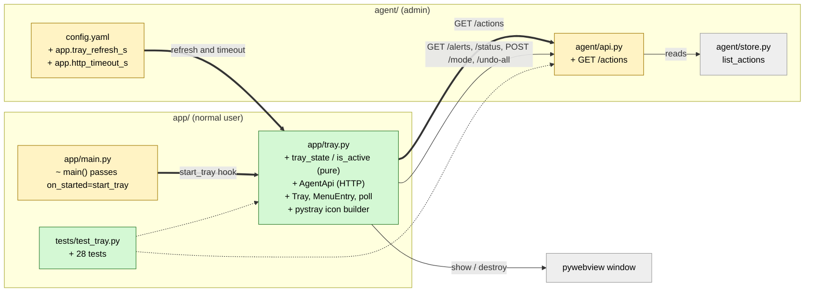

# Study guide: The tray shield with status colours and a menu

**Ticket:** #42 · **Date:** 2026-11-07 · **Gate:** APPROVE (713 passed: 685 baseline + 28 new, ruff clean, smoke passes, no tampering)

## The big picture

Before this change, HomeSOC only had a window (pywebview). If you closed it you had no way to
see whether the PC was safe, and no quick way to switch mode or undo a block. Now a small
shield sits in the Windows system tray (the icons by the clock). It is **green** when there are
no alerts, **yellow** when only low or medium alerts are open, and **red** when a high or
critical alert is still active. Right-click gives the menu: Open, Mode (off / notify / auto),
Undo all, Quit.

Analogy: it is the warning light on a car dashboard. You do not read the engine data. You just
glance at the colour, and the menu is the few buttons you may need in a hurry.

## Map of the changes



**How to read it:** green = new file, yellow = changed file, grey = existing and untouched; thick arrows are connections added by this ticket.

## File by file

### `config.yaml` - changed

**What it's for:** all tunable numbers live here, not in code.
**What changed and why:** a new `app:` section with two settings.

```yaml
app:
  tray_refresh_s: 5    # how often the tray re-reads the agent
  http_timeout_s: 5    # give up on one call after this long
```

The tray checks the agent every 5 seconds, and no single request may hang longer than 5 seconds.

### `agent/api.py` - changed

**What it's for:** the agent's local REST API.
**What changed and why:** `GET /alerts` does not say whether an alert's action was undone, but
the tray needs that to decide if an alert is still "active". So a read-only `GET /actions` was added.

```python
@app.get("/actions")
def actions(limit=..., undone: bool | None = None):
    return {"actions": [to_json(a) for a in store.list_actions(limit, undone=undone)]}
```

It just returns stored actions (undo records included), newest first. It changes nothing, so it
is safe to add. `limit` is capped at 10,000 and `undone` optionally filters.

### `app/tray.py` - new

**What it's for:** everything about the tray shield.
**What changed and why:** this is the ticket. It is split so that most of it can be tested without Windows, a display, or pystray.

**`is_active` and `tray_state` (the colour logic)**

```python
def is_active(alert, actions_by_id):
    action_ids = list(alert.get("action_ids") or [])
    if not action_ids:
        return True            # nothing to undo: keep warning
    for action_id in action_ids:
        action = actions_by_id.get(action_id)
        if action is None or not action.get("undone"):
            return True
    return False               # had actions, all known and undone
```

An alert counts as active unless it had at least one action and every one is known and undone.
Two "in doubt, keep warning" cases: no actions at all, or an action id we cannot find.
`tray_state` then picks the colour: any active high/critical gives red, any other active alert
gives yellow, else green.

Worked example: a high alert with action `a1`. Before Undo, `a1.undone=False`, so the alert is active and the shield is red. After "Undo all", `a1.undone=True`, the alert is no longer active, and the shield goes green (or yellow if a medium alert is still open).

**`AgentApi` (talking to the agent)**

A thin wrapper over an HTTP client that is passed in (`httpx.Client` in the real app, a fake in
tests). Methods: `alerts()`, `actions()`, `mode()`, `set_mode()`, `undo_all()`. It runs the base
URL through `validate_api_url`, so it can only talk to `127.0.0.1:8765`, and `set_mode` refuses
unknown modes before sending anything.

**`MenuEntry` and `Tray` (the controller, no pystray)**

`Tray` holds the colour, the mode, and whether the agent is online. `refresh()` fetches alerts,
actions and mode and recomputes the colour; if the agent is unreachable it keeps the last
colour and marks the title "(agent offline)". `menu()` returns plain `MenuEntry` objects (Open,
Mode with three children, Undo all, Quit), so tests can "click" them without a real tray. Setting
the mode or undoing re-refreshes so the colour updates right away.

**`poll` and `tray_settings`**

`poll` refreshes once, then every `refresh_s` seconds until a stop flag is set. Polling was chosen over the WebSocket because it is simpler. `tray_settings` reads the two numbers from config and rejects values of zero or below.

**`shield_image`, `build_icon`, `start_tray` (the real pystray part)**

`shield_image` draws a six-point shield polygon in the state colour. `build_icon` turns the
`MenuEntry` list into a pystray menu and hooks `tray.on_change` so the icon colour and tooltip
follow every refresh. `start_tray(window)` is the hook for the window: it builds the HTTP client,
makes the icon, calls `icon.run_detached()` (runs in the background so it does not fight
pywebview for the main thread), and starts the polling thread. Quit stops polling, stops the
icon and destroys the window. `pystray`, `PIL` and `httpx` are imported lazily, inside the
functions, so merely importing the module works on any OS.

### `app/main.py` - changed

**What it's for:** starts the window.
**What changed and why:** `main()` now calls `run(on_started=start_tray)`, so the tray starts once the GUI loop is up.

```python
from app.tray import start_tray  # here, not at the top: app.tray imports this module
run(on_started=start_tray)
```

The import sits inside the function to avoid a circular import, since `tray.py` imports `API_BASE_URL` from `main.py`.

### `tests/test_tray.py` - new (test)

**Fake data:** small alert and action dictionaries, a `FakeHttp` that records every request, a fake `pystray` module, and for some tests the real `create_app` with a real temporary store and a recording fake firewall.

- Colours: none is green, low/medium is yellow, active high/critical is red.
- "Active" rules: all actions undone is inactive; one still in force stays red; no actions or an unknown action stays active.
- Menu: has Open / Mode / Undo all / Quit; Mode items send `POST /mode`; Undo all sends `POST /undo-all` and refreshes.
- Safety: every request goes to `127.0.0.1:8765`; an unknown mode sends nothing; Open/Quit call their hooks.
- Offline: an unreachable agent keeps the last colour and says "offline".
- Against the real API: undoing the last high alert turns red to yellow/green; `GET /actions` lists stored actions.
- Plumbing: poll stops when told; settings come from config; icon follows the tray; `start_tray` runs and Quit closes the window; `main` passes the hook; importing the tray does not import pystray or PIL.

## How you know it works

- The colour rules are covered by pure-function tests, including the "in doubt" edge cases.
- Tests that use the real API and store show the red-to-green flip after an undo, not just mocks.
- Menu clicks are checked to produce exactly the right HTTP calls to the local address only.
- Gate: 713 passed (685 before + 28 new), ruff clean, smoke test passes, no test tampering found.

## Try it yourself

1. Run only these tests: `.venv/bin/python -m pytest -q tests/test_tray.py` (Windows: `.venv\Scripts\python -m pytest -q tests/test_tray.py`).
2. Run the lint check: `.venv/bin/ruff check .`
3. On the Windows VM, start the agent (admin) then `python -m app.main`, trigger the fake malware, and watch the shield turn red, then press Undo all.

## Open questions / risks

- The real pystray icon is untested on Windows; only a fake pystray module was used. Whether `run_detached` works alongside pywebview needs a check on the VM.
- There is no way to dismiss an alert, so once any action-less alert exists the tray stays yellow.
- The UI's Home shield still goes red for undone high alerts, which is inconsistent with the tray's rule.
- The developer saw one test failure in one run that could not be reproduced.
- The verifier was skipped (size S).
