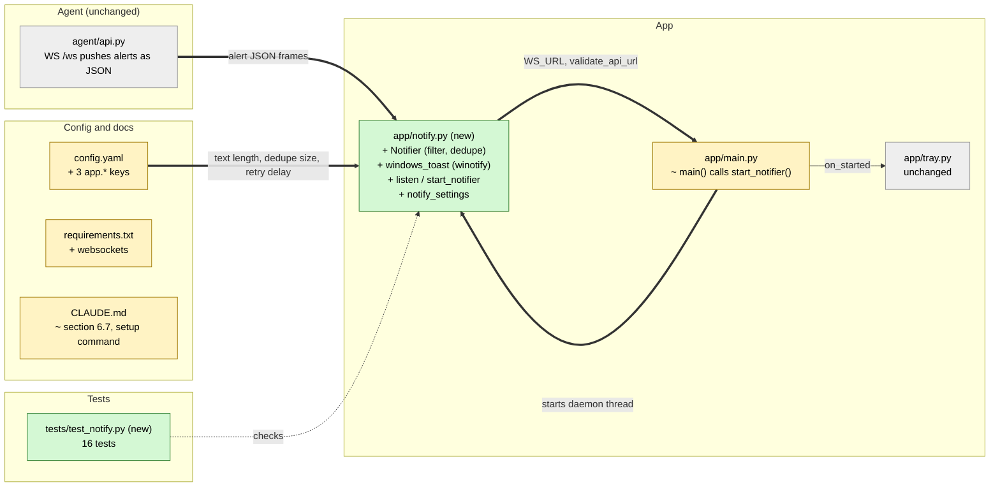

# Study guide: Windows pop-up toasts for serious alerts

**Ticket:** #43 · **Date:** 2026-11-07 · **Gate:** APPROVE (762 passed, ruff clean, smoke passes)

## The big picture

Before this change, HomeSOC showed alerts only inside its window and as a coloured tray icon. If you
weren't looking, a serious alert (for example a program quietly talking to a command server) could
go unnoticed. Now, whenever the agent announces a **high** or **critical** alert, Windows shows a
small pop-up in the corner of the screen (a "toast") with the alert title and the start of the
advice "what you should do". The same alert never pops up twice.

Analogy: the agent is a smoke detector that already writes in a logbook. This change adds the
loud beep, but only for real fires (not for a bit of toast smoke), and only one beep per fire.

## Map of the changes



**How to read it:** green = new, yellow = changed, grey = untouched; thick arrows are connections added by this ticket.

## File by file

### `app/main.py` - changed

**What it's for:** the entry point that opens the HomeSOC window.
**What changed and why:** `main()` now also starts the toast listener just before opening the window.

```python
from app.notify import start_notifier
...
start_notifier()
run(on_started=start_tray)
```

The import sits inside the function because `app.notify` itself imports `app.main` (for `WS_URL`), and importing at the top would make a circle. It is called directly, not through `on_started`, so the existing tray test stays the same.

### `app/notify.py` - new

**What it's for:** turn alert messages from the agent into Windows toasts.
**What changed and why:** the whole file is new; all Windows-only code lives here, as CLAUDE.md section 10 requires, so the rest can be tested on any computer.

**Settings (`NotifySettings`, `notify_settings`)** read three numbers from `config.yaml` (how many characters of advice to show, how many alert ids to remember, seconds between reconnect attempts). Missing keys fall back to defaults; zero or negative values raise an error.

**`is_windows()` and `windows_toast(title, text)`**

```python
if not is_windows():
    return
import winotify   # lazy
winotify.Notification(app_id=APP_ID, title=title, msg=text).show()
```

"Lazy import" means the library is only loaded when a toast is actually shown, so the file can be imported on a Mac or Linux where `winotify` does not exist. Off Windows, or if `winotify` is missing, it quietly does nothing. `is_windows()` is its own tiny function so tests can pretend to be on either system.

**`Notifier`** is the brain, with no network or Windows code of its own (the toast function is passed in).
- `handle_message(msg)` ignores anything that is not `type == "alert"` with severity `high` or `critical`, and ignores alerts without an id.
- It remembers ids in an ordered dictionary; the oldest id is dropped once more than `toast_dedupe_max` are stored, so memory stays bounded.
- The toast title is the alert title; the text is `what_you_should_do` squashed to one line and cut by `truncate` (ending in "…").
- If showing the toast fails, it logs the error and returns False; the id still counts as seen, so a broken toast system cannot cause an endless retry loop.
- `handle_raw(text)` first parses the JSON text frame; bad JSON is ignored.

Worked example: with a limit of 120 characters, a 200-character advice string becomes its first 119 characters plus "…".

**`listen(...)`, `_drain`, `_default_connect`**

```python
validate_api_url(url)
while not stop.is_set():
    try:
        with connect(url) as ws:
            _drain(notifier, ws, stop)
    except Exception: ...
    stop.wait(reconnect_s)
```

It connects to `ws://127.0.0.1:8765/ws` with the `websockets` library (also imported lazily), hands every message to the Notifier, and if the agent is offline or the connection drops, waits `ws_reconnect_s` seconds and tries again. `validate_api_url` refuses any address other than the local one, keeping the "talk to 127.0.0.1 only" rule. `connect` can be swapped for a fake in tests.

**`start_notifier(...)`** starts `listen` in a daemon thread (a background thread that dies with the program) and returns a stop switch. Off Windows, with the real toast function, it starts nothing and returns `None`.

### `config.yaml`, `requirements.txt`, `CLAUDE.md` - changed

Three new keys under `app:` (`toast_text_chars: 120`, `toast_dedupe_max: 1000`, `ws_reconnect_s: 5`), keeping numbers out of the code. `websockets` is a new dependency. CLAUDE.md section 6.7 now documents the toast behaviour and the setup pip line includes `websockets`.

### `tests/test_notify.py` - new (test)

Fake data: small alert dictionaries with chosen id and severity, a `FakeWinotify` that records toasts instead of showing them, and a `FakeConn` that plays a list of messages and can raise errors.

- High and critical toast once; low, medium and non-alert messages never do; a raw JSON frame works.
- Text length comes from `config.yaml`; bad settings are refused.
- Same id twice gives one toast; the memory is bounded; a failing toast is logged, not raised, not retried.
- Non-Windows: module reloads without `winotify`, installed `winotify` is not touched, Windows without it is a no-op, importing never loads `winotify` or `websockets`.
- Listener: feeds messages, reconnects after a failure, refuses a non-local URL; `start_notifier` uses a daemon thread; `main()` starts the notifier.

## How you know it works

- Every severity and message-type rule is checked with a fake toast recorder, so the filtering is proven without Windows.
- Dedupe, its size limit, and the failing-toast case each have their own test.
- Importing the module on a non-Windows machine is tested directly.
- The gate reported 762 tests passed (746 before plus 16 new), ruff clean, smoke test passing.

## Try it yourself

1. Run just these tests: `.venv/bin/python -m pytest -q tests/test_notify.py` (Windows: `.venv\Scripts\python -m pytest -q tests/test_notify.py`).
2. Run lint: `.venv/bin/ruff check .`.
3. On the Windows VM: `pip install websockets`, start the agent, then `python -m app.main`, and trigger the fake malware to see a toast.

## Open questions / risks

- The real `winotify` and `websockets` code paths have never run on Windows; only fakes were tested.
- The demo VM needs `pip install websockets` or the listener will not start.
- A failed toast is never retried by design; the user could miss it if the toast system is briefly broken.
- Unrelated and already present: `tests/test_api_ws.py::test_100_flows_in_one_second_give_at_most_5_flow_messages` is flaky (shared fake clock race). It deserves its own ticket.
