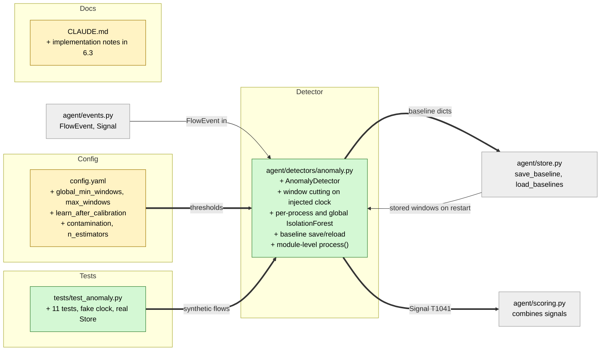

# Study guide: Spotting unusual uploads with a per-app "weirdness" model

**Ticket:** #45 · **Date:** 2026-11-07 · **Gate:** APPROVE (573 passed = 562 baseline + 11 new, ruff clean, no flakiness)

## The big picture

Before this ticket, HomeSOC could catch known-bad IPs, random-looking domains and regular "check-ins" (beacons), but nothing noticed when an app suddenly *sent a lot of data out*. That is what data theft (exfiltration, MITRE technique T1041) looks like: the fake malware in our lab POSTs about 20 MB to the C2 server.

Now `agent/detectors/anomaly.py` watches every app's outbound traffic in one-minute buckets ("windows"). For the first few minutes (calibration) it only learns what is normal for each app. Afterwards, if a minute goes over 10 MB **and** a machine-learning model called an IsolationForest says that minute looks unlike the app's usual minutes, it emits a `Signal` with a score between 0.6 and 0.9.

Analogy: a night guard learns that the bakery's delivery van normally leaves with a few boxes. One night it leaves with the whole safe. The guard does not need a rule for "safes"; the load simply looks unlike anything he has seen the van carry.

## Map of the changes



**How to read it:** green = new file, yellow = edited, grey = existing and unchanged; thick arrows are connections added by this ticket. Note that `scoring.py` is not yet fed by this detector in a running agent (see risks).

## File by file

### `config.yaml` - changed

**What it's for:** every tunable number lives here (project rule: no magic numbers in detectors).
**What changed and why:** five new keys under `detectors.anomaly`, next to the existing `bytes_out_threshold`, `score_min`, `score_max`.

```yaml
global_min_windows: 10   # pooled windows needed before the global model is fitted
max_windows: 1440        # windows kept per process
learn_after_calibration: true
contamination: auto
n_estimators: 100
```

`global_min_windows` is how much pooled history the fallback model needs. `max_windows` caps memory and database size (1440 minutes = 24 hours). `learn_after_calibration` turns on the "keep learning" behaviour described below. The last two are IsolationForest settings. Calibration length is not duplicated here; it reuses `calibration.minutes`.

### `agent/detectors/anomaly.py` - new

**What it's for:** turn a stream of flows into one-minute summaries, learn what is normal, and raise a `Signal` for an unusually large upload.
**What changed and why:** the whole file is new; it is the deliverable of the ticket.

**Windows on the injected clock.**

```python
index = now // self._window_ms     # now = self._clock(), not event.ts_ms
win = self._open.get(event.process)
win.bytes_out += max(event.bytes_out, 0)
win.flows += 1
win.dst_bytes[event.dst_ip] = ...
```

Each process has one "open" window that collects three numbers: `bytes_out`, `flows`, and `unique_dst_ips` (how many different addresses it talked to). The window a flow belongs to is decided by *when the detector received it*, not by the timestamp stored inside the flow. Why: NFStream only reports a flow after it ends, so flow timestamps arrive late and out of order. Processing time only moves forward, and tests can fake it with a `clock` function. Windows whose minute has passed are closed the next time `process()` or `tick()` runs.

**Calibration.** For `calibration.minutes` after creation, closed windows are just stored; `process()` returns nothing. After that, scoring begins.

**Choosing a model.**

```python
if len(windows) >= self._min_windows:      # 30
    ... return fitted, "process"
total = self.total_windows
if total < self._global_min_windows:       # 10
    return None, "global"                  # nothing to compare with -> silent
... pooled model over all processes -> "global"
```

An app with 30 or more learned minutes gets its own IsolationForest. A new or thin app is judged by one "global" model trained on everyone's windows pooled together. With almost no history at all, the detector stays silent rather than guess. Models are fitted lazily and refitted only when the baseline has grown. `random_state=42` keeps results repeatable.

**Features are `log1p`.** `np.log1p` is "log(1 + x)". It squashes huge ranges so the model compares sizes by ratio: 20 MB versus 30 KB is a gap of about 6.5 in log terms (log of roughly 650x), not 20,000,000 versus 30,000.

**When it fires.**

```python
if win.flagged or now < self._calibration_end_ms or win.bytes_out <= self._threshold:
    return []
assessment = self.assess(event.process, win.as_window())
```

The check happens on every flow while the minute is still open, as soon as the running total passes 10 MB, so alerts do not wait for the minute to end. `win.flagged` guarantees one Signal per process per window. An anomalous window under 10 MB never signals.

**The score (0.6 to 0.9).** `_score` measures how far past the model's own cut-off the window is, as a fraction of the remaining room up to 1.0, and maps that onto `[score_min, score_max]`. Example: if the cut-off is 0.55 and the window scores 0.775, it is halfway through the remaining 0.45, so the score is 0.6 + 0.3 x 0.5 = 0.75. The Signal's `target` is the destination IP that received the most bytes, and `reasons` say things like "uploaded 20.0 MB in 60 s, far above its usual 0.1 MB".

**Learning after calibration.** A 10-minute demo calibration gives only about 10 windows, never 30. So when `learn_after_calibration` is on, closed windows that were not flagged and not over 10 MB are still added (capped at `max_windows`). Flagged or huge windows are deliberately *not* learned, so an attacker cannot teach the model that exfiltration is normal.

**Persistence.** After each closed window the baseline is saved:

```python
data = {"version": 1, "calibration_end_ms": ..., "windows": self._baselines[process]}
self._store.save_baseline(process, data, updated_ms=now)
```

On startup, stored baselines are reloaded (bad entries are skipped with a warning), the stored calibration end is reused, and models are refitted from the windows. So a restart does not mean another calibration. A failure while saving is logged and swallowed on purpose: a broken database should not stop detection.

**`process()` at module level.** Every detector must expose `process(event)`, so a small wrapper creates one in-memory detector lazily. The real agent should build `AnomalyDetector(cfg, store)` to get persistence.

### `CLAUDE.md` - changed

**What it's for:** project spec. **What changed:** a short "Implementation notes" bullet under `anomaly.py` in section 6.3 describing the above, as the repo rule says to update the spec with the change.

### `tests/test_anomaly.py` - new (test)

Fake data: a `FakeClock` that tests move by hand, a seeded random generator producing "steady" minutes (3-5 flows of 20-40 KB to 1-3 addresses), a real `Store` on a temporary SQLite file, and a spike of 20 MB to the lab C2 `192.168.56.20`. Calibration is set to 35 minutes in tests so every process can gather 30+ windows.

- No Signal during calibration, and none when there is no baseline at all.
- A 20 MB minute after calibration gives one Signal: T1041, score in 0.6-0.9, target is the C2 IP.
- An anomalous minute that stays under 10 MB does not signal.
- A thin or brand-new process is judged by the global model.
- Baselines reload after a restart; a restart mid-calibration keeps the stored end time.
- Only one Signal per process per window.
- Normal windows are learned after calibration, flagged ones are not.
- Inbound flows are ignored; defaults apply when the config section is missing.

## How you know it works

- The 11 tests cover each design choice above, using synthetic flows and a fake clock, so no real network or waiting is needed.
- The persistence tests use a real SQLite `Store`, not a mock, so the saved format is really round-tripped.
- Test gate verdict: APPROVE, 573 passed (562 before + 11 new), ruff clean, no flaky runs.
- The independent verifier returned PASS.

## Try it yourself

1. Run just these tests (the `CLAUDE.md` Checks command, narrowed): `.venv\Scripts\python -m pytest -q tests/test_anomaly.py`
2. Run the linter: `.venv\Scripts\ruff check .`
3. Read `test_20mb_upload_after_calibration_signals` first; it is the whole feature in one test.
4. Optionally change `bytes_out_threshold` in `config.yaml` to 50 MB and watch that test fail, confirming the threshold is honoured.

## Open questions / risks

- **Not wired in yet.** `agent/main.py` does not exist, so nothing calls this detector in a running agent. Whoever builds the pipeline must create `AnomalyDetector(cfg, store)` and call `tick()` periodically when traffic is sparse.
- **No baseline means no signal.** A fresh install stays silent until at least 10 pooled windows exist. That is safe against false alarms but is a blind spot early on.
- **No recalibrate control.** There is no way for a user to reset what was learned.
- **Verifier minor point:** on reload the calibration end is `min(calibration_end_ms)` across all processes, so one corrupt or odd entry could shift it for everyone.
- **Store save errors are swallowed** (logged only). This is deliberate, but it means a broken database fails quietly and a restart would lose recent learning.
- `new_countries` from the spec is not used because there is no GeoIP data.
