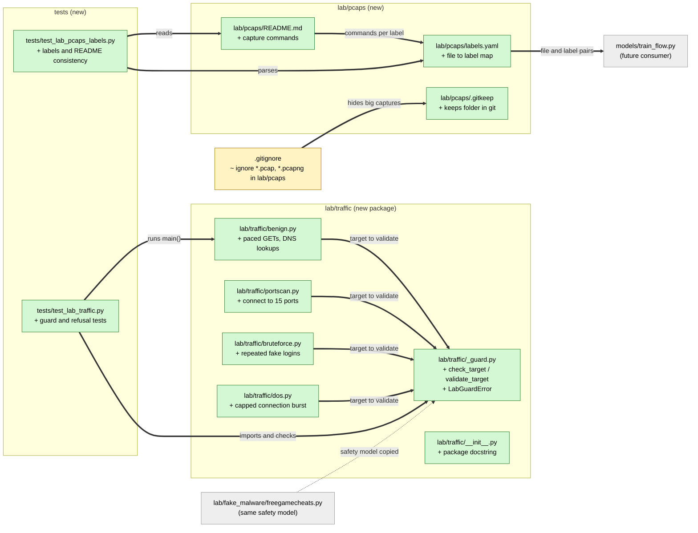

# Study guide: Capture labeled lab traffic for the flow classifier

**Ticket:** #46 · **Date:** 2026-11-07 · **Gate:** APPROVE

## The big picture

HomeSOC will have a "flow classifier": a small AI model that looks at a network
connection coming *into* the PC and decides if it is normal (`benign`) or an attack
(`portscan`, `bruteforce` or `dos`). To learn, a model needs many examples that are already
labeled with the right answer. Before this ticket we had no such examples and no way to make
them.

This ticket adds the "example factory": four small Python scripts that each create one kind of
traffic, a `labels.yaml` file that says which recording holds which kind, and a README with the
exact recording commands. Everything is meant to run only inside an isolated practice network
(`192.168.56.0/24`, no internet route). A shared safety check refuses to run against anything
else.

Analogy: think of a medical student's training set. You stage a few labeled cases (healthy,
flu, ...) in a closed teaching clinic, photograph each one, and write the label on every photo.
The safety check is the clinic door that only opens for the clinic's own patients.

## Map of the changes



**How to read it:** green = new file, yellow = changed, grey = existing or future file it
plugs into; thick arrows are connections added by this ticket, the dotted arrow is "copies the
idea of".

## File by file

### `lab/traffic/_guard.py` - new

**What it's for:** the safety gate every generator must pass before touching the network.
**What changed and why:** CLAUDE.md section 9 says test traffic must never leave the lab. This
file copies the rules of `freegamecheats.py` so the new generators are held to the same ones.

**`validate_target` / `check_target`**

```python
if not lab_enabled:
    raise LabGuardError("refusing to run: HOMESOC_LAB='1' is required ...")
...
ip = ipaddress.ip_address(target)      # is it a literal like 192.168.56.20?
if ip not in LAB_NETWORK: raise LabGuardError(...)
return [str(ip)]
```
(shortened) Two checks, in order. First, the environment variable `HOMESOC_LAB` must be exactly
`"1"` (a deliberate "I know this is lab-only" switch). Second, the target must be inside
`192.168.56.0/24`. An IP address is checked directly. A hostname is looked up (resolved) and
**every** address it resolves to must be in range, so a name that points one place in the lab
and another place on the internet is still refused. A name that cannot be resolved is refused
too. `check_target` is a thin wrapper that reads the environment for you.

Worked example: `8.8.8.8` is refused (outside range). `192.168.56.20` passes and returns
`["192.168.56.20"]`. A name resolving to `192.168.56.20` and `1.2.3.4` is refused because one
address is outside.

**The returned IP is the one used.** Generators connect to the validated address, not the name,
so a second DNS lookup cannot send them somewhere else. `LabGuardError` is a custom error type
so callers can catch exactly this failure. The resolver is an optional argument so tests can
pass a fake one.

### `lab/traffic/benign.py` - new

**What it's for:** makes ordinary-looking traffic for the `benign` label.
**What changed and why:** the classifier needs "normal" examples to tell apart from attacks.

**`run`** sends 30 HTTP GET requests, one per second, cycling through a few URL paths, each on
a fresh connection (`Connection: close`), plus three DNS lookups of `.lab` names. **`main`**
calls the guard first and exits with code 2 if refused:

```python
try:
    addrs = _guard.check_target(args.target)
except _guard.LabGuardError as exc:
    raise SystemExit(2) from exc
```
The same `main` pattern is used by all four generators. `argparse` reads command-line options
like `--target` and `--port`.

### `lab/traffic/portscan.py` - new

**What it's for:** makes the `portscan` pattern (MITRE T1046).
**What changed and why:** a scan is one source quickly poking many ports; the model must see it.

`connect_once` tries one TCP connection to a port and closes it. `run` loops over a fixed list
of 15 common ports (`DEFAULT_PORTS`, such as 22, 80, 445, 3389). Closed ports simply fail, which
is expected and logged, not an error.

### `lab/traffic/bruteforce.py` - new

**What it's for:** makes the `bruteforce` pattern (T1110).
**What changed and why:** repeated login guesses on one port look different from normal use.

`attempt_login` opens a short connection, sends `LOGIN labuser:<password>` and reads whatever
comes back. `run` repeats this 40 times, rotating through five meaningless passwords. The
username and passwords are made-up constants, so no real account is ever targeted.

### `lab/traffic/dos.py` - new

**What it's for:** makes the `dos` (denial of service) pattern (T1498).
**What changed and why:** the model needs to see a rapid single-target burst, but we must not
build a real flood tool.

```python
MAX_BURST = 1000
count = min(burst, MAX_BURST)
```
`run` opens and closes up to `count` connections with no pause. The default is 200, and a hard
cap of 1000 means even `--burst 999999` is clamped. A negative burst raises `ValueError`.

### `lab/traffic/__init__.py` - new

Makes `lab/traffic` an importable package (`python -m lab.traffic.dos`) and documents that
nothing here is an attack tool.

### `lab/pcaps/labels.yaml` - new

**What it's for:** the answer key, mapping each recording (pcap = packet capture file) to one
label.
**What changed and why:** the future `models/train_flow.py` needs to know which file holds which
class.

```yaml
version: 1
pcaps:
  - file: benign.pcapng
    label: benign
  - file: portscan.pcapng
    label: portscan
  ...
```
(shortened) One entry per label: benign, portscan, bruteforce, dos. The shape (`version` plus a
`pcaps` list) is our own choice made in advance, see Open questions.

### `lab/pcaps/README.md` - new

**What it's for:** a step-by-step recipe for creating the recordings on the lab VM.
Per label it gives a Windows `dumpcap` command and a Linux `tcpdump` command, then the matching
generator command. The order is: start the capture in shell 1, run the generator in shell 2,
stop the capture when the generator finishes. Captures use the filter `host 192.168.56.20` so
only lab traffic is recorded.

### `lab/pcaps/.gitkeep` and `.gitignore` - new / changed

The captures are big binary files, so `.gitignore` gains `lab/pcaps/*.pcap` and
`lab/pcaps/*.pcapng`. The empty `.gitkeep` file keeps the otherwise empty folder in git.

### `tests/test_lab_traffic.py` - new (test)

**Fake data:** no real network is used. DNS is always replaced by a fake resolver, and a
"tripwire" patches `socket.create_connection` and `http.client.HTTPConnection` so that any
connection attempt is counted.

- Refusal through the real `main()` of generators (public IP, public hostname, flag unset):
  exit code 2 and **zero** connection attempts.
- Guard accepts a lab IP and a hostname that resolves into the lab.
- Guard refuses a public IP, public hostname, unresolvable hostname, flag unset, and a hostname
  with mixed in-range and out-of-range addresses.
- Helper checks: range test for several addresses, and `HOMESOC_LAB` must be exactly `1`.

### `tests/test_lab_pcaps_labels.py` - new (test)

**Fake data:** none; it reads the real `labels.yaml` and `README.md`.

- The file exists, parses, and every entry has a valid label and a file name.
- All four labels are covered and filenames are unique.
- Consistency both ways: every labelled pcap appears in the README, and every pcap the README
  names is in `labels.yaml`.

## How you know it works

- Refusal tests prove the guard fires before any socket is used (0 connection attempts).
- Guard unit tests cover each accept and refuse rule, including the tricky mixed-address case.
- Label tests keep `labels.yaml` and the README from drifting apart.
- Test gate: APPROVE. Tests went from 627 to 660 (33 new), no regressions; ruff and the smoke
  test are clean. Verifier verdict: PASS.

## Try it yourself

1. Run just these tests (Windows form of the CLAUDE.md Checks command):
   `.venv\Scripts\python -m pytest -q tests/test_lab_traffic.py tests/test_lab_pcaps_labels.py`
2. See a refusal: `python -m lab.traffic.dos --target 8.8.8.8` with `HOMESOC_LAB` unset prints
   an error and exits with code 2 without sending anything.
3. On the lab VM only, follow `lab/pcaps/README.md` to record the four pcaps.
4. Run the whole suite and lint: `.venv\Scripts\python -m pytest -q` then
   `.venv\Scripts\ruff check .`

## Open questions / risks

- `bruteforce.py --attempts` has no upper cap (unlike `dos.py`), and `--port` is not range
  checked. Targets are still guard-restricted, so this is minor.
- The refusal for an unresolvable hostname is tested at guard level, not through each
  generator's `main`.
- The `labels.yaml` schema (`version` plus `pcaps: [{file, label}]`) is an assumption until
  `models/train_flow.py` exists and may need adjusting.
- The pcap files are not committed, so the model cannot be trained until someone records them
  on the lab VM.
