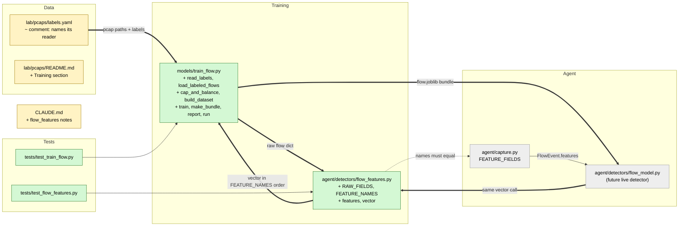

# Study guide: Train the inbound flow classifier

**Ticket:** #47 · **Date:** 2026-11-07 · **Gate:** APPROVE

## The big picture

Before this change HomeSOC could capture traffic and run rule-based detectors, but it had no
way to recognise *inbound attacks* (someone scanning ports, guessing passwords, or flooding the
PC). The lab already had four recorded traffic files ("pcaps"), each labelled `benign`,
`portscan`, `bruteforce` or `dos`. Now there is a script that turns those recordings into a
trained machine-learning model, `models/flow.joblib`, plus a shared helper that turns one
network "flow" into a list of numbers the model understands.

Analogy: think of teaching a new security guard. You show them hundreds of example visitors
tagged "normal", "case-the-building", "door-rattler" and "mob". The guard learns what each looks
like by *behaviour* (how fast, how many knocks), never by name or address. That is what this
script does, and the helper makes sure the guard is later shown visitors in exactly the same way.

## Map of the changes



**How to read it:** green = new, yellow = edited, grey = existing/not yet written; thick arrows
are links this change adds, thin ones already existed.

## File by file

### `agent/detectors/flow_features.py` - new

**What it's for:** Turns one flow's raw statistics into a fixed-order list of numbers.
**What changed and why:** The ticket needs training and the future live detector to use the
exact same features. Putting it in one shared file (like `dga_features.py`) prevents drift.

**`RAW_FIELDS` and `FEATURE_NAMES`**

```python
RAW_FIELDS = (
    *(f"{d}_{m}" for d in _DIRECTIONS for m in ("duration_ms", "packets", "bytes")),
    ...  # (shortened) packet sizes, inter-arrival times, TCP flags
)
FEATURE_NAMES = (*RAW_FIELDS, *DERIVED_NAMES)
```

These are 57 statistics NFStream (the packet-analysis library) reports for every flow, each in
three directions (both ways, client to server, server to client). The `*(... for ...)` syntax
builds the tuple by looping instead of typing 57 names. A test checks the list matches
`capture.FEATURE_FIELDS`, so live events carry exactly these fields. `DERIVED_NAMES` adds 6
ratios, so 63 columns in total.

**`features()` / `vector()`**

```python
out["syn_share"] = _ratio(out["bidirectional_syn_packets"], packets)
out["packets_per_s"] = packets / duration_s
```

Worked example: a port scan flow with 2 packets, 1 of them a SYN (a "connection start" packet),
has `syn_share = 1/2 = 0.5`. A 0 ms flow is treated as 1 ms so `packets_per_s` never divides by
zero. Any missing, `None`, text, NaN or infinite value becomes `0.0`, and extra keys such as
`src_ip` are simply ignored. `vector()` returns the same values as a plain list in
`FEATURE_NAMES` order, ready to feed to the model.

### `models/train_flow.py` - new

**What it's for:** Reads the labelled pcaps, trains the classifier, prints metrics and saves
`models/flow.joblib`.
**What changed and why:** This is the ticket's main deliverable (CLAUDE.md §7: random_state 42,
20k cap per class, print metrics, no IPs or ports).

**Loading: `read_labels`, `pcap_flows`, `load_labeled_flows`**

`read_labels` parses `labels.yaml` and raises `ValueError` for a bad version, an empty list or an
unknown label. `pcap_flows` is the only place NFStream is imported (inside the function, so
tests never need it); it returns one dict of the 57 raw fields per flow. `load_labeled_flows`
takes a `flow_loader` argument, so tests pass a fake loader instead of reading real files. A
missing pcap gives a clear `FileNotFoundError` pointing at the README.

**Balancing: `cap_and_balance`**

```python
n = min(cap, *(len(flows[label]) for label in CLASSES))
rng = random.Random(random_state)
return {label: rng.sample(list(flows[label]), n) for label in CLASSES}
```

Example: benign 90,000 flows, portscan 3,000, bruteforce 500, dos 40,000 -> every class is cut
to 500. Each class gets the same number of rows, so the model cannot score well just by always
guessing the biggest class. The sample is seeded so reruns pick the same rows. The cost: the
smallest class decides how much data is used.

**Training: `build_dataset`, `train`, `make_bundle`**

`build_dataset` runs `vector()` on each flow and pairs it with its string label. `train` fits a
`RandomForestClassifier` (many decision trees that vote) with 200 trees. `run` first does a
stratified 80/20 split (each label appears in the same proportion in train and test). The
saved file is a dict, not just the model:

```python
{"model": ..., "feature_names": [...], "classes": [...], "class_index": {"benign": i, ...}, ...}
```

`class_index` says which column of `predict_proba` (the model's per-class probabilities) belongs
to which label, so the live detector does not have to guess the order. The live detector must
unpack this dict rather than treat the file as a bare model.

**Reporting: `report`, `top_features`, `save_confusion`**

Prints the classification report (precision/recall per class), the confusion matrix (rows = true
class, columns = predicted class, so off-diagonal numbers are mistakes) and the 15 most
important features. The matrix is also saved to `models/flow_confusion.csv` for the metrics
slide. `main()` wires the command-line options `--labels --out --cap --n-estimators`.

### `lab/pcaps/labels.yaml` and `lab/pcaps/README.md` - changed

**What it's for:** Documentation of the training data.
**What changed and why:** The yaml comment no longer says the trainer is "not yet written"; the
README gains a Training section with the exact commands and what is printed. These files are in
the lab area, which is owned by CS (Jake), so he should glance at the edits.

### `CLAUDE.md` - changed

Adds `flow_features.py` to the repo layout and a short spec of the feature extractor and the
joblib dict format under §6.3, so the future `flow_model.py` author knows the contract.

### `tests/test_flow_features.py` - new (test)

Uses hand-made raw dicts. Groups:
- Safety: no feature name contains "ip" or "port", and identity/time fields are not features.
- Contract: `RAW_FIELDS` equals `capture.FEATURE_FIELDS`; names are unique and ordered.
- Cleaning: missing, bad and non-finite values become 0.0.
- Maths: derived ratios, zero denominators and zero duration; `vector` follows name order.

### `tests/test_train_flow.py` - new (test)

Fake data: small synthetic flows shaped like each class (a scan is 2 tiny packets with a SYN and
RST; a DoS is hundreds of fast small packets), plus junk `src_ip`/`dst_port` fields that must be
ignored. A fake loader and tiny label files stand in for real pcaps.
- End to end: `main` writes a loadable model that predicts all four labels.
- Output: prints class counts, report, confusion matrix, top features; CSV is saved.
- Errors: missing pcap and unknown label give clear errors; the real `labels.yaml` parses.
- No IP/port: saved feature names are clean and `featurize` ignores those fields.
- Balancing: 20k default cap, lopsided data uses the smallest class, seeded, bad input rejected.
- Determinism: two runs give identical predictions and `random_state` is 42.

## How you know it works

- The synthetic classes are separable, so the end-to-end test proves the pipeline from labels
  to saved model to four-way prediction works.
- Balancing and seeding tests prove the cap and the "never above the smallest class" rule.
- The no-IP/port tests guard the privacy and generalisation rule in §7.
- Verifier: PASS. Test gate: APPROVE, 870 tests passed (837 before), ruff clean, smoke test
  passed, nothing blocking.

## Try it yourself

1. Run only these tests: `.venv/bin/python -m pytest -q tests/test_flow_features.py tests/test_train_flow.py` (Windows: `.venv\Scripts\python -m pytest -q tests\test_flow_features.py tests\test_train_flow.py`).
2. Lint them: `.venv/bin/ruff check agent/detectors/flow_features.py models/train_flow.py tests`.
3. On the lab VM with the four pcaps present: `.venv\Scripts\python models\train_flow.py` and read the printed report.

## Open questions / risks

- The real `models/flow.joblib` is not trained yet; that needs the lab VM pcaps.
- `pcap_flows()` is untested because it needs NFStream and real pcaps (verifier minor point).
- The live detector must unpack the joblib dict (`bundle["model"]`, `class_index`).
- The model sees one flow at a time. Port scans and brute force show up mostly as many flows
  from one source, and there are no per-source window features yet, so recall on those may be
  limited.
- Every flow in a pcap gets that file's label, so benign background flows inside an attack
  capture are labelled as the attack (label noise).
- The edits under `lab/pcaps/` touch CS (Jake) territory.
