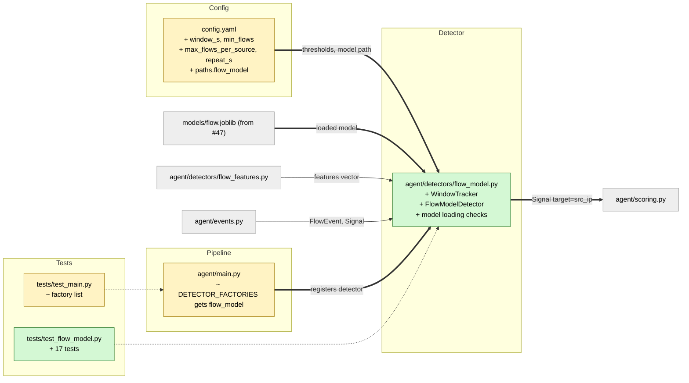

# Study guide: Classify inbound attacks live (flow model detector)

**Ticket:** #48 · **Date:** 2026-11-07 · **Gate:** APPROVE

## The big picture

Before this change, HomeSOC trained an attack classifier (`models/flow.joblib`, ticket #47) but
nothing used it while the agent ran. Now a new detector, `FlowModelDetector`, looks at every
**inbound** flow (a connection started by another machine), asks the model "is this a normal
connection, a port scan, a brute-force login, or a flood?", and raises a `Signal` aimed at the
attacker's IP when it is confident. Outbound flows are never shown to the model.

Analogy: a security guard watching the front door. One odd knock proves nothing, but if the same
stranger tries three or more doors in a minute and each looks like lock-picking, the guard
calls it in, and only once per minute so the phone does not ring non-stop.

## Map of the changes



**How to read it:** green = new file, yellow = changed, grey = unchanged; thick arrows are new
connections, thin ones already existed.

## File by file

### `config.yaml` - changed

**What it's for:** every tunable number lives here, not in code.
**What changed and why:** the model only scores one flow at a time, so four settings control how flows are grouped, plus the path to the model.

```yaml
window_s: 60            # group flows per source IP over this long
min_flows: 3            # flows needed before a signal
max_flows_per_source: 1000
repeat_s: 60            # one signal per (IP, class) this often
```

The existing `probability_threshold: 0.85` is unchanged. `paths.flow_model` points to `models/flow.joblib`.

### `agent/detectors/flow_model.py` - new

**What it's for:** turn inbound flows into attack Signals.
**What changed and why:** the whole file is new; this is the ticket.

**`WindowTracker`** remembers, per source IP, the class probabilities of its recent flows.

```python
flows.append((now_ms, dict(proba)))
self._expire(flows, now_ms)      # drop anything older than window_ms
```

A `deque(maxlen=...)` is a list that drops its oldest item when full, which bounds memory during a flood. Old sources are swept out at most once per window. Time comes from an injected clock (a function you can fake in tests), not from the flow's own timestamp.

**`FlowModelDetector.process`** is the main logic:

```python
if self._model is None or event.direction != INBOUND or not event.src_ip:
    return []
window = self._tracker.add(event.src_ip, now, self._predict(event.features))
if window.flows < self._min_flows: return []
```

Steps: skip outbound, score the flow with `predict_proba` (a probability for each class), add it to that IP's window, then average each class over the window. The attack class with the highest average wins if it reaches 0.85.

Worked example: three flows from one IP give portscan probabilities 0.95, 0.90, 0.85. The mean is 0.90, which is at least 0.85, so a Signal is produced with score 0.90 and MITRE `T1046`. A single flow at 0.99 produces nothing, because `min_flows` is 3. Averaging also stops one over-confident row from firing alone.

**Repeat suppression (`_due`)** keeps the time of the last Signal per `(source IP, class)` and refuses another within `repeat_s`. It also tidies the dictionary so it cannot grow forever.

**Model loading (`_load_model`, `_unpack_model`)** accepts the `train_flow.py` bundle (a dict with `model`, `feature_names`, `class_index`) or a bare model. A missing file, a model with no `predict_proba`, unknown feature names, or no attack classes is logged and leaves the detector inert (returns nothing) instead of crashing the agent.

**MITRE map:** `portscan` to `T1046`, `bruteforce` to `T1110`, `dos` to `T1498`. Benign is never signalled. A module-level `process()` gives the standard detector entry point.

### `agent/main.py` - changed

**What it's for:** the pipeline that runs all detectors.
**What changed and why:** one line was added to `DETECTOR_FACTORIES` so the agent actually runs the new detector. The comment notes it logs a warning and returns no signals if `flow.joblib` is absent. The docstring was updated to match.

```python
("flow_model", lambda cfg: FlowModelDetector(cfg).process),
```

### `tests/test_flow_model.py` - new (test)

Fake data: a `StubModel` returns chosen class probabilities, a fake `Clock` is advanced by hand, and `inbound()` builds synthetic FlowEvents from the attacker `192.168.56.20`. No real model is used.

- Outbound flows are ignored and never call the model; inbound ones use the training feature vector.
- Each attack class at 0.9 gives a Signal with the right MITRE ID and `target=src_ip`.
- No signal before `min_flows`, below the threshold, or for benign; the threshold comes from config.
- The window uses the mean, is per source IP, drops flows older than `window_s`, and caps flows per source.
- One Signal per (IP, class) per `repeat_s`.
- Missing file, bare model, and bad feature names are handled (inert or accepted as designed).
- End-to-end: in `auto` mode an attack makes the pipeline block the source IP.

### `tests/test_main.py` - changed (test)

The expected detector list now includes `"flow_model"`.

## How you know it works

- The tests above cover each acceptance rule: inbound only, 0.85 threshold, MITRE mapping, `target=src_ip`.
- The gate approved: 891 tests pass (baseline 870), ruff is clean, the smoke test passes.
- The verifier returned PASS.

## Try it yourself

1. Run `.venv/bin/python -m pytest -q tests/test_flow_model.py tests/test_main.py` (Windows: `.venv\Scripts\python -m pytest -q tests/test_flow_model.py tests/test_main.py`).
2. Run the lint check: `.venv/bin/ruff check .`.
3. Change `min_flows` to 1 in a test config and watch `test_no_signal_before_min_flows` logic change.

## Open questions / risks

- A single flow never fires, because of the mean plus `min_flows`. The spec did not ask for this; it is configurable.
- Only stub models are tested; there is no real `flow.joblib` in the repo yet, so real accuracy is unproven.
- `predict_proba` runs once per inbound flow, which may be costly during a flood.
