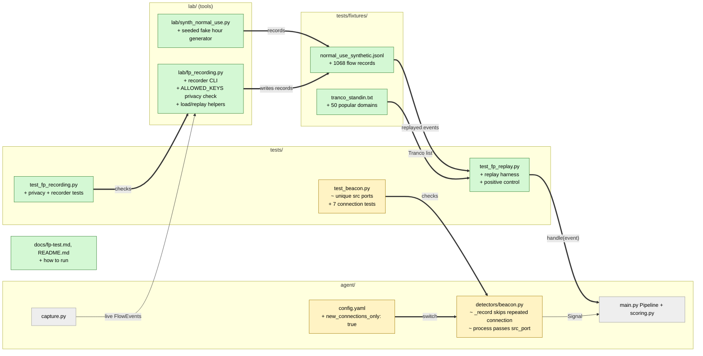

# Study guide: Run the false-positive test and tune thresholds

**Ticket:** #49 · **Date:** 2026-11-07 · **Gate:** APPROVE (753 passed, baseline 718)

## The big picture

Before this ticket nobody had checked whether HomeSOC stays quiet on an ordinary PC. A security
tool that cries wolf (alerts, or worse blocks Spotify) is worse than none. Now there is a
recorder that captures an hour of real use, a replay test that feeds that hour through the real
pipeline in `auto` mode (the mode that blocks things), and a fake stand-in hour so the test works
before the real recording exists. The test fails if normal use produces any medium-or-higher alert
or any firewall action.

The replay immediately found a real bug. NFStream (the capture library) cuts one long connection
into many "flows" (after 10 s of silence or every 30 s). A Spotify keepalive ping every 30 s on
one connection therefore looked like 20 separate, perfectly regular check-ins, which is exactly
what a beacon detector hunts. The fix is a config switch, `detectors.beacon.new_connections_only`.
Analogy: a guard counting visitors who knock on the door every 5 minutes should not count the
same person standing at the door and being photographed every 5 minutes.

## Map of the changes



**How to read it:** green = new, yellow = changed, grey = untouched; thick arrows are links added
by this ticket.

## File by file

### `config.yaml` - changed

**What it's for:** all thresholds live here, not in code.
**What changed and why:** one new key switches the beacon fix on. No numeric threshold was changed.

```yaml
new_connections_only: true
```

When true, only a connection with a new source port counts as a check-in.

### `agent/detectors/beacon.py` - changed

**What it's for:** spots malware that phones home at fixed intervals.
**What changed and why:** it now remembers which connection each start time came from, so
NFStream's timeout splits of one connection are not counted as new check-ins.

**Connection id.** A connection is `(src_ip, src_port, protocol)`:

```python
conn = (event.src_ip, event.src_port, event.protocol) if event.src_port > 0 else None
```

A flow with no port (port 0, e.g. ICMP) can't be told apart, so it always counts as new.

**`_record`** (shortened):

```python
if (self._new_connections_only and conn is not None
        and any(held == conn for _, held in entries)):
    return None
```

If a start from the same connection is already held, it returns `None` and `process` returns no
signal. Starts are now stored as `(time, connection)` pairs. Worked example: Spotify pings every
30 s on port 52974. Before, 6 flows meant 6 starts with identical gaps, so a beacon. Now only the
first counts, so there is one start and nothing fires. The lab malware opens a new connection per
check-in (CLAUDE.md section 9.1), so each has a fresh port and is still caught.

### `lab/fp_recording.py` - new

**What it's for:** records live traffic to a file, and defines the file format.
**What changed and why:** the ticket needs a real hour of normal use as test data, with no
personal data in it.

**`ALLOWED_KEYS` and `personal_data_problems`.** A record may only hold 15 listed keys
(process name, IPs, ports, hostname, byte counts, times). The check also rejects strings that
look like a Windows or user path (which would leak the user name). `pid`, `exe_path` and raw
features are dropped; times are rebased so `t = 0` is the start of recording; `.local` hostnames
(they can name a person, like `Jakes-iPhone.local`) are blanked.

**`FixtureWriter` and `record`.** The writer pretends to be the event bus: the agent's real
`capture.run` publishes into it, and it writes one JSON line per flow, flushing each time so a
crash or Ctrl+C keeps what was recorded. A record that fails the privacy check is skipped, never
written. `record` refuses to overwrite a file unless `--force`.

**`replay_events`.** Reads records in arrival order (`seen_ms`) and gives each process name a
stable fake PID.

Run it on the VM with `python -m lab.fp_recording --minutes 60`.

### `lab/synth_normal_use.py` - new

**What it's for:** makes a fake but realistic hour (Chrome, Edge, Discord, Spotify, svchost,
Defender, OneDrive, LAN broadcasts) until the real recording exists.
**What changed and why:** the real VM recording comes tomorrow; this keeps the test meaningful now.

It uses one seeded random generator (`SEED = 49`), so the same code writes the same file. It
simulates packets per connection, then cuts flows the way NFStream does (idle and active
timeouts), which is what reproduces the keepalive problem. All IPs are private or RFC 5737
documentation addresses, never real threat-feed IPs (section 9.2).

### `tests/fixtures/normal_use_synthetic.jsonl` and `tranco_standin.txt` - new (data)

The JSONL is the generated hour (1068 flow lines). The Tranco file is 50 popular domains standing
in for the real top-100k cache, so the DGA detector skips them in a fresh checkout or CI.

### `tests/test_fp_replay.py` - new (test)

Fake data: the synthetic hour. The harness uses the real detectors (intel, dga, beacon, anomaly),
the real scorer, config and allowlist, in `auto` mode. A fake clock moves with each record's
`seen_ms`, so the 10-minute anomaly calibration and 60 s scoring window behave as they did live.
Only `subprocess.run` is patched, and in the normal tests any call fails the test.

- Normal use gives no medium+ alert, no Action, no firewall call (run for every `normal_use_*.jsonl`, so tomorrow's file is picked up automatically).
- The fixture lasts longer than twice the calibration, so post-calibration detectors really run.
- Regression proof: with `new_connections_only` off, the same hour raises beacon alerts for Spotify and Chrome, but only alerts (they are allowlisted).
- Positive control: 12 fake-malware check-ins spliced into minute 25 are caught by intel and beacon, and exactly one quarantine (two rules) results. This proves the harness is not blind.

### `tests/test_fp_recording.py` - new (test)

Fake data: hand-made `FlowEvent`s and a fake NFStreamer.

- Privacy: the allowed key set is the documented one; every fixture has only allowed keys and no user paths; the check rejects extra or missing keys and paths.
- Conversion: `to_record` drops pid, exe path and features, and rebases times; `from_record` round-trips; replay sorts and gives stable PIDs.
- Recorder: writes only allowed keys, stops after the duration, keeps data on Ctrl+C, won't overwrite without force, skips unclean records.
- Synthetic fixture: matches its generator, is small, covers the normal apps, uses only private or documentation IPs.

### `tests/test_beacon.py` - changed (test)

Each fake flow now gets its own source port by default (like the lab malware), so old tests still
mean "new connection". New tests: keepalives on one port don't fire; a long download cut by the
active timeout doesn't fire; real new connections still fire among repeats of another connection;
the same port over TCP vs UDP counts as different connections; port-0 flows always count; the
switch can be turned off; the shipped config has it on.

### `docs/fp-test.md` and `README.md` - new / changed (docs)

How to record, replay, and read a failure. The README has a short section pointing to them.

## How you know it works

- The replay of a full synthetic hour raises zero medium+ alerts and zero actions in `auto` mode.
- The same hour with the fix off does alert, so the fix is what makes it quiet, and the test shows it.
- The spliced fake malware is caught and quarantined, so a quiet result is not a blind harness.
- Privacy tests guard the fixture format; recorder tests cover the stop, Ctrl+C and overwrite cases.
- Gate: APPROVE, 753 passed (baseline 718), ruff clean, smoke test passes, no flakiness. Verifier: PASS.

## Try it yourself

1. Run just these tests: `.venv\Scripts\python -m pytest -q tests/test_fp_replay.py tests/test_fp_recording.py tests/test_beacon.py`
2. In `config.yaml` set `new_connections_only: false` and run the replay test; it should fail with Spotify/Chrome beacon alerts. Set it back to `true`.
3. Regenerate the stand-in hour with `.venv\Scripts\python -m lab.synth_normal_use`; the file should not change.
4. On the VM (admin terminal): `.venv\Scripts\python -m lab.fp_recording --minutes 60`.

## Open questions / risks

- The real VM recording is still owed; the synthetic hour only shows what we thought of.
- Unconfirmed: that NFStream keeps the same source port across timeout splits. The fix depends on it, so check on the real recording.
- Trade-off: command-and-control over one persistent connection is no longer caught by the beacon detector.
- The dedupe only looks at the last 20 starts per key.
- The replay treats every app as signed, so the x1.2 unsigned boost is not exercised.
- The replay runs `AnomalyDetector`, but `agent/main.py` does not register it yet, so the live agent does not run it.
