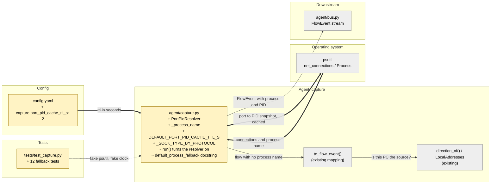

# Study guide: Find the app behind a flow when NFStream doesn't know it

**Ticket:** #5 · **Date:** 2026-11-07 · **Gate:** APPROVE

## The big picture

Before this change, capture asked NFStream (the library that watches network traffic) which app
made each connection. Sometimes NFStream has no answer and the process name comes back empty. Those
flows were labelled `"unknown"` with PID `-1`, so the detectors and scoring could not tie the traffic
to an app. A PID is the number Windows gives each running program.

Now, when NFStream has no name, capture asks the operating system through `psutil` (a Python
library that lists running programs and open connections). Every connection uses a local port on
this PC, and the OS knows which program owns that port. Capture finds the port, looks up the owner,
and fills in the process name and PID.

Think of a phone call with no caller ID. You can't see the name, but the phone company's directory
can tell you who owns that number. The port is the phone number and `psutil` is the directory.
Because the directory is slow to look up, we keep a copy for 2 seconds instead of calling it for
every single flow.

## Map of the changes



**How to read it:** yellow boxes are files that changed, grey boxes are existing pieces they plug
into, and thick arrows are connections this ticket added.

## File by file

### `config.yaml` - changed

**What it's for:** holds the settings so detectors and capture have no magic numbers in code.
**What changed and why:** one new setting says how long to reuse a port-to-PID snapshot.

```yaml
port_pid_cache_ttl_s: 2 # reuse one psutil port->PID snapshot this long
```

"TTL" means time to live: how many seconds a saved answer stays fresh. Two seconds keeps the
lookup cheap during a burst of flows, while still noticing new programs quickly. If the key is
missing, the code falls back to the same 2 seconds.

### `agent/capture.py` - changed

**What it's for:** turns NFStream flows into `FlowEvent` objects and puts them on the bus.
**What changed and why:** a new class, `PortPidResolver`, supplies the missing process name and
PID. `run()` now uses it by default.

**Constants**

```python
_SOCK_TYPE_BY_PROTOCOL = {6: socket.SOCK_STREAM, 17: socket.SOCK_DGRAM}
```

A flow carries an IP protocol number: 6 is TCP and 17 is UDP. `psutil` describes sockets by
type instead, so this small table translates between them. Any other protocol, such as ICMP
(ping), has no ports and is never looked up.

**`PortPidResolver.__call__` and `_socket_key`** (shortened)

```python
key = self._socket_key(flow)
pid = self._snapshot().get(key)
return (self._name_of(pid) or UNKNOWN_PROCESS, pid)
```

The class has a `__call__` method, so an instance can be used like a function. That is what
`to_flow_event` expects as its `process_fallback`. First it builds a key of
`(socket type, local port)`. The local port is the port on this PC's side. For an outbound flow
that is `src_port`, and for an inbound flow it is `dst_port`. The existing `direction_of`
logic decides which one applies. Matching on the socket type means a TCP flow only matches a TCP
socket, and a UDP flow only matches a UDP socket.

Worked example: a flow from this PC at port 51515 over TCP gives the key `(SOCK_STREAM, 51515)`.
If `psutil` says PID 777 owns that, and PID 777 is `updater.exe`, the event becomes
`("updater.exe", 777)`. If no socket owns the key, the flow stays `("unknown", -1)`.

**`_snapshot` and `_read_ports`: the cache**

```python
if self._read_at is None or now - self._read_at >= self._ttl_s:
    self._ports = self._read_ports()
    self._names = {}
    self._read_at = now  # also after an error
```

One call to `psutil.net_connections(kind="inet")` builds a dictionary of port to PID. That
dictionary is reused until the TTL runs out, then rebuilt on the next lookup. Fifty flows in a
burst therefore cost one `psutil` call. Connections without a PID, without a local address, or
with the "no PID" values (0 and -1) are skipped. If two sockets share a port, `setdefault` keeps
the first one `psutil` listed.

**Error handling**

```python
except Exception as exc:
    log = logger.debug if self._failing else logger.warning
```

Reading connections can fail, for example with `AccessDenied` when the program lacks permission.
The error is never raised into the capture loop, so capture keeps running. The first failure is
logged as a warning. Repeats are logged quietly as debug so the log doesn't flood. A failure is
cached for the TTL too, so a broken `psutil` is not called again for every flow. After the TTL it
tries again and recovers by itself.

**`_name_of` and `_process_name`**

Once the PID is known, `psutil.Process(pid).name()` gives the program name, and the result is
cached per PID inside each snapshot. If the process already exited or access is denied, the name
comes back as `None`. The event then keeps the real PID but the process stays `"unknown"`. A PID
is still useful because it can be looked up later.

**`run()` and `default_process_fallback`**

```python
if process_fallback is None:
    ttl_s = capture_cfg.get("port_pid_cache_ttl_s", DEFAULT_PORT_PID_CACHE_TTL_S)
    process_fallback = PortPidResolver(ttl_s, local_addresses)
```

Only the live `run()` function turns the resolver on. `to_flow_event` called by itself with no
fallback stays "pure": it does no lookups, so it is simple to test. `default_process_fallback`
still returns `None`. Only its docstring changed, from a to-do note to a pointer at the
resolver. `run()` also now reads `cfg.get("capture", {})`, so an empty config no longer crashes
when a custom `local_addresses` is passed.

### `tests/test_capture.py` - changed (test)

**What it's for:** proves the fallback works without needing Windows or real network traffic.
**What changed and why:** twelve new tests, one `fake_psutil` fixture, and a fake clock.

The fake data is a pretend list of connections. TCP port 51515 belongs to `updater.exe`
(PID 777), TCP port 3389 to `rdpsvc.exe` (PID 888), and UDP port 5353 to `mdns.exe` (PID 999).
The fixture also counts how many times `net_connections` is called. The fake clock lets a test
move time forward without waiting.

Tests, grouped by what they prove:

- **Outbound uses `src_port`:** the owner of the local port is attached to the event.
- **Inbound uses `dst_port`:** a flow from the lab attacker to port 3389 gets `rdpsvc.exe`.
- **Socket type matters:** UDP 5353 matches `mdns.exe`, but TCP 5353 does not.
- **No match keeps the defaults:** unknown port, wrong protocol, port 0, and ICMP all stay
  `("unknown", -1)`.
- **Bad connection entries are skipped:** no PID, no local address, or PID 0.
- **Name unreadable keeps the PID:** the PID is kept and the process stays `"unknown"`, both
  for a missing process and for `AccessDenied`.
- **Caching:** 50 flows make one call. Inside the TTL a changed owner is not seen. At exactly
  the TTL the snapshot refreshes.
- **Errors never escape:** `AccessDenied` is logged as a warning, capture still publishes all
  3 events, the failure is cached, and it recovers after the TTL.
- **`run()` wiring:** it builds the resolver with the TTL from config (7 in the test), or the
  default of 2 when config has no key.
- **Config:** `config.yaml` really contains `port_pid_cache_ttl_s: 2`.

## How you know it works

- The new tests cover each design choice: port choice by direction, TCP/UDP matching, the cache
  TTL, and error handling.
- `psutil` and the clock are faked, so the tests run on any OS, as the project requires.
- The test gate said **APPROVE**: 370 tests pass (the baseline was 356, so 14 more, which
  includes the config-sync tests), and `ruff` is clean.
- No blocking items were raised. The verifier was skipped because the ticket is size S.

## Try it yourself

1. Open `agent/capture.py` and find `PortPidResolver`. Follow `__call__` down to
   `_socket_key`, `_snapshot`, and `_name_of`.
2. Run only the capture tests:
   `.venv/bin/python -m pytest -q tests/test_capture.py`
   (Windows: `.venv\Scripts\python -m pytest -q tests\test_capture.py`).
3. Change `port_pid_cache_ttl_s` in `config.yaml` and note that
   `test_config_sets_port_pid_cache_ttl` fails. It guards the config value.
4. Run the linter: `.venv/bin/ruff check .`

## Open questions / risks

- **Port only, not local IP:** the lookup ignores the local address. If two sockets share a port
  (for example the same port on different interfaces), the first one `psutil` returns wins, which
  could pick the wrong app.
- **Not tried on the Windows VM yet:** all tests use fake `psutil` data. Real behaviour with
  Npcap capture is unconfirmed.
- **Short-lived connections:** a flow that ends before the next snapshot refresh (up to 2 s old)
  may not be found, or may be matched to a later owner of a reused port. The ticket accepts this
  trade for speed.
- **Elevated rights:** on some systems `psutil.net_connections` needs elevated rights. The agent
  runs as admin on Windows, but a non-admin run falls back to `"unknown"` with a warning.
