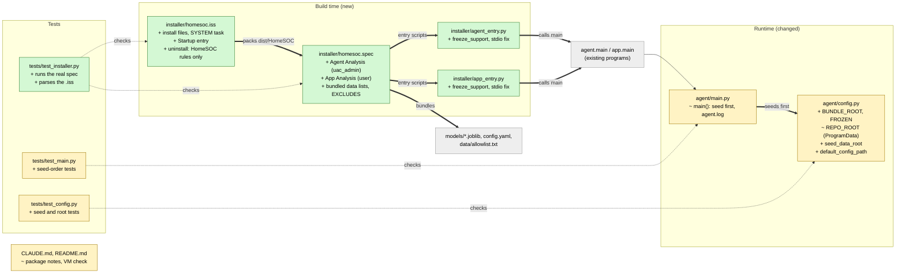

# Study guide: Package the agent and app into HomeSOC-Setup.exe

**Ticket:** #50 · **Date:** 2026-11-07 · **Gate:** APPROVE

## The big picture

Before this ticket, HomeSOC only ran from source: you needed Python, a virtual environment and
the repo folder. Now two build tools turn it into one installer. **PyInstaller** freezes the
Python code into ordinary `.exe` files (it bundles Python and every library inside them).
**Inno Setup** wraps those files in `HomeSOC-Setup.exe`, a normal "Next, Next, Install" wizard.

Installing does three things: copies the programs into `C:\Program Files\HomeSOC`, makes the
agent start by itself at boot with admin rights, and makes the app start when a user logs in.
Uninstalling removes the programs and only the firewall rules HomeSOC itself created.

Analogy: moving house. The spec is the packing list (what goes in the boxes, what is left
behind), the installer script is the moving company's instructions (where boxes go, who
unpacks), and `config.py` is the new house's rule that Program Files is a locked display cabinet
so anything that changes goes in a separate drawer (`%PROGRAMDATA%\HomeSOC`).

## Map of the changes



**How to read it:** green = new file, yellow = changed file, grey = existing, untouched. Thick
arrows are connections this ticket added, thin arrows already existed, dotted arrows are tests
checking a file.

## File by file

### `installer/agent_entry.py` and `installer/app_entry.py` - new

**What they're for:** the first lines that run when `HomeSOC-Agent.exe` or `HomeSOC.exe`
starts. They call `agent.main.main()` / `app.main.main()`.
**What changed and why:** a frozen exe has no `python -m ...` command, so each needs a tiny
script PyInstaller can use as its starting point.

**`freeze_support()`**

```python
multiprocessing.freeze_support()  # NFStream starts worker processes
```

NFStream starts helper processes. In a frozen exe a helper would re-run the whole program
instead of its job, unless this line is first. It does nothing when running normally.

**`_ensure_stdio()`**

```python
for name in ("stdout", "stderr"):
    if getattr(sys, name) is None:
        setattr(sys, name, open(os.devnull, "w", encoding="utf-8"))
```

The exes are "windowed" (no black console box), so Python has no output stream and anything that
prints (uvicorn's logging) would crash. This swaps in a throwaway stream (`os.devnull`).
The import of `main` happens after this on purpose.

### `installer/homesoc.spec` - new

**What it's for:** the PyInstaller recipe. It is a Python file; PyInstaller supplies names like
`Analysis` and `EXE` (hence the `# noqa: F821` comments telling the linter not to complain).
**What changed and why:** the ticket needs two programs with different privilege levels from one
build.

**Two Analyses, one folder.** The agent Analysis uses `AGENT_DATAS` (`config.yaml`,
`data/allowlist.txt`, the other two data lists, both `.joblib` models) plus NFStream's files. The
app Analysis only bundles `config.yaml` and `app/ui`. Each excludes the other's heavy libraries
(the app drops `sklearn`, `nfstream`, `uvicorn`...) to keep size down. A final `COLLECT` writes both
exes into `dist\HomeSOC`, sharing one `_internal` folder.

**Privilege levels**

```python
name="HomeSOC-Agent", console=False, uac_admin=True,   # (shortened)
name="HomeSOC",       console=False, uac_admin=False,
```

`uac_admin=True` embeds a manifest that makes Windows ask for admin when the agent is launched.
The app has none, so it runs as the normal user.

**`EXCLUDES`.** `lab`, `tests`, `models` (the training scripts), `pytest`, `ruff`, `tranco` are
never pulled in. This is the safety rule: the fake malware and GPL-licensed DGA generator code
must not ship. Note the `.joblib` model files are bundled as plain data, not as the `models`
Python package.

**Hidden imports.** PyInstaller finds imports by reading code, so things loaded dynamically are
listed by hand: uvicorn submodules, scikit-learn (the models are unpickled, so nothing imports it
statically) and `pystray._win32`.

### `agent/config.py` - changed

**What it's for:** finds `config.yaml` and decides where every relative path points.
**What changed and why:** inside Program Files nothing is writable, but the agent writes a
database, caches and logs. So there are now two roots.

**Two roots**

```python
FROZEN = bool(getattr(sys, "frozen", False))
BUNDLE_ROOT = bundle_root_for(FROZEN, getattr(sys, "_MEIPASS", None))
REPO_ROOT = data_root_for(FROZEN, os.environ)
```

`BUNDLE_ROOT` is the read-only shipped files (`sys._MEIPASS` is PyInstaller's unpack folder).
`REPO_ROOT` keeps its old name so no other code changes: from source it is still the repo;
frozen it becomes `%PROGRAMDATA%\HomeSOC`. Both helpers take their inputs as arguments so tests
can try them without really being frozen.

**`seed_data_root()`**

```python
for rel, refresh in [(r, False) for r in SEED_IF_MISSING] + [(r, True) for r in SEED_REFRESH]:
    ...
    if dst.is_file() and not (refresh and not filecmp.cmp(src, dst, shallow=False)):
        continue
    shutil.copyfile(src, dst)                                 # (shortened)
```

Copies the shipped files into the data folder. Config and lists are copied only if missing, so
the user's edits (for example the capture interface name) survive upgrades. The models are
re-copied when their bytes differ, so a reinstall with retrained models takes effect. Worked
example: user edits `config.yaml`, then installs a new build. Config stays as edited, `dga.joblib`
is replaced. When both roots are the same (running from source) it returns an empty list.

**`default_config_path()`.** Prefers the data-root config but falls back to the bundled one, so the
app (which does not seed anything) can start before the agent has run.

### `agent/main.py` - changed

**What it's for:** starts the whole agent.
**What changed and why:** `main()` now calls `config.seed_data_root()` before `config.load()`,
because the config may not exist in ProgramData on first run. When frozen it also adds a log file
`agent.log` there, since the windowed exe has no console. An `OSError` (cannot write the folder)
logs and exits with code 1 instead of a traceback.

### `installer/homesoc.iss` - new

**What it's for:** the Inno Setup script (`#define` lines are constants; sections like `[Files]`
are Inno's format).
**What changed and why:** turns `dist\HomeSOC` into an installer with the right privileges.

**Install.** `PrivilegesRequired=admin`, files go to `{autopf}\HomeSOC`. The `[Code]` part warns
if Npcap is missing and stops running copies first so files can be replaced.

**Agent as a SYSTEM scheduled task.** A `[Run]` entry calls PowerShell to register a task:

```powershell
$t = New-ScheduledTaskTrigger -AtStartup; $p = New-ScheduledTaskPrincipal -UserId 'SYSTEM' ... -RunLevel Highest
$s = New-ScheduledTaskSettingsSet -ExecutionTimeLimit ([TimeSpan]::Zero) ...   # (shortened)
```

A task starts at boot with no user logged in and, with a zero time limit, never gets killed after
72 hours (the Windows default). It is registered through PowerShell rather than Inno's own
mechanisms so those settings are possible.

**App as the user.** `{commonstartup}` is the all-users Startup folder, so the app launches at
every login as that user. The post-install launch uses `runasoriginaluser`, otherwise it would
inherit setup's admin rights.

**Uninstall.** Delete the task, kill both exes, then run
`Remove-NetFirewallRule -Group 'HomeSOC'`. That is the only firewall command, matching safety rule
§9.3; nothing touches Defender or other rules. The agent is stopped before the rules are removed so
it cannot re-create them.

### `CLAUDE.md` and `README.md` - changed

Docs only: the repo layout, the packaging commands, the explanation of the two roots, and a
"Building the installer" and "Manual check on a fresh VM" section. The demo checklist step 1 now says
to set `capture.interface` in the ProgramData copy of the config.

### `tests/test_installer.py` - new (test)

The spec and installer are not normal Python, so the tests treat them as data. Fake data: the real
`.spec` is executed with stubbed `Analysis`/`EXE`/`COLLECT` functions that record what they were
given; the `.iss` is parsed into sections and entries by a small parser.

- Bundling: agent gets models, config, allowlist and seeded lists; app gets UI and config.
- Never bundled: nothing from `lab/`, `tests/`, training scripts or generator code. A negative
  test adds a lab file and shows it is caught.
- Privileges: agent exe has `uac_admin=True`, app exe does not.
- Entry scripts: call the right `main` and fix missing stdio.
- Uninstall: exactly one firewall command, scoped to group `HomeSOC`; broader commands (all rules,
  Defender) are rejected by the checker; the agent is stopped first.
- Installer: agent task runs as SYSTEM, app uses `runasoriginaluser`, Startup entry exists.
- README documents the build, the test-VM-only Defender exclusion and the manual VM check.

### `tests/test_config.py` and `tests/test_main.py` - changed (test)

- Source runs unchanged (both roots equal the repo, seeding does nothing).
- Frozen roots resolve to `_MEIPASS` and ProgramData, including a real subprocess import with
  `sys.frozen` set.
- Seeding: fills an empty data root, is a no-op the second time, keeps edited config, refreshes
  changed models, skips files missing from the bundle, and config falls back to the bundle.
- `main()` seeds before loading config and exits 1 on a write error.

## How you know it works

- The spec and `.iss` are checked by executing/parsing the real files, with negative cases proving
  the checks can fail.
- Seeding logic is tested with temp folders, including the "user edits survive" case.
- Test gate: APPROVE, 870 passed (baseline 837), ruff clean, smoke test passed.
- Verifier: PASS.

## Try it yourself

1. Run just these tests: `.venv\Scripts\python -m pytest -q tests/test_installer.py tests/test_config.py tests/test_main.py`
2. Lint: `.venv\Scripts\ruff check .`
3. On a VM with models trained: `.venv\Scripts\pyinstaller --noconfirm installer\homesoc.spec`, then
   compile `installer\homesoc.iss` with `ISCC.exe`.

## Open questions / risks

- The real PyInstaller and Inno builds have not been run; `models/*.joblib` are not trained yet and
  the build needs them.
- The manual fresh-VM check (tray goes green after install, criterion 4) is still open.
- An install path containing `'` would break the scheduled-task command (it is inside single quotes).
- Running the agent as SYSTEM goes beyond the ticket text but was judged reasonable (needs admin
  anyway; no login needed at boot).
- Style nit: E305 blank-line spacing near `config.py:111`.
