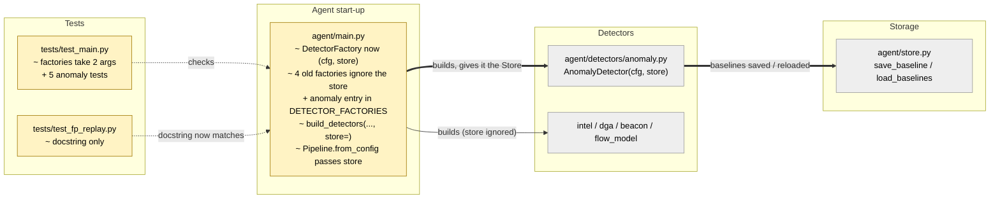

# Study guide: Start the "unusual upload" detector in the live agent

**Ticket:** #53 · **Date:** 2026-11-07 · **Gate:** APPROVE

## The big picture

HomeSOC has a detector that notices when a program suddenly uploads far more data than it
normally does (MITRE T1041, "exfiltration over the existing channel"). It was written in ticket
#45, but the agent's start-up code (`agent/main.py`) never switched it on. So when the fake
malware pushed its 20 MB upload to the lab server, nothing noticed.

Now the agent starts that detector together with the other four. It also hands the detector the
agent's SQLite database (the `Store`), because the detector learns what is "normal" for each
program (a baseline) and needs somewhere to save it. After a restart it loads those baselines
back instead of forgetting them.

Analogy: a night guard who learns how many people usually walk past each door. Before this
ticket the guard had been hired but never given a shift, and had no notebook. Now the guard is on
duty and writes the counts in a notebook that survives a power cut.

## Map of the changes



**How to read it:** yellow = changed, grey = existing and untouched; thick arrows are new
connections, thin ones already existed, dotted arrows are tests.

## File by file

### `agent/main.py` - changed

**What it's for:** builds the pipeline that runs every network flow through every detector, and
scores the signals they produce.
**What changed and why:** the anomaly detector is now in the list of detectors, and the code that
builds detectors can hand each one the agent's `Store`.

**Factories take two arguments.** A "factory" is a small function that builds one detector.

```python
DetectorFactory = Callable[[dict[str, Any], Store | None], DetectorFn]  # (cfg, store)

("intel", lambda cfg, store: IntelDetector(cfg).process),
("anomaly", lambda cfg, store: AnomalyDetector(cfg, store).process),
```

Before, a factory only received the config (`cfg`). The anomaly detector also needs the store,
so every factory now receives both. The four older detectors accept the `store` but ignore it
(a `lambda` is a tiny one-line function). `Store | None` means "a store, or nothing"; with
`None` the anomaly detector keeps its learning in memory only.

**The new `anomaly` entry.** It is added at the end of `DETECTOR_FACTORIES`, the one list that
decides which detectors the agent runs. `.process` is the method the pipeline calls for each
flow. The comment beside it explains why no timer is needed: `process()` itself closes any
60-second window whose time has passed every time a flow arrives, and a big upload is scored on
the still-open window as the flow comes in.

**`build_detectors(cfg, factories=None, *, store=None)`** (shortened)

```python
for name, factory in DETECTOR_FACTORIES if factories is None else factories:
    try:
        detectors.append(NamedDetector(name, factory(cfg, store)))
    except Exception:
        logger.exception("Detector %r could not start; running without it", name)
```

Two small changes. The `store` is passed on to each factory (the bare `*` means `store` must be
written by name, as `store=...`). And the default list is now looked up when the function runs,
not when the file is first read; this lets tests swap `DETECTOR_FACTORIES` for a shorter list.
A detector that crashes while starting (for example if loading baselines fails) is still logged
and skipped, so one bad detector cannot stop the agent.

**`Pipeline.from_config`** now calls `build_detectors(cfg, store=store)`. `run_agent` goes through
this, so the real agent gives the anomaly detector the real database and baselines survive a
restart. The module docstring about "adding a detector" was updated to describe the two-argument
factory.

### `tests/test_fp_replay.py` - changed (test)

**What it's for:** replays an hour of recorded normal use to prove the detectors stay quiet.
**What changed and why:** only a docstring. It used to say that `main.py` did not list the
anomaly detector yet; it now says the replay uses the same detector `main.py` runs.

### `tests/test_main.py` - changed (test)

**What it's for:** tests for the pipeline and the detector list.
**What changed and why:** the two existing factory tests were updated for the two-argument
shape, and five new tests were added for the anomaly detector.

The fake data: a program `uploader.exe` (PID 5151, in a Downloads folder, unsigned) sending flows
to `203.0.113.7`. One helper (`seed_calibrated_baseline`) pre-fills the store with 40 small
60-second windows, so the detector counts as "finished learning". Another (`fake_wall_clock`)
replaces the detector's clock with a list of milliseconds the test can move forward.

Tests, grouped by what they prove:

- **It is registered:** the default factory names are now `intel, dga, beacon, flow_model, anomaly`.
- **It builds with a store and accepts flows:** during calibration it collects but gives no
  signal, for outbound and inbound flows alike.
- **It saves baselines:** after the clock moves past 60 s, the next flow closes the window and
  `store.load_baseline` returns it (`[[13345, 2, 1]]`: bytes out, flows, unique destinations).
- **It catches the upload:** with a calibrated baseline, a 30 KB flow gives nothing, then a
  20 MB flow gives one `anomaly` signal with MITRE `T1041` and a score between 0.6 and 0.9.
- **End to end through `Pipeline.from_config`:** the 20 MB flow becomes a stored and published
  alert in `notify` mode, with no firewall action.
- **A broken start is tolerated:** a store whose `load_baselines` raises leaves the anomaly
  detector out and logs `Detector 'anomaly' could not start`.

## How you know it works

- The new tests cover registration, store hand-over, saving baselines, the 20 MB detection, and
  the failure path, all with fake flows and no network or PowerShell.
- The gate ran the full suite: 956 tests pass (951 before plus 5 new), ruff is clean, and the
  smoke test (fake malware to alert to quarantine to undo) passes.
- The verifier returned PASS and the gate returned APPROVE with no blocking items.

## Try it yourself

1. Run just these tests (Windows, from the `CLAUDE.md` Checks table):
   `.venv\Scripts\python -m pytest -q tests/test_main.py`
2. Run the whole suite and the linter:
   `.venv\Scripts\python -m pytest -q` then `.venv\Scripts\ruff check .`
3. Temporarily delete the `("anomaly", ...)` line in `agent/main.py` and re-run step 1. The
   registration test and the pipeline test should fail. Put the line back afterwards.

## Open questions / risks

- The calibration end time is the wall clock at the moment the detector is built. With a fresh
  database, every agent restart starts the 10-minute calibration again until at least one window
  has been saved. This is the existing spec for #45, not a defect in this ticket.
- The currently open 60-second window is only in memory, so it is lost if the agent stops
  before it closes (minor).
- No periodic `tick()` was added on purpose. If a process goes completely silent, its last window
  closes only when some later flow arrives (any process, any direction).
