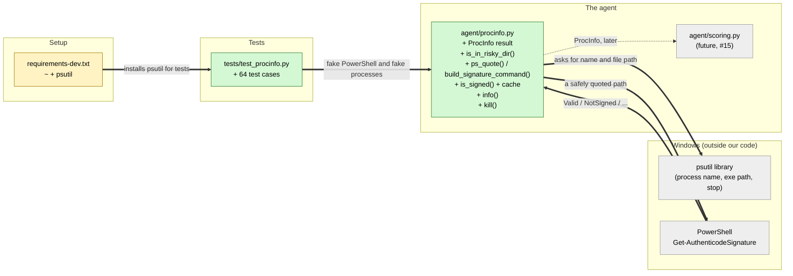

# Study guide: Look up a process — where it lives, whether it's signed — and stop it

**Ticket:** #6 · **Date:** 2026-11-06 · **Gate:** APPROVE (second pass; the first pass was BLOCK, fixed below)

## The big picture

When HomeSOC sees a suspicious connection, it knows the process ID (PID), a number Windows gives
each running program. To judge how worried to be, the scoring step (#15) needs a few facts about
that program. Where is its file? Is it sitting in Downloads or a Temp folder, where downloaded
malware usually runs from? Does it carry a valid digital signature from its publisher?

Before this ticket nothing could answer those questions. Now `agent/procinfo.py` can.
`info(pid)` returns the program's name, file path, a "risky folder?" flag and a "signed?" flag.
`kill(pid)` stops a program, but only after the user confirms in the app.

Everyday analogy: it's a bouncer checking ID. What's your name, where did you come from (a
trusted address or a back alley), and is your ID card genuine (signed) or homemade?

## Map of the changes



**How to read it:** green = new file, yellow = changed file, grey = things this code talks to but
didn't change (scoring doesn't exist yet). `+` = added, `~` = changed. Thick arrows are
connections this ticket added. The dotted arrow is a planned connection.

## Words you'll see

| Word | What it means here |
|------|--------------------|
| **process / PID** | A running program, and the ID number Windows gives it, e.g. PID 1234. |
| **exe path** | Where the program's file is on disk, e.g. `C:\Users\bob\Downloads\FreeGameCheats.exe`. |
| **digital signature (Authenticode)** | A publisher's tamper-proof stamp on a program file. Windows reports it as `Valid`, `NotSigned`, `HashMismatch` (the file was changed after signing), and so on. |
| **PowerShell** | Windows' built-in command language. `Get-AuthenticodeSignature` is the command that checks a signature. |
| **psutil** | A Python library that reads process info (name, path) and can stop processes, on any OS. |
| **subprocess** | Python's way of running another program (here PowerShell) and reading what it prints. |
| **stdout / stderr** | The two text streams a program prints to: normal output and error messages. |
| **command injection** | A trick where text such as a file name is crafted so a command treats part of it as a *new command*. `;` ends a command in PowerShell, so `a; Remove-Item C:\` would run two commands. |
| **string literal / quoting** | Text wrapped in quotes so the command treats it as plain text, not instructions. |
| **cache** | Remembering an answer so you don't recompute it. Here: "this exe is signed". |
| **lock** | A guard that stops two threads changing the cache at the same moment. |
| **thread** | A line of work running inside a program. Several can run at once. |
| **dataclass / frozen** | A class that just holds data. Frozen means it can't be changed after it's made. |
| **`None`** | Python's "nothing / unknown" value. |
| **exception / raise / except** | An error stopping the code (`raise`), and code that catches a specific one (`except`). |
| **encoding / decoding** | Text is stored as bytes. An encoding (cp1252, cp437, UTF-8, …) is the table that maps bytes to letters. Decoding with the wrong table can fail. |
| **TOCTOU** | "Time of check to time of use": something changes between checking it and using it, e.g. a file is deleted after you read its path. |
| **mock / fake** | A stand-in for the real thing in tests, so tests don't run real PowerShell or kill real programs. |

## File by file

### `agent/procinfo.py` - new

**What this file is for:** answering "what is this process?" and stopping one on request.
**What changed and why:** new file. It's one of the few places allowed to run Windows-only
commands (CLAUDE.md §10), so the rest of the agent stays testable on a Mac.

#### Piece 1 - constants

```python
DOWNLOADS_DIR = "downloads"
LOCAL_TEMP_PARTS: tuple[str, ...] = ("appdata", "local", "temp")
TEMP_ENV_VARS: tuple[str, ...] = ("TEMP", "TMP")

POWERSHELL_EXE = "powershell"
POWERSHELL_ARGS: tuple[str, ...] = ("-NoProfile", "-NonInteractive", "-Command")
SIGNATURE_CMD_TEMPLATE = (
    "Get-AuthenticodeSignature -LiteralPath {path} | Select-Object -ExpandProperty Status"
)
SIGNATURE_VALID = "Valid"
SIGNATURE_TIMEOUT_S = 15.0

PS_SINGLE_QUOTES: frozenset[str] = frozenset("'\u2018\u2019\u201a\u201b")
FORBIDDEN_PATH_CHARS: frozenset[str] = frozenset("\r\n\x00")

KILL_TIMEOUT_S = 3.0
PROTECTED_PIDS: frozenset[int] = frozenset({0, 4})  # System Idle Process, System
```

(Shortened: the imports and `UNKNOWN_NAME = "unknown"` are left out.)

**In plain words:** every fixed fact gets a name: which folders are risky, the exact PowerShell
command, what "signed" looks like, how long to wait, which characters are dangerous, and which
PIDs must never be stopped.

**Line by line:**
1. `("appdata", "local", "temp")` is a **tuple** (fixed list) of folder names in order, all
   lowercase, so comparisons can ignore case.
2. `-NoProfile -NonInteractive -Command` tells PowerShell to skip the user's startup scripts,
   never wait for typing, and run the command that follows.
3. `{path}` in the template is a blank that `.format(path=...)` fills in later.
4. `|` in PowerShell is a **pipe**: it passes the first command's result to the next one.
   `Select-Object -ExpandProperty Status` keeps just the status word, e.g. `Valid`.
5. `-LiteralPath` makes PowerShell take the path exactly as written, without treating `*` or `?`
   as wildcards.
6. `"\u2018"` is a **Unicode escape**, a way to write a character by its number. `\u2018` and
   `\u2019` are the curly quotes `‘` `’`. PowerShell treats them like a normal `'`, which matters
   for quoting.
7. `"\r\n\x00"` are invisible characters: carriage return, newline and NUL (byte zero).
8. PIDs 0 and 4 are Windows' own core processes.

**Why it's written this way:** no magic numbers inline (§10), and the security-sensitive pieces
(the command text, the dangerous characters) sit in one place where they're easy to review.

#### Piece 2 - the result type

```python
@dataclass(frozen=True)
class ProcInfo:
    pid: int
    name: str
    exe_path: str | None
    in_risky_dir: bool | None
    signed: bool | None

    def as_dict(self) -> dict[str, Any]:
        return asdict(self)
```

**In plain words:** one bundle of facts per process. `as_dict()` turns it into a plain
dictionary, the shape §6.2 promises.

**Line by line:**
1. `@dataclass(frozen=True)` makes a read-only data class (see the #1 guide).
2. `bool | None` means True, False, or `None` (unknown). If the file path can't be read, we
   genuinely don't know if it's signed, and `None` says that honestly instead of guessing False.
3. `asdict(self)` is a dataclass helper that copies every field into a dictionary.

**Why it's written this way:** scoring boosts risk for "unsigned". If an unreadable system
process came back as `signed=False`, it would be unfairly flagged, so unknown is kept separate.
CLAUDE.md §6.2 was updated in this change to say `info()` returns `ProcInfo` and that `None`
means "unknown, not unsigned".

#### Piece 3 - is it in a risky folder?

```python
def _folded_parts(path: str) -> tuple[str, ...]:
    return tuple(part.casefold() for part in PureWindowsPath(path).parts)


def _contains_run(parts: tuple[str, ...], run: tuple[str, ...]) -> bool:
    width = len(run)
    return any(parts[i : i + width] == run for i in range(len(parts) - width + 1))


def is_in_risky_dir(exe_path: str, temp_dirs: Iterable[str] | None = None) -> bool:
    dir_parts = _folded_parts(exe_path)[:-1]
    if DOWNLOADS_DIR in dir_parts or _contains_run(dir_parts, LOCAL_TEMP_PARTS):
        return True
    dirs = _env_temp_dirs() if temp_dirs is None else list(temp_dirs)
    for temp_dir in dirs:
        temp_parts = _folded_parts(temp_dir)
        if temp_parts and dir_parts[: len(temp_parts)] == temp_parts:
            return True
    return False
```

(Shortened: the docstring and the 2-line `_env_temp_dirs()`, which reads `%TEMP%` and `%TMP%`
from the environment, are left out.)

**In plain words:** split the path into folder names, lowercase them, drop the file name, then
ask three questions. Is any folder exactly `downloads`? Does `appdata\local\temp` appear in a
row? Does the path start with the user's Temp folder? Any yes means risky.

**Line by line:**
1. `PureWindowsPath(path).parts` splits a Windows path into pieces on any OS, accepting `\` or
   `/`. `C:\Users\bob\Downloads\x.exe` becomes `('C:\\', 'Users', 'bob', 'Downloads', 'x.exe')`.
2. `tuple(part.casefold() for part in ...)` lowercases every piece, giving `('c:\\', 'users',
   'bob', 'downloads', 'x.exe')`.
3. `[:-1]` is **slicing**: take everything except the last item, so the file name is dropped.
   A file *named* `Downloads.exe` therefore doesn't count.
4. `parts[i : i + width]` takes `width` items starting at position `i`. `_contains_run` slides
   that window along the path looking for `('appdata', 'local', 'temp')` in a row.
5. `any(...)` is True if at least one window matches.
6. `dir_parts[: len(temp_parts)] == temp_parts` asks "does the path *start with* the Temp folder's
   pieces?"
7. `temp_dirs=None` lets tests pass their own Temp folder instead of reading this machine's.

**Why it's written this way:** comparing whole folder names avoids substring traps.
`C:\Program Files\DownloadsHelper\x.exe` contains the letters "downloads", but no folder is
*exactly* `downloads`, so it's correctly not risky.

#### Piece 4 - quoting a path safely for PowerShell

```python
def ps_quote(value: str) -> str:
    if any(ch in FORBIDDEN_PATH_CHARS for ch in value):
        raise UnsafePathError(f"Refusing to pass a path with control characters: {value!r}")
    escaped = "".join(ch * 2 if ch in PS_SINGLE_QUOTES else ch for ch in value)
    return f"'{escaped}'"


def build_signature_command(exe_path: str) -> str:
    return SIGNATURE_CMD_TEMPLATE.format(path=ps_quote(exe_path))
```

**In plain words:** wrap the path in single quotes so PowerShell treats it as plain text. Inside
single quotes PowerShell interprets nothing (`;`, `$` and backticks are all just characters)
except a single quote, which would end the text early. So every quote inside the path is doubled,
which PowerShell reads as "one literal quote". Paths with newlines or NUL are refused outright.

**Line by line:**
1. `any(ch in FORBIDDEN_PATH_CHARS for ch in value)` checks each character `ch` of the path.
2. `ch * 2` repeats a string, so `"'" * 2` is `"''"`.
3. `X if condition else Y` is the short if/else: double the character if it's a quote,
   otherwise keep it.
4. `"".join(...)` glues the characters back into one string.
5. Example: the path `C:\Users\x\Downloads\it's; Remove-Item C:\ -Recurse.exe` becomes
   `'C:\Users\x\Downloads\it''s; Remove-Item C:\ -Recurse.exe'`. The `''` stays inside the text,
   so the `;` never gets a chance to start a second command.

**Why it's written this way:** file names are chosen by whoever made the file, and malware can
name itself anything. If the name could break out of the quotes, a malicious file name could
make our elevated agent run commands. The verifier fuzzed 2,000 nasty strings and none escaped.

#### Piece 5 - running the signature check

```python
def _run_signature_check(exe_path: str) -> bool | None:
    try:
        cmd = build_signature_command(exe_path)
    except UnsafePathError:
        logger.warning("Not checking signature of unsafe path %r; treating as unsigned", exe_path)
        return False
    try:
        result = subprocess.run(
            [POWERSHELL_EXE, *POWERSHELL_ARGS, cmd],
            check=False,
            capture_output=True,
            text=True,
            errors="replace",
            timeout=SIGNATURE_TIMEOUT_S,
        )
    except (OSError, subprocess.TimeoutExpired, UnicodeError) as exc:
        logger.warning("Signature check for %s could not run: %s", exe_path, exc)
        return None
    if result.returncode != 0:
        ...  # log stderr
        return None
    status = (result.stdout or "").strip()
    if not status:
        ...  # log
        return None
    return status == SIGNATURE_VALID
```

(Shortened: a 3-line comment above `errors="replace"` and the logging calls inside the last two
`if` blocks are replaced or left out.)

**In plain words:** run PowerShell once. Return True for `Valid`, False for any other status,
and `None` if the check itself broke (PowerShell missing, too slow, an error, no output).

**Line by line:**
1. `[POWERSHELL_EXE, *POWERSHELL_ARGS, cmd]` builds the argument list. `*` **unpacks** the tuple
   into the list, giving `["powershell", "-NoProfile", "-NonInteractive", "-Command", cmd]`. Five
   separate items, with no shell in between to re-interpret anything.
2. `check=False` means don't raise just because PowerShell exited with an error; we check
   `returncode` ourselves.
3. `capture_output=True` collects stdout and stderr instead of printing them.
4. `text=True` turns the output bytes into text, using the computer's default text table.
5. `errors="replace"` is **the first-pass fix**. If a byte doesn't exist in that table, it's
   swapped for `�` instead of crashing. PowerShell on Windows can write `ü` as byte `0x81`, which
   the default table (cp1252) doesn't have, so without this line an error message about
   `C:\Users\Jürgen\...` would crash `info()`.
6. `timeout=15.0` gives up after 15 seconds so a stuck PowerShell can't freeze the agent.
7. `except (OSError, subprocess.TimeoutExpired, UnicodeError)` catches three error types:
   PowerShell not found (OSError), too slow (TimeoutExpired) and, as a second safety net,
   unreadable text (UnicodeError). All three count as "the check broke".
7. `returncode != 0`: an exit code of 0 means success, anything else is a failure.
8. `(result.stdout or "").strip()` uses `""` if stdout is empty and trims spaces and newlines,
   so `"Valid\r\n"` becomes `"Valid"`.
9. `status == SIGNATURE_VALID` gives True only for the exact word `Valid`.

**Why it's written this way:** "the check broke" (`None`) is kept apart from "definitely not
signed" (False), so the cache can retry the first but remember the second.

#### Piece 6 - the cache

```python
def is_signed(exe_path: str) -> bool:
    key = _cache_key(exe_path)
    with _cache_lock:
        cached = _signature_cache.get(key)
    if cached is not None:
        return cached
    result = _run_signature_check(exe_path)
    if result is None:
        return False
    with _cache_lock:
        _signature_cache[key] = result
    return result
```

**In plain words:** look up the exe in the cache first. On a miss, run PowerShell and remember
a definite answer. A broken check returns False this time but isn't remembered, so it's retried.

**Line by line:**
1. `_cache_key()` normalizes the path and lowercases it, so `C:\APP.exe` and `c:/app.exe` share
   one cache entry. Windows treats them as the same file.
2. `with _cache_lock:` holds the lock only for the indented lines, then releases it automatically.
3. `.get(key)` returns `None` when the key isn't cached yet.

**Why it's written this way:** PowerShell takes about a second to start. Chrome makes hundreds
of connections, and running PowerShell for each one would bog the PC down.

#### Piece 7 - `info()`

```python
def info(pid: int, temp_dirs: Iterable[str] | None = None) -> ProcInfo:
    try:
        proc = psutil.Process(pid)
    except (psutil.NoSuchProcess, psutil.AccessDenied) as exc:
        logger.debug("Cannot open pid %d: %s", pid, exc)
        return ProcInfo(pid, UNKNOWN_NAME, None, None, None)

    name = _read_name(proc)
    exe_path = _read_exe(proc)
    if exe_path is None:
        return ProcInfo(pid, name, None, None, None)
    return ProcInfo(
        pid=pid,
        name=name,
        exe_path=exe_path,
        in_risky_dir=is_in_risky_dir(exe_path, temp_dirs),
        signed=is_signed(exe_path),
    )
```

**In plain words:** open the process. If it's already gone or off-limits, return "unknown"
rather than crash. Otherwise read its name and path, then fill in the risky and signed flags.

**Line by line:**
1. `psutil.NoSuchProcess` means the PID no longer exists. `AccessDenied` means Windows won't let
   us look.
2. `_read_name` and `_read_exe` (small helpers, not shown) catch the same two errors. Malware
   often runs briefly and exits, so the process can vanish between any two lines.
3. `ProcInfo(pid=pid, name=name, ...)` uses **keyword arguments**, naming each field so they
   can't get mixed up.

#### Piece 8 - `kill()`

```python
def kill(pid: int, timeout_s: float = KILL_TIMEOUT_S) -> bool:
    if pid in PROTECTED_PIDS or pid == os.getpid():
        raise KillError(f"Refusing to kill protected pid {pid}")
    try:
        proc = psutil.Process(pid)
        proc.terminate()
        try:
            proc.wait(timeout=timeout_s)
        except psutil.TimeoutExpired:
            logger.warning("pid %d still alive %.1f s after terminate(); killing", pid, timeout_s)
            proc.kill()
            proc.wait(timeout=timeout_s)
    except psutil.NoSuchProcess:
        logger.info("pid %d already exited; nothing to kill", pid)
        return False
    except psutil.AccessDenied as exc:
        raise KillError(f"Access denied killing pid {pid}") from exc
    except psutil.TimeoutExpired as exc:
        raise KillError(f"pid {pid} survived kill()") from exc
    logger.info("Killed pid %d", pid)
    return True
```

**In plain words:** refuse to stop Windows itself or HomeSOC. Otherwise ask the program to close
politely (`terminate`), wait 3 seconds, and force it (`kill`) if it's still running. Returns True
if we stopped it and False if it was already gone. Anything else raises a clear `KillError`.

**Line by line:**
1. `os.getpid()` is our own PID, so the agent can't stop itself.
2. A `try` nested inside a `try`: the inner one catches only "still alive after waiting" and
   escalates. The outer one catches everything else.
3. `%.1f` formats a number with one decimal place, e.g. `3.0`.

**Why it's written this way:** the docstring (not shown) says only the UI's confirm flow may
call this. Nothing in the agent calls it automatically, so a user always decides.

### `CLAUDE.md` - changed

```diff
-- `info(pid) -> dict`: `exe_path`, `name`, `in_risky_dir` (...), `signed` (...).
+- `info(pid) -> ProcInfo` (frozen dataclass; `.as_dict()` gives the dict): `pid`, `name`, `exe_path`,
+  `in_risky_dir` (...), `signed` (...).
+- When the exe path can't be read (process gone / access denied), `exe_path`, `in_risky_dir` and
+  `signed` are `None`, meaning **unknown, not unsigned**. Scoring (§6.4) must not apply the
+  unsigned/risky-dir boost for `None`. `info()` never raises for a vanished process.
```

(Shortened: the folder list and PowerShell details inside the brackets are unchanged.)

**In plain words:** the spec now matches the code. §13 requires updating the spec in the same
change, and Jake's scoring ticket (#15) reads this section to learn what `None` means.

### `requirements-dev.txt` - changed

```diff
 pytest
 ruff
 pyyaml
+psutil
```

**In plain words:** the Mac test setup now installs psutil, which the new code imports.

### `tests/test_procinfo.py` - new (test)

**The fake data:** `FakeRun` replaces `subprocess.run`. It records every call and returns
whatever output the test sets (e.g. `stdout="NotSigned"`). `FakeProcess` replaces
`psutil.Process`, with a configurable name and path, and it can raise `NoSuchProcess` or
`AccessDenied` on demand. No real PowerShell runs and no real program is stopped.

```python
def test_second_info_for_same_exe_does_not_rerun_powershell(fake_run, monkeypatch):
    _patch_process(monkeypatch, lambda pid: FakeProcess(pid))
    first = procinfo.info(100)
    second = procinfo.info(200)  # different PID, same exe
    assert first.signed is True and second.signed is True
    assert len(fake_run.calls) == 1
```

**What the checks do:** `monkeypatch` is a pytest fixture that swaps a real function for a fake
one during a single test. `lambda pid: FakeProcess(pid)` is a tiny unnamed function. Two
`info()` calls for the same exe must produce exactly 1 PowerShell call.

The tests, grouped:
- **Risky folders (19 cases):** Downloads and `AppData\Local\Temp` in any capitalization and
  with `/` slashes are risky. `Program Files`, `DownloadsHelper`, `MyDownloads` and
  `Roaming\Temp` are not. `%TEMP%`/`%TMP%` are read at call time, and injected Temp folders
  match on whole folder names.
- **Signature parsing (9):** `Valid`→True, and `NotSigned`/`HashMismatch`/`UnknownError`→False.
  The exact 5-item argument list is sent, including `errors="replace"`. A non-zero exit, empty
  output, missing PowerShell or a timeout gives False, and a failure followed by success is
  rechecked.
- **Unreadable output (4, added by the fix):** three tests start a *real* small child program
  (this Python) that prints the raw byte `0x81`, the `ü` in `Jürgen`, so the real decoding runs
  instead of a fake. Its error output, its status output and a full `info()` call on a vanished
  `C:\Users\Jürgen\Downloads\dropper.exe` all return unsigned without crashing. A fourth checks
  that a decode error isn't cached, so the next lookup retries. The gate removed each half of the
  fix in turn and a test failed each time.
- **Cache (4):** a second lookup of the same exe doesn't re-run PowerShell. The cache ignores
  case and slash style, remembers negative answers, and checks different exes separately.
- **Injection (10):** the `it's; Remove-Item` path becomes one literal (the exact command string
  is checked). Every inner quote is doubled, the curly quotes are doubled, `$` and backticks
  stay literal, newline/CR/NUL are refused and never reach PowerShell.
- **Vanished processes (6):** a gone PID, a process exiting between calls, `AccessDenied` on the
  path or on everything, and an empty path all return `exe_path=None` without raising.
- **kill (9):** polite stop, escalation to force, a survivor raising, an already-gone process
  returning False, access denied raising, and PIDs 0, 4 and our own refused.

## How you know it works

- 64 new tests pass, plus the 39 from #1: **103 passed** on all 3 gate runs, with ruff clean and
  no regressions.
- The test gate approved every test group: the fakes sit only at the real outside boundary
  (PowerShell and the OS), and the assertions check actual values.
- The first gate pass said BLOCK. It reproduced a crash on non-English characters, and the spec
  hadn't been updated. After the fix, the second pass said **APPROVE**.

## Try it yourself

1. Run all checks from `CLAUDE.md` `## Checks`: `.venv/bin/python -m pytest -q` (expect
   `103 passed`) and `.venv/bin/ruff check .`.
2. Run just this ticket's tests: `.venv/bin/python -m pytest -q tests/test_procinfo.py`.
3. See the quoting yourself:
   `.venv/bin/python -c "from agent import procinfo; print(procinfo.build_signature_command(r\"C:\\x\\it's; Remove-Item C:\\.exe\"))"`
   The `'` comes out doubled and everything stays inside one pair of quotes.
4. On the Windows VM, the real thing:
   `.venv\Scripts\python -c "import os; from agent import procinfo; print(procinfo.info(os.getpid()))"`
   shows your own Python's path and `signed=True`.

## Open questions / risks

- **Fixed (first gate pass blocked on this): `info()` could crash on non-English characters.**
  PowerShell 5.1 writes `ü` as byte `0x81`, which Windows' normal text table can't read. If a
  dropper in `C:\Users\Jürgen\Downloads\` deleted itself mid-check (a TOCTOU race), the error
  message crashed `info()`. It's fixed by `errors="replace"` plus catching `UnicodeError`, and
  covered by the four "unreadable output" tests.
- **Fixed (first gate pass blocked on this): the spec said `info(pid) -> dict`.** CLAUDE.md
  §6.2 now documents `ProcInfo` and that `None` means unknown. **Tell Jake** before he starts
  #15: scoring must not boost risk when `signed` or `in_risky_dir` is `None`.
- **Not tested on real Windows yet.** The decode tests use the Mac's UTF-8 locale, where `0x81`
  is also invalid. The fix doesn't depend on the encoding, but a real check on the VM is worth
  doing.
- **Advisory: `kill()` can hit the wrong program if a PID is reused.** If the process exits
  while the user is reading the alert and Windows hands its PID to another program, confirming
  would stop that one. A follow-up could pass the expected exe path or start time and check it
  first.
- **Advisory: the signature cache never expires.** If a signed exe is swapped for an unsigned one
  at the same path, it stays "signed" until the agent restarts. Keying on path + modified time
  would fix it later.
- **Assumptions:** any folder named `Downloads` counts as risky. The kill and signature timeouts
  (3 s, 15 s) are module constants, not entries in `config.yaml`. Failed checks aren't cached, so
  a machine where PowerShell keeps failing re-tries on every lookup.
