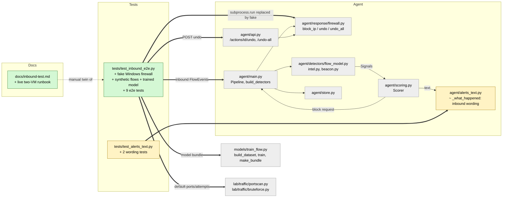

# Study guide: Test inbound attack detection (portscan -> block IP)

**Ticket:** #61 · **Date:** 2026-11-07 · **Gate:** APPROVE (969 passed, baseline 956; ruff clean; smoke passes)

## The big picture

HomeSOC already had pieces that react to an attack coming *into* the PC: a model (`flow_model`)
that recognises port scans and password-guessing, a scorer that decides to block, and a firewall
module that can block an IP and undo it. Nobody had proven they work together. The real proof
needs two virtual machines (an attacker and a victim), which is slow and hard to repeat.

This ticket adds two things. First, an automated test that plays the attacker's traffic through
the real pipeline and checks the resulting firewall state. Second, a runbook (`docs/inbound-test.md`)
for doing the real two-VM run by hand. Along the way it fixes a wording bug: an alert about an
inbound attack used to say "HomeSOC noticed unknown behaving like malware", blaming the victim.

Analogy: a fire drill. Instead of waiting for a real fire (two VMs), the test lights a fake
one in a controlled room (fake firewall, fake clock) and checks that the alarm rings, the door
closes, and that the door can be reopened.

## Map of the changes



**How to read it:** green = new file, yellow = changed, grey = existing and unchanged; thick
arrows are connections this change adds (mostly the test reaching into real code).

## File by file

### `agent/alerts_text.py` - changed

**What it's for:** turns detector signals into the plain-English "What happened" text.
**What changed and why:** for an inbound attack the local `process` is only the victim (often
"unknown"), so calling it malware was wrong and confusing.

**`_what_happened`**
```python
if set(groups) == {"flow_model"}:
    parts = ["HomeSOC noticed an attack on your PC from another computer on the network."]
else:
    parts = [f"HomeSOC noticed {process} behaving like malware."]
```
`groups` is the signals grouped by detector name. If the only detector involved is `flow_model`
(which only looks at inbound traffic), the sentence blames the remote computer. If any other
detector is also present (say a beacon from a local app), the old wording stays, because then
a local process really is involved.

### `docs/inbound-test.md` - new (docs)

**What it's for:** a step-by-step runbook for the real run: Windows VM (`192.168.56.101` in the live run, agent
and app) and Ubuntu VM (`192.168.56.20`, attacker).
**What changed and why:** the ticket's real goal is a live run; this tells two people exactly how.

Main parts, in order:
- **Preconditions:** the model file must exist, the capture interface must be right, the
  attacker's IP must be commented out of `data/test_intel.txt` (otherwise the intel detector
  also fires and can quarantine the listener), agent in an admin terminal, mode set to auto,
  no leftover firewall rules.
- **Step 1, portscan:** run the lab scan, expect a T1046 alert and two firewall rules (one
  outbound, one inbound) named `HomeSOC block 192.168.56.20 ...`.
- **Step 2, undo then bruteforce:** undo the block, start a listener on the Windows VM (a
  brute force needs something to connect to), **wait 65 s**, then run the brute force and expect T1110
  and a fresh pair of rules.
- **Step 3, undo all**, then restore the intel line.
- **If nothing fires:** the thresholds (`min_flows` 3, `probability_threshold` 0.85, auto
  block risk 0.85), where to look in logs, and a snippet that scores the captured traffic by hand.

### `tests/test_inbound_e2e.py` - new (test)

**What it's for:** the automated twin of the runbook.
**What changed and why:** it proves the whole chain works without two VMs, admin rights, Npcap
or real PowerShell. Everything is real except `subprocess.run`.

**Synthetic flows and the model (`flow_stats`, `flow_bundle`)**
```python
if label == "portscan":    # SYN, RST back, nothing else
    return _raw(2, 1, int(114 * j), 1.0 * j, syn=1, rst=1)
```
`models/flow.joblib` is gitignored, so the test trains a small model in the same format using
the real functions in `models/train_flow.py`. Each class (benign, portscan, bruteforce, dos)
gets made-up per-flow statistics with a little random jitter `j`. The attack replayed later
uses a different random seed, so the model must classify rows it has never seen.

**Attack replays (`portscan_flows`, `bruteforce_flows`)** build `FlowEvent`s that look like
what `capture.py` would produce: started by `192.168.56.20`, process "unknown", direction
inbound. Port lists and attempt counts come from the lab scripts, so they cannot drift apart.

**`FakeWindowsFirewall`** replaces `subprocess.run`. It reads the PowerShell text HomeSOC
sends, with regular expressions, and edits a dictionary of rules: "create a rule", "remove a rule by exact
name inside group HomeSOC", "remove the whole group". Anything unrecognised fails the test.
Its `group()` method answers "what would `Get-NetFirewallRule -Group HomeSOC` list?", so tests
check the end state. It also holds a bystander Windows rule that must survive every undo.

**`Harness` and `make_harness`** wire the real `Pipeline`, `Scorer` (real `config.yaml`),
`Store` (temporary SQLite file) and detectors together with one fake clock. `replay()` moves the
clock to each flow's end and feeds it in; `wait_s()` jumps time forward (no sleeping).

Tests, grouped by what they prove:
- **Portscan -> T1046 alert + block:** one alert, title, text, MITRE id, one `block_ip` action,
  two correct rules, Action published before the Alert. Also: the signal fires exactly when
  `min_flows` is reached, and the intel hit on the lab IP produces an alert but never a quarantine.
- **Bruteforce -> T1110:** undo the scan block, wait out the windows, replay the brute force,
  get a T1110 alert and a *new* block with different rule names.
- **Undo removes rules:** via the real API, `undo` removes exactly the stored rule names and
  leaves the bystander rule; it cannot be done twice (409). `undo-all` clears the group only.
- **Negative cases:** fewer than `min_flows` flows, flows spread wider than the time window,
  and `notify` mode all give no block (notify gives an alert without an action).

### `tests/test_alerts_text.py` - changed (test)

Two new tests. One (run for processes "unknown", "svchost.exe", "System") checks an inbound-only
alert never says "behaving like malware" and starts with the new sentence. The other checks a
mixed set of signals (inbound plus a beacon) keeps the old wording naming the process.

## How you know it works

- The e2e tests assert the final firewall rule table, not just "a function was called".
- Detection uses real `predict_proba` on unseen synthetic rows, so the threshold logic is exercised.
- Undo and undo-all are checked through the real API, including that unrelated rules survive.
- Gate: APPROVE, 969 passed (baseline 956, so 13 new), ruff clean, smoke test passes, no test
  tampering, no flaky tests. The verifier was skipped (size S).

## Try it yourself

1. Run just the new tests:
   `.venv\Scripts\python -m pytest -q tests/test_inbound_e2e.py tests/test_alerts_text.py`
2. Lint: `.venv\Scripts\ruff check .`
3. Full suite as in CLAUDE.md Checks: `.venv\Scripts\python -m pytest -q`
4. For the real thing, follow `docs/inbound-test.md` with both VMs.

## Open questions / risks

- The test uses a model trained on invented statistics. It proves the plumbing, not that the
  real `flow.joblib` recognises a real Windows-victim scan. Lab pcaps were captured against
  Ubuntu (closed ports answer RST); Windows Firewall drops SYNs silently, so retraining on a
  Windows capture may be needed.
- `data/test_intel.txt` lists `192.168.56.20`; if the runbook step to comment it out is
  forgotten, intel interferes (and may quarantine the bruteforce listener).
- Repeat suppression can swallow a bruteforce alert within 60 s of the scan, hence the 65 s wait.
- A brute force needs a listening service on the Windows VM, or it looks like a scan.
- `flow_model` logs its signals at DEBUG only, so a silent live run is hard to diagnose.
- The live run itself (two VMs) has not been done; only its automated equivalent.
- `docs/inbound-test.md` shows garbled section-sign characters (`§`), an encoding glitch worth fixing.
