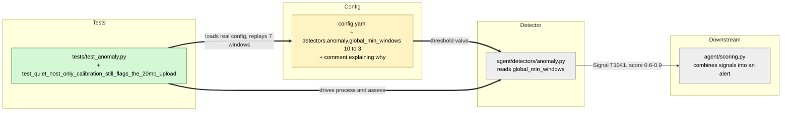

# Study guide: Make the anomaly detector catch the 20 MB upload

**Ticket:** #62 · **Date:** 2026-11-07 · **Gate:** APPROVE (970 passed, baseline 969; ruff clean; FP replay and smoke pass)

## The big picture

**Before:** the anomaly detector (an `IsolationForest`, a model that learns what "normal" looks like and flags
oddballs) never fired during the live demo on the Windows VM. The fake malware's single ~20 MB upload went
unnoticed. **Now:** one number in `config.yaml` was lowered, so the detector flags the upload with MITRE
technique T1041 ("exfiltration over the existing channel"), and a new test locks that in.

Why it failed: the detector learns for 10 minutes ("calibration") by cutting traffic into one-minute windows.
The VM captures on the host-only network adapter, which only carries quiet background chatter (DHCP, multicast).
The calibration saw just 7 windows. The fake malware (`python.exe`) is a brand-new program, so it is judged by a
"global" model built from all programs pooled together. That model demanded 10 windows, had only 7, so it
refused to judge at all: no model, no signal.

Analogy: a night guard asked "is this delivery unusual?" after only watching a quiet street for 7 minutes. He
used to say "I need 10 minutes of watching first". Now he says "3 is enough", so he can speak up, at the cost of
being a bit more jumpy.

## Map of the changes



**How to read it:** green = new, yellow = changed, grey = untouched; thick arrows are links this change added.

## File by file

### `config.yaml` - changed

**What it's for:** holds every tunable threshold, including the anomaly detector's.
**What changed and why:** the ticket allowed a config-only fix. The pooled-window minimum for the global model
dropped from 10 to 3 so the VM's 7 quiet windows are enough.

**`detectors.anomaly.global_min_windows`**

```yaml
global_min_windows: 3      # pooled windows needed before the global model is fitted. Low on purpose ...
```

In `anomaly.py` (line ~290) the check is `if total < self._global_min_windows:` then no model, no signal. With 7
windows and a limit of 10 that always bailed out. With a limit of 3 the global model is fitted, sees that a
21 MB window is far outside the tiny chatter it learned, and returns a signal. Live result: "python.exe uploaded
21150909 bytes in one window (global model, score 0.599 > 0.500)", and the alert showed intel + anomaly (T1041).
No Python code changed; the code default in `anomaly.py` stays 10 and config overrides it.

### `tests/test_anomaly.py` - changed (test)

**What it's for:** unit tests for the anomaly detector, using a fake clock and synthetic flows.
**What changed and why:** one new test reproduces the VM's exact situation so the fix cannot silently regress.

**`test_quiet_host_only_calibration_still_flags_the_20mb_upload`**

```python
cfg = copy.deepcopy(config.load())  # the real 10-min calibration and thresholds
...
assert det.assess("python.exe", [20_971_520, 1, 1]).model == "global"
```

The fake data: seven tiny flows (a few hundred bytes each) spread over windows 0, 1, 4, 8 and 9 for `unknown`,
`svchost.exe` and `msedge.exe`, which produces exactly 7 learned windows, copied from the VM's agent log. The
test then moves past the calibration period, uploads 20 MiB as `python.exe`, and expects one signal. Crucially it
loads the real `config.yaml`, not a test config, so it fails if someone raises the value back to 10 (it failed at
10 and passes at 3).

Checks, grouped:
- The quiet calibration yields no signals and `total_windows == 7`.
- Exactly one signal: detector `anomaly`, MITRE `T1041`, process `python.exe`, target the C2 IP.
- Score lies in the configured 0.6 to 0.9 range.
- The upload was judged by the `global` model (not a per-process one).

## How you know it works

- The new test failed with the old value (10) and passes with 3.
- Test gate: APPROVE, 970 tests pass (one more than the 969 baseline), ruff clean.
- The false-positive replay (an hour of recorded normal use) and the smoke test (fake malware, alert, quarantine,
  undo) still pass, so the looser setting did not create alerts on normal traffic.
- Live VM rerun produced the anomaly signal and a combined alert.
- The verifier agent was skipped (small change).

## Try it yourself

1. Run just the new test: `.venv\Scripts\python -m pytest -q tests/test_anomaly.py -k quiet_host_only`
2. Edit `config.yaml` to `global_min_windows: 10` and rerun it. It should fail. Change it back to 3.
3. Run the whole anomaly file and lint: `.venv\Scripts\python -m pytest -q tests/test_anomaly.py` then
   `.venv\Scripts\ruff check .`

## Open questions / risks

- A global model fitted on only 3 windows is a weak baseline. It trades some false-positive risk for demo
  reliability; the FP replay passes, but it was recorded on a busier setup than the host-only adapter.
- Not fixed here (follow-up ticket): in the live log the DGA lookups and about half the check-ins were attributed
  to "unknown" instead of `python.exe`. This split the beacon detection and put the DGA alert on "unknown". Likely
  cause (a guess, not confirmed): NFStream's process-visibility helper crashing at start-up with WinError 6.
- The real cause of the thin calibration is that capture only sees the host-only adapter; capturing the NAT adapter
  too would be a different fix.
