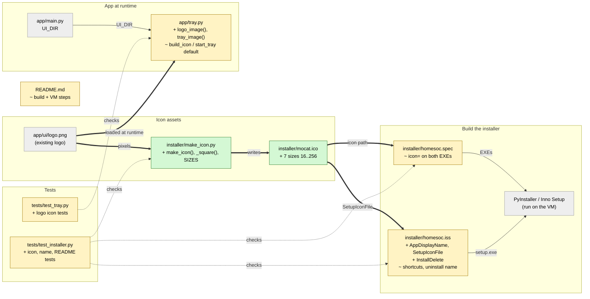

# Study guide: MoCat branding for the installer (ticket #63, code side)

**Ticket:** #63 "Build the installer and test it on a fresh VM" · **Date:** 2026-11-07 · **Gate:** APPROVE (986 passed, baseline 970; ruff clean; JS 17/17; smoke passes; no tampering, no flakes). Verifier: PASS with minor findings.

## The big picture

Before this change, the app had been rebranded "MoCat HomeSOC" with a new logo (`app/ui/logo.png`), but everything Windows shows outside the window still said plain "HomeSOC": the `.exe` files had the default Python icon, the setup wizard and "Apps & features" list said "HomeSOC", and the tray icon was a drawn shield. Now both `.exe` files and the setup program carry a MoCat icon, the user-visible names say "MoCat HomeSOC", and the tray icon is the logo with a small green/yellow/red status dot.

The ticket itself (build `HomeSOC-Setup.exe`, install it on a clean VM snapshot, see the tray go green, uninstall and find no HomeSOC firewall rules) is **manual work on the VM and not done yet**. This change is the code-side prep so the first build already looks right. Think of it as changing the shop sign and the name on the receipts, while the street address, the phone number and the filing cabinets keep their old labels so nothing already installed gets lost.

That last point is deliberate: the **internal names stay HomeSOC** (installer AppId, install folder, `HomeSOC-Setup.exe`, `HomeSOC.exe` / `HomeSOC-Agent.exe`, the scheduled task `HomeSOC Agent`, `%PROGRAMDATA%\HomeSOC`, the firewall group `HomeSOC`, and the uninstall firewall command). Renaming those would break upgrades (Windows would see a "different" app) and could orphan firewall rules that Undo needs to find.

## Map of the changes



**How to read it:** green = new, yellow = changed, grey = existing and untouched; thick arrows are connections added by this change, thin ones already existed, dotted ones are tests checking a file.

## File by file

### `installer/make_icon.py` - new

**What it's for:** a small build-time script that turns the logo PNG into a Windows `.ico` file.
**What changed and why:** Windows needs an `.ico` (a file holding the same picture at several sizes) for `.exe` icons; the logo is only a PNG. The script is never bundled into the app.

**`make_icon(src, dst, sizes)`**

```python
square = _square(img.convert("RGBA"), Image)
square.save(dst, format="ICO", sizes=[(s, s) for s in sizes])
```

It opens the logo with Pillow (a Python image library), makes sure it is square, scales it up to 256 px if it is smaller, and saves one `.ico` holding every size in `SIZES = (16, 24, 32, 48, 64, 128, 256)`. Explorer picks the best-fitting size for the view (small list, big tiles, taskbar). "RGBA" just means colour plus transparency, so the logo's see-through corners are kept.

**`_square(img, image_module)`** puts a non-square logo in the middle of a transparent square canvas so it is padded, not stretched. Run it from the repo root after changing the logo, then commit the new `mocat.ico`.

### `installer/mocat.ico` - new

**What it's for:** the generated icon file, committed to git so the build VM does not need Pillow or the script.
**What changed and why:** it is the single icon used by both the spec and the `.iss`. A test checks that it is not gitignored (otherwise a fresh clone could not build).

### `installer/homesoc.spec` - changed

**What it's for:** the PyInstaller recipe that builds the two `.exe` files.
**What changed and why:** each EXE now gets the icon, so the files look right in Explorer, the taskbar and the Startup list.

```python
ICON = str(ROOT / "installer" / "mocat.ico")
...
agent_exe = EXE(..., name="HomeSOC-Agent", icon=ICON, console=False, uac_admin=True, ...)
app_exe   = EXE(..., name="HomeSOC",       icon=ICON, console=False, uac_admin=False, ...)
```

`console=False` was already there; it only gained a comment (the agent runs hidden from a scheduled task and logs to `agent.log`; the app is a window plus tray).

### `installer/homesoc.iss` - changed

**What it's for:** the Inno Setup script that builds `HomeSOC-Setup.exe`.
**What changed and why:** the user-visible name becomes "MoCat HomeSOC", while internal names stay as they were.

**A new define for the display name**

```
#define AppName "HomeSOC"
#define AppDisplayName "MoCat HomeSOC"
...
AppName={#AppDisplayName}
DefaultDirName={autopf}\{#AppName}      ; still ...\HomeSOC
SetupIconFile=mocat.ico
UninstallDisplayName={#AppDisplayName}
```

`#define` is an Inno Setup constant. Two constants keep the split clear: `AppName` for folders and tasks, `AppDisplayName` for anything a person reads. `SetupIconFile` is relative to the `.iss` file, so it finds `installer\mocat.ico`. The wizard title, the Start-menu group, the shortcuts, the "Open MoCat HomeSOC" checkbox and the Apps & features entry now use the display name.

**`[InstallDelete]`**

```
Type: files; Name: "{autoprograms}\HomeSOC.lnk"
Type: files; Name: "{commonstartup}\HomeSOC.lnk"
```

The shortcuts are now named `MoCat HomeSOC.lnk`. On a PC that already had the old install, the old `HomeSOC.lnk` would stay in the Startup folder next to the new one, and the app would launch twice at logon. This section deletes the old shortcut files before the new ones are created. (`{autoprograms}` and `{commonstartup}` are Inno placeholders for the Start-menu programs folder and the all-users Startup folder.)

### `app/tray.py` - changed

**What it's for:** the system-tray icon (colour shows alert state).
**What changed and why:** the tray should show the brand logo, with the state colour as a dot, instead of the hand-drawn shield.

**`logo_image(colour, logo_path=None, ...)`**

```python
img = logo.convert("RGBA").resize((s, s), LANCZOS)
d = round(s * DOT_FRACTION)          # 0.42 of the icon
draw.ellipse(box, fill=(*COLOURS_RGB[colour], 255), outline=white, width=...)
```

Loads `app/ui/logo.png` (path `LOGO_PATH = UI_DIR / "logo.png"`, reusing `UI_DIR` from `app/main.py` so it works from source and inside the PyInstaller bundle), shrinks it to the icon size, and paints a coloured dot with a white ring in the bottom-right corner. Pillow is imported lazily so importing the tray stays cheap (a test guards that).

**`tray_image(colour, logo_path=None)`** calls `logo_image`, and if the logo cannot be read (`OSError` or `ValueError`) it logs a warning and returns the old `shield_image`. The tray therefore never fails to appear just because of a missing picture. `build_icon` and `start_tray` now default to `tray_image` instead of `shield_image`; the colour logic (`tray_state`) is untouched.

### `README.md` - changed

**What it's for:** the build and manual-check instructions.
**What changed and why:** the build steps now say the spec bundles models **from `models\`**, which are not in git (`dga.joblib` is about 125 MB), so they must be trained or copied in first, with a `Test-Path` check. It documents the icon and `make_icon.py`, notes that internal names stay HomeSOC, and updates the fresh-VM check ("Open MoCat HomeSOC", tray shows the logo with a green dot).

### `tests/test_installer.py` - changed (test)

Fake data: no fakes needed for most; the tests read the real `mocat.ico`, `.iss`, spec and README, and run the spec with PyInstaller's `EXE` stubbed.

- **Icon file is valid:** a small parser reads the `.ico` header and checks sizes 16/32/48/256 exist, no duplicates, and that a PNG is rejected.
- **Icon is committed:** `git check-ignore` says it is not ignored.
- **Script works:** `make_icon` writes every size and keeps the transparent corner (skipped without Pillow).
- **Spec:** both EXEs use `installer/mocat.ico` and stay windowed.
- **Names:** the `.iss` shows "MoCat HomeSOC" for name, group, uninstall name, shortcuts; `SetupIconFile` points at the icon; the old shortcuts are in `[InstallDelete]`.
- **Internal names unchanged:** AppId, install dir, output name, task name, exe names, and the uninstall command are asserted.
- **README order:** models, then `pyinstaller`, then `ISCC.exe`, and the icon is documented.

### `tests/test_tray.py` - changed (test)

Fake data: the real logo plus the existing fake HTTP client and fake pystray.

- **Dot colour:** for green/yellow/red the dot pixel is that colour and the rest is the logo, not the shield.
- **Only the dot differs** between states.
- **Path:** `LOGO_PATH` equals `UI_DIR / "logo.png"` and exists.
- **Fallback:** a missing or corrupt PNG gives exactly the plain shield and logs "plain shield".
- **Default:** `build_icon` uses the logo image.

## How you know it works

- The icon tests parse the real `.ico` bytes, so a broken or PNG-in-disguise icon fails.
- The spec and `.iss` tests parse the real files, so the names, icon paths and the "internal names unchanged" list cannot drift silently.
- The tray tests compare actual pixels for each colour and the fallback.
- Gate: 986 passed (baseline 970, so 16 new tests), ruff clean, JS 17/17, smoke test passes.
- Not proven by tests: that the built `.exe` really shows the icon, or that setup, tray and uninstall behave on Windows. That needs the VM.

## Try it yourself

1. Run just these tests: `.venv\Scripts\python -m pytest -q tests/test_installer.py tests/test_tray.py` (the project's pytest command from `CLAUDE.md` Checks).
2. Lint: `.venv\Scripts\ruff check .`
3. Regenerate the icon after a logo change: `.venv\Scripts\python installer\make_icon.py`.
4. On the VM (the still-open part of #63): copy `dga.joblib` and `flow.joblib` into `models\`, run `pyinstaller --noconfirm installer\homesoc.spec`, then `ISCC.exe installer\homesoc.iss`. **Copy `HomeSOC-Setup.exe` off the VM before reverting to the clean snapshot**, or it is lost.

## Open questions / risks

- **The three Done-when items are still open:** build `HomeSOC-Setup.exe`; install on a clean snapshot and see the tray go green; uninstall and confirm `Get-NetFirewallRule -Group 'HomeSOC'` is empty.
- Verifier finding: the tray **squashes a non-square logo** into a square (`logo_image` resizes without padding, unlike `make_icon`). Fine while `logo.png` is square.
- Verifier finding: only `OSError` / `ValueError` trigger the shield fallback; another Pillow error type would escape.
- Verifier finding: `AppPublisher` ("HomeSOC hackathon team") and the setup status message "Starting the HomeSOC agent..." are **not rebranded**.
- The models come from the VM's `models\` folder at build time and are not in git, so a build on a machine without them fails or ships without them (the README now says to check first).
- Nothing here has been committed yet.
