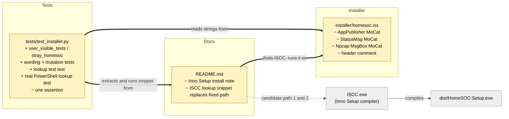

# Study guide: Installer polish - find Inno Setup wherever it is, and say "MoCat"

**Ticket:** #67 · **Date:** 2026-11-08 · **Gate:** APPROVE (1059 passed, baseline 1044; ruff clean; smoke passed)

## The big picture

**Before:** building the installer (`HomeSOC-Setup.exe`) needed Inno Setup, the free tool that
turns our files into a setup program. Its compiler is called `ISCC.exe`. The README told you to
run it from one fixed place, `C:\Program Files (x86)\Inno Setup 6`. But `winget` (Windows' command-line
app installer) puts Inno Setup in your own user folder, `%LOCALAPPDATA%\Programs\Inno Setup 6`, so
the build failed with "file not found". Separately, the product had been renamed "MoCat HomeSOC", but
the installer still showed plain "HomeSOC" in a few places.

**Now:** the README has a small PowerShell snippet that checks both places and uses the first one that
exists (the system-wide one wins if both exist). It throws a clear error if neither exists. The
installer's visible texts say "MoCat". Names that the program uses behind the scenes (the install
folder, the scheduled task, the firewall group) are deliberately still "HomeSOC", because changing
them would break upgrades and the rules in CLAUDE.md section 6.7.

**Analogy:** like looking for your keys in the coat pocket and then the desk drawer, instead of only
the coat pocket. And, separately, repainting the shop sign without renaming the street address.

## Map of the changes



**How to read it:** yellow = changed file, grey = existing thing we plug into; thick arrows are links
added by this ticket, thin ones already existed (the dotted arrow is "looks for").

## File by file

### `README.md` - changed (docs)

**What it's for:** the "Building the installer" runbook.
**What changed and why:** the hard-coded `ISCC.exe` path (the cause of the winget failure) became a lookup.

**The lookup snippet**

```powershell
$iscc = @("${env:ProgramFiles(x86)}\Inno Setup 6\ISCC.exe",
          "$env:LOCALAPPDATA\Programs\Inno Setup 6\ISCC.exe") |
    Where-Object { Test-Path $_ } | Select-Object -First 1
if (-not $iscc) { throw "ISCC.exe not found: ..." }
& $iscc installer\homesoc.iss
```

It lists the two possible places, keeps only those that exist (`Where-Object { Test-Path $_ }`), and
takes the first (`Select-Object -First 1`). Because the system-wide path is listed first, it wins when
both exist. If nothing is found, `throw` stops with a readable message instead of a confusing error.
`& $iscc` means "run the program whose path is in this variable". It is written for Windows
PowerShell 5.1, so there is no `??` or `&&`. The intro text also explains both install routes (installer
from jrsoftware.org, or `winget install JRSoftware.InnoSetup`).

### `installer/homesoc.iss` - changed

**What it's for:** the Inno Setup script that describes the setup program.
**What changed and why:** three strings the user can see said "HomeSOC"; they now say "MoCat".

- `AppPublisher=MoCat hackathon team` (shown in Windows "Apps and features").
- `StatusMsg: "Starting the MoCat agent..."` (the progress text while the background agent starts).
- The Npcap-missing message box: "Npcap was not found. MoCat needs it to see network traffic...".
- The comment at the top now mentions that the README finds a per-machine or per-user Inno Setup.

Left on purpose: `AppId`, `{autopf}\HomeSOC`, the exe names, the task `HomeSOC Agent` and the firewall
group `HomeSOC`. Those are identifiers, not wording, and the uninstaller relies on them.

### `tests/test_installer.py` - changed (test)

**What it's for:** checks the `.iss` and README without needing Inno Setup or a VM.
**Fake data:** none needed for the wording tests (they read the real `.iss`); the PowerShell test builds fake
"Program Files" and "Local AppData" folders inside pytest's temporary directory and puts empty `ISCC.exe` files in them.

**Helpers `user_visible_texts` / `stray_homesoc`.** The first collects every string setup could show:
chosen `[Setup]` keys, `StatusMsg`/`Description`/`Comment` in entries, shortcut names, `[Messages]`,
`[CustomMessages]`, and every quoted string in the `[Code]` Pascal section. The second removes the allowed
names (`MoCat HomeSOC`, `HomeSOC-Agent.exe`, `HomeSOC.exe`) and reports anything still containing "homesoc".
Collecting from the whole file, not only the three lines fixed, means a future stray string is caught too.

Tests, grouped by what they prove:
- **Wording:** no stray "HomeSOC" in visible text; publisher, status message and Npcap box have the exact new text.
- **Mutation checks (8 cases):** each puts old "HomeSOC" wording back (or adds a new message section) and requires
  the check to fail, proving the check can actually fail rather than always passing.
- **Internal names kept:** `AppName` is still `HomeSOC`, the firewall-group removal, `RemoveHomeSOCFirewallRules` and the
  `taskkill` of `HomeSOC-Agent.exe` are still present.
- **README text:** the two candidate paths are exactly per-machine then per-user, the lookup has the filter, first-pick and
  `throw`, ISCC is never run from a literal path, and the lookup comes before the call. The older assertion was
  updated to expect `& $iscc installer\homesoc.iss`.
- **Real PowerShell run (4 cases):** it extracts the snippet and runs it in Windows PowerShell with the fake folders:
  only machine, only user, both (machine wins), neither (non-zero exit and "ISCC.exe not found"). It is skipped when
  PowerShell is missing.

## How you know it works

- The wording check scans every user-visible string in the script; the mutation tests show it fails when old wording returns.
- The lookup is executed for real in all four install situations, not just read as text.
- Gate: 1059 passed (up from 1044), ruff clean, smoke test passed. The verifier was skipped (small ticket).

## Try it yourself

1. Run just these tests: `.venv\Scripts\python -m pytest -q tests/test_installer.py`
2. Run the full check: `.venv\Scripts\python -m pytest -q` then `.venv\Scripts\ruff check .`
3. On a build VM, paste the README snippet after running PyInstaller and confirm `dist\HomeSOC-Setup.exe` appears.
4. Run the produced setup and look for "MoCat" in the publisher, progress text and Npcap prompt.

## Open questions / risks

- The real `ISCC` compile was not run, so the end-to-end build with the new snippet is still a manual VM check.
- The wording check only knows the string places listed in `USER_VISIBLE_SETUP_KEYS` and friends; a visible
  string in an Inno section not listed there would not be seen.
- Other per-user locations (for example a custom install folder) are not searched; the build then stops with the "not found" error.
