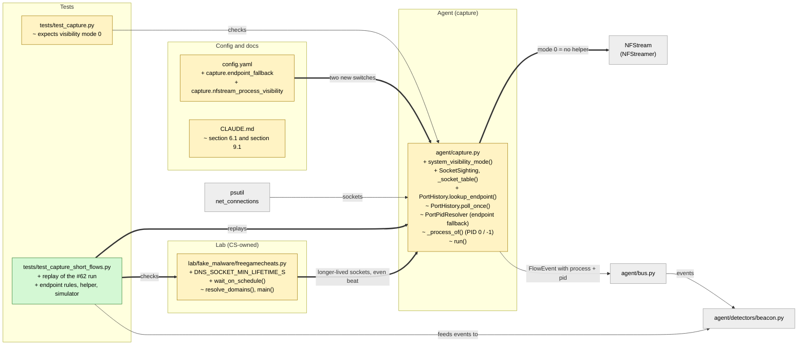

# Study guide: Short flows keep their process

**Ticket:** #68 · **Date:** 2026-11-08 · **Gate:** APPROVE (1044 passed, baseline 1019; ruff clean; smoke passes)

## The big picture

HomeSOC tags every network "flow" (one conversation between the PC and another machine) with
the app that made it. In the #62 live VM run, the fake malware's DNS lookups and about half
of its HTTP check-ins came out as `unknown pid=-1`. The DGA alert (random-looking domain names)
then had no app to quarantine, and the beacon detector, which counts check-ins *per app*,
never reached its 6 starts.

Now almost every flow gets its app. Three things changed: the buggy NFStream process helper is
off by default, HomeSOC's own port-owner lookup gets a new "who else talks to this address?"
fallback, and the fake malware holds its DNS sockets open a little longer and keeps its
check-ins on an even 5 s beat. Analogy: a doorman who writes down who walks through each door.
Visitors who dash through faster than he looks up get missed. So he now also remembers
"every time a visitor came to room 12, it was Alex", and the visitors slow down a bit.

## Map of the changes



**How to read it:** green = new file, yellow = changed file, grey = untouched; thick arrows are
connections this ticket added, thin arrows already existed.

## File by file

### `config.yaml` - changed

**What it's for:** the settings file; thresholds and switches live here, not in code.
**What changed and why:** two new switches under `capture:`.

```yaml
endpoint_fallback: true
nfstream_process_visibility: false
```

`endpoint_fallback` turns the new "same remote address" guess on or off. `nfstream_process_visibility`
decides whether NFStream starts its own process-tracking helper (off, because it crashes on Windows).

### `agent/capture.py` - changed

**What it's for:** turns NFStream flows into `FlowEvent`s and names the app behind each one.
**What changed and why:** it needed to stop relying on the broken NFStream helper and to name
flows that lived shorter than one poll.

**`system_visibility_mode(cfg)`**
```python
return SYSTEM_VISIBILITY_ON if enabled else SYSTEM_VISIBILITY_OFF   # (shortened)
```
Before, `make_streamer` always passed `system_visibility_mode=1`. Now it passes 0 unless the
config says otherwise, and logs one line saying which source names the apps (a WARNING if
someone turns the helper back on). The helper crashed at start-up (WinError 6), never named
UDP flows (Windows lists UDP sockets with no remote address, and the helper only matches
sockets that have one), and called a closing socket "System Idle Process" (PID 0).

**`_process_of()`**
```python
if pid in NFSTREAM_UNKNOWN_PIDS:
    resolved = fallback(flow)
    return resolved if resolved is not None else (name, UNKNOWN_PID)
```
If a flow has a name but a PID of 0 or -1 (the TIME_WAIT case), HomeSOC's own resolver is
asked first. Only if it finds nothing is NFStream's name kept, without a PID, as before.

**`SocketSighting` and `_socket_table()`**
```python
class SocketSighting(NamedTuple):
    sock_type: int; port: int; pid: int; remote: EndpointKey | None = None
```
A `NamedTuple` is a small read-only record. The old `_socket_owners()` returned only
"local port -> PID". `_socket_table()` now also keeps the remote address when psutil gives one,
and `_socket_owners()` is built on top of it so the rest of the code is unchanged.

**`PortHistory`** (the background poller that records who owns which port, every 50 ms)
```python
def lookup_endpoint(self, endpoint):   # (socket type, remote IP, remote port)
    ...
    if len(pids) != 1:
        return None
```
`poll_once()` now also records which processes were seen talking to each remote endpoint, kept
for `port_history_s` (60 s) like the port sightings. `lookup_endpoint` answers only if exactly
one process was seen there; two or more means "ambiguous", so it returns nothing rather than guess.

**`PortPidResolver`** (the lookup order for a flow with no name)
1. the live snapshot of ports, 2. the port history, 3. **new:** the endpoint fallback.

The fallback runs only for outbound flows, and only if `endpoint_fallback` is on. Worked
example: a check-in from local port 50103 to `192.168.56.20:8080` opened and closed between
two polls, so its port was never seen. But `python.exe` was seen on that same address:port in
earlier polls, and nobody else was. So the flow is named `python.exe`. Inbound flows never get
this, because their "remote port" belongs to the attacker, not to an app on this PC.

**`run()`** reads `capture.endpoint_fallback` and passes it to the resolver.

### `lab/fake_malware/freegamecheats.py` - changed (CS-owned file)

**What it's for:** the harmless demo "malware" (CLAUDE.md section 9.1).
**What changed and why:** a CE developer edited this CS-owned file, for timing only. It sends the
same traffic to the same lab address, so it stays inside the section 9.1 rules.

**`DNS_SOCKET_MIN_LIFETIME_S = 0.25` in `resolve_domains()`**
```python
remaining = min_lifetime - (time.monotonic() - opened)
if remaining > 0:
    time.sleep(remaining)
sock.close()
```
An answered DNS lookup on the lab network takes about 1 ms, much less than the 50 ms poll, so
the poller could never see the socket. Holding it open at least 0.25 s lets about five polls
catch it. A lookup that already timed out waits no extra.

**`wait_on_schedule(started, interval)` in `main()`**
After the 20 MB upload, the simulator sleeps until the next multiple of 5 s after the upload
*started*. Worked example: upload starts at t=0 and takes 0.7 s; it sleeps 4.3 s, so the first
check-in is at t=5, then 10, 15. Why: the upload goes to the same C2 port as the check-ins, so
the beacon detector counts it as one more start. Without this the gaps were ~1 s then 5 s, the
spread (coefficient of variation) went over the 0.1 limit and no beacon was reported.

### `CLAUDE.md` - changed

Section 6.1 now describes the helper being off, PID 0/-1 handling and the endpoint fallback;
section 9.1 notes the DNS socket hold time and the check-in beat.

### `tests/test_capture.py` - changed (test)

Two existing assertions now expect `system_visibility_mode=0`.

### `tests/test_capture_short_flows.py` - new (test)

**Fake data:** a made-up timeline of sockets (8 DNS lookups, one upload, six check-ins), a
real `PortHistory` polling it every 50 ms, flows reported 10 s after their socket closed (like
NFStream's idle timeout), then the real resolver and the real `BeaconDetector`. This replays
the #62 run on any OS.

- **The bug reproduces:** with 1 ms DNS sockets and no fallback, DNS is 0 of 8 attributed and check-ins are partly lost.
- **DNS attribution:** with the simulator's hold time, all 8 lookups get the app (at least 90% required).
- **Check-in attribution:** check-ins no poll ever saw still get the app via the endpoint.
- **Beacon fires:** with everything attributed and on the beat, the real detector signals for that app.
- **Beacon stays silent without the fixes:** old behaviour gives no signal; an off-beat upload hides the beacon even with perfect attribution.
- **Fallback rules:** two apps on one endpoint is ambiguous (unknown); never for inbound; can be switched off; sightings expire after 60 s; same socket type needed.
- **psutil table:** TCP remotes kept, Windows UDP has none, listening sockets and PID 0 handled.
- **NFStream helper:** off by default with one INFO line; on gives one WARNING; PID 0 "System Idle Process" is replaced by the real owner; a real PID never asks the fallback.
- **Config:** `run()` reads `capture.endpoint_fallback`.
- **Simulator:** each DNS socket stays open at least 0.25 s; first check-in one interval after the upload; `wait_on_schedule` sleeps to the next beat; no extra wait after a timeout.

## How you know it works

- The replay tests show the #62 symptoms (unknown DNS, silent beacon) before the fix and a firing beacon after it.
- The ambiguity, inbound, switch-off and expiry tests show the new guess is limited and reversible.
- The simulator tests use a fake clock, so they check timing without sleeping.
- The test gate returned APPROVE: 1044 passed (baseline 1019), ruff clean, smoke test passes.
- The verifier returned PASS.

## Try it yourself

1. Run just these tests: `.venv\Scripts\python -m pytest -q tests/test_capture_short_flows.py tests/test_capture.py`
2. Run the full check: `.venv\Scripts\python -m pytest -q` and `.venv\Scripts\ruff check .`
3. In `config.yaml` set `capture.endpoint_fallback: false`, rerun step 1, and see which tests expect it on.

## Open questions / risks

- **Not verified here (live VM):** at least 90% of the fake malware's flows attributed, a live beacon alert, and no WinError 6 at start-up.
- **Real-world DNS:** apps normally resolve names through the Windows resolver service, so the DNS flow belongs to that service, not the app. Naming the true asker needs ETW (Windows event tracing), which this ticket does not do.
- **Port reuse:** Windows can hand the same local port to a different app soon after. The live snapshot and history may then name the newer or older owner; not tested against a live system.
- **Endpoint fallback can mislabel:** an unseen connection to a shared address can be pinned on the one other app seen there. Low risk, and it can be switched off.
- **CS-owned file edited by CE:** `freegamecheats.py` was changed for timing only; worth telling the CS owner.
- **Stale doc:** `docs/study-guides/4-capture-nfstream-to-flowevents.md` still says `system_visibility_mode=1`.
