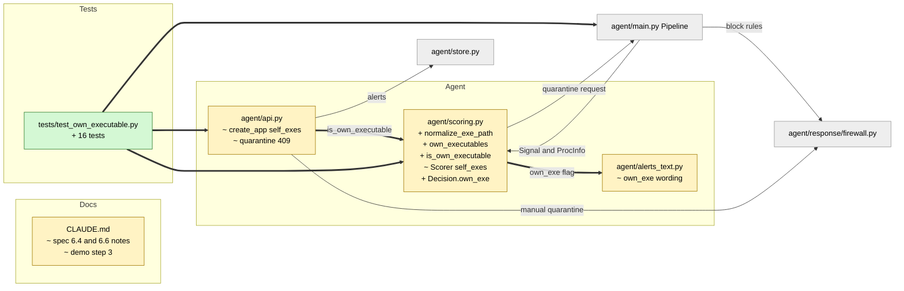

# Study guide: Never quarantine HomeSOC's own executable

**Ticket:** #69 · **Date:** 2026-11-08 · **Gate:** APPROVE

## The big picture

HomeSOC "quarantines" an app by adding Windows Firewall rules that block that program's network traffic. The rule is tied to the program's file path (its `.exe`). In the #61 live run, the fake malware was started from source, so its process was `python.exe`. That is also the Python interpreter HomeSOC itself runs on. Auto mode quarantined `python.exe`, and that blocked HomeSOC's own traffic (the blocklist refresh failed with `WinError 10013`).

Now HomeSOC knows which executables it runs on and never quarantines them. It still raises an alert, and the alert text says why nothing was blocked. The manual "Quarantine" request from the app is refused with a 409 error before any firewall command runs.

Analogy: a security guard who can lock any door in the building, but is not allowed to lock the door of the guard room he is sitting in.

## Map of the changes



**How to read it:** yellow = changed, green = new, grey = unchanged; thick arrows are connections added by this ticket.

## File by file

### `agent/scoring.py` - changed

**What it's for:** combines detector signals into a risk score and decides whether to alert or quarantine.
**What changed and why:** it now knows HomeSOC's own executables and treats them like allowlisted apps: alert only, never quarantine.

**The helper trio**

```python
def normalize_exe_path(path: str) -> str:
    return ntpath.normcase(ntpath.normpath(path)).casefold()
```

Turns a path into one comparable form: slashes fixed, `..` removed, lower case. It uses `ntpath` (the Windows path rules) rather than `os.path`, so the comparison behaves the same even when tests run on another OS.

```python
candidates = [getattr(sys_module, "executable", None)]
if not getattr(sys_module, "frozen", False):
    candidates.append(getattr(sys_module, "_base_executable", None))
```
(shortened)

`own_executables()` builds the protected set. `sys.executable` is the program running now. When running from source (not "frozen" into an installer exe), it also adds `sys._base_executable`, because a virtual environment's `python.exe` is only a launcher that hands off to the real base interpreter, and the network traffic comes from that one. Each path is stored both as given (made absolute) and with links resolved (`realpath`). `sys_module` can be swapped in tests.

`is_own_executable(exe_path, own=None)` answers yes or no for one path. `None` or an empty path is "no".

**Scorer and Decision**

`Scorer(..., self_exes=None)` stores the normalised set (default: the real one). `Decision` gets a new field `own_exe`. In `add()`, own_exe is true only for outbound signals with a known process info whose exe path matches. It is then passed into the same "protected" check that the allowlist uses:

```python
request = self._action_request(window, latest, inbound, risk, detectors, allowlisted or own_exe)
```

Inside `_action_request` the parameter was renamed `protected`; if it is true, no quarantine is requested. Alerts are still raised. `finalize_alert` carries `own_exe` through so the final text keeps the right wording. Inbound attacker signals (block an IP) are untouched, since no local app is involved.

### `agent/alerts_text.py` - changed

**What it's for:** writes the plain-English "What happened / What we did / What you should do".
**What changed and why:** without new wording, the alert would say nothing was blocked and tell the user to quarantine the app. Doing so from the UI would now fail with a 409.

`build_alert_text(..., own_exe=False)` passes the flag to two helpers. "What we did" says nothing was blocked because the process is "the program MoCat itself runs on". "What you should do" says MoCat cannot quarantine it without blocking itself and suggests closing the script and running a Defender scan. The new branch sits before the allowlist branch.

### `agent/api.py` - changed

**What it's for:** the local web API the app talks to.
**What changed and why:** the manual endpoint `POST /alerts/{id}/quarantine` must also protect HomeSOC.

`create_app(..., self_exes=None)` builds `own_exes` (default: `scoring.own_executables()`). In the quarantine handler, after the "exe path unknown" check and before the allowlist check:

```python
if scoring.is_own_executable(exe_path, own_exes):
    raise HTTPException(409, f"{exe_name} is the program MoCat itself runs on; ...")
```
(shortened)

Because this raises before any firewall function is called, no PowerShell command runs and no Action is saved. The module docstring's list of 409 reasons was updated too.

### `CLAUDE.md` - changed

Spec notes were added under scoring (6.4) and the API errors (6.6). Demo step 3 now says to run the packaged `FreeGameCheats.exe` instead of the script from source, since from source it is `python.exe` and would only produce an alert, not a quarantine.

### `tests/test_own_executable.py` - new (test)

**Fake data:** made-up Windows paths for a venv `python.exe`, a base `python.exe`, a frozen `HomeSOC-Agent.exe`, and a `FreeGameCheats.exe` in Downloads. A fake clock, a fake firewall and a recorder that stands in for PowerShell. Nothing real is touched.

Tests, grouped by what they prove:
- The set: includes the base interpreter from source, ignores it when frozen, tolerates missing attributes, and the default is the real running interpreter. Matching ignores case, slashes and `..`.
- Scoring: in auto mode an intel hit or a strong multi-detector risk on the own exe gives an alert but no quarantine request; other exe paths are still quarantined; the default Scorer protects the running interpreter.
- Pipeline: for the own exe, no firewall command is ever run.
- API: manual quarantine of the own exe returns 409 with no firewall call; another exe still works; the default `create_app` refuses the running interpreter.

## How you know it works

- Each protected path (venv launcher, base interpreter, odd spelling) gives alert-only behavior.
- The control tests show other apps, such as the fake malware exe, are still quarantined, so the protection is not too wide.
- An end-to-end pipeline test records PowerShell calls and finds none for the own exe.
- Gate: APPROVE. 16 new tests, 1019 passed in total, ruff clean, smoke test passes, no existing tests were changed. The verifier was skipped (size S).

## Try it yourself

1. Run just the new tests: `.venv\Scripts\python -m pytest -q tests/test_own_executable.py`
2. Run the whole check: `.venv\Scripts\python -m pytest -q` and `.venv\Scripts\ruff check .`
3. Optional: run the smoke test `.venv\Scripts\python -m pytest -q tests/test_smoke.py` to see that quarantine still works for normal apps.

## Open questions / risks

- Only the agent's own exe is protected. The user-side `HomeSOC.exe` (the app window) is not in the set, so it could in principle be quarantined. Its traffic is only to `127.0.0.1`, but this is an open decision.
- From source, the whole Python interpreter is protected, so any other Python script is also never auto-quarantined. This is why the demo must use the packaged exe.
- Protection depends on `sys.executable` and `sys._base_executable`. Other launch methods (for example a different host process) are not covered.
