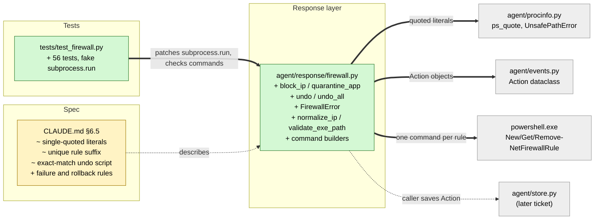

# Study guide: Block an IP, quarantine an app, and undo it (Windows Firewall)

**Ticket:** #7 · **Date:** 2026-11-07 · **Gate:** APPROVE (413 -> 469 tests, ruff clean)

## The big picture

Before this ticket HomeSOC could *see* bad behavior but could not *do* anything about it. Now
`agent/response/firewall.py` can contain a threat by adding **Windows Firewall rules**: block a
remote IP address (both directions), or "quarantine" a program so it cannot use the network at
all. Every rule lives in one named group, `HomeSOC`, and every action can be undone, even after
the agent restarts, because the rule names travel inside the returned `Action`.

Analogy: a building security guard who may only put red tape on doors *he labelled himself*. Each
piece of tape carries a unique ticket number, so removing one ticket's tape never peels off
another's, and the guard refuses to touch any door that is not his.

The code talks to Windows by running PowerShell commands, so the main danger is **injection**:
text that sneaks extra commands into the PowerShell line. Most of the design is about preventing
that and about never silently failing.

**What went wrong first.** The first version was rejected (BLOCKED) for three things: (1) removing
a rule by `-DisplayName` treats `[ ] * ?` as wildcards, so a name like `setup[1].exe` silently
removed nothing; (2) rule names were not unique, so undoing one action could remove another's
rules; (3) `-ErrorAction SilentlyContinue` hid real errors. This version fixes all three and
updates `CLAUDE.md` §6.5 to match.

## Map of the changes



**How to read it:** green = new file, yellow = edited file, grey = existing code it plugs into;
thick arrows are connections this ticket added, the dotted arrow to the store is not wired yet.

## File by file

### `agent/response/firewall.py` - new

**What it's for:** creates and removes the `HomeSOC` firewall rules through PowerShell.
**What changed and why:** it is the containment step of the pipeline (§6.5); nothing existed
before.

**Input validation (`normalize_ip`, `validate_exe_path`)**

```python
addr = ipaddress.ip_address(ip)
if addr.is_loopback or addr.is_unspecified:
    raise ValueError(...)
return str(addr)
```

The IP is parsed by Python's `ipaddress` module and only its canonical string form is used, so
`1.2.3.4; Stop-Computer` is rejected before anything runs. Loopback (`127.0.0.1`) and `0.0.0.0`
are refused because blocking them would break the PC itself. An exe path must be an absolute
Windows path with no NUL, CR or LF characters; otherwise `UnsafePathError` is raised.

**Quoting every literal**

Every value that goes into a command (rule name, group, IP, path) is wrapped by
`agent.procinfo.ps_quote`. That produces a PowerShell *single-quoted* string, inside which
nothing is expanded (`$`, backticks, `;`, `"` are just text). The only special character is the
single quote itself, which is doubled (`'` becomes `''`, and the curly "smart" quotes too).
Example: `C:\Users\O'Brien\a.exe` becomes `'C:\Users\O''Brien\a.exe'`.

**Unique rule names**

```python
f"{RULE_PREFIX}block {ip} {short} {tag}"     # tag = "#" + first 8 hex of the action id
# e.g. HomeSOC block 192.168.56.20 out #a1b2c3d4
```

Each action gets a fresh random id, and its rules end with the first 8 characters of it. Blocking
the same IP twice, or quarantining two different `update.exe` files, produces different names, so
undoing one action cannot delete another's rules.

**`block_ip` and `quarantine_app`**

```python
NEW_RULE_TEMPLATE = ("New-NetFirewallRule -DisplayName {name} -Group {group} "
    "-Direction {direction} {match} -Action Block -ErrorAction Stop | Out-Null")  # (shortened)
```

Each makes two rules (outbound, then inbound), one PowerShell call per rule. `-RemoteAddress`
is used for an IP, `-Program` for an app. `-ErrorAction Stop` turns any cmdlet error into a
non-zero exit code. Both return an `Action` that records the exact rule names created.

**Failure handling (`_run_powershell`, `FirewallError`, `_create_rules`)**

A non-zero exit, a 30 s timeout, or a missing `powershell` is logged at ERROR level and raised as
`FirewallError`; it is never treated as success. If the second rule fails, the first is rolled
back (removed by name). `FirewallError.rule_names` lists what was created and
`leftover_rules` lists anything the rollback could not remove (those stay in group `HomeSOC`, so
`undo_all` still catches them).

**`undo` and the exact-match removal script**

```powershell
try { $rules = @(Get-NetFirewallRule -Group 'HomeSOC' -ErrorAction Stop) } catch { ... }
$match = @($rules | Where-Object { $_.DisplayName -ceq '<rule name>' })
if ($match.Count -gt 0) { Remove-NetFirewallRule -InputObject $match -ErrorAction Stop }  # (shortened)
```

Instead of `-DisplayName` (wildcards!), undo lists group `HomeSOC` and keeps only rules whose
name equals the stored one using `-ceq`, a plain case-sensitive comparison. Remove is only called
with a non-empty `-InputObject`, because a bare `Remove-NetFirewallRule` would delete every rule
on the machine. If the group is empty, PowerShell raises an `ObjectNotFound` error; the script
treats that one error as "nothing to remove" (exit 0, so undo is safe to repeat). Any other error
(for example access denied) goes to stderr with exit 1 and becomes a `FirewallError`.

`undo(action)` refuses actions that are not `block_ip`/`quarantine_app`, already undone, or hold a
name not starting with `HomeSOC `. On success it sets `action.undone = True` and returns a new
`Action(kind="undo", target=<original id>)`. If any removal failed, `undone` stays `False`.

**`undo_all`**

Same script but with every rule in group `HomeSOC` and nothing outside it. Returns
`Action(kind="undo", target="HomeSOC", rule_names=[])`; the caller marks its stored actions undone.

### `CLAUDE.md` - changed (spec)

**What it's for:** project memory and the shared spec.
**What changed and why:** §6.5 now documents what the code really does: single-quoted literals,
the `<tag>` suffix, `-ErrorAction Stop`, the exact-match undo script with its ObjectNotFound rule,
rollback and `FirewallError`. The spec said to update it in the same change.

### `tests/test_firewall.py` - new (test)

**What it's for:** proves the module works on any OS without touching real PowerShell.
**Fake data:** a `FakeRun` object replaces `subprocess.run`, records every command string, and can
be told to fail (exit 1, "Access is denied."). A tiny PowerShell-quote reader in the tests parses
the command back, so tests check that a nasty path comes out as exactly one literal. Sample IP is
`192.168.56.20`, sample exe `C:\Users\bob\Downloads\FreeGameCheats.exe`. 56 tests, grouped:

- **block_ip:** out and in rules in group `HomeSOC`, canonical IP, bad or non-string input rejected without running anything.
- **quarantine_app:** `-Program` rules, unsafe paths rejected, quotes/`$`/backticks/`;` survive as one literal, bracketed paths round-trip.
- **undo:** removes exactly the stored names, block round-trip, invalid actions refused, wildcard characters matched literally.
- **unique names:** same exe in two folders, same IP twice, and undo of one action referencing only its own names.
- **undo_all:** targets group `HomeSOC` only.
- **failures:** non-zero exit raises and logs, partial create rolls back (and reports failed rollback), failed undo leaves `undone=False`, missing PowerShell counts as failure, the remove scripts never use `SilentlyContinue`.

## How you know it works

- Command strings are checked exactly, so injection attempts (`'`, smart quotes, `$(...)`, `;`) are shown to stay inside one quoted literal.
- The wildcard bug that blocked the first version has direct tests (`[ ] * ?` in names, bracketed exe round trip).
- Rollback, leftover reporting and undo-failure paths are all covered.
- Test gate: APPROVE, no regressions: the suite went from 413 to 469 tests (56 new), ruff clean. Verifier: PASS.

## Try it yourself

1. Run just these tests: `.venv/bin/python -m pytest -q tests/test_firewall.py` (Windows: `.venv\Scripts\python -m pytest -q tests/test_firewall.py`).
2. Run the whole suite (469 tests): `.venv/bin/python -m pytest -q`, then lint with `.venv/bin/ruff check .`.
3. On the Windows VM (admin PowerShell), call `block_ip("192.168.56.20")`, check `Get-NetFirewallRule -Group HomeSOC`, then `undo` the returned action and confirm the rules are gone.

## Open questions / risks

- **Not yet run on real Windows PowerShell.** On the VM, run `undo_all` twice: the second call must succeed. If the empty-group error category is not `ObjectNotFound`, it fails loudly (exit 1), not silently.
- Confirm on the VM that `Get-NetFirewallRule -Group` finds the rules that `New-NetFirewallRule -Group` created.
- Store integration is pending: this module does not save anything; the caller must save the `Action` in `agent/store.py` (a later ticket), or undo after a restart has nothing to read.
- `undo_all` returns an empty `rule_names`, so callers must mark stored actions undone themselves.
