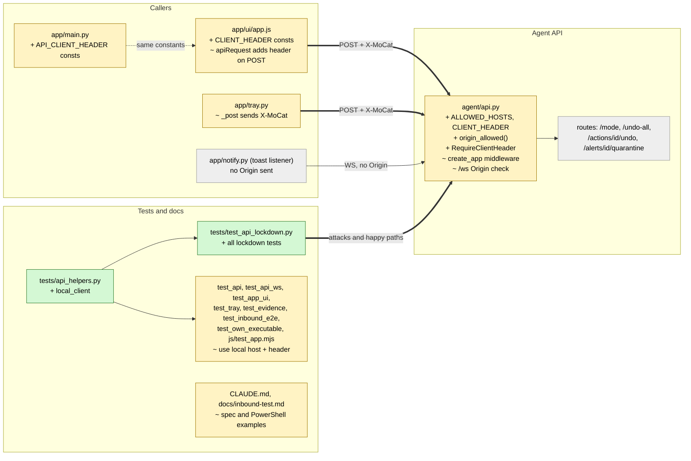

# Study guide: Lock the agent API to this PC

**Ticket:** #71 · **Date:** 2026-11-08 · **Gate:** APPROVE (1217 passed, baseline 1059; ruff clean; smoke passed; no flakes in 3 reruns)

## The big picture

The HomeSOC agent runs a small web server (the "API") on `127.0.0.1:8765`. `127.0.0.1` means "this PC only", so people assumed nothing outside could reach it. A security review showed that was wrong: any web page the user visits runs inside their browser, and the browser is on this PC. Three tricks worked:

- **Cross-site WebSocket hijacking.** A page opens `ws://127.0.0.1:8765/ws` and reads alerts and flows live. Browsers do not apply CORS (the "may this site read that site?" rule) to WebSockets, and `/ws` never checked who was asking.
- **Cross-site "simple" POST.** A page sends `POST /undo-all` with `mode: 'no-cors'`. Browsers send some POSTs without asking first (no "preflight"), so every firewall block could be removed.
- **DNS rebinding.** A hostile site's name is switched to point at `127.0.0.1`. The browser then treats the API as that site's own and lets it read `/alerts` and `/apps`. The API never looked at the `Host` header.

Now the API checks three things: the `Host` must be `127.0.0.1` or `localhost`, a WebSocket `Origin` (if present) must be a loopback page, and every POST must carry a custom header `X-MoCat: 1`.

Analogy: a house with a locked front door that anyone inside the neighbourhood could still talk through. We added a doorman who checks the address on the envelope (Host), who sent the visitor (Origin), and a secret handshake for anything that changes things (the header).

## Map of the changes



**How to read it:** green = new file, yellow = changed, grey = untouched. Thick arrows are new connections (the header on POSTs, the lockdown tests); dotted means "keeps the same constants".

## File by file

### `agent/api.py` - changed

**What it's for:** the FastAPI server the app, tray and toast listener talk to.
**What changed and why:** it now refuses requests that did not come from this PC's own app, closing the three holes above.

**Constants**

```python
ALLOWED_HOSTS = (config_module.LOOPBACK_HOST, "localhost")
CLIENT_HEADER = "X-MoCat"
CLIENT_HEADER_VALUE = "1"
CLIENT_HEADER_METHODS = frozenset({"POST"})
WS_CLOSE_POLICY_VIOLATION = 1008
```

The only allowed Host names, the secret header and value, which HTTP methods need it, and the WebSocket close code meaning "policy violation".

**`TrustedHostMiddleware`** (a ready-made Starlette "middleware", code that sits in front of every route). It is given `ALLOWED_HOSTS`. A request whose `Host` header is anything else gets 400, including the WebSocket handshake. This stops DNS rebinding, because a rebinding page still sends its own hostname as Host.

**`origin_allowed(origin)`**

```python
return origin is None or re.fullmatch(CORS_ORIGIN_REGEX, origin) is not None
```

No Origin is fine (non-browser programs such as the toast listener send none). Otherwise the Origin must match the existing loopback-only pattern, so `null` (sandboxed pages, `file://`) and remote sites are refused.

**`/ws` handler.** At the top it reads the `origin` header and, if `origin_allowed` says no, closes with code 1008 and returns. This is needed because browsers do not enforce CORS on WebSockets; the server has to check itself.

**`RequireClientHeader`** (a hand-written ASGI middleware, ASGI being the Python web-server interface)

```python
if scope["type"] == "http" and scope.get("method") in CLIENT_HEADER_METHODS:
    if Headers(scope=scope).get(CLIENT_HEADER) != CLIENT_HEADER_VALUE:
        ... JSONResponse({"detail": ...}, status_code=403)
```

Any POST without `X-MoCat: 1` gets 403 before the route runs, so no firewall call, no database write and no mode change. Why it works: a browser must send a CORS preflight ("may I send this header?") before a cross-site request with a custom header, and foreign origins fail that preflight. A page can no longer fire a "simple" POST.

**Middleware order in `create_app`.** Starlette runs the last one added first, so the code adds them in reverse and the real order is TrustedHost, then CORS, then the header check. Consequences: a preflight (`OPTIONS`, which cannot carry the custom header) is answered by CORS before the header check; and a 403 still carries CORS headers, so the app window can read the error. `allow_headers` now also lists `X-MoCat`. GETs do not need the header; the Host check and CORS protect reads.

### `app/main.py` - changed

**What it's for:** the app's entry point and its single source of the API address.
**What changed and why:** it gets `API_CLIENT_HEADER = "X-MoCat"` and `API_CLIENT_HEADER_VALUE = "1"`. They are copied here rather than imported from `agent/api.py` so the user-level app does not pull in the elevated agent's server code.

### `app/tray.py` - changed

**What it's for:** the tray icon, which talks to the agent over HTTP.
**What changed and why:** `AgentApi._post` now passes `headers={API_CLIENT_HEADER: API_CLIENT_HEADER_VALUE}`. Without it, "Mode" and "Undo all" in the tray would get 403. The module docstring was updated to match.

### `app/ui/app.js` - changed

**What it's for:** the window's JavaScript.
**What changed and why:** the same two constants are added, and `apiRequest` sets the header when the method is POST:

```js
if (init.method === "POST") init.headers[CLIENT_HEADER] = CLIENT_HEADER_VALUE;
```

All POST helpers (`undoAction`, `undoAll`, `setMode`, `quarantineAlert`) go through `apiRequest`, so one line covers them. The constants are also exported for the JS test.

### `CLAUDE.md` and `docs/inbound-test.md` - changed (docs)

CLAUDE.md §6.6 and §6.7 now describe the lockdown, as the project rules require when a spec changes. The inbound test guide's PowerShell `Invoke-RestMethod` POST examples add `-Headers @{'X-MoCat'='1'}`, or they would now get 403.

### `tests/api_helpers.py` - new (test)

**What it's for:** one place to build a test client that behaves like the real app.
`local_client(app)` makes a `TestClient` with base URL `http://127.0.0.1:8765` and the `X-MoCat: 1` header. The default test host `testserver` is now refused, and the code never allows it. `LOCAL_WS_URL` is a full URL because the WebSocket test helper ignores the base URL.

### `tests/test_api_lockdown.py` - new (test)

**What it's for:** proves the lockdown. Fake data: an in-memory/temporary `Store` seeded with one alert and action, a fake firewall that records calls, and a real `Scorer`. Routes are listed from the real app, so a future route is covered automatically, and a sanity test stops the lists from being empty.

- Foreign Host (several names, plus `testserver`) gives 400 on every route and on `/ws`; `127.0.0.1`, `localhost`, with or without a port or capitals, still works; `ALLOWED_HOSTS` is exactly loopback.
- Every POST route without the header (missing, wrong value, empty) gives 403 and changes nothing: no firewall call, store snapshot identical.
- With the header, every POST route runs; GET routes need no header.
- Preflight from loopback origins succeeds without the header.
- `/ws` refuses foreign, `null` and other bad Origins; accepts loopback Origins and none.
- `origin_allowed` is checked directly on a table of inputs.

### Other test files - changed (test)

`test_api.py`, `test_api_ws.py`, `test_evidence.py`, `test_inbound_e2e.py`, `test_own_executable.py`: switched to `local_client` and `LOCAL_WS_URL`, so they still pass under the new rules.

`test_app_ui.py`: adds a test that the header constants are identical in `agent/api.py`, `app/main.py` and `app.js`; preflight from the window allows `x-mocat`; a header-less POST from the window is 403 but still has CORS headers; a foreign-origin preflight fails with 400 even when asking for the header.

`test_tray.py`: every tray POST sends `{"X-MoCat": "1"}`. `tests/js/test_app.mjs`: every POST helper sends the header and the GET helpers do not.

## How you know it works

- Each attack from the review has a test that fails without the fix: foreign Host, foreign/`null` Origin on `/ws`, header-less POST.
- Nothing happens on a refused request: the fake firewall is never called and the store and mode are unchanged.
- The real app paths still work: window, tray and loopback WebSocket clients are tested with the header, and a missing Origin on `/ws` is accepted.
- Gate numbers: 1217 passed (baseline 1059), ruff clean, smoke test passed, no flakes over 3 reruns. The author's attack proof of concept now gets 400s, and the firewall no longer runs.

## Try it yourself

1. Run only the new tests: `.venv\Scripts\python -m pytest -q tests/test_api_lockdown.py`
2. Run the related ones: `.venv\Scripts\python -m pytest -q tests/test_app_ui.py tests/test_tray.py tests/test_api_ws.py`
3. Run lint: `.venv\Scripts\ruff check .`
4. With the agent running, try `Invoke-RestMethod -Method Post http://127.0.0.1:8765/undo-all`: it should fail with 403. Adding `-Headers @{'X-MoCat'='1'}` makes it work.

## Open questions / risks

- No test in a real browser was done; the browser behaviour (preflight, no-cors POST) is reasoned from the standards and checked only with test clients.
- The real `websockets` toast client was not run against the lockdown, because `websockets` is missing from the local `.venv` (it is in `requirements.txt`). The claim that it sends no Origin was verified in websockets 17.4 only.
- The header is not a secret: any program on this PC can send it. It protects against web pages, not against local malware. That was the stated goal.
- Older study guides still show POST examples without the header.
- The verifier was skipped (size S).
