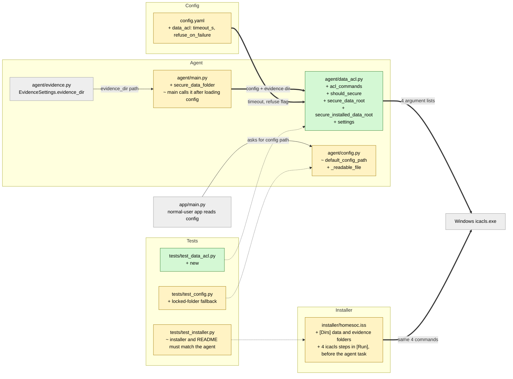

# Study guide: Lock down the HomeSOC data folder so other accounts can't read captured traffic

**Ticket:** #72 · **Date:** 2026-11-08 · **Gate:** APPROVE (1250 passed, baseline 1217; ruff clean; smoke test passes)

## The big picture

**Before:** the installed program keeps everything it records in `C:\ProgramData\HomeSOC`: the rolling packet capture, exported evidence files (pcaps), the alert database `homesoc.db`, and `agent.log`. A new folder under `C:\ProgramData` automatically copies that folder's permissions, and those let every local account read it and create files and folders inside it. So any other user on the PC, or any malware running as an ordinary user, could read captured traffic or plant files there.

**Now:** that folder is locked so only **SYSTEM** (the account the agent runs as) and **Administrators** can touch it. One exception: ordinary users may *read* `data\evidence`. That keeps "Export evidence -> open in Wireshark" working for a normal user without admin rights. The lock is applied twice: by the installer at setup, and by the agent every time it starts.

**Analogy:** the folder used to be a room in a shared office building whose door anyone with a staff badge could open. We changed the lock so only the security team has a key. One drawer (the evidence drawer) is left open for everyone to read, because that is where finished reports are handed out.

A few terms used below:
- **ACL** (access control list): the list of who may do what to a file or folder.
- **`icacls`**: the built-in Windows command-line tool that edits ACLs.
- **SID**: a fixed numeric ID for an account or group. SYSTEM is always `S-1-5-18`, Administrators `S-1-5-32-544`, Users `S-1-5-32-545`. We use these instead of names like "Administrators" because the names are translated on non-English Windows (for example "Administrateurs"), but the numbers never change.
- **Frozen**: the program has been packaged into a `.exe` by PyInstaller. Running from source (`python -m agent.main`) is "not frozen".

## Map of the changes



**How to read it:** green = new, yellow = changed, grey = untouched; thick arrows are connections this ticket added, dotted lines show which test covers which file.

## File by file

### `agent/data_acl.py` - new

**What it's for:** builds and runs the `icacls` commands that lock the data folder.
**What changed and why:** this is the heart of #72. Before, nothing set permissions on `%PROGRAMDATA%\HomeSOC`.

**`acl_commands(data_root, evidence_dir, icacls)`** (shortened)
```python
[icacls, root, "/inheritance:r", "/grant:r", "*S-1-5-18:(OI)(CI)F", "*S-1-5-32-544:(OI)(CI)F", "/Q"],
[icacls, root, "/setowner", SID_ADMINISTRATORS, "/T", "/Q"],
[icacls, root, "/remove:g", *BROAD_SIDS, "/T", "/Q"],
[icacls, evidence, "/grant:r", "*S-1-5-32-545:(OI)(CI)RX", "/Q"],
```
It returns four commands, each a list of separate arguments (never one text string handed to a shell, so a strange path can't inject extra commands). In order:
1. `/inheritance:r` cuts the link to `C:\ProgramData`'s permissions, then SYSTEM and Administrators get Full control. `(OI)(CI)` means "also apply to every file and subfolder inside", and this goes first so the biggest hole closes first.
2. `/setowner` makes Administrators the owner of everything (`/T` = the whole tree). An owner can always rewrite permissions, so a folder a normal user created before the fix can't stay theirs.
3. `/remove:g` scrubs any leftover explicit entries for Users, Authenticated Users, Everyone and CREATOR OWNER anywhere in the tree.
4. Users get **R**ead + e**X**ecute on `data\evidence` only, inherited by pcaps written there later.

**`should_secure` / `secure_installed_data_root`**
```python
return bool(frozen) and data_root.resolve() != bundle_root.resolve()
```
The lock only runs for the installed (frozen) agent whose data folder is separate from the program bundle. From source, the "data folder" is the developer's own repo, and this keeps it from ever being re-permissioned. Otherwise it returns `None` ("nothing done").

**`secure_data_root`**
Creates the folders if missing, then runs each command through an injected `run` function (normally `subprocess.run`, a fake in tests, so tests work off Windows). A non-zero exit, timeout or missing `icacls.exe` is logged as an ERROR, but the remaining commands still run. It returns `True` only if all four succeeded. If the evidence folder is configured outside the data root, it is not opened to Users (a warning is logged).

**`settings(cfg)`** reads `timeout_s` (default 30) and `refuse_on_failure` (default false) from `config.yaml`.

### `agent/main.py` - changed

**What it's for:** the agent's startup and pipeline.
**What changed and why:** the agent now re-applies the lock on every start, so an upgrade, a manual repair, or a folder that existed before the fix is corrected.

**`secure_data_folder(cfg, run=None)`**
```python
locked = data_acl.secure_installed_data_root(cfg, evidence.EvidenceSettings.from_config(cfg).evidence_dir, ...)
if locked is False and data_acl.settings(cfg)[1]:
    raise SystemExit(1)
```
It takes the evidence folder from the existing evidence settings, so there is one source of truth. On failure it logs an ERROR and carries on, because a demo shouldn't be bricked by a permissions hiccup. Only if `data_acl.refuse_on_failure` is true does the agent exit. `main()` calls it right after the config is loaded and before the agent runs.

### `agent/config.py` - changed

**What it's for:** finds `config.yaml` and the data and bundle roots.
**What changed and why:** the app runs as a normal user and used to read `config.yaml` from `%PROGRAMDATA%\HomeSOC`. Once locked, Python 3.12's `Path.is_file()` *raises* `PermissionError` instead of returning False, which would crash the app at startup.

**`_readable_file(path)`**
```python
try:
    return path.is_file()
except OSError:
    return False
```
`default_config_path` uses it, so a locked data folder counts as "not readable" and the app falls back to the `config.yaml` bundled in `C:\Program Files\HomeSOC`. (Side effect: the app no longer sees admin edits to `app.*` settings in the ProgramData config; see risks.)

### `config.yaml` - changed

New `data_acl:` section with `timeout_s: 30` and `refuse_on_failure: false`, so no magic numbers sit in code (project rule). There is also a whitespace-only tweak on the `tray_refresh_s` line.

### `installer/homesoc.iss` - changed

**What it's for:** builds `HomeSOC-Setup.exe` (Inno Setup).
**What changed and why:** locking at install time means the folder is never exposed, even before the agent first starts.

- **`[Dirs]`** creates the data folder, `data`, and `data\evidence` with `uninsneveruninstall` (alerts and settings survive an uninstall, as before).
- **`[Run]`** gets the same four `icacls` commands, in the same order, placed *before* the step that registers and starts the agent task. They run hidden and wait until finished. If one fails, setup does not abort; the agent re-locks on its next start.

### `tests/test_data_acl.py` - new (test)

Fake data: `FakeRun`, a stand-in for `subprocess.run` that records every call and returns chosen exit codes; temp folders replace the real ProgramData; a fixture pretends to be the frozen installed agent.
- **Exact commands:** the four argument lists, the well-known SIDs, Users get read on evidence only and no write anywhere, inheritance cut first.
- **Failures:** a bad exit code, missing icacls or timeout is logged and the other commands still run; an evidence folder outside the root is never opened.
- **Only the installed agent:** from source or when data root equals bundle, nothing runs and no folder is created.
- **Config and wiring:** `config.yaml` values load; locked at start, ERROR-and-continue by default, `SystemExit(1)` with `refuse_on_failure`; `main()` order is seed, load, 4x icacls, run.
- **Real `icacls` (Windows only):** applies the lock to a temp folder and inspects the resulting permissions (SDDL text): inheritance cut, owner, no Users/Everyone entries, evidence readable, same result when run twice.

### `tests/test_installer.py` - changed (test)

Parses the `.iss` file and checks that its `icacls` lines equal the agent's `acl_commands`, use only SIDs, use `{sys}\icacls.exe`, run before the agent task, and that the folders survive uninstall. "Mutation" tests weaken the installer on purpose (keep inheritance, grant Users more, use a localised name, and so on) and assert the check catches each. It also checks the README's manual steps and hand-typed `icacls` commands match the agent, and adjusts an older test that assumed the agent task was the first `[Run]` line.

### `tests/test_config.py` - changed (test)

One test: when every stat under the data root raises `PermissionError`, `default_config_path` returns the bundled `config.yaml`.

### Docs (`README.md`, `CLAUDE.md`) - changed

Describe the lock, the clean-VM manual check, and editing the ProgramData config from an admin editor. Not code, but tests assert the README commands stay in sync.

## How you know it works

- The command lists are checked exactly, including "Users get read on evidence only and nothing else".
- Failure paths (non-zero exit, timeout, no icacls, evidence outside root) are logged without stopping the rest.
- The installer and the agent cannot drift apart: a test compares them, and mutation tests prove it notices weaker versions.
- The real `icacls` test confirms the resulting permissions on a temp folder.
- Gate: APPROVE, 1250 passed (baseline 1217, so 33 new), ruff clean, smoke test passes. The verifier said PASS.

## Try it yourself

1. Run just these tests: `.venv\Scripts\python -m pytest -q tests/test_data_acl.py tests/test_installer.py tests/test_config.py`
2. Run the full suite and linter from the CLAUDE.md Checks table: `.venv\Scripts\python -m pytest -q` then `.venv\Scripts\ruff check .`
3. Read the commands: `.venv\Scripts\python -c "from pathlib import PureWindowsPath as P; from agent import data_acl; print(*data_acl.acl_commands(P(r'C:\ProgramData\HomeSOC'), P(r'C:\ProgramData\HomeSOC\data\evidence')), sep='\n')"`
4. Manual (still to do on a clean VM, see README "Manual check on a fresh VM"): install, run `icacls C:\ProgramData\HomeSOC /T` as admin, then as a non-admin user confirm reads and creates give "Access is denied" and an exported pcap under `data\evidence` opens in Wireshark.

## Open questions / risks

- **Manual check not done yet:** the clean-VM check (`icacls /T` output, non-admin denied, Wireshark opens the pcap) still needs a person.
- **Small exposure windows (verifier, non-blocking):** the agent seeds and opens `agent.log` before locking, so on a manual frozen start there is a brief window; evidence merge temp parts are briefly readable by Users; installer `icacls` failures don't abort setup (the agent re-locks on start).
- **App config:** the app now reads the bundled config, so it no longer sees admin edits to `app.*` keys in the ProgramData config.
- **Junctions:** a junction (folder shortcut) pre-planted inside the folder before the lock is not detected.
- **Explorer:** a normal user can't browse into `data\evidence` in Explorer; opening the full path works (Windows lets everyone traverse by full path).
