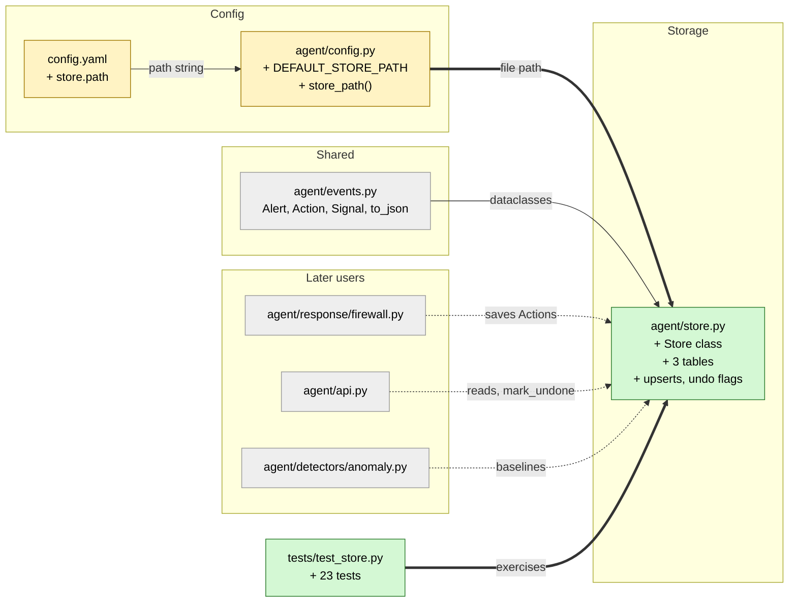

# Study guide: Remember alerts, actions and baselines in a database

**Ticket:** #8 - Persist alerts, actions and baselines in SQLite (`agent/store.py`) · **Date:** 2026-11-07 · **Gate:** APPROVE

## The big picture

Before this change, everything HomeSOC knew lived in memory. If the agent restarted, it forgot
every alert and, worse, it forgot the *names* of the firewall rules it had created. Without those
names, the Undo button could not remove a quarantine rule (CLAUDE.md section 6.5).

Now there is a small database file (`data/homesoc.db`, SQLite) with three tables: alerts,
actions and baselines (what "normal" traffic looks like for each app). Think of it as a
filing cabinet next to the security guard's desk: the guard (the agent) can go home and come
back tomorrow, and the cabinet still says "I locked door 3 with key #deadbeef, here is how to
unlock it".

Note: the store is not wired into the pipeline or API yet. That is expected; this ticket only
builds the cabinet.

## Map of the changes



**How to read it:** green = new, yellow = changed, grey = existing and unchanged. Thick arrows
are connections added now; dotted arrows are future users of the store (not wired yet).

## File by file

### `config.yaml` - changed

**What it's for:** all tunable settings live here (no magic values in code).
**What changed and why:** a new `store:` section says where the database file is.

```yaml
store:
  path: data/homesoc.db
```

A relative path is read relative to the repo root.

### `agent/config.py` - changed

**What it's for:** loads `config.yaml` and offers helpers.
**What changed and why:** `store_path(cfg)` turns the config value into a real `Path`, so the
store does not need to know about YAML.

```python
def store_path(cfg):
    ...
    path = Path(value)
    return path if path.is_absolute() else REPO_ROOT / path
```

If the `store` section is missing, it falls back to `DEFAULT_STORE_PATH` (`data/homesoc.db`).
Relative paths are anchored at the repo root so it works no matter which folder you start from.

### `agent/store.py` - new

**What it's for:** saving and loading alerts, actions and baselines.
**What changed and why:** the whole file is new; it makes Undo survive an agent restart.

**Opening the database (`Store.__init__`)**

```python
self._conn = sqlite3.connect(self._path, check_same_thread=False)
self._conn.executescript(_SCHEMA)
self._conn.execute("PRAGMA user_version = 1")
```

SQLite is a database that is just one file, and Python includes it (`sqlite3`), so there is
nothing to install. It creates the folder and tables if missing. `user_version = 1` stamps the
file's format number so future versions could migrate it; there are no migrations yet.

**One connection plus a lock (`_tx`)**

```python
@contextmanager
def _tx(self):
    with self._lock, self._conn:
        yield self._conn
```

The agent has an asyncio loop and capture threads, and they might touch the store at the same
time. A lock makes them take turns; `check_same_thread=False` allows sharing the connection.
`with self._conn` commits on success and rolls back on error, so each write is saved at once.

**Alerts**

```python
data = json.dumps(to_json(alert))
"INSERT INTO alerts (...) ... ON CONFLICT(id) DO UPDATE SET ..."
```

An alert is stored as one JSON text blob (so nested signals come along for free) plus a few
plain columns (`ts_ms`, `severity`, `process`) used for sorting. Saving is an *upsert*: insert,
or update if the id exists. That matters because the alert is saved first, then saved again after
`finalize_alert` fills in `action_ids`. Because it updates in place, the alert keeps its position
in the list. `list_alerts` returns newest first (`ts_ms` high to low, then latest inserted).
Unknown fields in old blobs are ignored when reading back.

**Actions**

```python
json.dumps(list(action.rule_names))   # stored as a JSON list
```

Each action has real columns, with `rule_names` as a JSON list. This is the important bit for
Undo: after a restart, `get_action(id)` returns the same rule names the firewall code needs.
`mark_undone(id)` flips the flag and returns `False` for an unknown id, so the API can answer
404 without catching an exception. `mark_all_undone()` handles "Undo all". `list_actions(undone=False)`
lists only actions still in force.

**Baselines**

```python
store.save_baseline("chrome.exe", {"windows": [[1, 2, 3]]})
store.load_baseline("chrome.exe")   # -> {"windows": [[1, 2, 3]]}
```

One JSON dict per process name, for the anomaly detector's calibration data. JSON has no
tuples, so tuples come back as lists. Anything not a dict (or not JSON-friendly) raises an error.

**Guards:** saving an alert or action with an empty `id` raises `ValueError`, since the id is
the key. `Store.from_config(cfg)` opens the file from `config.yaml`.

### `tests/test_store.py` - new (test)

Fake data: one realistic alert (two signals: beacon and DGA) and one quarantine action with two
firewall rule names, saved into a temp folder.

- Alerts: round trip equals the original (also after closing and reopening), no-signal alerts,
  unknown id gives `None`, upsert, newest-first order, stable position on re-save, empty id fails.
- Actions: rule names survive a reopen (the Undo-after-restart case), awkward characters in
  names, order and `undone` filter, upsert, empty id fails.
- Undo flags: `mark_undone` persists, unknown id returns `False`, `mark_all_undone` counts rows.
- Baselines: per-process save/load, replace, non-dict and non-JSON payloads rejected.
- Store basics: creates missing folders, path comes from config, four threads writing 80 actions.

## How you know it works

- The "survives reopen" tests close the database and open it again, which is what a restart is.
- Round-trip tests compare whole objects for equality, so no field is silently lost.
- The thread test shows the lock keeps concurrent writes safe.
- Verifier: PASS, no findings. Test gate: APPROVE, 527 tests pass (504 existing + 23 new), ruff clean.

## Try it yourself

1. Run just these tests: `.venv/bin/python -m pytest -q tests/test_store.py`
   (Windows: `.venv\Scripts\python -m pytest -q tests\test_store.py`).
2. Run the whole suite and linter: `.venv/bin/python -m pytest -q` and `.venv/bin/ruff check .`.
3. In a Python shell: `from agent.store import Store`, open `Store("x.db")`, save an `Action`,
   close, reopen, and call `get_action` to see the rule names come back.

## Open questions / risks

- Not wired into the pipeline, API or firewall yet; later tickets must call `save_*` and
  `mark_undone`. Undo-after-restart is proven only at the store level until then.
- No migrations: `user_version` is just stamped as 1.
- Nothing prunes old alerts, so the file grows over time.
- Every write commits immediately, which is simple and safe but could be slow for very
  high-volume writes (not an issue at alert volumes).
