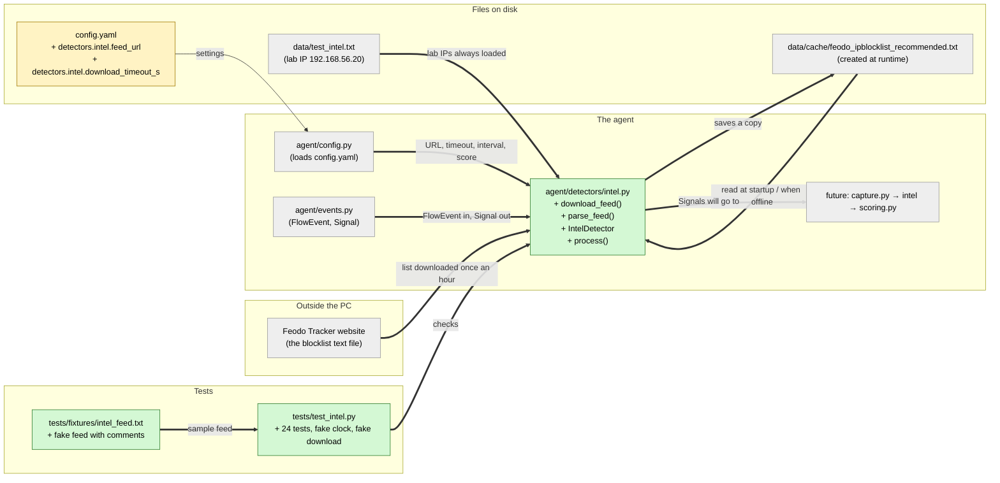

# Study guide: Spotting connections to known-bad IP addresses

**Ticket:** #9 · **Date:** 2026-11-07 · **Gate:** APPROVE

## The big picture

HomeSOC watches every network connection the PC makes. Each one arrives as a `FlowEvent` (from ticket #2), which says which app talked to which IP address. Several "detectors" read these events and look for trouble. Before this ticket there were no detectors at all, so a connection to a known malware server went unnoticed.

Now there's the first detector, `agent/detectors/intel.py`. It keeps a list of IP addresses that security researchers have already identified as malware control servers. The list comes from abuse.ch's Feodo Tracker, plus our own lab-only list `data/test_intel.txt` for demos. If a connection's IP is on the list, the detector raises a `Signal` with score 1.0 ("certain"). It re-downloads the list at most once an hour and keeps a copy on disk, so it still works offline. Think of it as a shop guard with a printed sheet of banned faces: they check everyone who comes in or goes out against the sheet, pick up a fresh sheet from head office every hour, and use yesterday's sheet if head office is closed.

## Map of the changes



**How to read it:** green boxes are new files, yellow is a changed file, grey boxes are unchanged files the new code uses. `+` marks something added inside a file. Thick arrows (`==>`) are connections this ticket created; the thin arrow (`-->`) already existed. The cache file isn't in git: the detector creates it when it runs. "future" is code that doesn't exist yet.

## Words you'll see

| Word | What it means here |
|---|---|
| IP address | The number that identifies a computer on a network, e.g. `192.168.56.20`. |
| blocklist / feed | A text file listing known-bad IPs, one per line. "Feed" because it's updated regularly. |
| Feodo Tracker | A free service run by abuse.ch that lists IPs used to control banking malware. |
| C2 (command and control) | The server malware "phones home" to for instructions. |
| `test_intel.txt` | Our own fake blocklist with lab IPs only, so the demo can trigger an alert safely. |
| cache | A saved copy on disk, used when the live version can't be fetched. |
| detector | A piece of HomeSOC that reads `FlowEvent`s and produces `Signal`s when something looks bad. |
| `FlowEvent` / `Signal` | The message shapes from ticket #2: one connection, and one detector finding. |
| outbound / inbound | Outbound: this PC started the connection. Inbound: someone else connected to this PC. |
| `src_ip` / `dst_ip` | Source (who started it) and destination (who it went to). |
| remote IP | The IP that isn't this PC: `dst_ip` for outbound, `src_ip` for inbound. |
| MITRE `T1071` | The standard code for "malware talking over normal internet protocols". |
| module | A `.py` file. `from agent.events import Signal` borrows `Signal` from `agent/events.py`. |
| function (`def`) | A named block of steps you can run, with inputs and a result. |
| class / instance | A blueprint, and one thing built from it. `IntelDetector` is the blueprint, and `IntelDetector(cfg)` builds one. |
| method | A function that belongs to a class, e.g. `detector.process(event)`. |
| `self` | Inside a method, "this particular object". `self._score` means "my score". |
| property (`@property`) | A method you read like a plain value: `detector.ips` with no brackets. |
| leading underscore (`_name`) | A Python convention meaning "internal, don't use from outside". |
| type hint | `: str`, `-> list[Signal]`: notes about what kind of value goes where. |
| `str \| None` | "Text, or nothing." |
| `frozenset` | A set (unordered, no duplicates) that can't be changed after it's made. |
| thread | A second line of work running at the same time, so a slow download doesn't freeze detection. |
| daemon thread | A background thread that's killed automatically when the program exits. |
| lock | A "one at a time" token: whoever holds it may proceed, and others skip or wait. |
| exception | An error that stops normal flow. `try`/`except` catches it. |
| `urllib.request` | Python's built-in tool for downloading from the web. |
| timeout | How long to wait before giving up, here 10 seconds. |
| HTTPS | Encrypted web traffic. The detector refuses any other kind of URL. |
| logging | Writing messages to the program's log instead of printing them. |
| config / `config.yaml` | The settings file. CLAUDE.md §10 says numbers like "1 hour" belong there, not in code. |
| fixture (file) | A sample input file used only by tests. |
| fixture (pytest) | A helper pytest runs before a test to set things up, e.g. a fresh temp folder. |
| monkeypatch | Temporarily replacing a real function with a fake one during a test. |
| fake clock | A pretend clock the test can move forward instantly, instead of waiting an hour. |
| `tmp_path` | A throwaway folder pytest gives each test, so tests never touch the real `data/cache/`. |
| documentation IP ranges | `192.0.2.x`, `198.51.100.x`, `203.0.113.x`: reserved for examples and never real machines. |

## File by file

### `config.yaml` - changed

**What this file is for:** all HomeSOC settings live here.
**What changed and why:** two settings for the detector. CLAUDE.md §10 says values like a URL or a timeout must not be hard-coded inside detectors.

#### Edit 1 - Where to download the list, and how long to wait

```diff
   intel:
     refresh_interval_s: 3600   # Feodo Tracker blocklist refresh (hourly)
     score: 1.0                 # signal score on a blocklist hit
+    # abuse.ch Feodo Tracker "recommended" list (§6.3). Downloaded only, never connected to (§9.2).
+    feed_url: "https://feodotracker.abuse.ch/downloads/ipblocklist_recommended.txt"
+    download_timeout_s: 10     # give up on a blocklist download after this long
```

**In plain words:** the address of the blocklist, and "give up after 10 seconds".

**Line by line:**
1. Lines starting with `+` are added and lines without a mark were already there. In YAML, indentation shows nesting, so these keys sit inside `detectors:` → `intel:`.
2. `feed_url: "https://…"`: `key: value`. The quotes make it text.
3. `download_timeout_s: 10`: a number. The `_s` ending means seconds, as the comment at the top of the file explains.
4. `# …`: comments, ignored by the program.

**Why it's written this way:** the existing `refresh_interval_s: 3600` (1 hour) and `score: 1.0` were already here from ticket #1. The new keys sit next to them so all intel settings are in one place.

### `agent/detectors/intel.py` - new

**What this file is for:** checks every connection against the known-bad IP list and keeps that list fresh.
**What changed and why:** the whole file is new. It implements CLAUDE.md §6.3 "intel.py" and ticket #9.

#### Piece 1 - The header, imports and fixed values

```python
"""Known-bad IP detector (CLAUDE.md §6.3 "intel.py").
... (docstring shortened: explains the safety rule and when refreshes happen)
"""

from __future__ import annotations

import ipaddress
import logging
import os
import threading
import time
import urllib.request
from collections.abc import Callable
from pathlib import Path
from typing import Any

from agent import config as config_module
from agent.events import FlowEvent, Signal

logger = logging.getLogger(__name__)

DETECTOR_NAME = "intel"
MITRE_TECHNIQUE = "T1071"  # Application Layer Protocol (§6.3)
CACHE_FILE_NAME = "feodo_ipblocklist_recommended.txt"
COMMENT_PREFIX = "#"
REQUIRED_URL_SCHEME = "https://"
USER_AGENT = "HomeSOC-intel/0.1"

Clock = Callable[[], float]
Spawner = Callable[[Callable[[], None]], None]
```

**In plain words:** a description, the tools borrowed from Python and from our own project, a logger to write messages with, and some fixed names and values.

**Line by line:**
1. `"""…"""`: the docstring, documentation for humans.
2. `from __future__ import annotations`: a technical line that lets type hints mention things defined later in the file. Safe to ignore.
3. `import ipaddress`: Python's tool for checking and tidying IP addresses. `logging` writes log messages. `os` handles file operations, `threading` runs background work, `time` gives the current time, and `urllib.request` downloads from the web.
4. `from pathlib import Path`: `Path` represents a file location and works on Windows and Mac alike.
5. `from agent import config as config_module`: borrow our own `agent/config.py`, nicknamed `config_module` (`as` gives it a local name).
6. `from agent.events import FlowEvent, Signal`: the message shapes from ticket #2.
7. `logger = logging.getLogger(__name__)`: a logger named after this module (`__name__` is `"agent.detectors.intel"`), so log lines show where they came from.
8. `DETECTOR_NAME = "intel"` and the lines after it: constants. By convention, ALL_CAPS names are values that never change. `MITRE_TECHNIQUE = "T1071"` is fixed by the spec, so it's a constant rather than a setting.
9. `Clock = Callable[[], float]`: a type alias, a nickname for a type. `Callable[[], float]` means "something you can call with no inputs that gives back a decimal number", which is what `time.time()` is.
10. `Spawner = Callable[[Callable[[], None]], None]`: "something you call with a task, which starts that task". The real one starts a thread, and the test one just runs the task straight away.

**Why it's written this way:** the score, interval, URL and timeout come from config, but the detector name and MITRE ID are fixed by §6.3, so they're constants here. The `Clock` and `Spawner` aliases exist so tests can swap in fakes (Piece 4).

#### Piece 2 - `download_feed()`: the only network call

```python
def download_feed(url: str, timeout_s: float) -> str:
    """Download the blocklist text. The ONLY network call in this module (§9.2).
    ...
    """
    request = urllib.request.Request(url, headers={"User-Agent": USER_AGENT})
    with urllib.request.urlopen(request, timeout=timeout_s) as response:
        return response.read().decode("utf-8")
```

**In plain words:** fetch the text file from the web address and hand back its contents as text. Give up after `timeout_s` seconds.

**Line by line:**
1. `def download_feed(url: str, timeout_s: float) -> str:`: a function with two inputs, a URL (text) and a timeout (decimal number), that returns text.
2. `urllib.request.Request(url, headers={…})`: prepare a web request. `headers` is a dict of extra information. `"User-Agent"` tells the server which program is asking. It's set to `"HomeSOC-intel/0.1"`, a generic name with no personal details.
3. `with … as response:`: `with` opens something and guarantees it gets closed afterwards, even if an error happens. `urlopen(…)` makes the actual connection.
4. `response.read()` gets the raw bytes, and `.decode("utf-8")` turns bytes into readable text.
5. `return`: hand the text back.

**Why it's written this way:** safety rule §9.2 says HomeSOC must never connect to a listed IP, and the only network call allowed is downloading the list. Putting that one call in its own tiny function makes it easy to check, and easy for tests to replace with a fake so tests never touch the internet.

#### Piece 3 - `parse_feed()` and helpers: turning text into a set of IPs

```python
def parse_feed(text: str) -> frozenset[str]:
    ips: set[str] = set()
    for raw_line in text.splitlines():
        line = raw_line.strip()
        if not line or line.startswith(COMMENT_PREFIX):
            continue
        normalized = _normalize_ip(line)
        if normalized is None:
            logger.debug("Skipping blocklist line that is not an IP: %r", line)
            continue
        ips.add(normalized)
    return frozenset(ips)


def _normalize_ip(value: str) -> str | None:
    try:
        return str(ipaddress.ip_address(value.strip()))
    except ValueError:
        return None


def _spawn_daemon(task: Callable[[], None]) -> None:
    threading.Thread(target=task, name="intel-refresh", daemon=True).start()


def _read_list(path: Path, label: str) -> frozenset[str]:
    try:
        text = path.read_text(encoding="utf-8")
    except FileNotFoundError:
        logger.info("No %s at %s", label, path)
        return frozenset()
    except (OSError, ValueError) as exc:
        logger.warning("Could not read %s at %s: %s", label, path, exc)
        return frozenset()
    ips = parse_feed(text)
    logger.info("Loaded %d IPs from %s (%s)", len(ips), label, path)
    return ips
```

**In plain words:** `parse_feed` reads the list one line at a time. It skips empty lines and lines starting with `#`, keeps anything that's a real IP address, and quietly drops anything else. `_read_list` does the same for a file on disk. If the file is missing or unreadable it returns an empty list instead of crashing.

**Line by line:**
1. `ips: set[str] = set()`: start with an empty set. A set ignores duplicates, so the same IP listed twice is stored once.
2. `for raw_line in text.splitlines():`: a loop. `splitlines()` cuts the text into lines, and the indented block runs once per line.
3. `line = raw_line.strip()`: remove spaces from both ends, so `"   198.51.100.7"` becomes `"198.51.100.7"`.
4. `if not line or line.startswith(COMMENT_PREFIX):`: `not line` is true for an empty string. `or` means either condition is enough. `startswith("#")` catches comments.
5. `continue`: skip the rest of this loop round and go to the next line.
6. `_normalize_ip(line)`: inside it, `ipaddress.ip_address(...)` raises a `ValueError` if the text isn't an IP. `try:` / `except ValueError:` catches that and returns `None`. If it is an IP, `str(...)` turns it back into tidy standard text.
7. `logger.debug("… %r", line)`: a low-importance log message. `%r` is filled in with `line`, shown in quotes.
8. `ips.add(normalized)`: put the IP in the set.
9. `return frozenset(ips)`: return a frozen (unchangeable) copy.
10. `_spawn_daemon`: creates a background `Thread` that will run `task`, names it `"intel-refresh"` for the logs, marks it `daemon=True` so it won't keep the program alive, and `.start()`s it.
11. `_read_list`: `path.read_text(encoding="utf-8")` reads the whole file. `except FileNotFoundError:` handles the first-run case where there's no cache yet. `except (OSError, ValueError) as exc:` catches other read problems and keeps the error in `exc` so it can be logged. `"Loaded %d IPs"`: `%d` is filled with a whole number, here `len(ips)`, the count.

**Why it's written this way:** acceptance criterion 3 says comment and blank lines must be ignored. Checking that each line really is an IP also protects against a download that returns an error web page instead of the list: `<html>` isn't an IP, so it's dropped. Returning a frozenset means nobody can accidentally change the list while another thread is reading it.

#### Piece 4 - Setting up an `IntelDetector`

```python
class IntelDetector:
    """Matches flows against the Feodo Tracker list plus the lab test list."""

    def __init__(
        self,
        cfg: dict[str, Any] | None = None,
        *,
        cache_dir: str | Path | None = None,
        test_intel_path: str | Path | None = None,
        clock: Clock = time.time,
        spawn: Spawner = _spawn_daemon,
    ) -> None:
        cfg = cfg if cfg is not None else config_module.load()
        intel_cfg = cfg["detectors"]["intel"]
        paths = cfg["paths"]

        self._feed_url: str = intel_cfg["feed_url"]
        if not self._feed_url.startswith(REQUIRED_URL_SCHEME):
            raise ValueError(f"detectors.intel.feed_url must use https, got {self._feed_url!r}")
        self._timeout_s = float(intel_cfg["download_timeout_s"])
        self._refresh_interval_s = float(intel_cfg["refresh_interval_s"])
        self._score = float(intel_cfg["score"])

        self._cache_path = Path(cache_dir or _repo_path(paths["cache_dir"])) / CACHE_FILE_NAME
        self._test_intel_path = Path(test_intel_path or _repo_path(paths["test_intel"]))
        self._clock = clock
        self._spawn = spawn

        self._refresh_lock = threading.Lock()
        self._last_attempt: float | None = None
        self._test_ips = _read_list(self._test_intel_path, "test intel list")
        self._feed_ips: frozenset[str] = frozenset()
        self._ips: frozenset[str] = self._test_ips
        self._set_feed(_read_list(self._cache_path, "cached blocklist"))

        self._maybe_schedule_refresh()

    @property
    def ips(self) -> frozenset[str]:
        return self._ips

    @property
    def feed_ips(self) -> frozenset[str]:
        return self._feed_ips
```
(docstrings shortened)

**In plain words:** when a detector is created it reads its settings, refuses any feed address that isn't HTTPS, loads the lab list and the saved copy of the blocklist from disk, and then asks for a fresh download in the background.

**Line by line:**
1. `class IntelDetector:`: the blueprint.
2. `def __init__(self, …)`: the special setup method Python runs when you write `IntelDetector(...)`.
3. `cfg: dict[str, Any] | None = None`: the settings. If none are given, it loads `config.yaml` itself.
4. `*,`: everything after the star must be given by name, e.g. `cache_dir=...`. This prevents mixing up the order.
5. `clock: Clock = time.time`: by default use the real clock, but a test can pass a fake one. Note `time.time` has no brackets: it passes the function itself, to be called later.
6. `cfg = cfg if cfg is not None else config_module.load()`: Python's one-line if/else, read as "use `cfg` if it's given, otherwise load the config file".
7. `cfg["detectors"]["intel"]`: look up nested settings, the same nesting as in `config.yaml`.
8. `self._feed_url: str = …`: store a value on this object. The leading `_` marks it as internal.
9. `if not self._feed_url.startswith("https://"): raise ValueError(...)`: refuse plain `http://` or `file://` addresses. `{self._feed_url!r}` puts the value in the message, quoted.
10. `float(...)`: turn the setting into a decimal number, so `3600` becomes `3600.0`.
11. `Path(cache_dir or _repo_path(...)) / CACHE_FILE_NAME`: `a or b` uses `a` if it's given, otherwise `b`. The `/` between `Path`s joins folder and file name, giving `data/cache/feodo_ipblocklist_recommended.txt`. `_repo_path` (bottom of the file) turns a relative path from config into one inside the project folder.
12. `threading.Lock()`: the one-at-a-time token for downloads.
13. `self._last_attempt: float | None = None`: when we last tried to download. `None` means never.
14. `self._test_ips = _read_list(...)`: load the lab IPs (`192.168.56.20`).
15. `self._ips = self._test_ips` then `self._set_feed(_read_list(self._cache_path, ...))`: start with only the lab IPs, then add whatever the saved copy holds (Piece 6).
16. `self._maybe_schedule_refresh()`: since `_last_attempt` is `None`, this starts the first download.
17. `@property def ips(self)`: lets other code read `detector.ips` like a value. It's read-only from outside.

**Why it's written this way:** reading from disk is quick and needs no internet, so detection works the moment the detector exists, even offline. Being able to pass in the clock, the spawner and the folders is what lets the tests run instantly, without network, and without touching the real `data/cache/`.

#### Piece 5 - `process()`: checking one connection

```python
    def process(self, event: FlowEvent) -> list[Signal]:
        """Return one intel Signal if the flow's remote IP is listed, else an empty list."""
        self._maybe_schedule_refresh()

        hit = self._listed_remote_ip(event)
        if hit is None:
            return []
        if event.direction == "inbound":
            reason = f"receives a connection from {hit}, which is on a known-bad IP list"
        else:
            reason = f"talks to {hit}, which is on a known-bad IP list"
        return [
            Signal(
                detector=DETECTOR_NAME,
                process=event.process,
                pid=event.pid,
                target=hit,
                score=self._score,
                reasons=[reason],
                mitre=MITRE_TECHNIQUE,
                ts_ms=event.ts_ms,
            )
        ]

    def _listed_remote_ip(self, event: FlowEvent) -> str | None:
        if event.direction == "inbound":
            candidates = (event.src_ip, event.dst_ip)
        else:
            candidates = (event.dst_ip, event.src_ip)
        listed = self._ips
        for candidate in candidates:
            normalized = _normalize_ip(candidate) if candidate else None
            if normalized is not None and normalized in listed:
                return normalized
        return None
```
(the comment above `_listed_remote_ip`'s body is left out here)

**In plain words:** for each connection, maybe start a refresh, then look up the connection's IPs in the list. If one is listed, return exactly one Signal saying which app talked to which bad IP. Otherwise return an empty list.

**Line by line:**
1. `def process(self, event: FlowEvent) -> list[Signal]:`: the shape every detector must have (§6.3): a FlowEvent in, a list of Signals out.
2. `if hit is None: return []`: nothing listed means no Signals.
3. `if event.direction == "inbound":` … `else:`: `==` compares. The wording of the reason depends on who started the connection.
4. `f"talks to {hit}, …"`: an f-string, where `{hit}` is replaced by the IP, giving e.g. `"talks to 192.168.56.20, which is on a known-bad IP list"`.
5. `return [ Signal(...) ]`: a list holding one Signal. The `name=value` pairs fill in its fields: the app comes from the event, the score from config, and the MITRE code is the constant.
6. `candidates = (event.src_ip, event.dst_ip)`: a tuple, a fixed pair. For inbound, check the source first, since that's the remote side. For outbound, check the destination first.
7. `listed = self._ips`: grab the current list once, so the whole check uses the same list even if a refresh swaps it halfway through.
8. `_normalize_ip(candidate) if candidate else None`: the one-line if/else again. Empty IPs (`""`) are skipped.
9. `normalized in listed`: `in` checks membership in the set, which is very fast even for thousands of IPs.
10. `return normalized` stops at the first hit, and `return None` means no hit.

**Why it's written this way:** acceptance criteria 1 and 2 need outbound connections *to* a bad IP and inbound connections *from* one to both raise a Signal. The detector checks *both* IPs, remote side first, and stops at the first match, so a flow gives at most one Signal. The developer's reasoning: a listed bad IP is never this PC's own address, so checking the other side can't cause a false alarm, and it still works if capture got the direction wrong.

#### Piece 6 - Refreshing the list safely

```python
    def refresh(self) -> None:
        """Download the feed, cache it and swap it in. Never raises; failures keep the old list."""
        if not self._refresh_lock.acquire(blocking=False):
            logger.debug("Blocklist refresh already running; skipping")
            return
        try:
            self._refresh_once()
        except Exception:  # refreshing must never break detection
            logger.exception("Unexpected error while refreshing the blocklist")
        finally:
            self._refresh_lock.release()

    def _set_feed(self, feed_ips: frozenset[str]) -> None:
        self._feed_ips = feed_ips
        self._ips = feed_ips | self._test_ips

    def _maybe_schedule_refresh(self) -> None:
        now = self._clock()
        if self._last_attempt is not None and now - self._last_attempt < self._refresh_interval_s:
            return
        # Stamp the attempt before spawning, so later flows don't start another download.
        self._last_attempt = now
        self._spawn(self.refresh)

    def _refresh_once(self) -> None:
        try:
            text = download_feed(self._feed_url, self._timeout_s)
        except (OSError, ValueError) as exc:  # URLError, HTTPError, timeouts, bad encoding
            logger.warning(
                "Blocklist download from %s failed (%s); using %d cached IPs",
                self._feed_url,
                exc,
                len(self._feed_ips),
            )
            return

        ips = parse_feed(text)
        if not ips:
            logger.warning(...)   # (shortened) "held no IPs; keeping N cached IPs"
            return

        self._set_feed(ips)
        logger.info("Refreshed blocklist: %d IPs from %s", len(ips), self._feed_url)
        self._write_cache(text)

    def _write_cache(self, text: str) -> None:
        tmp_path = self._cache_path.with_name(self._cache_path.name + ".tmp")
        try:
            self._cache_path.parent.mkdir(parents=True, exist_ok=True)
            tmp_path.write_text(text, encoding="utf-8")
            os.replace(tmp_path, self._cache_path)
        except OSError as exc:
            logger.warning("Could not write blocklist cache %s: %s", self._cache_path, exc)
```
(the comment above `_set_feed`'s body is left out here)

**In plain words:** at most once an hour, start a background download. If it works and contains IPs, switch to the new list and save a copy. If anything goes wrong, write a warning to the log and carry on with the list we already had. Errors never reach the code that's checking connections.

**Line by line:**
1. `self._refresh_lock.acquire(blocking=False)`: try to take the token without waiting. It returns `False` if another download already holds it, and then we skip.
2. `try:` … `except Exception:` … `finally:`: `try` runs the risky part, `except Exception` catches *any* error, and `finally` always runs, here to give the token back. `logger.exception(...)` logs the message plus the full error details.
3. `feed_ips | self._test_ips`: `|` between two sets means "union", everything in either. So the active list is always feed + lab IPs.
4. `now - self._last_attempt < self._refresh_interval_s`: e.g. `1_003_599 - 1_000_000 = 3599`, which is less than `3600`, so it's too soon and we `return`. At `3600` it's no longer less, so a refresh starts. `and` means both sides must be true.
5. `self._last_attempt = now` *before* `self._spawn(self.refresh)`: record the attempt first, so the next connection a millisecond later doesn't start a second download. `self.refresh` without brackets passes the method to be run later, on the thread.
6. `except (OSError, ValueError) as exc:`: network failures, HTTP errors and timeouts are all kinds of `OSError`, and a garbled download is a `ValueError`. We log and `return`, keeping the old list.
7. `if not ips:`: an empty set counts as false. A download with zero IPs (e.g. a maintenance page) is ignored rather than wiping the list.
8. `_write_cache`: `with_name(… + ".tmp")` makes a sibling file name ending in `.tmp`. `mkdir(parents=True, exist_ok=True)` creates the folder if needed and doesn't complain if it exists. `write_text` writes the temp file, and `os.replace` renames it over the real cache in one step.

**Why it's written this way:**
- *Background thread:* the capture loop must never wait on the network (§6.1).
- *Swapping whole sets:* a reader always sees a complete old or new list, never a half-built one.
- *Temp file then rename:* if the program crashes mid-write, the old cache is still intact instead of half a file.
- *Catching everything:* acceptance criterion 4 says no exception may escape when the download fails.

#### Piece 7 - The module-level `process()`

```python
def _repo_path(value: str | Path) -> Path:
    path = Path(value)
    return path if path.is_absolute() else config_module.REPO_ROOT / path


_default_detector: IntelDetector | None = None


def process(event: FlowEvent) -> list[Signal]:
    """Module-level detector entry point (§6.3), backed by one lazily created IntelDetector."""
    global _default_detector
    if _default_detector is None:
        _default_detector = IntelDetector()
    return _default_detector.process(event)
```

**In plain words:** §6.3 says every detector has a plain `process(event)` function. This one creates a single shared `IntelDetector` the first time it's called, and passes every event to it.

**Line by line:**
1. `_repo_path`: `path.is_absolute()` is true for a full path like `C:\...`. A relative one like `data/cache` is joined onto the project folder (`REPO_ROOT`, from `agent/config.py`).
2. `_default_detector: IntelDetector | None = None`: a module-level variable, starting empty.
3. `global _default_detector`: tells Python "when I assign to this name inside the function, change the module-level one", not a new local variable.
4. `if _default_detector is None: _default_detector = IntelDetector()`: "lazy" creation, built only when first needed.

**Why it's written this way:** it matches the `process(event)` shape the rest of the system expects (§6.3), while the class does the real work and stays easy to test. The verifier noted downsides of creating it lazily; see Open questions.

### `tests/fixtures/intel_feed.txt` - new (test)

**What this file is for:** a fake blocklist in the same format as the real Feodo file, used by tests.

```
################################################################
# Fake Feodo-style blocklist for tests (format mirrors ipblocklist_recommended.txt).
# Documentation ranges only (RFC 5737). NEVER put real threat-intel IPs here (CLAUDE.md §9.2).
################################################################
#
# ip_address

192.0.2.10
   198.51.100.7

  # an indented comment line
#203.0.113.99
203.0.113.5
```

**In plain words:** every awkward case in one file: banner comments, blank lines, an IP with spaces in front, an indented comment, and a commented-out IP (`#203.0.113.99`) that must *not* be loaded. The correct result is exactly three IPs: `192.0.2.10`, `198.51.100.7`, `203.0.113.5`. All of them are from ranges reserved for documentation, so they can never be real servers.

### `tests/test_intel.py` - new (test)

**What this file is for:** proves the detector meets all five acceptance criteria, without ever touching the internet.

**The fake data and helpers it uses:**
- `FakeClock`: a pretend clock that starts at `1_000_000.0` seconds and only moves when the test calls `advance(seconds)`. An hour passes instantly.
- `FakeDownload`: stands in for `download_feed`. It records every call in `.calls`, and either returns some text or raises a chosen error.
- `run_now`: a spawner that runs the refresh immediately instead of on a thread, so the test knows it has finished.
- `no_network` (autouse fixture): runs automatically around *every* test. It replaces both `download_feed` and `urllib.request.urlopen` with guards. If a test reaches either one without patching it, the test fails. No test can accidentally go online.
- `cfg` fixture: a copy of the real config. `copy.deepcopy` means a test can change it freely.
- `make_detector(...)`: builds an `IntelDetector` with the fake download, a fake clock, `run_now`, and a `tmp_path` cache folder.
- `outbound_flow(...)` / `inbound_flow(...)`: build sample `FlowEvent`s, e.g. `freegamecheats.exe` (pid 4242) talking to `192.168.56.20:8080`.
- Test IPs: lab `192.168.56.x` and documentation ranges only.

**Syntax you'll see:** `monkeypatch.setattr(intel, "download_feed", fake)` means "for this test only, replace `intel.download_feed` with `fake`". `[signal] = detector.process(...)` unpacks a list that must contain exactly one item, and fails if there are 0 or 2. `@pytest.mark.parametrize(... ids=[...])` runs a test once per input, each with a readable name.

**Every test, one sentence each:**

Config and safety:
- `test_real_config_has_intel_feed_settings`: the real `config.yaml` has the Feodo URL, a positive timeout, a 3600 s interval and score 1.0.
- `test_non_https_feed_url_is_rejected`: a `file:///etc/passwd` URL makes the detector refuse to start, with a `ValueError` mentioning https.

AC1 (outbound to a test-list IP → one Signal, score 1.0, T1071):
- `test_outbound_flow_to_test_intel_ip_produces_one_signal`: a flow to `192.168.56.20` returns a list equal to exactly one fully filled-in Signal (detector, app, pid, target, score 1.0, reason text, T1071, timestamp).
- `test_score_comes_from_config`: changing the config score to 0.75 changes the Signal's score to 0.75.
- `test_unlisted_flow_produces_no_signal`: unlisted IPs, and an empty FlowEvent, return `[]` without crashing.
- `test_module_level_process_uses_default_detector`: the plain `intel.process(event)` function returns the intel Signal.

AC2 (inbound from a listed `src_ip` → Signal):
- `test_inbound_flow_from_listed_src_ip_produces_signal`: an inbound connection *from* `192.168.56.20` gives one Signal with the "receives a connection from…" wording.
- `test_mislabelled_direction_still_gives_exactly_one_signal`: a flow marked outbound but with the bad IP as the source still gives one Signal.
- `test_both_ips_listed_gives_one_signal_for_the_remote_ip`: if both IPs are listed, there's still exactly one Signal, about the remote one.

AC3 (comments and blank lines ignored, fixture file):
- `test_parse_feed_ignores_comments_and_blank_lines`: the fixture parses to exactly the three expected IPs, and the commented-out one is absent.
- `test_parse_feed_skips_lines_that_are_not_ips`: `not-an-ip` and `<html>` are dropped, and a duplicate IP is stored once.
- `test_downloaded_feed_with_comments_loads_only_the_ips`: through the full download path, the detector loads exactly those 3 IPs plus the lab IP, flags `198.51.100.7`, and saves the download to the cache word for word.

AC4 (download fails → cache used, nothing escapes):
- `test_download_failure_uses_cached_list` (×4: URLError, HTTPError 503, timeout, bad encoding): with a cache file present and the download failing, nothing raises, the cached IPs are loaded, a cached IP is flagged, and the cache file is unchanged.
- `test_download_failure_without_cache_falls_back_to_test_list`: with no cache and no internet, only the lab IP is loaded, it still gets flagged, and no cache file is created.
- `test_download_with_no_ips_keeps_cache`: a "maintenance" HTML page doesn't wipe the existing cached list.
- `test_unexpected_refresh_error_does_not_escape`: even a surprise `RuntimeError` during download doesn't stop detection.
- `test_download_feed_uses_url_and_timeout`: the real `download_feed`, with only `urlopen` faked, asks for the right URL with the right timeout and returns the decoded text.
- `test_download_feed_propagates_http_errors`: the real `download_feed` passes an HTTP 404 error up, which is what the detector then catches.

AC5 (no re-download within the interval, fake clock):
- `test_not_downloaded_again_within_refresh_interval`: one download at startup, still one after 3599 s of flows, two at exactly 3600 s (with the new IPs swapped in and cached), and still two half an hour later.
- `test_failed_download_is_not_retried_on_every_flow`: after a failed download, 50 flows over 50 s cause no retries, and the next try happens one interval later.

Background behavior:
- `test_default_refresh_runs_off_the_calling_thread`: with the real thread spawner and a deliberately stuck download, detection already works from the lab list, and the download runs on a different thread and finishes once released.

## How you know it works

- **Detection is exact:** the AC1 and AC2 tests compare the *whole* Signal, so every field (app, pid, target, score, MITRE code, reason wording) is checked, not just "something came back".
- **Parsing is strict:** the fixture covers every kind of comment and blank line, and a commented-out IP is proven not to load.
- **Offline is safe:** four kinds of download failure, plus a surprise error and an empty download, all leave detection working on the cached or lab list.
- **The hourly limit holds:** the fake clock proves the download count at 3599 s, exactly 3600 s and after.
- **The tests never go online:** the autouse guard fails any test that reaches the network.
- **Gate results (2026-11-07):** full suite 105 passed (81 before + 24 new), ruff clean, and the new tests passed 3 runs in a row. The gate approved every test, found no tampering and no regressions.

## Try it yourself

1. Open a terminal in the project folder.
2. Run just these tests:
   ```powershell
   .venv\Scripts\python -m pytest -q tests/test_intel.py
   ```
   You should see `24 passed`.
3. Run everything (CLAUDE.md `## Checks`):
   ```powershell
   .venv\Scripts\python -m pytest -q
   .venv\Scripts\ruff check .
   ```
   Expect `105 passed` and `All checks passed!`.
4. Try it by hand without going online. Start `.venv\Scripts\python` and type:
   ```python
   from agent import config
   from agent.detectors.intel import IntelDetector
   from agent.events import FlowEvent
   d = IntelDetector(config.load(), cache_dir="scratch_cache", spawn=lambda task: None)
   d.process(FlowEvent(process="demo.exe", dst_ip="192.168.56.20"))
   d.process(FlowEvent(process="demo.exe", dst_ip="192.168.56.99"))
   ```
   `spawn=lambda task: None` means "never actually start the download". The first call returns one intel Signal and the second returns `[]`. Delete the `scratch_cache` folder afterwards if it appeared.
5. Break it on purpose: in `parse_feed`, delete `or line.startswith(COMMENT_PREFIX)` and rerun step 2. The comment tests still pass because `#` lines aren't valid IPs anyway, which shows why the IP check is a second safety net. Now also change `if normalized is None:` to `if False:` and watch the AC3 tests fail. Undo both changes.

## Open questions / risks

None of these blocked the ticket. The verifier said PASS and the gate said APPROVE, and both flagged the following as worth a follow-up.

- **Wall clock, not a stopwatch.** The default clock is `time.time`. If the PC's clock jumps backwards, e.g. when restoring a VM snapshot as the demo does, `now - last_attempt` goes negative and refreshes stop until the clock catches up. `time.monotonic` (a stopwatch that only moves forward) would avoid this.
- **Lazy module-level detector.** `intel.process()` builds its detector on the first connection. If that fails (bad config, non-https URL), it re-raises on *every* connection, inside the capture path. Two connections arriving at once could also build two detectors. Creating it once at agent startup (`agent/main.py`, a later ticket) would be cleaner. The lazy path itself has no test.
- **Offline start means up to an hour without the live list.** A failed download waits a full interval before retrying. A shorter retry-after-failure would need a new config key.
- **Every restart downloads once**, even if the cache is minutes old. Checking the cache file's age first would honour "hourly" across restarts.
- **Small hardening ideas:** the download size isn't capped, and `urllib` follows redirects, so an https URL could redirect to http. A `Thread.start()` failure, which is very unlikely, could escape `process()`.
- **Checking both IPs** goes slightly beyond the ticket's wording. It's deliberate and tested to give at most one Signal per flow.
- **The module-level `process()` writes to the real `data/cache/`.** That's intended in production. Tests always use a temp folder.
